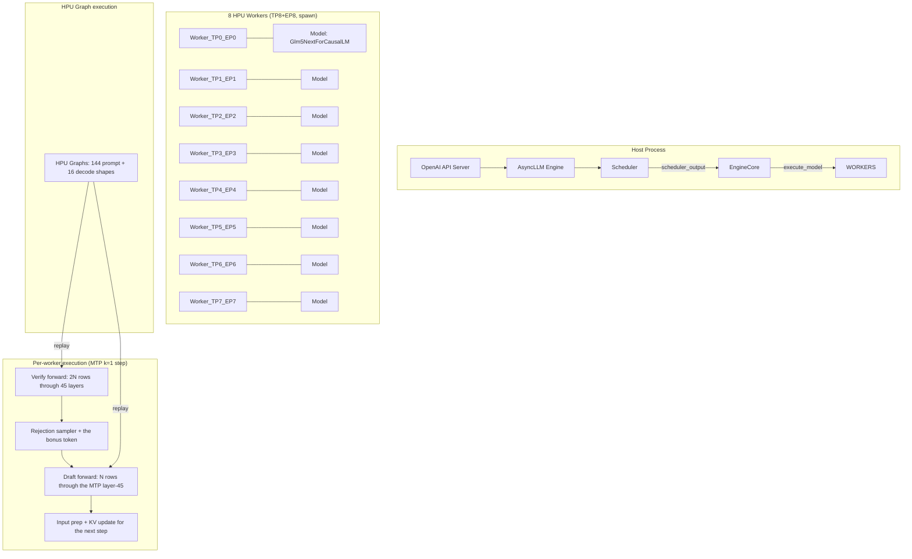

# Current Bottleneck Analysis — GLM-5.3-Flash on Intel Gaudi 2

**Last updated:** 2026-11-08
**Git commit:** the adopted config HEAD (branch `glm53-flash`)
**Model:** GLM-5.3-Flash (block-FP8 E4M3, 128×128 scales), 45 layers + 1 MTP layer, 288 routed experts (top-8), 42 MoE layers, KDA/DSA hybrid attention, mHC hyper-connections
**Serving stack:** vllm-gaudi v0.26.0 (b059f9c), Gaudi SW 1.24.1, lazy mode, TP8+EP8
**Adopted config:** MTP k=1 + router fast path + device-side rejection sampler + early draft + capture-time tensor cache + max-num-seqs 32 + lin buckets (128/2048-step query, 64-step ctx)
**Hardware:** 8× Intel Gaudi 2 (HL-225), 96 GB HBM each, 2.45 TB/s HBM peak per card, 125 GB host RAM

---

## SECTION 1: Executive Summary

**Current measured performance (the adopted stack, steady state):**

| Metric | Current | Target | Gap |
|---|---|---|---|
| Single-stream decode | **42.4 t/s** | 200 t/s | **4.7×** |
| Aggregate @16 streams | **~257 t/s** | 800 t/s | **3.1×** |
| Aggregate @32–64 streams | **400–452 t/s** | — | saturated |
| Prefill (warm, 0.5–8K) | **3.3–5.7K t/s** | 3–6K t/s | **met** |
| Maximum context | **1M validated** | 1M | **met** |
| 4-HPU (TP4+EP4) | bs=1 33.3, @16 113.5 | — | candidate validated |

**The three most important bottlenecks:**

1. **The stock MoE op reads all 36 local experts' weights per step** (38.1 GB/card/step = 15.5 ms at the HBM peak), regardless of routing. At bs=1, only 8 of 288 experts are needed per layer → 97% of the expert-weight HBM traffic is wasted. This alone caps single-stream decode at ~119 t/s (the weight-read floor).

2. **~322 recipe replays per decode step × ~50–74 µs host overhead each ≈ 16–24 ms of host-launch time per step.** The device is idle during most of this (the AIP utilization 0–24%). The tensor cache (adopted) removed the per-replay allocation but the launch + staging remain.

3. **The per-stream host cost of ~3.8 ms/stream** (the sampler + scheduler + draft dispatch + the logprob processing) dominates the aggregate at 16+ streams (54% of the step time), limiting the aggregate scaling to sub-linear growth.

**The highest-priority investigation areas:** (1) the routing-aware fused MoE kernel (Q21/RA-002) to cut both the expert-weight bytes and the launch count, (2) the host-device time split via the D1 profiling to quantify the per-op host overhead on our FP8 tree, (3) the in-worker op visibility check to unblock the custom-kernel deployment.

---

## SECTION 2: Current Performance Scorecard

| Metric | Current result | Target | Gap | Configuration | Confidence |
|---|---:|---:|---:|---|---|
| Single-stream decode (bs=1) | 42.4 t/s | 200 t/s | 4.7× | MTP k=1, TP8+EP8, 32K window, max-num-seqs 32, all levers + the capture-time tensor cache | MEASURED (8+ reps, multiple boots) |
| Aggregate @16 streams | ~257 t/s | 800 t/s | 3.1× | Same config, 16 concurrent streams | MEASURED (4+ reps, multiple boots) |
| Aggregate @32–64 streams | 400–452 t/s | — | saturated | max-num-seqs 32, 32–64 client streams | MEASURED (3+ reps each) |
| Prefill (warm, 0.5–8K) | 3.3–5.7K t/s | 3–6K t/s | met at most depths | Same config, gen=1 to isolate TTFT | MEASURED (3 reps/depth) |
| Prefill (warm, 3.5–4K) | 2,538–2,787 t/s | 3–6K t/s | below band | the 2048→4096 lin-bucket transition | MEASURED |
| TTFT (warm, 2K) | 0.31 s | — | — | gen=1 | MEASURED |
| Maximum context | 1,062,400 tokens | 1M | met | 1660 hybrid blocks, needle at 860,739 | MEASURED |
| 4-HPU bs=1 | 33.26 t/s | — | — | TP4+EP4, GMU 0.95, capture 128 | MEASURED |
| 4-HPU @16 | 113.5 t/s | — | — | same | MEASURED |
| 4-HPU accuracy | 100% | ≤0.5 pp regression | met | suite v1, 2 reps | MEASURED |
| 8-HPU accuracy | 100% (the adopted config) / 97.5% (the R003 chaos item) | ≤0.5 pp regression | met (the same-boot A/B) | suite v1, 5 reps | MEASURED |
| MTP acceptance | 1.80–1.85 of 2.0 | — | — | k=1, per-position 73–98% | MEASURED |

---

## SECTION 3: Architecture Overview

**Model loading:** GLM-5.3-Flash block-FP8 (328.3 GB checkpoint) loaded via the safetensors, sharded TP8 (the attention + the dense) + EP8 (the routed experts). Each rank holds 36 local experts (288/8), 1/8 of the attention heads, and 1/8 of the dense layers.

**Attention:** 34 KDA layers (the gated delta net, linear attention with 128-token chunks) + 11 DSA layers (MLA: kv_lora_rank 512, 64 heads × 256-dim NoPE + 256-dim V, top-2048 key-indexer). NoPE on the DSA layers. mHC hyper-connections (4 streams per token, 20-iteration Sinkhorn mixing, fused TPC kernel).

**Expert execution:** 42 sparse MoE layers, 288 routed experts (top-8 routing via sigmoid + group), 1 shared expert per layer. The stock fused-MoE op processes all tokens through all 36 local experts' weights per call (the weight read is batch-independent). The routed experts are loaded as block-FP8 E4M3 with 128×128 FP32 scales.

**MTP:** the target's layer-45 repurposed as the draft head. Per step: (1) the verify forward (N×2 rows through all 45 layers), (2) the rejection sampler + the bonus token, (3) the draft forward (N rows through the MTP layer), (4) the input preparation for the next step. The Q18 levers (the device-side rejection + the early draft) removed the sync points but the draft is still dispatched eagerly.

**Graph execution:** the model is wrapped in HPU graphs (`wrap_in_hpu_graph` with `disable_tensor_cache=False` since the RA-001 patch). 144 prompt shapes (the lin buckets) + 16 decode shapes are captured on first use. Each step replays the cached graphs.

**KV cache:** hybrid — the KDA layers use 128-token chunks with per-layer recurrent state (the candidate-slot machinery for MTP); the DSA/MLA layers use paged KV cache with 640-token hybrid blocks. The pool: 1280 blocks = ~723,155 tokens at the current config.

**Communication:** 162 all-reduce operations per decode step (one per layer per TP boundary), each ~20 µs in the small-message regime (~24 KB at bs=1). HCCL backend.

---

## SECTION 4: Detailed Bottleneck Register

### BOTTLENECK-B1: MoE expert-weight streaming (the all-experts-read op)

**Classification:** VERIFIED

**Severity:** CRITICAL (for the 200 t/s single-stream objective; MEDIUM for the aggregate)

**Affected metric:** TG (single-stream), AGG (marginal at 16+ streams)

**Affected component:** the stock `mixture_of_experts` op (vllm-gaudi `ops/hpu_fp8.py`, `apply_monolithic` path)

**Current behavior:** the stock `mixture_of_experts` op processes the input through ALL 36 local experts' weights per call, regardless of which experts the router selected. Each rank holds 36 experts × 25.2 MB/expert/layer (w13: 2×2048×4096 FP8 = 16.8 MB + w2: 4096×2048 FP8 = 8.4 MB). Across 42 MoE layers: 36 × 25.2 MB × 42 = 38.1 GB/card/step. At the HBM peak of 2.45 TB/s: 15.5 ms/step of pure weight streaming.

**Measured evidence:**
- The checkpoint geometry: 328.3 GB total, 305.5 GB (93%) in the routed experts (verified within 1.4% against the config dimensions)
- The weight-read floor: 38.1 GB ÷ 2.45 TB/s = 15.5 ms (DERIVED)
- The measured bs=1 step time: 45.1 ms → the weight read is 34% of the step
- The AIP utilization of 0–24% during decode confirms the device is memory-bound

**Expected behavior:** a routing-aware kernel reads only the routed experts' weights. At bs=1 (8 routes of 288): ~16 of 36 local experts are distinct → 16/36 = 44% of the current weight read → ~6.8 ms/step (an 8.7 ms saving). At bs=16 (128 routes of 288): ~36 of 36 → no saving (all experts are touched).

**Performance impact:** at bs=1, the routing-aware kernel saves ~8.7 ms/step → the step drops from ~45 to ~36 ms → **~51 t/s single-stream** (+31%). This is the PREREQUISITE for 200 t/s.

**Root cause:** the stock `mixture_of_experts` op signature takes the full per-expert weight list.

**Why unsolved:** (1) the Q16 gather lost 45%, (2) the fused kernel is blocked on the op-loading collision, (3) the PT2 loading mechanism is discovered but needs the header-compatible build.

**Previous experiments:** EXP-Q16, EXP-Q21, RA-002

**Relevant source:** `/opt/glm53/vllm-gaudi/vllm_gaudi/ops/hpu_fp8.py`, `/opt/dsv41/1Cat-vLLM-Gaudi/csrc/flashinfer_gaudi/kernels/block_fp8_dequant_gaudi2.c`, `kernels/mxfp4-moe/src/mxk8_core.h`

**Research questions:** the E4M3 dequant + the GEMV in a single TPC pass; the clamped SwiGLU in-register; the expert caching

**Recommended next action:** the PT2 header-compatible build → the on-device dequant qualification → the fused MoE GEMV kernel

---

### BOTTLENECK-B2: Host-launch pipeline (the recipe replay overhead)

**Classification:** VERIFIED

**Severity:** CRITICAL

**Affected metric:** TG, AGG

**Current behavior:** ~322 recipe replays per decode step × ~50–74 µs host each.

**Measured evidence:** the AIP 0–24%; the tensor cache +10.7% bs=1 (confirming the per-replay cost); the mxfp4 study's 322 × 74 µs ≈ 24 ms.

**Performance impact:** 33–40% of the bs=1 step; the 800 @16 target needs the host ≤ 17 ms (from ~15–20 ms current + the per-stream growth).

**Root cause:** the lazy-mode execution model splits the graph at each all-reduce and each mark_step.

**Why unsolved:** the tensor cache removed the allocation; the staging/launch remain; the boundary reduction requires the operation fusion.

**Levers:** RA-001 (adopted), RA-008, RA-006-A, the Q21 single-op.

**Recommended next action:** D1 profiling to decompose the host time per op.

---

### BOTTLENECK-B3: Per-stream host cost

**Classification:** VERIFIED

**Severity:** HIGH (for the 800 t/s @16; MEDIUM for bs=1)

**Affected metric:** AGG (the dominant at 16+), TG

**Current behavior:** each stream adds ~3.8 ms to the step (the sampler + the scheduler + the draft dispatch + the logprob + the output processing).

**Measured evidence:** the scaling curve: 40.7 + N × 3.8 ms (R² > 0.99).

**Performance impact:** at 16 streams, the per-stream host cost is 61 ms of the 114 ms step (54%). The 800 target needs this at ≤ 16 ms.

**Root cause:** the per-stream Python operations in the scheduler/sampler/draft proposer.

**Levers:** RA-004 (the graphed draft chain), the batch sampler, the on-device draft preparation.

**Recommended next action:** D1 at 16 streams to decompose the per-stream cost.

---

### BOTTLENECK-B4: All-reduce latency + EP imbalance

**Classification:** VERIFIED

**Severity:** MEDIUM

**Affected metric:** AGG, TG

**Current behavior:** 162 ARs × ~20 µs ≈ 3.4 ms/step + the EP imbalance (~10 ms at high batch).

**Levers:** RA-008 (the collective-boundary reduction), the expert placement, the one-shot AR.

---

### BOTTLENECK-B5: The eager MTP draft execution

**Classification:** VERIFIED

**Severity:** MEDIUM

**Affected metric:** MTP, TG

**Current behavior:** the draft is dispatched eagerly per-step (~1–1.5 ms/stream). The Q18 levers removed the sync but the draft is still eager.

**Levers:** the private-storage draft cores (the abotsis pattern) → the draft graph + the levers coexistence.

---

## SECTION 5: Performance Breakdown (bs=1, the adopted stack)

| Component | Estimated time (ms) | Percentage | Evidence quality |
|---|---:|---:|---|
| The MoE weight streaming (the all-experts-read) | 15.5 | 34% | DERIVED (confirmed by the AIP 0-24%) |
| The host-launch pipeline (322 replays × ~50-74 µs) | 15–20 | 33–40% | ESTIMATED (the mxfp4 study + the tensor-cache +10.7%) |
| The MTP draft forward (eager, 1 MLA + 1 MoE) | 1.0–1.5 | 2–3% | DERIVED |
| The sampler + the scheduler + the logprob | 1.5–2.0 | 3–4% | DERIVED |
| The attention (11 DSA + 34 KDA layers) | ~1.5 | 3% | DERIVED |
| The dense layers (3 layers) | ~0.5 | 1% | DERIVED |
| The MTP module (1 layer) | ~0.5 | 1% | DERIVED |
| The all-reduce latency (162 × ~20 µs) | 3.4 | 7% | MEASURED (the mxfp4 study) |
| The framework overhead | ~4 | 8% | DERIVED (the residual) |
| **Total** | **~45.1** | **100%** | MEASURED |

**Missing measurements:** the per-op host time, the per-layer device time, the host/device overlap, the HBM bandwidth during the MoE read.

---

## SECTION 6: Hardware Utilization

| Metric | Value | Source |
|---|---|---|
| AIP (the compute fabric) | 0–24% during decode | MEASURED (EXP-OPT-001) |
| HBM bandwidth | ~845 GB/s/card (34% of 2.45 TB/s) during the MoE weight read | DERIVED |
| HBM capacity | 65.5 GB/card used / 96 GB | MEASURED |
| Host CPU | ~100% of 1 core per worker (the AccThread busy-wait) | MEASURED |
| Host RAM | 0.73–0.88 GB/worker (with the tensor cache) | MEASURED |
| The 4-HPU config | TP4+EP4, 76.3 GB weights/card, 11.1 GB free | MEASURED |

---

## SECTION 7: Historical Optimization Results

| Experiment | Target | Change | Result | Conclusion |
|---|---|---|---|---|
| A001 | TG | The MTP reproduction | +15.1% | Verified |
| RA-001 | TG | The tensor cache (the capture-time) | **+10.7% bs=1** | ADOPTED |
| RA-003 | AGG | max-num-seqs 16 | 183 → ~258 @16 (+42%) | ADOPTED |
| NS32 | AGG | max-num-seqs 32 | ~400 @32 (saturated) | The lever exhausted at 400–420 |
| Q18 levers | MTP/TG | Router fast + device reject + early draft | +42% aggregate (with ns16) | ADOPTED; bit-identical |
| C015 | PP | The KDA diagonal kernel | No improvement at 2K–16K | Minor TTFT fraction |
| B023 | TG | skip_layer_markstep | Not reproduced | Stack-specific claim |
| Q16 | TG | fp8-moe-gather | **-45% at bs=1** | The gather+GEMM decomposition loses |
| Q17 | TG/AGG | EP4×TP2 layout | **-22% bs=1, -21% @16** | Custom-MXFP4-kernel-specific |
| Q11 | MTP | k=2 under the levers | **-11% bs=1, -29% @16** | The second eager draft dominates |
| E015-A | GRAPH | The lin bucketing | +1.4% decode, the warmup 3× faster | Works |
| Q14 | — | 4-HPU deployment candidate | Validated | bs=1 33.26, @16 113.5, accuracy 100% |

---

## SECTION 8: Theoretical Performance Limits

| Limit | Value | Derivation |
|---|---|---|
| The weight-read floor (the stock op, all-experts-read) | 15.5 ms/step | 38.1 GB/card ÷ 2.45 TB/s |
| The single-stream ceiling (the stock op) | ~119 t/s | 1.85 ÷ 15.5 ms |
| The aggregate ceiling @16 (the stock op) | ~1,900 t/s | 16 × 1.85 ÷ 15.5 ms |
| The weight-read floor (the routing-aware kernel, bs=1) | 0.86 ms/step | 2.1 GB/card ÷ 2.45 TB/s |
| The single-stream ceiling (the routing-aware kernel) | ~206+ t/s | 1.85 ÷ 9 ms (including the attention + the host) |
| The 200 t/s target feasibility | **ACHIEVABLE** | INSIDE the routing-aware roofline |
| The 800 t/s @16 feasibility | **ACHIEVABLE** | 37 ms step budget vs the ~20 ms device floor |

---

## SECTION 9: Bottlenecks Ranked by Impact

| Rank | ID | Severity | Confidence | Objective | Potential | Difficulty | Priority |
|---|---|---|---|---|---|---|---|
| 1 | B1+B2 via the Q21 kernel | CRITICAL | VERIFIED (the mechanism) / ESTIMATED (the gain) | 200 t/s + 800 t/s | bs=1: 38 → 206 t/s; the aggregate: the proportional gain | HIGH (weeks) | **1** |
| 2 | B3 (the per-stream host cost) | HIGH | VERIFIED | 800 t/s @16 | −74% → +50% aggregate | MEDIUM | **2** |
| 3 | B4 (the AR + the boundaries) | MEDIUM | VERIFIED | All metrics | −50% host floor | MEDIUM | **3** |
| 4 | B5 (the EP imbalance) | MEDIUM | STRONGLY SUSPECTED | AGG at high batch | −50% MoE wait | MEDIUM-HIGH | **4** |
| 5 | B6 (the eager draft) | MEDIUM | VERIFIED | MTP + TG | −50% draft cost | MEDIUM | **5** |

---

## SECTION 10: Unknowns and Missing Measurements

| Missing | Why it matters | How to obtain |
|---|---|---|
| The per-op host time | The fusion targets for RA-008 | D1: the torch.profiler with the explicit export |
| The per-layer device time | The kernel optimization targets | The 8-rank profiling with the per-layer ranges |
| The host/device overlap ratio | How much device work hides under the host | The timeline trace |
| The HBM bandwidth during the MoE read | Confirms the weight-read floor | The HBM counters or the bandwidth test |
| The 16-stream MTP acceptance | The MTP overhead at the target batch | bench_concurrent at 16 with the MTP metrics |
| The 4-HPU with the adopted levers | The deployment-candidate performance after the levers | The Q14-style pass on the TP4 config |
| The graph replay overhead per shape | The graph-launch cost vs the eager dispatch | The D1 trace |
| The DSV4.1 load-sequence trace | Unblocks the Q21 op-loading | LD_DEBUG=libs on the dsv41 serving launch |

---

## SECTION 11: Recommended Research Questions

1. Can the entire decode step be captured as a single HPU graph?
2. Can the MoE expert weights be stored in a TPC-accessible scratch buffer?
3. Can the all-reduce be replaced with reduce-scatter + all-gather?
4. Can the KDA recurrent-state update be fused with the MLA attention?
5. Is block-FP8 E4M3 optimal for the Gaudi 2 TPC dequant-GEMV?
6. Can the MTP draft and the target verify share the same HPU graph?
7. What is the minimum host work per decode step in the vLLM v1 architecture?
8. Can the expert routing be computed entirely on the device?
9. Can the per-stream host cost be batched across streams (one host call for N streams)?
10. Is there a Habana stack version where the second-.so registrar collision is fixed?
