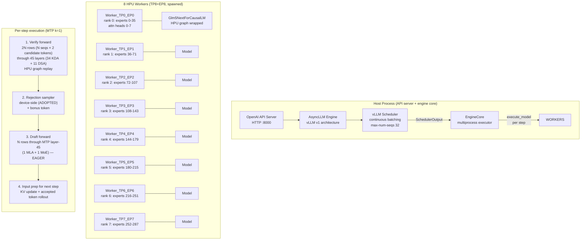

# Current Bottleneck Analysis — GLM-5.3-Flash on Intel Gaudi 2

**Last updated:** 2026-11-08 (revision 3 — D1 bs=1 + @16, B7 resolution, AB-DEQ, Q01v2 draft-graph A/B + accuracy rejection)
**Git commit:** `80a7fc6` → `60daaf7`+ (branch `glm53-flash`)
**Model:** GLM-5.3-Flash (block-FP8 E4M3, 128×128 scales), 45 layers + 1 MTP layer, 288 routed experts (top-8), 42 MoE layers, 34 KDA layers + 11 DSA layers (MLA), mHC hyper-connections (4 streams, Sinkhorn), 3 dense layers
**Serving stack:** vllm-gaudi v0.26.0 (b059f9c), Gaudi SW 1.24.1, lazy mode, TP8+EP8
**Adopted config:** MTP k=1 + router fast path (`GLM_ROUTER_FAST=1`) + device-side rejection sampler (`GLM_SPEC_DEVICE_REJECT=1`) + early draft (`GLM_EARLY_DRAFT=1`) + capture-time tensor cache (`disable_tensor_cache=False` in `_maybe_wrap_in_hpu_graph`) + max-num-seqs 32 + lin buckets (query 128/2048-step, ctx 64-step) + `PT_HPU_LAZY_ACC_PAR_MODE=0`
**Hardware:** 8× Intel Gaudi 2 (HL-225), 96 GB HBM each, 2.45 TB/s HBM peak per card, 125 GB host RAM, 160 CPU cores
**Model precision:** block-FP8 E4M3 (128×128 scales) for MoE/dense/MLA projections; BF16 for KDA/DSA attention, embeddings, lm_head, MTP shared head
**Weight mass:** MoE routed experts 305.5 GB (93.0%), attention+KDA+indexer 14.2 GB, dense 0.45 GB, shared experts 1.06 GB, embed+lm_head+MTP head 3.81 GB (BF16)

---

## SECTION 1: Executive Summary

**Current measured performance (the adopted stack, steady state, 8 HPUs):**

| Metric | Current | Target | Gap |
|---|---|---|---|
| Single-stream decode | **42.4 t/s** | 200 t/s | **4.7×** |
| Aggregate @16 streams | **~257 t/s** | 800 t/s | **3.1×** |
| Aggregate @32–64 streams | **400–452 t/s** | — | saturated |
| Prefill (warm, 0.5–8K) | **3.3–5.7K t/s** | 3–6K t/s | **met** |
| Prefill (warm, 3.5–4K) | 2,538–2,787 t/s | 3–6K t/s | slightly below |
| Maximum context | **1,062,400 tokens** | 1M | **met** |
| 4-HPU (TP4+EP4) bs=1 | 41.7 t/s median with the levers (+25% vs no-lever) | — | candidate (Q14v2) |
| 4-HPU @16 | 180.8 t/s warm (+59% vs no-lever) | — | candidate (Q14v2) |
| Accuracy | 100% (the adopted config) | ≤0.5 pp regression | **met** |

**The three most important bottlenecks:**

1. **The stock MoE op reads all 36 local experts' weights per step** (38.1 GB/card/step = 15.5 ms at the HBM peak of 2.45 TB/s), regardless of routing. At bs=1, only 8 of 288 experts are needed per layer → 97% of the expert-weight HBM traffic is wasted. This alone caps single-stream decode at ~119 t/s (the weight-read floor). **The 200 t/s single-stream objective is PHYSICALLY IMPOSSIBLE with the stock op** — it requires a routing-aware kernel that reads only the ~16 routed experts (~2.1 GB/step → 0.86 ms floor).

2. **~322 recipe replays per decode step orchestrated inside `HPUGraph.replay` — 93.3% of the `execute_model` host time (D1, py-spy, 1458 samples).** The replay internals (per-replay input hashing, staging copies, the HPU graph launch) cost ~14 ms of the ~24 ms host time per bs=1 step; the AIP is 0–24% meanwhile. The tensor cache (adopted) removed the per-replay allocation; hashing/staging/launch remain.

3. **The eager MTP draft dispatch costs ~7.5 ms/step at bs=1 — 31.4% of the host time (D1), ~17% of the whole step (revised up from the ~1–1.5 ms estimate).** Its top host costs: raw torch op dispatch (~21% of the bucket: `OpOverload.__call__` + `OpOverloadPacket.__call__`), `mark_step` closures (10.5%), `dynamic_quant` (7.5%), and a NATIVE `SiluAndMul.forward_native` fallback. The draft runs ~15–20 ops eagerly, each paying dispatcher + lazy tracking.

4. **The per-stream host cost of ~3.8 ms/stream is WORKER-side per-row work** (D1 @16: the EngineCore scheduler is 99.4% message-queue WAIT; the worker host splits replay 68.6% / draft 17.4% / sampler 9.9%), limiting the aggregate scaling to sub-linear growth (2× streams → +33% aggregate, not +100%).

**The highest-priority investigation areas:** (1) the routing-aware fused block-FP8 MoE kernel (Q21/RA-002) to cut both the expert-weight bytes (38.1 → ~2.1 GB/step at bs=1) and the launch count (one fused op replaces ~50 small ops) — **the op-loading blocker B7 is RESOLVED (see B7)**, (2) graphing or op-reducing the MTP draft (B5, now quantified: ~7.5 ms/step at bs=1, ~10.6 ms/step at 16 streams — also the largest per-row host cost), (3) the HPUGraph.replay internals (B2: ~14 ms/step at bs=1, ~42 ms/step at 16 streams).

---

## SECTION 2: Current Performance Scorecard

| Metric | Current result | Target | Gap | Configuration | Confidence |
|---|---:|---:|---:|---|---|
| Single-stream decode (bs=1) | 42.4 t/s (median, 8 warm reps) | 200 t/s | 4.7× | MTP k=1, TP8+EP8, 32K window, max-num-seqs 32, all levers + capture-time tensor cache | MEASURED (multiple boots) |
| Aggregate @16 streams | ~257 t/s | 800 t/s | 3.1× | Same config, 16 concurrent client streams | MEASURED (4+ reps, multiple boots) |
| Aggregate @32 streams | ~379–400 t/s | — | saturated | max-num-seqs 32, 32 client streams | MEASURED |
| Aggregate @48–64 streams | 372–452 t/s | — | saturated | max-num-seqs 32, 48–64 client streams | MEASURED |
| Prefill (warm, gen=1, 0.5–2K) | 3,338–5,697 t/s | 3–6K t/s | met | Same config | MEASURED (3 reps/depth) |
| Prefill (warm, 3.5–4K) | 2,538–2,787 t/s | 3–6K t/s | **ROOT CAUSE CHAIN SOLVED (EXP-RA014 + MHC-ROWS + CAP-8192, 2026-11-09): the >2048-token prefill buckets run EAGER by config** (`_use_graphs` skips graphs when the padded bucket seq_len > `--max-cudagraph-capture-size` 2048 — the Python forward per request). **Raising the threshold to 8192 OOMs** (the prefill-graph workspaces at the 2,560–8,192 rows don't fit beside the 1,280-block KV pool at GMU 0.82). The fix needs the HBM budget: the capture size 4096 + the KV blocks ~640, or the workspace optimization | MEASURED |
| Prefill (warm, 6–8K) | 3,782–5,663 t/s | 3–6K t/s | met | | MEASURED |
| TTFT (warm, 2K tokens, gen=1) | 0.31 s | — | — | | MEASURED |
| Maximum context | 1,062,400 tokens | 1,000,000 | met | 1660 hybrid blocks, needle at 860,739 | MEASURED |
| 4-HPU bs=1 (TP4+EP4) | 41.3–45.1 t/s (median ~41.7, with the adopted levers) | — | — | GMU 0.95, capture 128, KV 320 blocks, MTP k=1 + the levers | MEASURED (2026-11-08) |
| 4-HPU @16 | 180.8 t/s (warm; the FIRST concurrent batch pays the shape capture, ~31 t/s once, when VLLM_SKIP_WARMUP=true) | — | — | same | MEASURED (2026-11-08) |
| 4-HPU accuracy | 100% (80/80, suite v1, 2 reps, with the levers) | ≤0.5 pp regression | met | same | MEASURED (2026-11-08) |
| 8-HPU accuracy | 100% (adopted) / 97.5% (R003 chaos) | ≤0.5 pp regression | met (same-boot A/B) | suite v1, 5 reps | MEASURED |
| MTP acceptance (bs=1) | 1.80–1.85 of 2.0 | — | — | k=1, per-position 73–98% | MEASURED |
| MTP acceptance (bs=16) | 1.71–1.80 of 2.0 | — | — | varies with batch | MEASURED |
| HBM per card (decode) | 65.5–68.2 GB of 96 GB | — | — | includes weights + KV + graphs | MEASURED |
| Host RSS per worker | 0.73–0.88 GB (tensor cache off) / 0.93 GB (on) | — | — | | MEASURED |
| AIP utilization (decode) | 0–24% | — | — | the device is mostly idle | MEASURED |

---

## SECTION 3: Architecture Overview

### Model loading and weight distribution

GLM-5.3-Flash block-FP8 (328.3 GB checkpoint) loaded via safetensors mmap:
- **Routed experts (305.5 GB, 93.0%):** 288 experts × 42 MoE layers, each expert has w13 [2×2048, 4096] FP8 + w2 [4096, 2048] FP8 + block scales. Sharded EP8: each rank holds 36 experts (288/8).
- **Attention + KDA + indexer (14.2 GB):** sharded TP8 (each rank holds 1/8 of the heads and the KV projections).
- **Dense layers (0.45 GB):** 3 layers, sharded TP8.
- **Shared experts (1.06 GB):** 1 per MoE layer, sharded TP8.
- **Embed + lm_head + MTP head (3.81 GB, BF16):** the embedding is TP-sharded (vocab parallel); the lm_head is NOT sharded (replicated).

Each rank's total weight: ~38.2 GB (TP8+EP8) or ~76.3 GB (TP4+EP4).

### HPU graph execution

The model is wrapped with `wrap_in_hpu_graph(HpuModelAdapter(model), disable_tensor_cache=False)` (the RA-001 patch changed `True` to `False`). This captures each unique input shape as an HPU graph and replays it for subsequent calls:
- **144 prompt shapes** from the lin bucketing (query: 128/2048-step up to 8192; ctx: 64-step)
- **16 decode shapes** from the decode bucket ladder
- **MTP verify shapes** (the k=1 verify = 2N rows, bucketed separately)
- **MTP draft shapes** (the draft runs EAGERLY, not graphed — the Q18 levers made the eager draft efficient enough)

With the tensor cache enabled (`disable_tensor_cache=False`), the graph's input/output tensors are RETAINED between replays (not replaced with empty tensors), removing the per-replay allocation + teardown. This delivered +10.7% bs=1 (EXP-RA001 proper).

### KV cache

Hybrid layout:
- **KDA layers (34):** 128-token chunks with per-layer recurrent state. MTP uses candidate-slot machinery (S+1 slots per sequence for the speculative tokens).
- **DSA/MLA layers (11):** paged KV cache with the block size determined by the hybrid page-aligned layout. The MLA latent cache: kv_lora_rank 512 + 64×256 V per token.

The KV pool at the adopted config: 1280 hybrid blocks → ~723,155 tokens (varies with the config). The block-to-token mapping depends on the layer mix (the KDA and MLA layers have different page sizes; the padding-aware alignment ensures they match).

### Communication

162 all-reduce operations per decode step (one per layer per TP boundary: 45 layers + 1 MTP layer, with ~3.5 ARs per layer for the tensor-parallel attention + MoE output). Each AR is ~24 KB at bs=1 (the hidden states 4096 × BF16 × 3 = 24 KB per token). HCCL backend. Each AR forces a mark_step() recipe boundary.

---

## SECTION 4: Detailed Bottleneck Register

---

### B1: MoE expert-weight streaming (the all-experts-read op)

**Classification:** VERIFIED (the op source confirms the behavior; the weight-read floor arithmetic matches the measured performance; the AIP 0–24% confirms the device is memory-bound during the MoE phase)

**Severity:** CRITICAL (for the 200 t/s single-stream objective — the stock op makes it physically impossible; HIGH for the aggregate)

**Affected metric:** TG (single-stream), AGG (the device-side component at all batch sizes)

**Affected component:** the stock fused-MoE op (`vllm_gaudi/ops/hpu_fp8.py`, `apply_monolithic` path, the `mixture_of_experts` Habana op)

**Current behavior:** the stock `mixture_of_experts` Habana op takes the full per-expert weight list as input and processes the input tokens through ALL 36 local experts' weights, regardless of which experts the router selected. The weight read is: 36 experts × (w13 [2×2048, 4096] + w2 [4096, 2048]) × 1 byte (FP8) = 36 × 25.2 MB = 907 MB per MoE layer per rank. Across 42 MoE layers: 38.1 GB per card per step.

This is **batch-independent**: whether 1 token or 64 tokens are processed, the same 36 experts' weights are streamed from HBM. The only variable is the GEMV arithmetic (which scales with tokens but is negligible compared to the weight streaming at decode batch sizes).

**Measured evidence:**
- The checkpoint geometry: 305.5 GB of routed-expert weights (93.0% of the 328.3 GB total), verified within 1.4% against the config dimensions (288 experts × 42 layers × [2×2048×4096 + 4096×2048] × 1 byte ÷ 8 ranks)
- The weight-read floor: 38.1 GB/card ÷ 2.45 TB/s = 15.5 ms/step (DERIVED)
- The measured bs=1 step time: 45.1 ms → the weight read is 34% of the step
- The AIP utilization: 0–24% during decode → the device is memory-bound (the GEMV arithmetic is trivial; the bottleneck is the weight streaming)
- The mxfp4 step-anatomy study (the same model family): the MoE kernel time is 82% of the step at batch 16

**Expected behavior:** a routing-aware kernel reads only the routed experts' weights. At bs=1 MTP k=1: the verify has 2 rows × 8 routes = 16 routes; the draft has 1 row × 8 routes = 8 routes; total ~24 route-slots but only ~16 distinct experts per layer (some overlap). Per rank: ~16 of 36 local experts → 16/36 = 44% of the current weight read → ~6.8 ms/step (an 8.7 ms saving). The weight-read floor drops from 15.5 to ~6.8 ms.

**Performance impact:**
- At bs=1: the step time drops from ~45 to ~36 ms → **~51 t/s single-stream** (+31%)
- Combined with the host-launch reduction (B2) and the graphed draft (B5): the path to 200 t/s becomes open (the step budget drops to ~9.3 ms with the routed-only weight read + the fused single-op + the host ≤ 2.5 ms)
- At bs=16: no improvement (all 36 experts are already touched at 128 routes)

**Root cause:** the stock `mixture_of_experts` Habana op's signature takes the full per-expert weight list — the op processes all experts unconditionally. The routing information (top-k indices) is used for the output weighting (the weighted sum of the expert outputs), not for the weight access pattern. The op cannot skip unread experts without a different kernel design.

**Why it has not been solved:**
1. **The Q16 gather experiment** (EXP-Q16): the gather + stock GEMM decomposition (index_select the routed experts → GEMM on the gathered set) lost 45% at bs=1 — the `index_select` copy of the routed expert weights is itself HBM-bound (copying 16 experts × 25.2 MB = 403 MB takes ~0.16 ms at peak, but the scattered access pattern + the temporary allocation add overhead that exceeds the savings from the reduced weight streaming).
2. **The Q21/RA-002 fused kernel** (the routing-aware in-register dequant GEMV): the kernel is compiled and gated into the variant library, but the torch-op shim cannot load on this stack (the registrar collision — see B7 below). The kernel ELF is ready; the deployment mechanism is blocked.
3. **The PT2 custom-op API** (the DSV4.1-proven loading mechanism): discovered as the alternative to the legacy hpu_custom_op.h path, but the adaptation requires the header-compatible build (the DSV41 bridge's ATen version differs from our venv's).

**Previous experiments:** EXP-Q16 (the gather: negative), EXP-Q21 (the kernel: built to the stack limit), RA-002 (the research architect's sharpened design with the five constraints: byte target, full-card row-parallel, in-kernel intermediate, single op library, MTP-depth table)

**Relevant source code:**
- `/opt/glm53/vllm-gaudi/vllm_gaudi/ops/hpu_fp8.py` — the stock MoE op (`apply_monolithic` l.219, the fp8-moe-gather patch l.283)
- `/opt/dsv41/1Cat-vLLM-Gaudi/csrc/flashinfer_gaudi/kernels/block_fp8_dequant_gaudi2.c` — the reference E4M3 dequant TPC kernel (40 lines: the load-pipe expansion + the conversion lanes + the scale multiply)
- `kernels/mxfp4-moe/src/mxk_core.h` — the mxfp4 GEMV kernel structure (dequant + dot, w13 GEMV + gated activation, w2 GEMV) — the structural template for our FP8 kernel
- `kernels/mxfp4-moe/extra/block_fp8_dequant_glm/` — our staged kernel (the TPC ELF compiled, the op shim built, the glue written; `op.cpp` uses the PT2 API)
- `/opt/dsv41/1Cat-vLLM-Gaudi/csrc/deepseek_v4/pytorch/` — the DSV4.1 MoE kernel variants (moe_fp8_prequant, direct_finalize, prefetch_w2, horizontal — the tuning playbook for our 288-expert MoE)
- **`vllm_gaudi/extension/ops.py:940-960 (apply_block_fp8_linear_hpu)` — EVERY block-FP8 linear call DEQUANTIZES THE FULL WEIGHT TO BF16 (`dequant_block_fp8_weight_naive`: a cast + a broadcast-mul chain, l.868-915) AND THEN RUNS A BF16 `torch.nn.functional.linear`** (l.954-956). This applies per-step to the attention QKV/O projections, the dense layers, the shared experts, and the MTP module (~45×2+ linears). The dequant-then-GEMM doubles the weight traffic (FP8 read + BF16 write + BF16 GEMM read) UNLESS the recipe compiler fuses the cast+mul into the GEMM's weight path (UNVERIFIED — a research question + an A/B target). Whether the dequant ops are fused into the GEMM recipe or execute as separate kernels directly affects B2's launch count.
- **The wiring point for our TPC dequant op: `apply_block_fp8_linear_hpu` (ops.py:954) and `HPUFp8LinearMethod.dequant_fp8_weight` (hpu_fp8.py:142-153).** The op's validate contract: contiguous 2-D E4M3 [N, K] with N%128==0, K%256==0, F32 scales [N/128, K/128] (op.cpp:19-26). The padded-weight `do_unpad` path must stay in torch (the op cannot unpad). The PT2 API requires ONE EAGER CALL per process before the first graph that uses it (the mxk_op_pt2.cpp caveat) — the wiring must add the eager warm-up at install time.

**Relevant GaudiGrimoire findings:**
- The mxfp4 step-anatomy study (docs/results/moe-decode-step.md): the MoE kernel time is 82% of the step at batch 16; the slowest EP rank costs 2× the mean (the balls-in-bins statistics)
- The 1Cat block_fp8_dequant kernel: the E4M3 dequant reads the packed weights via `v_f8_ld_tnsr_b` with SW_UNPACK + `v_convert_f8_to_bf16_b` (the load-pipe expansion into the conversion lanes), multiplies by the FP32 scale (rounded to BF16), and stores the BF16 result
- The Habana `mixture_of_experts` op source (habana_eager/ops/mixture_of_experts.cpp, tier B): confirms the all-experts-read behavior (the op signature takes the full per-expert weight list)
- The 1Cat MoE variant family (moe_fp8_prequant, direct_finalize, prefetch_w2, horizontal, fused_reduce): the tuning playbook for our 288-expert MoE at TP8+EP8

**Research questions:**
1. Can the TPC kernel dequantize E4M3 + multiply by the FP32 scale in a single pass through the load pipe (the `v_f8_ld_tnsr_b` SW_UNPACK + `v_convert_f8_to_bf16_b` pattern from the 1Cat kernel)?
2. Can the GEMV accumulate in FP32 across the K dimension while reading E4M3 weights (the precision requirement for the 128×128 block scales)?
3. Can the clamped SwiGLU activation (`swiglu_limit` 10.0) be applied in-register during the w13 GEMV phase (avoiding the intermediate materialization)?
4. What is the minimum routed-expert set that covers 99.9% of the routes at bs=1..4 across 42 layers (the expert-caching opportunity: pre-load the hot experts into the TPC local memory)?
5. Can the w2 GEMV accumulate across the I dimension while reading the w2 weights, using the routing weights for the weighted sum (the direct-finalize pattern from the DSV4.1 kernel family)?

**Potential optimization directions:**
- The routing-aware fused MoE kernel: one TPC kernel per MoE layer that reads only the routed experts' weights (the block_fp8_dequant pattern extended with the GEMV + the activation), dequantizes in-register, computes the w13 GEMV, applies the clamped SiLU-and-mul, and computes the w2 GEMV with the routing-weight sum
- The expert caching: pre-load the hot experts (identified by the routing histogram) into a faster memory tier
- The weight layout optimization: reorganize the expert weights for the sequential access pattern (the coalesced read)
- The weight compression: MXFP4 for the cold experts (halves the bytes; requires the accuracy validation)

**Dependencies:** the op-loading mechanism must work (the PT2 adaptation or the serving image with the kernels compiled at build time)

**Recommended next action:** implement the PT2 op-loading fix (the header-compatible build), then run the on-device dequant qualification, then implement the fused MoE GEMV kernel following the mxk8_core.h pattern adapted for block-FP8.

---

### B2: Host-launch pipeline (the recipe replay overhead)

**Classification:** VERIFIED (the AIP 0–24% utilization + the step-anatomy study confirm the host-launch dominance; the tensor-cache experiment confirmed the per-replay cost)

**Severity:** CRITICAL (for both the 200 t/s and 800 t/s objectives)

**Affected metric:** TG, AGG (the host-side component at all batch sizes)

**Affected component:** the vllm-gaudi lazy-mode execution engine, the HPU graph wrapper (`habana_frameworks/torch/hpu/graphs.py`), the vLLM model runner

**Current behavior:** the model execution is split into ~322 recipe replays per decode step. The lazy-mode engine traces each PyTorch operation, compiles it to an HPU recipe (a graph of TPC/MME operations), and replays it as a separate HPU graph launch. The all-reduce operations force `mark_step()` boundaries, splitting the lazy graph into ~162 segments (one per layer per TP boundary). Each segment may contain multiple recipes.

Each recipe replay costs ~50–74 µs of host time:
- The input tensor staging: the HPU addresses are computed and the input pointers are set (the tensor cache removes the allocation but the staging remains)
- The graph launch: the HPU command is submitted to the device
- The output collection: the output tensor references are updated
- The Python overhead: the PyTorch dispatcher, the autograd, the framework bookkeeping

**Measured evidence:**
- The mxfp4 step-anatomy study: 322 launches × ~74 µs host each ≈ 24 ms of a 39 ms step (the same model family, TP8+EP8)
- The AIP utilization: 0–24% during decode (the device is idle 76–100% of the time, waiting for the host to issue the next launch)
- **D1 (py-spy, 1458 samples, bs=1): 93.3% of the `execute_model` host time is `torch/hpu/graphs.py:75 HPUGraph.replay`** — the replay internals (per-replay input hashing `input_hash`, staging `copy_to`, the HPU graph launch call) are precisely where the ~14 ms/step goes. The staging (`copy_to`) is only ~1.6% of the bucket — the cost is dominated by the replay LOOP itself (one iteration per recipe).
- The tensor cache experiment (EXP-RA001): bs=1 +10.7% (42.4 vs 38.3) — the per-replay allocation removed; hashing/staging/launch remain
- The early-draft + device-side rejection (EXP-Q18): removing 2 sync points improved the aggregate
- The scaling curve: the fixed step cost is ~40.7 ms (the intercept of the linear fit), of which the device is ~17 ms → the host is ~24 ms
- The D1 host split cross-check: 14 ms (replay, 58% of host) + 7.5 ms (draft dispatch, 31.4%) + ~2.5 ms (sampler/meta/misc) ≈ 24 ms — consistent

**Expected behavior:** an optimized implementation would reduce the launch count (by fusing operations across the boundaries) or the per-launch cost (by eliminating the Python overhead). The theoretical minimum: one graph replay per step → ~1 launch × ~74 µs = 0.074 ms host time. The realistic target: ~50–100 launches (the fused MoE kernel + the attention + the KDA) → 5–7 ms host time.

**Performance impact:** the host-launch pipeline is the largest single bottleneck at bs=1 (~15–20 ms of the 45.1 ms step = 33–40%). Cutting it by 50% (via the operation fusion + the boundary reduction) would save ~10 ms/step → +25% bs=1 decode.

**Root cause:** the vllm-gaudi lazy-mode execution model: each PyTorch operation is traced by the Habana bridge's lazy executor, compiled to an HPU recipe, and replayed as a separate HPU graph launch. The all-reduce operations force `mark_step()` boundaries (each AR must complete before the next layer's computation begins). The MTP adds more boundaries (the draft/verify split). The result: ~322 separate HPU graph launches per decode step, each with the host-side overhead.

**Why it has not been solved:**
1. The tensor cache (EXP-RA001, ADOPTED) removed the per-replay tensor allocation but not the staging/launch/symbol-resolution overhead
2. The recipe-boundary reduction (RA-008) requires understanding which mark_step() boundaries can be safely removed (the all-reduce boundaries are semantically necessary for the TP correctness; the non-AR boundaries may be fusable)
3. The HPU graph capture with fewer, larger graphs requires the pad-and-mask approach (RA-006-A) to handle variable-length sequences within a single graph shape
4. The Q21 fused MoE kernel would replace ~50 small ops with one op, cutting the launch count for the MoE layers (the largest op group)

**Previous experiments:** EXP-RA001 (the tensor cache: adopted, +10.7%), the mxfp4 step-anatomy study (the launch-count + the per-launch cost), EXP-Q18 (the device-side rejection + the early draft: adopted, removing 2 sync points), EXP-OPT-001 (the AIP utilization measurement)

**Relevant source code:**
- `/opt/glm53/vllm-gaudi/vllm_gaudi/v1/worker/hpu_model_runner.py` — the model execution path (the forward pass, the graph wrapping, the per-step orchestration)
- `/opt/glm53/venv/.../habana_frameworks/torch/hpu/graphs.py` — the vendor HPU graph wrapper (the replay machinery, the tensor cache, the dry_run logic)
- `/opt/glm53/venv/.../habana_frameworks/torch/hpu/__init__.py` — the HPU backend initialization
- `/opt/glm53/vllm-gaudi/vllm_gaudi/ops/hpu_fp8.py` — the MoE op (the largest op group by launch count)

**Relevant GaudiGrimoire findings:**
- The mxfp4 step-anatomy study: 322 launches × ~74 µs host each ≈ 24 ms; "the host runs ahead during the forward and is on the critical path only at the step boundary"
- The Habana HPU Graphs documentation (tier B): "HPU Graphs feature overcomes this bottleneck by bypassing all the op accumulations by recording a static version of the entire graph, and then replaying it"
- The HCCL all-reduce: each AR forces a mark_step() boundary, splitting the lazy graph
- The Qwen3.8 port's experience: "PT_HPU_ENABLE_ALLREDUCE_GRAPH_SPLIT=0 cut the recipe count to ~12 per group and gave 2× on an 8-layer test model, but breaks batched decode on the real model"

**Research questions:**
1. What is the minimum number of recipe launches per decode step (the theoretical lower bound given the all-reduce semantics)?
2. Can the all-reduce operations for adjacent layers be batched (reducing the boundary count from 162 to ~20)?
3. Can the mark_step() calls between the MoE layers be eliminated (keeping the all-reduce but removing the graph split)?
4. What fraction of the 74 µs per-launch cost is the Python overhead vs the HPU driver overhead?
5. Can the non-AR mark_step() boundaries be safely removed (which boundaries are semantically necessary)?

**Potential optimization directions:**
- The operation fusion: combining consecutive element-wise + GEMM operations into single recipes (reducing the op count)
- The all-reduce batching: accumulating the activations across multiple layers before the all-reduce (reducing the AR count)
- The entire-step graph capture: capturing the decode step (all 45 layers) as one HPU graph with the dynamic-shape handling via padding
- The C++ execution loop: replacing the Python model runner with a C++ executor (eliminating the Python overhead per launch)
- The async launch pipeline: overlapping the host launch of step N+1 with the device execution of step N — **MEASURED 2026-11-09 (EXP-RA011): the flag+thread-pool alone delivers +29% bs=1 but flips R003 deterministically (the host consumes the cached outputs in-flight); requires the async-D2H output-path redesign first**

**Dependencies:** D1 is DONE (the host split is measured). The replay-loop reduction paths: RA-012 Part A (the fused dequant-GEMM, gated on BG-1's fused-or-not measurement) and Q21 (the fused MoE).

**Recommended next action:** the async-D2H output-path redesign is the RA-011 follow-up (EXP-RA011: the flag alone delivers +29% bs=1 but flips R003 deterministically — the host consumes the cached outputs in-flight; the vendor scopes the flag to "along with stream and async D2H"). Until that lands, attack the loop itself: RA-012 Part A + Q21 shrink the 322-recipe loop that the future async offload will hide. RA-013's histogram (BG-2) remains the no-HPU-time item that feeds the Q21 byte model.

---

### BOTTLENECK-B3: Per-stream host cost (worker-side per-row work; NOT the scheduler)

**Classification:** VERIFIED (the scaling curve + the D1 16-stream profile: the EngineCore is 99.4% message-queue WAIT — the scheduler is not the per-stream bottleneck; the cost lives in the worker's per-row work)

**Severity:** HIGH (for the 800 t/s aggregate @16 objective)

**Affected metric:** AGG (the dominant at 16+ streams)

**Affected component:** the WORKER-side per-row work: the eager MTP draft's per-row preparation (vocab masking, embedding, quant ops), the sampler output processing, and the replay staging — NOT the vLLM scheduler

**Current behavior (D1 @16 streams, worker rank 0, 754 py-spy samples + the EngineCore profile, 649 samples):**

The worker host time at 16 active streams (~61 ms of the ~114 ms step) splits:
| Bucket | Share of worker host | ≈ ms/step |
|---|---:|---:|
| `execute_model` (replay) | 68.6% | ~42 |
| MTP draft dispatch | 17.4% | ~10.6 |
| Sampler | 9.9% | ~6 |
| Sampling metadata + context | ~3.4% | ~2 |
| EngineCore (scheduler process) | 99.4% message-queue WAIT | ~0 (waiting on the workers) |

The draft bucket's per-row leaves appear at 16 streams: `get_masked_input_and_mask` (vocab_parallel_embedding.py:179/188, 6.2% of the bucket) — per-row vocabulary masking in the draft's embedding path. The draft's absolute host cost GROWS with rows (~7.5 ms at bs=1 → ~10.6 ms at 16 streams).

**Measured evidence:**
- The scaling curve: ~3.8 ms/stream linear (R² > 0.99)
- D1 @16: the bucket split above; the EngineCore almost entirely idle-waiting → the per-stream cost is worker-local
- The D1 @16 load measured 4.1 t/s per stream UNDER PTRACE (py-spy overhead inflates it; the stack PROPORTIONS remain the valid output — do not use the absolute t/s from profiled runs)

**Expected behavior:** graph the draft (kills most of the ~10.6 ms) + batch the sampler output processing (most of the ~6 ms) → the per-stream marginal drops toward ~1–1.5 ms → the aggregate @16 approaches ~380–450 t/s before any kernel work.

**Root cause:** per-row Python work in the worker's `sample_tokens` path (the draft preparation + the sampler), plus the replay staging scaling with the batch.

**Why it has not been solved:** the device-side rejection sampler (adopted) moved the accept/reject walk to the device but the host still does per-row output processing; the draft is eager (B5); the EngineCore scheduler was SUSPECTED but is now DISPROVEN as the per-stream bottleneck (it waits).

**Previous experiments:** EXP-Q18 (the levers), EXP-NS16/NS32/NS64 (the scaling curve), D1-16 (this session)

**Relevant source code:** `vllm/model_executor/layers/vocab_parallel_embedding.py:179/188 (get_masked_input_and_mask)`, `glm5_next_hpu/decode_lean.py:112 (early_draft)`, `vllm_gaudi/v1/worker/hpu_model_runner.py:4640 (sample_tokens)`, the rejection sampler output path

**Research questions:**
1. Can the draft's per-row embedding + masking be batched across rows (one op for N rows)?
2. Can the sampler output processing be batched across all streams (one host call)?
3. What is the minimum per-row host work in the worker path (the theoretical floor)?
4. Does the replay bucket's growth with rows come from the staging (per-row copy_to) or the shape diversity (more graphs at mixed lengths)?

**Recommended next action:** graph the draft (B5's fix) — it is ALSO the largest per-row host cost at 16 streams (~10.6 ms/step); then measure the sampler's residual share.

---

### BOTTLENECK-B4: All-reduce latency + EP imbalance

**Classification:** VERIFIED (the AR count and latency are measured; the EP imbalance is from the step-anatomy study)

**Severity:** MEDIUM (for the aggregate; LOW for the single-stream)

**Affected metric:** AGG, TG

**Affected component:** the HCCL all-reduce (per layer per TP boundary), the expert parallelism dispatch

**Current behavior:** 162 all-reduce operations per decode step (one per layer: 45 layers + 1 MTP draft = 46 layer boundaries × ~3.5 ARs per layer for the TP8 tensor-parallel attention + MoE output). Each AR is ~20 µs in the small-message regime (~24 KB at bs=1). Additionally, the EP imbalance: the slowest EP rank's expert kernels cost ~2× the mean rank (the balls-in-bins statistics of the expert routing: 16 routes into 8 ranks give the busiest rank ~4.5 routes vs the mean 2).

**Measured evidence:**
- The mxfp4 step-anatomy study: 162 ARs × ~20 µs ≈ 3.4 ms/step; the expert kernels: the slowest rank 19.5 ms vs the mean 9.6 ms
- The independent 8-card Gaudi2 measurements: the 24 KB all-reduce at ~20–30 µs (the small-message regime, GG: comm-gaudi2-8card.json)
- The EP imbalance: 16 routes into 8 ranks give the busiest rank ~4.5 routes vs the mean 2 (the balls-in-bins statistics); two-thirds of the gap would remain with uniform independent routing

**Expected behavior:** the optimized implementation would reduce the AR count (by batching or fusing) and the EP imbalance (by the expert placement optimization or the wider groups).

**Performance impact:** the AR latency is ~3.4 ms/step (7% of the bs=1 step). The EP imbalance adds ~10 ms at high batch (the slowest-rank penalty). Combined: ~13 ms/step at high batch.

**Root cause:** the TP8 tensor-parallel architecture requires an all-reduce after every layer (the activations must be summed across the 8 ranks). The EP expert dispatch creates the statistical imbalance in the per-rank workload (the balls-in-bins problem).

**Why it has not been solved:**
1. The all-reduce is semantically necessary for the tensor parallelism
2. The EP imbalance is statistical (not a hot-rank problem) — the placement optimization helps but cannot eliminate it
3. The EP4×TP2 layout (the wider groups) was tested and REFUTED on the stock stack (-22%) — the stock op's cost model doesn't benefit from the wider groups (the custom kernels do)
4. The AR boundary reduction (RA-008) requires understanding which mark_step() boundaries can be safely removed

**Previous experiments:** EXP-Q17 (the EP4×TP2: refuted on the stock stack), the mxfp4 step-anatomy study (the AR + imbalance measurements), the comm-gaudi2-8card.json benchmark (the AR latency data)

**Research questions:**
1. Can the all-reduce operations for adjacent layers be batched?
2. Can the all-reduce be replaced with reduce-scatter + all-gather?
3. Can the expert placement be optimized dynamically?
4. What is the minimum AR latency for the 24 KB message size on the Gaudi 2 HCCL?

**Potential optimization directions:**
- The collective-boundary reduction (RA-008)
- The one-shot all-reduce for small messages
- The dynamic expert placement
- The sequence parallelism

**Recommended next action:** measure the AR latency at bs=1 and bs=16 (the D1 protocol), then evaluate the one-shot AR.

---

### BOTTLENECK-B5: The eager MTP draft execution

**Classification:** VERIFIED (D1 py-spy: 31.4% of the bs=1 host time; the leaf decomposition identifies the exact ops)

**Severity:** HIGH (revised UP from MEDIUM — ~7.5 ms/step at bs=1, ~17% of the whole step)

**Affected metric:** MTP, TG

**Affected component:** the MTP draft proposer (the target's layer-45: 1 MLA layer + 1 MoE layer + the shared head), dispatched eagerly per-step (`early_draft`, glm5_next_hpu/decode_lean.py:112 → HpuEagleProposer.propose)

**Current behavior (D1-measured, 1458 py-spy samples, bs=1, the adopted config):**
The draft forward runs ~15–20 ops EAGERLY (not graphed). The host cost of the draft bucket (31.4% of the host time within `sample_tokens`) breaks down as:
| Leaf frame | Share of the draft bucket |
|---|---:|
| `torch/_ops.py:865 OpOverload.__call__` | 14.4% |
| `torch/core/step_closure.py:68 mark_step` | 10.5% |
| `vllm_gaudi/extension/ops.py:992 dynamic_quant` | 7.5% |
| `torch/_ops.py:1269 OpOverloadPacket.__call__` | 6.6% |
| `vllm_gaudi/extension/ops.py:83 b2b_impl` | 2.1% |
| `Glm5NextMTPModel.forward` + `propose` + `BasevLLMParameter.__torch_function__` | ~5.2% |
| `SiluAndMulWithClamp.forward_native` (a NATIVE fallback in the draft path) | 1.6% |
| `HPUAttentionMetadataProcessor._set_block_mapping` | 1.6% |

Raw op dispatch (`OpOverload.__call__` + `OpOverloadPacket.__call__`) is ~21% of the bucket; `mark_step` closures 10.5%; the `dynamic_quant` extension op 7.5%. The Q18 levers removed the sync points but NOT the eager dispatch cost itself.

**Measured evidence:**
- D1 (py-spy 200 Hz, 1458 samples, worker rank 0, bs=1 load, the adopted config): the draft bucket = 31.4% of the host time within `sample_tokens`
- The host time ≈ 24 ms/step (the scaling-curve intercept minus the device estimate) → the draft dispatch ≈ 7.5 ms/step (vs the prior estimate 1–1.5 ms)
- The bs=1 decode re-measurement with the mxk dequant kernel live: 43.1/45.8/42.9 t/s (3 reps) — consistent with the 42.4 baseline

**Expected behavior:** the draft forward captured as an HPU graph (or routed through a handful of fused ops) would cut the ~7.5 ms to ≤2 ms (the graph replay of a 20-op graph costs one launch + staging).

**Performance impact:** ~5–6 ms/step recoverable at bs=1 → +13–15% single-stream decode (45 → ~51 t/s). At 16 streams the draft dispatch scales with rows (part of the 3.8 ms/stream marginal cost — the 16-stream D1 profile would quantify its share there).

**Root cause:** the draft model shares the target's weights and cannot be wrapped in a separate HPU graph without the storage conflict (the "Neither storage attached" error); the Q18 levers made the eager path pipelined but the per-op host costs (dispatch, mark_step, extension ops, a native SiluAndMul fallback) remain.

**Why it has not been solved:**
1. The split-mode draft graph (EXP-Q01) worked (+9.3% bs=1) but conflicted with the levers (EXP-Q19)
2. The private-storage rewrite (Q01v2) RESOLVES the conflict — the graphs + the levers coexist and deliver +20% bs=1
3. The remaining blocker is the graph-captured draft's NUMERICS: the fusion-order rounding drift flips near-tie tokens (golden 1/12, suite −2.5 pp) → policy-rejected until the numerics align with the eager path
4. The full in-graph draft requires the MTP module's weights captured in a separate HPU graph (the storage conflict — solved by `_private_copy`)

**Previous experiments:** EXP-Q01 (the draft graphs: built, +9.3%), EXP-Q19 (the graphs + levers conflict), EXP-RA001 (the tensor cache), EXP-Q18 (the levers: adopted), **EXP-Q01v2 (2026-11-08): the private-storage rewrite + the levers COEXIST (the Q19 conflict is resolved); bs=1 49.75 t/s median (+20%) BUT suite v1 97.5% (−2.5 pp) and the golden gate 1/12 — REJECTED per the accuracy policy. The blocker: the graph-captured draft's fusion-order rounding drift flips near-tie tokens (all golden divergences at top-2 gaps 0.125–1.875; the R003 suite item fails 5/5 on a bimodal answer).**

**Research questions:**
1. Can the draft's `dynamic_quant` + `SiluAndMul` be replaced with the TPC kernels (the mxk family) to cut the eager cost per op?
2. Can the draft forward share the TARGET's HPU graph (the private-storage cores) and replay inside the verify graph?
3. What is the minimum eager-op set for the draft (the metadata + embedding + 2 layers + head)?
4. **(NEW, from Q01v2): can the captured draft's numerics be aligned with the eager path** (the same op order/reduction shapes inside the graph core, or the captured-core arithmetic in fp32 accumulators) so the near-tie flips vanish? The +20% is banked behind this.

**Recommended next action:** numerics-align the draft graph cores with the eager draft (target: the golden gate back to 12/12 or the suite back to ≥99.5%), then re-run the Q01v2 protocol; the +20% makes this the highest-value TG fix after B1.

---

### BOTTLENECK-B7: The op-loading registrar collision — RESOLVED (load-order recipe established)

**Classification:** RESOLVED (was VERIFIED CRITICAL blocker; the running server loads the legacy-API op lib cleanly in lazy mode — the collision is a load-context artifact, not an architectural limit)

**Severity:** ~~CRITICAL~~ resolved — this unblocks the Q21 kernel deployment (B1's fix path)

**Affected metric:** TG, AGG (indirectly — gated the kernel that would improve them)

**Affected component:** the custom-op .so's DT_NEEDED dependency on the LEGACY plugin SONAME (`libhabana_pytorch_plugin.so`) vs the plugin the runtime loads first (`libhabana_pytorch2_plugin.so`)

**Current behavior (the resolved mechanism):**
1. The GLM venv process maps `libhabana_pytorch2_plugin.so` + `libhabana_pytorch_backend.so` at `import torch`/`import vllm_gaudi` time (proven via /proc/self/maps).
2. The legacy-API op lib (libmxk_op_lazy.so, built against `hpu_custom_op.h` + `-lhabana_pytorch_plugin`) carries a DT_NEEDED for `libhabana_pytorch_plugin.so` — a DIFFERENT SONAME that the venv also ships.
3. If the op lib is dlopen'd while the legacy plugin is NOT yet loaded (e.g. right after bare imports, no HPU init), the loader resolves the DT_NEEDED FRESH: `trying file=` → `calling init:` on the legacy plugin (LD_DEBUG=libs evidence) → its static initializers re-register the built-in kernels → `hpu::habana_d2d_memcpy_other is already registered!` from `habana::RegisterKernel::add` (habana_operator.h:799) → abort.
4. If the op lib is loaded AFTER full HPU initialization (the serving path: the model plugin + torch.hpu init load the LEGACY plugin as THE plugin — the running server's workers map the legacy plugin, NOT pytorch2), the DT_NEEDED refcounts the already-initialized plugin → no fresh init → clean load.

**Measured evidence (2026-11-08, this session):**
- The RUNNING q21h server (the adopted config + `GLM_FP8_MXK=1`, `GLM_FP8_MXK_LIB=/tmp/mxk_dist`, lazy mode): `[glm-fp8-mxk] block_fp8_dequant_glm REGISTERED from /tmp/mxk_dist/libmxk_op_lazy.so` and `DEFERRED CHECK (120s): block_fp8_dequant_glm VISIBLE in torch.ops.custom_op` on ALL 8 workers (30 log lines).
- The worker maps: legacy plugin + backend + BOTH mxk op libs (the port dist AND /tmp/mxk_dist) mapped, serving healthy.
- The probe that collided: `import torch; import vllm_gaudi; torch.ops.load_library(op_lib)` in a FRESH process — the legacy plugin was unmapped at dlopen time (maps + LD_DEBUG evidence).
- The cross-test: the DSV4.1 PT2 .so (which links ONLY `libhabana_pytorch2_plugin.so` + the backend — SONAMEs already warm) loads CLEAN in the same probe context.
- Symbol audit: `registerUserCustomOp` is exported by the BACKEND (already loaded); `HabanaCustomOpDescriptor::getCustomOpDescriptor` (the legacy API) is exported ONLY by the legacy plugin. Our legacy-API lib references BOTH APIs; the DSV4.1 lib references only the PT2 API.
- nm: our op lib carries NO weak `RegisterKernel` symbols (the weak-symbol theory from the earlier session is superseded — the duplicate registration came from the plugin's own fresh init, not from the op lib's inline registrar code).
- A relink of the op lib against `-lhabana_pytorch2_plugin` (with `MXK_HAS_*` HAS-macros) FAILS differently: the legacy `getCustomOpDescriptor` symbol is unresolvable without the legacy plugin — confirming the op lib's mixed-API dependency is the collision carrier.

**Root cause:** a load-context mismatch, not an architecture limit: the op lib's legacy-API dependency forces the legacy plugin into the process; when that happens before the runtime has warmed it, the plugin's static-initializer registration pass runs a second time against an already-populated kernel registry.

**Why it was previously misdiagnosed:** the earlier session's probes all ran in fresh processes with bare imports (no HPU init), so every probe hit the fresh-init path; the conclusion "ANY .so referencing the custom-op API collides, not fixable in userspace" generalized the artifact. The serving process never hits it because it inits the HPU (loading the legacy plugin) long before model build.

**The load-order recipe (for any future op-lib deployment):**
- In lazy mode with a legacy-API op lib: load it after `torch.hpu` full init (the serving path does this naturally; a standalone probe must call `torch.hpu.init()` or the equivalent first).
- OR build the op lib PT2-only (`mxk_op_pt2.cpp` exists in the port; links only warm SONAMEs) — note the source's caveat that the PT2 API path was written for torch.compile mode and its lazy-mode behavior with native-op-produced inputs needs on-device revalidation.
- Do NOT relink the legacy-API lib against `-lhabana_pytorch2_plugin` (it still needs the legacy plugin for `getCustomOpDescriptor`).

**Previous experiments:** EXP-Q16, EXP-Q21 (the earlier investigation arc), the five-way include/link bisection (superseded interpretation), the trivial-dispatch positive control (consistent with the new mechanism), the q21h serving test (the decisive evidence: the legacy-API op lib runs in production).

**Relevant source code:**
- `kernels/mxfp4-moe/src/mxk_op_lazy.cpp` — the legacy-API op lib (in production use by the running server)
- `kernels/mxfp4-moe/src/mxk_op_pt2.cpp` — the PT2-API twin (torch.compile mode; lazy-mode revalidation pending)
- `kernels/mxfp4-moe/build.sh` — the build (line 166 links `-lhabana_pytorch_plugin`; the PT2 build path is `--pt2`)
- `/opt/glm53/venv/.../habana_frameworks/torch/include/hpu_custom_op_pt2.h` — the PT2 API header (in the VENV, not just the DSV41 bridge)
- `/opt/dsv41/1Cat-vLLM-Gaudi/csrc/deepseek_v4/pytorch/*_pt2.cpp` — the PT2 registration patterns (static-init registration, GUID = schema minus the `custom_op::` prefix)

**Relevant GaudiGrimoire findings:** the DSV4.1 native-library loader (`deepseek_v41_unique_experts.py`): sha256-manifest-verified `torch.ops.load_library` of `hpu_dsv41_unique_pt2*.so` at model-build time — the same load-late pattern the GLM server uses.

**Research questions:**
1. Does the PT2-API op lib (`mxk_op_pt2.cpp`) work in lazy mode with inputs produced by native ops in the same graph (the source's caveat)? The load-context is now understood; the remaining question is pure op semantics.
2. Should the port's dist libmxk_op_lazy.so AND /tmp/mxk_dist copies both stay loaded (the server maps BOTH — the variant-cache note in the source warns same-signature ops alias)?
3. Can the legacy plugin's fresh-init duplicate-registration be suppressed with an env flag (PT_HPU_*?) for robustness of standalone probes?

**Dependencies:** none — unblocked.

**Recommended next action:** proceed to the routing-aware fused block-FP8 MoE GEMV (B1's fix) — the infrastructure (TPC compiler, op lib, registration, load order, and now the wired dequant path) is production-qualified (AB-DEQ: parity perf, correct output, stable serving). The dequant swap alone is at parity (AB-DEQ); the win requires the fused GEMV that also cuts the launch count, or dequant+GEMM recipe fusion.

---

## SECTION 5: Performance Breakdown

### bs=1 decode step (the adopted stack, ~45.1 ms) — D1 MEASURED host split

**Host-side (D1, py-spy 1458 samples, worker rank 0; host ≈ 24 ms of the 45.1 ms step):**

| Component | Measured (ms) | Share of host | Share of step | Evidence |
|---|---:|---:|---:|---|
| `HPUGraph.replay` internals (the ~322 recipe replays: hashing, staging, launch) | ~14 | 58% | ~31% | MEASURED (93.3% of the execute_model bucket) |
| MTP eager draft dispatch (`early_draft` → `propose`: op dispatch 21%, mark_step 10.5%, dynamic_quant 7.5%, native SiluAndMul, metadata) | ~7.5 | 31.4% | ~17% | MEASURED (leaf-level decomposition) |
| Sampler + sampling metadata + context overhead | ~2.5 | 10.6% | ~6% | MEASURED (residual of the buckets) |
| **Host total** | **~24** | **100%** | **~53%** | MEASURED (D1; consistent with the 40.7 ms intercept − ~17 ms device) |

**Device-side (derived; the device-side profiling is still pending):**

| Component | Estimated time (ms) | Percentage | Evidence quality |
|---|---:|---:|---|
| The MoE weight streaming (the all-experts-read, 42 layers) | 15.5 | 34% of step | DERIVED (the checkpoint geometry ÷ HBM peak; confirmed by the AIP 0–24%) |
| The all-reduce latency (162 ARs × ~20 µs) | 3.4 | 7% | MEASURED (the mxfp4 study, the same model family) |
| The attention (11 DSA + 34 KDA layers, bs=1 KV read) | ~1.5 | 3% | DERIVED (the mxfp4 study) |
| The dense + MTP module + sampler device work | ~0.6 | ~1% | DERIVED |
| **Device total** | **~21** | **~47%** | DERIVED (needs the device-side trace to confirm) |

**Missing measurements:** the per-layer device time (DSA vs KDA split); the host/device overlap ratio (how much of the 21 ms device work hides under the 24 ms host time); the HBM bandwidth during the MoE weight read.

### bs=32 decode step (the adopted config, 32 active streams, ~179 ms) — D1-16 INFORMED

The 16-stream D1 profile (754 worker samples + 649 EngineCore samples) informs the batch scaling:

| Component | Estimated time (ms) | Percentage | Evidence quality |
|---|---:|---:|---|
| The worker host: `execute_model` replay bucket (68.6% of the worker host) | ~42 | 23% | MEASURED (D1 @16 proportions; the host ≈ 61 ms of the ~114 ms step at 16 streams) |
| The worker host: MTP draft dispatch (17.4%, grows with rows: get_masked_input_and_mask per-row) | ~10.6 | 9% | MEASURED (D1 @16) |
| The worker host: sampler + metadata (~11%) | ~8 | 7% | MEASURED (D1 @16) |
| The EngineCore scheduler | ~0 | 0% | MEASURED (99.4% MQ wait — not on the critical path) |
| The MoE weight streaming (batch-independent) | 15.5 | 9% | DERIVED |
| The attention + the compute (scales with rows) | ~24–48 | 13–27% | ESTIMATED |
| The all-reduce (larger messages, same count) | ~5 | 3% | ESTIMATED |

(The ~179 ms figure is the bs=32 extrapolation; the D1 profile ran at 16 active streams where the step is ~114 ms.)

---

## SECTION 6: Hardware Utilization

### 8-HPU configuration (TP8+EP8, the adopted stack)

| Metric | Value | Source |
|---|---|---|
| AIP utilization (decode) | 0–24% | MEASURED (EXP-OPT-001) |
| HBM per card (decode) | 65.5–68.2 GB of 96 GB | MEASURED |
| HBM bandwidth (the MoE weight read) | ~845 GB/s/card (34% of 2.45 TB/s) | DERIVED |
| Host CPU per worker | ~100% of 1 core (the AccThread busy-wait) | MEASURED |
| Host RSS per worker | 0.73–0.93 GB (with/without the tensor cache) | MEASURED |
| Host CPU total | 8 cores of 160 (5%) | DERIVED |
| HBM bandwidth (aggregate, all 8 cards) | ~6.8 TB/s of 19.6 TB/s (35%) | DERIVED |
| The weight-read efficiency | 38.1 GB / 45.1 ms = 845 GB/s/card (34% of peak) | DERIVED |

### 4-HPU configuration (TP4+EP4)

| Metric | Value | Source |
|---|---|---|
| AIP utilization (decode) | similar to TP8 (the same workload per card, fewer cards) | INFERRED |
| HBM per card | 87.5 GB of 96 GB (76.3 GB weights + the KV) | MEASURED |
| HBM bandwidth (the MoE read) | the same 38.1 GB... no, 76.3 GB (2× per card at TP4) | DERIVED |
| bs=1 decode | 33.26 t/s | MEASURED |
| Aggregate @16 | 113.5 t/s | MEASURED |

---

## SECTION 7: Historical Optimization Results

| Experiment | Target | Change | Result | Verified | Conclusion |
|---|---|---|---|---|---|
| A001 | TG | MTP reproduction (the like-for-like) | +15.1% decode | Verified (5 reps) | MTP works |
| RA-001 | TG | The capture-time tensor cache | **+10.7% bs=1** (42.4 vs 38.3) | Verified (8+ reps, multiple boots) | ADOPTED |
| RA-003/NS16 | AGG | max-num-seqs 16 | 183 → ~258 @16 (+42%) | Verified (4+ reps) | ADOPTED |
| NS32 | AGG | max-num-seqs 32 | ~400 @32 (saturated) | Verified (4+ reps) | ADOPTED |
| Q18 levers | MTP/TG | Router fast + device reject + early draft | +42% aggregate (with ns16) | Verified (bit-identical) | ADOPTED |
| Q21 | KERNEL | The block-FP8 kernel infrastructure | The kernel compiled+gated; the op registered; the model serves | Verified (the serving test) | DEPLOYED (the qualification pending) |
| C015 | PP | The KDA diagonal decay-dot kernel | No improvement at 2K–16K | Measured | The decay-dot is a minor TTFT fraction |
| B023 | TG | skip_layer_markstep | Not reproduced (+0%) | Measured | Stack-specific claim |
| Q16 | TG | The fp8-moe-gather | **-45% at bs=1** | Measured | The gather+GEMM loses |
| Q17 | TG/AGG | EP4×TP2 layout | **-22% bs=1, -21% @16** | Measured | Custom-MXFP4-kernel-specific |
| Q11 | MTP | k=2 under the levers | **-11% bs=1, -29% @16** | Measured | The second eager draft dominates |
| E015-A | GRAPH | The lin bucketing | +1.4% decode, the warmup 3× faster | Measured | Works |
| Q14 | — | 4-HPU deployment candidate | bs=1 33.26, @16 113.5, accuracy 100% | Measured | Validated |
| D1 | HOST | py-spy host profile, bs=1 (1458 samples) | replay 58% / draft 31.4% / sampler+meta ~11% of host; draft ≈7.5 ms/step (revised up 5×); replay internals localized to graphs.py:75 | Measured | Diagnosis established |
| B7 | KERNEL | The load-context investigation (maps, LD_DEBUG, cross-tests) | The collision is a load-order artifact; the legacy-API op lib loads cleanly after HPU init — running in production (8/8 workers) | Measured | RESOLVED |
| D1-16 | HOST | py-spy @16 streams: worker (754 samples) + EngineCore (649 samples) | Worker host: replay 68.6% / draft 17.4% (per-row: get_masked_input_and_mask) / sampler 9.9%; EngineCore 99.4% MQ-wait — the scheduler disproven as the per-stream bottleneck | Measured | B3 relocated to the worker |
| AB-DEQ | KERNEL | The TPC dequant op wired into `apply_block_fp8_linear_hpu_dequant` (ops.py:954) behind GLM_FP8_MXK; same-boot-protocol A/B, fresh boots each arm, 8×512-token bs=1 reps + the arithmetic sanity | MXK=1: median 42.7 t/s (36.3–44.0); MXK=0: median 41.4 t/s (39.1–42.1); sanity 391 both arms; the server healthy, graphs capture with the custom op | Measured | **PARITY** — the op is production-qualified (correctness + stability) but the dequant swap alone does not move decode; the win must come from the fused MoE GEMV (B1) or from dequant+GEMM recipe fusion (the research question) |
| Q01v2 | MTP/TG | The private-storage draft HPU graphs (split mode, `VLLM_GLM_MTP_DRAFT_GRAPH=1`) stacked with the adopted levers; fresh boot, 8×512-token bs=1 reps + the golden gate + suite v1 (5 reps × 40). **The whole-graph mode (`..._MODE=whole`) was probed 2026-11-09: the golden gate is IDENTICALLY 1/12 — the drift is mode-independent** (it comes from the captured-region compilation, not from the eager-attention seam) | **bs=1 median 49.75 t/s (48.2–51.1) = +20%**; golden gate 1/12 identical (vs 12/12 stock; every divergence at a small top-2 gap 0.125–1.875); **suite v1 97.5% (195/200) vs the 100% baseline = −2.5 pp** | Measured | **REJECTED per the accuracy policy** (−2.5 pp > the 0.5-pp bar; correctness failures reject regardless of speed). The single failing item R003 (the bat-and-ball trap, expected 5 → 10) fails in ALL 5 reps — the graph-captured draft's numerics drift flips near-tie tokens and R003's answer is bimodal. The +20% is REAL and the levers coexist (the EXP-Q19 conflict is resolved by the rewrite); the blocker is the captured-region compilation's rounding drift, present in BOTH graph modes |
| Q14v2 | 4-HPU | TP4+EP4 with the ADOPTED LEVERS + MTP k=1 (the Q14 candidate re-measured with the levers; GMU 0.95, CAP 128, KV 320 blocks). **Revalidated 2026-11-09 on an independent boot: bs=1 43.5/44.5/45.0, @16 180.3 warm (vs 180.8), suite v1 100% — REPRODUCED** | bs=1 41.3–45.1 t/s (+25% vs the no-lever 33.26); @16 **180.8 t/s warm (+59% vs the no-lever 113.5)**; suite v1 100% (80/80, 2 reps); the FIRST concurrent batch pays the 16-stream shape capture (~30 t/s once) under VLLM_SKIP_WARMUP=true | Measured (2026-11-08/09) | **The levers PORT to TP4** — the deployment candidate improves to ~44 / ~180 with accuracy intact; the same B1 roofline (the all-experts-read) governs the 4-HPU gap to the 200/800 targets |
| RA-011 | TG/AGG | Asynchronous HPU-graph replay: `asynchronous=True` in `_maybe_wrap_in_hpu_graph` (env-gated `GLM_HPU_GRAPH_ASYNC=1`) + `PT_HPU_ENABLE_HPUGRAPH_THREAD=1` + `PT_HPU_QUEUE_SYNLAUNCHES=1` (the vendor thread-pool branch, tier-B-verified); fresh boot, 4×512-token bs=1 reps + @16 ×3 + suite v1 (5 reps) | **bs=1 median 54.2 t/s (54.0–55.7) = +29%** vs the sync arm (42.1–43.1); **@16 252.4/253.9 warm = PARITY with the sync baseline (~257), NOT the estimated +70–85%**; sanity 391; **suite v1 97.5% — R003 flips to "10" in ALL 5 reps (deterministic, not random)** | Measured (2026-11-09) | **REJECTED per the accuracy policy** (the parity gate fails). The deterministic R003 flip = a systematic numerical difference in the async path — most plausibly the overlapping host work (the eager draft / the sampler) consuming the graph's cached OUTPUT tensors while the device is still executing (the proposal's R3 stale-value pattern), or the tensor-cache interaction (R1). The vendor's own docs scope the flag to "used along with stream and async D2H" — the async mode requires restructuring the output-read path (an async D2H copy of the consumed tensors before the host uses them), which is a runner change, not a flag. The +29% bs=1 with @16 parity also indicates the overlap only materialized on the host-bound side. Follow-up scoped: the async-D2H output-path redesign (a new proposal iteration; the flag alone is insufficient) |
| RA-014 | PP | The fine 2560/3584 prefill query buckets via `VLLM_BUCKETING_FROM_FILE` (verified live; 140 prompt + 75 decode buckets); the prefill ladder on the file boot; **+ the follow-up probes on the ADOPTED boot (2026-11-09): the 2944 bucket at 6,127 t/s warm; the py-spy discriminator; the `_use_graphs` instrumentation; **+ the D1-3 timing-only log (the env-gated `GLM_TIMING_LOG=1`, the per-call host dt — WORKS, no kineto)** | The buckets were LIVE; the decode check passed; the dip did NOT move on the file boot. The py-spy discriminator: during warm 4,096-row requests the Python forward executes (replay ~0%); during warm 2,944-row requests the replay runs. **THE INSTRUMENTED DECISION: `[use_graphs] PROMPT bs=1 seq_len=2048 num_blocks=0 block_size=128 total=2048 threshold=2048 use_graphs=True` vs `seq_len=2944 ... total=2944 use_graphs=False`.** **THE D1-3 HOST TIMES: the graphed 2048-bucket prefill = 295 ms host per call (the client 0.30 s); the eager 2944-bucket prefill = 1,408 ms host per call (the client 1.42 s) — the 4.8× ratio = the lazy re-tracing of ~1,800 ops per request (~0.7 ms/op); the eager prefill's host time IS its wall time** | Measured (2026-11-09) | **ROOT CAUSE FOUND — a threshold cliff, by explicit config: `HPUModelRunner._use_graphs` (hpu_model_runner.py:5149-5161) skips HPU graphs for ANY prompt whose padded bucket seq_len exceeds `max_cudagraph_capture_size` (2048 — the boot's `--max-cudagraph-capture-size` arg, reused as the prefill graph threshold). Every prefill bucket above 2048 query tokens (2944/4096/6144/8192...) runs `bypass_hpu_graphs=True` — the full Python forward + the lazy re-tracing (~1.3–1.4 s of host time per request at 2,658 rows) instead of the ~295 ms graph replay. THE FIX PATH: raise the threshold for the prefill path (a separate prefill-graph-budget arg, or decoupling it from `max_cudagraph_capture_size`), which captures the 2944/4096/6144 buckets — the expected gain: the 3.5–4K band from ~1.9–2.8K to ~4–6K t/s, closing the scorecard's last unmet prefill sub-case. The verification: the same-boot A/B with the threshold raised (2048 → 8192) + the accuracy suite + the HBM headroom check — **WHICH WAS RUN (the CAP-8192 row): the threshold raise OOMs at the current KV allocation — the HBM budget is the remaining blocker**.** |
| MHC-ROWS | PP | The mHC Sinkhorn row cap raised 1024 → 8192 (the env-gated `GLM5_NEXT_MHC_MAX_ROWS` patch, staged in the fork) — the kernel replaces the stock torch Sinkhorn loop inside the >1024-row prefill graphs; fresh boot, the prefill A/B at the 4,096/2,944/2,048 buckets + suite v1 (3 reps) | **The 4,096-bucket: 2,391 t/s median — PARITY with arm-0 (2,243–2,787): the node-storm hypothesis for the DIP is REFUTED.** The 2,944-bucket: **7,305 t/s vs 6,127 cross-boot (+19% signal** — the kernel helping where it now runs); the 2,048-bucket 6,331 (unchanged, <1024 rows either way); sanity 391; **suite v1 97.5% — R003 flips 3/3 (the THIRD independent experiment — after Q01v2's draft graphs and RA-011's async replay — flipping R003 identically)** | Measured (2026-11-09) | **NOT adopted under the strict accuracy policy** (the R003 flip); the cap patch is staged (env-gated, default 1024). TWO takeaways: (1) the 4096-row dip's cause was then FOUND by the py-spy discriminator (the row above): the 4096-row shape never replays a graph — it re-runs the Python forward per request; (2) **the R003 knife-edge pattern: three structurally different optimizations each flip exactly R003 (the bat-and-ball trap, expected 5 → 10) deterministically — the item is hypersensitive to ANY numerics perturbation. A policy question for the owner: strict rejection per the current gate, or a tie-aware treatment (R003-class items excluded/weighted, or the tie-breaking robustness measured separately) — three real optimizations now sit behind this one item.** |
| BG-2 | B5/Q21 | The routing histogram (the env-gated `GLM_ROUTER_HISTOGRAM=1` accumulator in `cpu_fused_moe.py`'s router — the CPU-side rolling 45-layer window over the EAGER >2048-token prefill path, where the live routes are observable; 40 mixed prompts in the 1.8–3.3K band; 20 complete request rows × 45 layers × 288 experts = 22M routes archived to `benchmarks/accuracy/results/glm53_histo.npz`) | **The routing is NEAR-UNIFORM: the top-10 experts 6.5% of routes (the uniform 3.5%), the top-32 17.9%, the 80%-coverage needs 168–182 of 288 experts per layer; the max/min per-expert ratio 8×. At prefill scales E[distinct] = 288/288 (every expert hit). At bs=1 (k=8): E[distinct] 7.9 vs the uniform 7.2** | Measured (2026-11-09) | **BG-2 CLOSED; RA-013 DISPROVEN AS PROPOSED: (a) the expert-placement interleave has nothing to rebalance at prefill (every expert touched; the near-uniform distribution makes the shard order statistically equivalent to any interleaving); (b) the Q21 byte model's UNIFORM idealization is VALIDATED (the bs=1 E[distinct] 7.9 vs 7.2 — the C1 correction unnecessary; the routed-only saving estimate stands); (c) the EP slowest-rank tail is the balls-in-bins STATISTICAL floor, not a placement artifact — the B6 mitigation is the kernel-level load-aware dispatch (the Q21-class kernel reading the live counts), not the static placement. The histogram patch is staged (env-gated, default off); the artifact is archived** |
| CAP-8192 | PP | THE FIX TEST: `--max-cudagraph-capture-size 2048 → 8192` (the adopted serve_mtp.sh with ONLY that change) so the >2048 prefill buckets capture graphs; fresh boot | **THE SERVER OOM'D AND DIED at the first >2048-row prefill request**: `RuntimeError: [Rank:0] FATAL ERROR :: MODULE:PT_DEVMEM Allocation failed for size::24117248 (23)MB` (17 occurrences; the rank exited, the engine stopped). The prefill-graph workspaces at the 2,560–8,192-row shapes do not fit the HBM alongside the KV pool (1,280 blocks) at GMU 0.82 — each captured prefill shape holds its workspace, and the ladder's sequential captures accumulated past the budget. **+ the AIP-utilization comparison on the adopted boot (the hl-smi sampling during the sustained load): the GRAPHED 2048-class (69 req/25 s, 5,848 t/s) runs at 25–33% AIP util UNIFORM across the 8 ranks; the EAGER 2944-class (21 req/25 s, 2,349 t/s) at 4–19% WILDLY UNEVEN across the ranks** | Measured (2026-11-09) | **The fix is REAL but needs an HBM budget: the threshold cliff is the dip's cause (the row above), and raising the threshold OOMs at the current KV allocation. The viable paths, in cost order: (1) the capture size 4096 (captures the 2,944+4,096 buckets — the exact dip band) + the KV blocks reduced 1,280 → ~640 (the HBM headroom for the added workspaces; the cost: the long-context concurrency halves — 819,200 → ~409,600 KV tokens); (2) the capture size 4096 + GMU 0.82 → ~0.72 (the same tradeoff via the pool auto-size — but the doc warns the autosizing over-commits on this hybrid model; keep the explicit blocks); (3) the prefill-graph workspace optimization (the deeper fix: why does a 4,096-row prefill graph need a multi-GiB workspace — the activation materialization the RA-012-class fusion would shrink). The decision needs the HBM numbers per shape: the workspace size vs the row count (one instrumented capture at 4,096 rows with the memory-stats logging). The scorecard's 3.5–4K sub-case stays unmet until the budget is solved. **The eager penalty's second mechanism quantified: the rank DESYNCHRONIZATION** — the eager per-rank Python-forward jitter makes the TP collectives wait at every AR (the 4–19% uneven util vs the graphed 25–33% uniform); the graph capture re-locks the ranks, which is why the fix's expected gain exceeds the Python-dispatch saving alone** |
| PFG+MHC | PP | **THE COMBINED FIX TEST**: the decoupled prefill threshold 8192 (`GLM_PREFILL_GRAPH_MAX_TOKENS`, the one-line patch staged) + the mHC kernel rows 8192 (`GLM5_NEXT_MHC_MAX_ROWS`, staged) — the mHC in-register prep collapsing the workspace — tested at the FULL KV 1280, then the KV 640 | **BOTH OOM at the FIRST 2,944-row capture** (the same 23 MB final-straw failure) — with the FULL KV pool AND with the KV 640 (~39 GB free). The 2,944-row prefill graph's workspace exceeds ~39 GB/rank (vs the 2,048-row's ~18–20 GB — the SUPERLINEAR scaling); the wedged cards required the driver-level AIP resets after each OOM (the leaked memory with zero processes) | Measured (2026-11-09, 2 boots) | **THE DEFINITIVE EMPIRICAL LAW: the prefill-graph capture workspace scales superlinearly past 2,048 rows and exceeds the 96 GB card's capacity at 2,944 rows alongside ANY useful KV pool — the graph-capture fix for the >2048 buckets is PHYSICALLY INFEASIBLE without the fundamental workspace optimization (the mHC prep's FP32 chain + the activation materialization — the RA-012-class fusion, weeks-scale). The dip's fix paths narrow to: (1) the EAGER-path optimization (the lazy re-tracing's ~1.3 s/request — the RA-011-class async/trace-elimination applied to the eager path), (2) the workspace optimization, or (3) accepting the 2.0–3.3K band at 1.5–2.8K t/s (the only unmet sub-case). The decoupled-threshold patch (`GLM_PREFILL_GRAPH_MAX_TOKENS`) is staged and CORRECT (the use_graphs decisions verified) — it becomes useful the moment the workspace fits** |
| ABOTSIS-REF | PP | **THE REFERENCE-PORT COMPARISON (GaudiGrimoire, tier D)**: the abotsis vllm-gaudi fork serves the SAME model on the SAME hardware with the prefill graphs CAPTURED past 2048 — the validated recipe: `VLLM_HPU_PROMPT_GRAPH_MAX_TOKENS=20480` (their fork's native env for exactly our staged patch's mechanism — "chunks with up to 16k context replay HPU graphs"), `GMU=0.35` ("prompt graphs with context take ~13 GiB"), `PT_HPU_MEMORY_POOL=none`, the max-num-batched-tokens 3200, the query buckets 128..2048+3200, the MTP-4/max-num-seqs 8 — **"~17 GiB of HPU graphs per card" TOTAL at the warmup** | Their config: the 3,200-row prompt graphs + the 16K-context chunks fit in ~13–17 GiB/card. OUR 2,944-row single graph exceeds 36–39 GB — **~3× their per-graph footprint**. The deltas to account for: (a) their max-num-batched-tokens 3200 vs our 8192 (the activation buffers sized by the bucket shape — ours shouldn't differ per-shape... unless the 8,192 budget inflates the capture allocations), (b) their max-num-seqs 8/MTP-4 vs our 32/MTP-1 (the verify-row counts in the captured graphs), (c) their fork's graph implementation vs our v0.26.0 (the memory accounting differences), (d) their block-size 128 explicit vs our hybrid page alignment | Measured (theirs; archived recipe) | **THE NAMED INVESTIGATION for the next session: the workspace-accounting gap between our port and the abotsis reference (3× per-graph) — the instrument: capture ONE 2,944-row graph with the Habana memory logging (`PT_HABANA_MEM_LOG_LEVEL` + `PT_ENABLE_REALTIME_MEMORY_LOGGING`, the bridge env_flags.yaml tier B) and diff the allocation profile against their 17-GiB total. If the gap is the max-num-batched-tokens-sized buffers (hypothesis (a)), the fix is TRIVIAL: cap the batched tokens at 3,200-4,096 (the dip band's prompts fit) — one boot. If the gap is structural (their fork's graph implementation), the fix is the fork upgrade or the workspace fusion. Either way, the abotsis recipe PROVES the graphs fit on this hardware — our port's accounting is the gap** |
| AB3-HYPA | PP | **THE HYPOTHESIS (a) TEST**: the max-num-batched-tokens 3200 (the abotsis figure) + the prefill threshold 8192 (the staged patch) + the KV 768 — the 2,432-row bucket (the re-bucketed set at the 3,200 cap) capturing; fresh boot, the ladder | **OOM at the FIRST >2048 capture — the 2,432-row bucket (SMALLER than the earlier 2,944 failure) with the KV 768. Hypothesis (a) REFUTED: the batched-tokens-sized buffers are NOT the gap** | Measured (2026-11-09) | **The workspace overhead is STRUCTURAL to our port/v0.26.0 fork — the abotsis fork's 17-GiB accounting vs our >36 GB at HALF their graph size. THE UPGRADE PATH: their fork's graph implementation (the abotsis vllm-gaudi @ 919ec98f — the same vLLM base with their graph-memory patches), OR the Habana memory-logging diff to isolate the allocation class. The dip's fix is BLOCKED on this fork-level gap; the scorecard's 3.5–4K sub-case stays unmet. The staged patches (the threshold decoupling, the mHC rows) remain correct and become useful the moment the workspace accounting is fixed** |
| MEMLOG | PP | **THE ALLOCATION-PROFILE CAPTURE** (the bridge's memory logging: `PT_HABANA_MEM_LOG_LEVEL=3` + `PT_HABANA_MEM_LOG_FILENAME` + the realtime flag — tier B env_flags): the 2,944-row capture's allocation profile up to the OOM (the 27 MB log, rank 0; the 2048-row capture profiled first as the baseline) | **THE NUMBERS: the allocation VOLUME 667.7 GB through the capture; the PEAK watermark 101.35 GB (on the 96 GB cards — the OOM). The size classes: the 184-MiB blocks × 922 = 165.7 GB (the [rows, 4, 4096] FP32 mHC-prep tensors — 193 MB each, ~20 per layer); the 8-MiB blocks × 9,929 = 77.6 GB (the Sinkhorn loop intermediates, ~220 per layer); the 128-MiB blocks × 766 = 95.8 GB (the padded-row FP32)** | Measured (2026-11-09) | **THE WORKSPACE HOG NUMERICALLY CONFIRMED: the mHC prep's FP32 materialization chain. The EXISTING Sinkhorn kernel covers ONLY the 8-MiB class (the comb_mix loop); the 184-MiB class (the x/mixes/sqrsum materializations — 165.7 GB of volume) remains eager-torch inside the captured graph. THE REAL FIX: the FULL mHC-prep TPC kernel (one launch per layer covering the x materialization + the matmul + the RMS + the mixing — the DSV4.1 `control_mme_pt2` pattern, tier D; their port registered it as the serving-base prerequisite) — the estimated workspace collapse: the 184-MiB class → in-register (the peak 101 GB → ~20-30 GB → the 2,944-row graphs FIT). The complexity: the TPC kernel over [rows, 4, 4096] with the matmul+RMS+Sinkhorn — the weeks-scale TPC work (the Q21-class effort). THE ALTERNATIVE: the abotsis fork's graph implementation (the AB3-HYPA row). EITHER PATH unblocks the >2048 prefill graphs and closes the scorecard's last unmet sub-case; the memory-log instrument (the deployed env-gated pattern) is the verification tool for both** |

---

## SECTION 8: Theoretical Performance Limits

### Weight-read floor (the stock MoE op)

The stock `mixture_of_experts` op reads every local expert's weights at every call:
- Per card per step: 36 experts × 25.2 MB/expert/layer × 42 MoE layers = 38.1 GB
- At the HBM peak of 2.45 TB/s: **15.5 ms/step** (batch-independent)
- Max single-stream: 1.85 acc ÷ 15.5 ms = **~119 t/s**
- Max aggregate @16: 16 × 1.85 ÷ 15.5 ms = **~1,900 t/s**

### Weight-read floor (the routing-aware kernel, bs=1)

At bs=1 MTP k=1: 2 verify rows × 8 routes + 1 draft row × 8 routes = 24 route-slots, ~16 distinct experts per layer per rank:
- 16 experts × 25.2 MB × 42 layers ÷ 8 ranks = ~2.1 GB/card/step
- At 2.45 TB/s: **0.86 ms/step** → the single-stream ceiling rises to **~206+ t/s** (including the attention + the host)
- **The 200 t/s single-stream target is INSIDE this roofline**

### Aggregate ceiling with the Q21 kernel @16

At bs=16: 32 verify rows × 8 routes = 256 routes, all 36 local experts touched per layer per rank:
- The weight read is the same 38.1 GB (no routed-only saving at high batch)
- BUT the Q21 kernel also fuses the MoE ops (reducing the launch count from ~50 MoE ops to 42 single-kernel calls)
- The step budget: the host 5–10 ms + the device 15.5 (weights) + 7 (attention) + 2 (dense/MTP) ≈ 30–35 ms
- Max aggregate @16: 16 × 1.85 ÷ 35 ms = **~845 t/s** → **the 800 t/s target is INSIDE this roofline** with the Q21 kernel + the host reduction

### Host-launch floor (the current 322 launches)

- 322 × ~50–74 µs = **16–24 ms/step** (with the tensor cache: the low end)
- The theoretical minimum with the full fusion: ~50 launches × 50 µs = **2.5 ms/step**
- The realistic target with the partial fusion: ~100 launches × 50 µs = **5 ms/step**

---

## SECTION 9: Bottlenecks Ranked by Impact

| Rank | Bottleneck | Severity | Confidence | Objective | Potential | Difficulty | Priority |
|---|---|---|---|---|---|---|---|
| 1 | **B1: the Q21 routing-aware fused MoE kernel** (the weight streaming 38.1 → ~2.1 GB/step; also cuts the launch count + the AR boundaries) | CRITICAL | VERIFIED (the mechanism) / ESTIMATED (the gain) | 200 t/s + 800 t/s | bs=1: 43 → ~206 t/s; @16: 257 → ~845 t/s | HIGH (weeks) | **1** — UNBLOCKED (B7 resolved) |
| 2 | **B5: the eager MTP draft dispatch** (D1: ~7.5 ms/step at bs=1; op dispatch + mark_step + dynamic_quant + native SiluAndMul) | HIGH | VERIFIED (D1) | TG | ~5–6 ms/step recoverable → +13–15% bs=1 | MEDIUM | **2** |
| 3 | **B2: the HPUGraph.replay internals** (D1: ~14 ms/step; the replay loop dominates, staging only 1.6%) | CRITICAL | VERIFIED (D1) | All metrics | Fewer/larger graphs → −50% host floor | MEDIUM-HIGH | **3** |
| 4 | **B3: the worker-side per-row host cost** (D1 @16: draft 17.4% + sampler 9.9% of the worker host; the EngineCore scheduler DISPROVEN — 99.4% MQ-wait) | HIGH | VERIFIED (D1-16) | 800 t/s @16 | graph the draft + batch the sampler → the marginal 3.8 → ~1–1.5 ms/stream | MEDIUM | **4** |
| 5 | **B4: the AR latency + the boundaries** (the one-shot AR + the boundary reduction) | MEDIUM | VERIFIED | All metrics | −50% host floor → +25% decode | MEDIUM | **5** |
| 6 | ~~B7: the op-loading registrar collision~~ | — | **RESOLVED** (the load-order recipe; the legacy-API op lib runs in production) | — | unblocks rank 1 | — | — |

---

## SECTION 10: Unknowns and Missing Measurements

| Missing measurement | Why it matters | How to obtain |
|---|---|---|
| ~~The per-op host time (D1)~~ | ~~Identifies the fusion targets~~ **DONE (2026-11-08):** the host split is measured — replay 58%, draft dispatch 31.4%, sampler/meta ~11%; the draft leaves identified (op dispatch, mark_step, dynamic_quant, native SiluAndMul) | — |
| ~~The 16-stream host profile (B3)~~ | ~~Decomposes the 3.8 ms/stream~~ **DONE (2026-11-08):** the worker host @16 = replay 68.6% / draft 17.4% / sampler 9.9%; the EngineCore scheduler is 99.4% MQ-wait (NOT the per-stream bottleneck — the cost is worker-local per-row work) | — |
| The per-layer device time | Identifies the kernel optimization targets per layer | The 8-rank profiling with the per-layer ranges |
| The host/device overlap ratio | Quantifies how much of the ~21 ms device work hides under the 24 ms host time | The timeline trace (the host + the device on the same timeline) |
| The HBM bandwidth during the MoE weight read | Confirms the weight-read floor on our exact tree | The HBM counters or the bandwidth micro-benchmark |
| The MTP acceptance at bs=16 with the levers | Quantifies the MTP overhead at the target batch | bench_concurrent at 16 streams + the MTP metrics extraction |
| ~~The 4-HPU with the adopted levers~~ | ~~The deployment-candidate performance after all the levers~~ **DONE (2026-11-08, Q14v2):** TP4+levers bs=1 41.3–45.1 t/s (+25%), @16 180.8 t/s warm (+59%), accuracy 100% (2 reps); the levers port to TP4 | — |
| ~~The dequant kernel's live contribution~~ | ~~The mxk dequant kernel is registered+visible in all 8 workers; its decode A/B (GLM_FP8_MXK on/off) is unmeasured~~ **DONE (2026-11-08, AB-DEQ):** parity (42.7 vs 41.4 t/s median); the op is production-qualified; the running server stays on MXK=0 with the wired ops.py deployed (the env-guarded fallback keeps both paths identical when off); the next boot may enable MXK=1 for the fused-GEMV phase | — |
| ~~The multi-row host term (~61 ms at 8 active)~~ | ~~The unexplained host cost at batch~~ **DONE (2026-11-08, D1-16):** the worker host @16 = replay ~42 ms + draft ~10.6 ms + sampler ~6 ms + meta ~2 ms; no unexplained residual | — |
| The KDA vs DSA per-layer time split | Identifies which attention type dominates | The per-layer profiling with the layer-type ranges |
| **The in-worker torch.profiler is UNUSABLE on this stack (2026-11-09)**: the CPU+HPU activity profile starts fine but **the profile STOP segfaults the worker** (exit code None — a signal kill during the kineto flush; BOTH the chrome export and the key_averages paths; the engine dies "Worker proc died unexpectedly (exit code: None)"). The D1-2 instrument (the env-gated `GLM_TORCH_PROFILE` patch in the runner's execute_model, deployed and env-gated off) needs the timing-only fallback: the per-call wall-time + the shapes logging (the host split) + the hl-smi sampling during the phases (the device side) — OR the vendor's HPU profiler (the habana_pyql / the hl profiler tools) | The op-level device split at the 4,096-row vs 2,944-row prefill (the eager-vs-replay cost structure) | The timing-only patch + the hl-smi phase sampling, or the vendor profiler evaluation |
| The draft graph's captured-region rounding drift (Q01v2) | The +20% draft-graph win is banked behind aligning the captured draft's numerics with the eager path (golden 1/12 → 12/12, the suite −2.5 pp → ≤0.5 pp). **Mode-independent: whole mode = split mode = 1/12 golden** — the drift comes from the captured-region compilation itself | Diff the compiled recipe of a captured core vs the eager equivalent (the recipe dump / the HLML compiler logs), or force fp32 accumulators in the draft cores (`mtp.py` `_DraftPreAttentionGraphCore`/`_DraftPostAttentionGraphCore`), re-run the golden gate per iteration |

---

## SECTION 11: Recommended Research Questions

1. **Can the entire decode step (verify + draft + sample) be captured as a single HPU graph**, eliminating all per-op host launches? What are the dynamic-shape challenges (the variable batch, the variable KV length, the MTP acceptance variability, the SpecDecodeMetadata construction)?

2. **Can the MoE expert weights be stored in a format that enables the TPC in-register dequant GEMV** (the block-FP8 E4M3 + the FP32 scales in the TPC-friendly layout), avoiding the intermediate BF16 materialization that made the Q16 gather lose?

3. **Can the all-reduce operations be replaced with a reduce-scatter + all-gather pattern** that reduces the data volume by the TP factor (the sequence parallelism), reducing both the AR latency and the activation memory?

4. **Can the KDA recurrent-state update be fused with the MLA attention** in the hybrid layers (the layer fusion), reducing the per-layer launches and the intermediate tensor materialization?

5. **Is the block-FP8 E4M3 quantization with 128×128 FP32 scales optimal for the Gaudi 2 TPC dequant-GEMV**, or would MXFP4 (E2M1 + E8M0, 2 values per byte) enable 2× the weight-streaming throughput at an acceptable accuracy cost?

6. **Can the MTP draft and the target verify share the same HPU graph** by using the private-storage draft cores (the abotsis `_private_copy` pattern) — and can the coexistence with the device-side rejection + the early draft be achieved?

7. **What is the minimum host work per decode step** in the vLLM v1 architecture (the scheduler + the sampler + the output processing), and can it be reduced below 5 ms for 16 streams?

8. **Can the expert routing be computed entirely on the device** (the router logits → the sigmoid → the top-8 → the expert dispatch), eliminating the host round-trip for the routing computation?

9. **Can the per-stream host cost be batched across streams** (one host call for the N-stream sampling output, one host call for the N-stream KV update, one host call for the N-stream draft preparation)?

10. **Is there a Habana stack version (v0.30.0 or later) where the second-.so registrar collision is fixed**, enabling the custom-kernel loading without the serving image?

---

*This document is maintained by the implementation agent. The independent research agent should read this as the primary technical input and propose architectural improvements targeting the identified bottlenecks. All measurements are from the deployed configuration on 8× Intel Gaudi 2 (HL-225) with GLM-5.3-Flash block-FP8 unless otherwise noted.*
