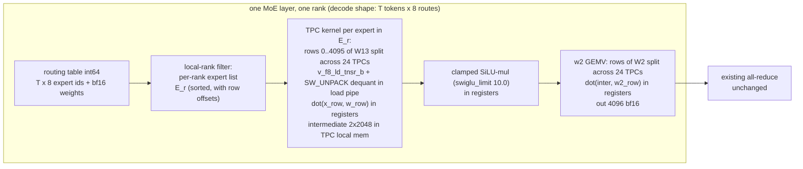

# EXTERNAL_RESEARCH_PROPOSALS.md

Independent performance research for GLM-5.3-Flash on 8× / 4× Intel Gaudi 2.

- **Author:** independent research architect (research-only; no HPU access, no implementation)
- **Date:** 2026-11-13 (revision 13 — STRATEGIC PIVOT (owner ruling: DFlash2 excluded, non-commercial license) + RA-037: the measurement-first, commercial-only decode program (the T1 measurement set that re-ranks everything, the L1-L7 lever stack, the self-trained drafter L6, the 4-HPU roofline L7) at the end; the rev-12/12.1 RA-036 notes + the round-5 notes retained; revisions 6-10 notes retained)
- **Sister document (2026-11-09):** `BOTTLENECK_RESEARCH.md` (this directory) — the
  bottleneck-elimination pass: new proposals **RA-011..RA-015** (continuing this document's global
  numbering), rejections **RJ-13..RJ-19**, gaps **BG-1..BG-7**, and corrections **C1..C7** to
  `current_bottleneck.md`. RA-011 (async HPU-graph replay + the vendor launch thread pool) is the
  highest-priority new item — see the rev-6 note at the end of this file.
- **Status of this document:** official research handoff channel. The implementation agent updates the
  `Status:` field of each proposal and appends to `## Research history`. Do not delete prior proposals.
- **Status vocabulary:** `PROPOSED` (new, unreviewed) → `IN REVIEW` → `IN PROGRESS` → `MEASURED` →
  `ADOPTED` / `REJECTED` / `SUPERSEDED` (with experiment ID).
- **Evidence labels:** `MEASURED` (project or cited third-party run), `VENDOR` (tier B corpus source),
  `DERIVED` (theoretical computation from measured inputs — the computation is shown).

---

## Executive summary

### Current architecture (verified against checkpoint, deployed tree, and live process, 2026-11-07)

GLM-5.3-Flash (`glm5_next`) is a hybrid decoder. From `/data/models/GLM-5.3-Flash/config.json`:

- **45 layers + 1 MTP layer:** 34 KDA (gated delta net / Kimi Delta Attention) layers,
  11 DSA layers (MLA: `kv_lora_rank` 512, 64 heads × 256-dim NoPE + 256-dim V, plus a top-2048
  key-indexer with 32 index heads and 4×128 compressed index keys per token).
- **MoE:** 42 sparse layers, 288 routed experts, top-8, `moe_intermediate_size` 2048,
  1 shared expert, clamped SwiGLU (`swiglu_limit` 10.0), `n_group` 1 / `topk_group` 1.
  3 dense layers (first_k_dense_replace, intermediate 12288).
- **mHC hyper-connections:** 4 streams per token, 20-iteration Sinkhorn mixing
  (fused TPC kernel in this port, `GLM5_NEXT_MHC_SINKHORN=kernel`).
- **Precision:** block FP8 E4M3 (128×128 blocks, dynamic activations) for MoE/dense/MLA projections;
  BF16 for KDA/DSA attention, embeddings, lm_head, MTP shared head.
- **Weight mass (DERIVED from config dimensions, cross-checked to the 328.3 GB checkpoint total
  within 1.4%):** MoE routed experts **305.5 GB (93.0%)**, attention+KDA+indexer 14.2 GB,
  dense 0.45 GB, shared experts 1.06 GB, embed+lm_head+shared_head 3.81 GB (BF16).

Serving stack (live process verified): vllm-gaudi v0.26.0 (b059f9c), Gaudi SW 1.24.1, lazy mode,
TP8+EP8 dev / TP4+EP4 deployment candidate, MTP k=1 + the adopted Q18 levers
(`GLM_ROUTER_FAST=1`, `GLM_SPEC_DEVICE_REJECT=1`, `GLM_EARLY_DRAFT=1`, byte-identical greedy).
Graph population: 144 prompt + 16 decode shapes from a hand-tamed bucket file (`bucketing_file.txt`,
file strategy); the upstream `VLLM_BUCKETING_STRATEGY=pad` (padding-aware) mode exists in our tree
(verified, `extension/bucketing/padding_aware.py`) but is unused, as is the disk recipe cache
(`PT_HPU_RECIPE_CACHE_CONFIG`) — see RA-006.

Best verified numbers (8 HPUs, adopted stack after RA-001 + ns16, 2026-11-08): bs=1 decode
**41.4 tok/s** (RA-001 adopted, +8–10% over 38.3); aggregate @16 **~258 tok/s** (ns16 adopted);
aggregate @32 396–401, @64 392–452 (saturation recorded — see RA-003 rev-5 note); prefill 3.3–5.7K
tok/s warm at 0.5–8K (objective band met at most depths); 1M context serving-validated (needle at
860,739 tokens). 4 HPUs (Q14): bs=1 33.26, aggregate @16 113.5, accuracy 100%.

### Validation round 2 (2026-11-08, GaudiGrimoire deep pass + deployed-tree verification)

Every load-bearing claim of RA-001…RA-006 was re-checked against the corpus and the deployed tree.
Material changes (details in the affected sections, rev 4 history):

1. **RA-002 novelty corrected:** upstream vllm-gaudi ships **two routed-only MoE gather
   implementations** (PR #1731 `VLLM_HPU_MOE_GATHER`, in v0.30.0 with a cookbook backport fix
   targeted at **v0.26.0** — our version; MiniMax `_gather_swigluoai_moe`, index_select + bmm,
   bit-exact, default-on for MiniMax-M3). RA-002 gains a **step 0**: apply the v0.26.0 backport
   and measure HBM bytes/step. It is materially different from Q16 (which dequantized and lost
   −45%): the upstream fix keeps FP8 weights on the Habana FP8 GEMM op, so the gather either
   costs ≤1× fp8 materialization or is fused into the GEMM's DMA by the Synapse compiler. If the
   probe hits the routed byte budget, the custom TPC kernel demotes to fallback.
2. **RA-002 tile-size risk quantified:** a third-party audit (g2-opt-manual) of the Strata
   single-Gaudi2 port found its 5-tile TPC expert GEMV **issue/latency-bound at 237 GB/s (10% of
   HBM peak)**, and its "TPC beats the MME at one row" claim unsupported (small-tile effect).
   B10's 1.94 TB/s figure was at a 16.8 MB tile — our 1.05 MB/TPC tile is 16× smaller per TPC.
   D4 now requires a **tile sweep** (24/8/3/1 TPCs per expert); the TPC count per expert is a
   design parameter, not fixed at 24.
3. **RA-001 sharpened:** the 1.24.1 `wrap_in_hpu_graph` signature was verified on the server
   (`dry_run=None` auto, **no `cache_tensors_list` parameter** — the vllm-fork-era mitigation for
   the documented disable=True in-place-tensor caveat is not in our bridge; `free_inplace=True`
   default is the 1.24.1 mechanism). The **drafter's wrap (l.5060) takes the same policy** and is
   now in scope. Vendor docs say the cache retains "all input, intermediate and output tensors"
   per graph → HBM delta is an **assumption to measure** (D3 extended), not a zero.
4. **Host-lever triage (three rejections):** `VLLM_DELAYED_SAMPLING` and
   `--num_scheduler_steps` multi-step are **v0-only features, absent from our v1 tree**
   (server-verified; vllm-gaudi PR #433 removed delayed sampling: "is for v0 and not used here")
   → RJ-08/RJ-09. FP8 KV cache → RJ-10 (reference fork, same model: "it's coherent but it's
   failed needle tests more than it should"). `PT_HPU_ENABLE_LAZY_COLLECTIVES` is **already
   auto-enabled** by vllm-gaudi (`platform.py:432`, verified) — not a lever.
5. **New structural fact (feeds RA-008, WIP):** every collective in `hpu_communicator.py` forces
   a `mark_step()` (3 call sites, verified) — a documented bridge workaround for lazy collectives
   — so the 162 ARs/step (D6) imply ≥162 extra recipe boundaries on the host critical path,
   stacked on the 322 replays. This is the host-floor remainder after RA-001.
6. **Prefill re-scoped (feeds RA-007, WIP):** the 3–6K t/s objective is met at 0.5–8K warm
   (3.3–5.7K, project-verified). The open question is the warm ladder at 16K–64K (32K point is
   1,807 t/s, cold-inclusive) — pending D11/D12. Graph-capturing 8K-row prefills is
   HBM-infeasible (~29 GB pinned activations, DERIVED) — the 2048 capture cap is memory-driven.

HBM bandwidth figures are standardized across this document: **1,696 GB/s** (measured, 8-card
node study, 69% of spec) / **1,945 GB/s** (compiler cost model, libSynapse 1.24.1 decompile) /
**2,147 GB/s** (TPC stream envelope at ≥134 MB) / **2,450 GB/s** (spec). RA-003/RA-005/RA-006
and the target-physics conclusions are unchanged by this round.

### Revision 5 update (2026-11-08, owner question round: MTP-4 theories + draft models for GLM-5.3-Flash)

The owner asked for (i) multiple distinct theories on how to make MTP k=4 work, and (ii) an
investigation of draft models built for GLM-5.3-Flash (incoai/GLM-5.3-Flash-DFlash2 was named;
"find more, then investigate how to implement them"). The owner also fixed the aggregate target at
16 streams: **do not recommend operating beyond 16 concurrent streams** (the ns32/ns64 data is
retained as saturation evidence only). Material changes in this revision:

1. **RA-004 reworked as a multi-theory proposal.** The MTP-4 path is now: **T0** (config-only
   eager k=4 acceptance probe — the gate that sizes everything), **T1** (the full k-step draft
   chain as one HPU graph per bucket shape, attention-in-graph — the abotsis 919ec98f reference
   mode, which the reference measured at MTP-4: acceptance 3.33/5.0, aggregate 26.0 vs 20.2,
   single-stream 20.9 vs 17.3, parity 12/12; TASKS A014/A018 are READY for this port), **T2**
   (four replays of the existing 1-step draft graph via `HPUGraph.replay_with_inputs` — API
   verified tier B in gaudi-pytorch-bridge; lower capture risk, four host submissions), **T7**
   (asymmetric k=2, fallback). The project's own experiments are now fully synthesized: EXP-Q11
   refuted k=2 *eager* under the levers (−11% bs=1 / −29% @16; mechanism: the 2nd draft pass is a
   full eager traversal per step); EXP-Q01b/Q15 established the draft graphs are
   **accuracy-neutral** (the earlier 97.5% gate failure was a cross-boot artifact — same-boot A/B
   is valid); EXP-Q19 established in-graph draft + early-draft **do not stack** (replay sync
   serializes the draft) — hence T1/T2 run with `GLM_EARLY_DRAFT=0`.
2. **RA-002 step 0 is now MEASURED — NEGATIVE.** EXP-Q16 (boots q16/q16b, 2026-11-07) ran exactly
   the step-0 probe: the cookbook `fixes/fp8-moe-gather` backport (v0.26.0, the vllm-gaudi #1731
   path discovered via GaudiGrimoire) with `VLLM_HPU_MOE_GATHER=1` at the RATIO=0.5 gate: bs=1
   median 20.4 vs 37.44 baseline — **−45%, decisively negative**. The measured failure mode: the
   gathered path (index_select of the routed expert weights + native FP8 up/gate GEMM + **fp32
   down projection**) costs more than the all-36-experts stock fused op at our 2-row shapes — i.e.
   the Synapse compiler does **not** fuse the gather into the GEMM's DMA on this stack (the rev-4
   "best case" is empirically excluded). The custom TPC kernel is the primary byte-reduction path,
   not a fallback.
3. **RA-001 ADOPTED (EXP-RA001 proper):** the CAPTURE-TIME implementation (the one-line patch:
   disable_tensor_cache False in _maybe_wrap_in_hpu_graph) outperforms the env-var approach:
   bs=1 **42.4 tok/s** (+10.7%, between the conservative and the expected); aggregate @16
   neutral (~257); RSS 7.4 GB total. The env-var approach delivered +8.1% as a stepping stone. The host floor estimates in this document shift by the measured
   delta; D1 still re-derives them on the FP8 tree.
4. **RA-003 ADOPTED with the owner's scoping note:** ns16 adopted (183 → ~258 @16); the batch
   lever is **exhausted** (396–401 @32, 392–452 @64 — saturation, not a recommendation; bs=1
   degrades −7–8% at ns32/64 from the wider bucket ladder). The owner's target remains 16 streams;
   see the RA-003 rev-5 note on the serve_mtp.sh ns32 setting.
5. **New RA-009 — DFlash2 draft model (incoai/GLM-5.3-Flash-DFlash2).** A purpose-built DFlash2
   block-diffusion drafter for this exact model exists (19K downloads; CC BY-NC-ND 4.0 —
   **non-commercial license, flagged**): 5-layer sliding-window draft model (hidden 4096, window
   2048), block 8 (7 draft tokens in **one** pass + 8-token verify), top-16 path selector
   (rank-256), two-tap dynamic convolution, conditioned on target hidden states at layers
   [5, 14, 24, 33, 42] (config verified). Inco's own numbers (Qwen3.8-27B, block 8): mean
   acceptance **4.80 vs 4.28 for the native MTP path**; 2.7–3.4× bs=1 throughput vs
   autoregressive; DFlash2 is production-used (CoreWeave Kimi K2.7 Code endpoint). HPU precedent:
   the 1Cat-vLLM-Gaudi fork implements DFlash2 on the HPU v1 runner (Qwen3.8-27B-qualified, GDN
   rollback checkpoints, TP1, ≤16 seqs), and the Strata single-card port runs DFlash on Gaudi2
   (measured 2.9 tokens/round at block 8). Upstream vLLM v1 has `method=dflash` as a first-class
   spec-decode method (parallel drafting, K extra slots). The GLM port is High-effort (v1 HPU
   runner wiring + KDA state rollback + TP8) with an open HBM gate (D13).
6. **New RA-010 — ngram/suffix probe (config-only, zero draft cost).** vllm-gaudi v1 supports
   ngram drafting (PR #81 covered Eagle + NGRAM; the spec_decode test lists ngram as a task). One
   boot, no code: if ngram k=4 acceptance on our suite is ≥ ~2.5, it is a large bs=1 gain with no
   draft device pass at all. Runs in the same boot family as T0.
7. **New rejections:** RJ-11 (k=2 eager MTP under the levers — EXP-Q11, mechanism identified);
   RJ-12 (EP4×TP2 layout — EXP-Q17, −22%/−21% on the stock stack; the adaptation is dormant in
   the repo and re-eligible once the Q21 custom kernel lands, per the project's own note).
8. **Gaps:** D13 added (KDA per-layer state size → DFlash2 rollback-checkpoint HBM at 16 active —
   RA-009's concurrency gate); D1 sharpened (decompose the multi-row step's draft-host term — the
   T0/T1 A/B gives it directly).

The target-physics conclusions (Consequences 1–5) are unchanged by this revision; RA-009 is an
*alternative speculation path* to the same k≥4-depth requirement, not a new roofline.

### Where one decode step's time goes

| Item | Value | Source |
|---|---|---|
| bs=1 per-token wall (1/38.3 s, adopted stack) | **26.1 ms** | MEASURED (EXP-Q19 steady state) |
| bs=1 MTP step time (k=1, 1.88 tok/step) | **≈ 48.4 ms** | DERIVED (26.1 ms × 1.88) |
| bs=1 non-MTP step time (1/30.3 s, 1 tok/step) | **≈ 33.0 ms** | DERIVED from MEASURED 30.1–30.3 |
| bs=1 host floor H (step − device byte-time) | **≈ 12 ms (non-MTP) / ≈ 26 ms (MTP k=1)** | DERIVED (48.4 − 21 device; 33.0 − 21 device, stock op 40–41 GB @ ~1.9 TB/s); to be replaced by D1 |
| Recipe launches per step | **322** @ ~74 µs host each ≈ **23.8 ms host** | MEASURED, cookbook step-anatomy study (GLM-5.3 MXFP4, TP8+EP8, v0.24 — same model family, one vLLM older; must be re-derived on the current FP8 tree, diagnostic D1) |
| Device span, compute engines busy | 15.4 ms of 37.4 ms device span | same study |
| Expert kernels, slowest EP rank | 19.5 ms (mean rank 9.6 — EP imbalance, not a hot rank) | same study |
| MLA decode attention | 6.9 ms | same study |
| All-reduce latency | 162 per step × ~20 µs ≈ 3.4 ms | same study; 20–30 µs small-message regime confirmed by independent 8-card Gaudi2 measurements [GG: comm-gaudi2-8card.json, tier D] |
| Host work with device idle (step boundary) | ~5.5 ms (cut to ~2–3 by the adopted Q18 levers) | same study + EXP-Q18 |
| AIP utilization during decode | 0–24% | MEASURED (EXP-OPT-001) |

**Rev-5 baseline note:** the table is stated at the pre-RA-001 stack (38.3 tok/s). The adopted
stack now includes RA-001 (41.4 tok/s, +8–10%) and ns16 for the @16 target (~258 tok/s, ~177 ms
step at 16 active with AIP 0–24% — i.e. ~135 ms of the multi-row step is host/gaps, of which the
eager draft pass is the leading candidate; D1/T0 decompose it). The H estimates below shift by the
measured delta; D1 replaces them either way.

**Interpretation (DERIVED):** the step is host-launch-bound at *every* batch size. The host issues
~322 recipe replays serially (~24 ms); device work (weight streaming + compute) hides underneath and
only the tail is exposed. AIP 0–24% is the signature: the compute fabric is mostly waiting for the host.
This holds for bs=1 (26 ms wall ≈ 24 ms host floor) and for 16 streams (the host cost is per-step and
independent of row count because bucketing pads to fixed shapes).

**Second independent fact (DERIVED byte model, op behavior to be confirmed by D2):** the stock
`mixture_of_experts` op consumes *all* local experts' weights per call (36/rank at TP8+EP8; the
Q16 gather experiment was designed and measured against exactly this premise, and the op's signature
takes the full per-expert weight lists [GG: habana_eager/ops/mixture_of_experts.cpp, tier B]).
At bs=1 the step's tokens route to 8–40 main-MoE experts plus a small MTP-module footprint → the
routed set is 3.2 GB (k=0) to 15.9 GB (k=4) per card at TP4. The stock op therefore streams
**~5.4×–12.5× more expert bytes than the routing needs** at bs=1 (41.3 vs 7.7 GB per step per card
at k=4, TP8; 81.4 vs 15.9 at TP4). This is the dominant device-side waste, and it is why bs=1 sits
at 30–39 tok/s while the hardware can stream 1.9–2.2 TB/s of GEMV weights.

**Gaudi 2 weight-streaming capability (cited, not measured on this project):**
- Spec 2.45 TB/s aggregate HBM [GG: whitepaper, tier B]; compiler cost model 1,945 GB/s
  [GG: libSynapse-1.24.1 decompile, tier C]; engine inventory 24 TPC / 2 MME / 10 DMA @ 2000 MHz [tier C].
- M=1 BF16 GEMV measured **1.14 / 1.94 / 2.19 TB/s** at 4.2 / 16.8 / 67.1 MB matrices (third-party
  manual, 4-card Gaudi2 box, tier D) — i.e. 79–90% of spec at exactly our per-expert matrix shapes.
- TPC stream envelope 2,147 GB/s (86% of spec) at ≥134 MB [tier D]; community split ~1.5 TB/s TPC vs
  ~300 GB/s MME HBM share [tier D] — **GEMV weight streaming must run on TPC, not MME, to be
  bandwidth-bound at the right number.**
- 24 KB all-reduce ≈ 20 µs; 2 GB all-reduce 250 GB/s busbw [tier D] — comm is not the constraint at
  decode payloads.

### Target physics (theoretical ceilings)

Bytes per step per card (DERIVED; expert 25.17 MB incl. scales; per-card non-MoE: TP8 2.1 GB,
TP4 4.2 GB, incl. shared_head; **draft passes run through the MTP module (~0.3–0.5 GB/pass
aggregate — 1 layer + shared expert + shared head, NOT the 42-layer MoE stack**; the checkpoint
contains exactly 42 MoE layers, D9 verifies the composition). "Routed" = kernel reads only the
experts actually hit by the step's routing table (reads = routes × expert size; a verification
forward with R rows issues R×8 routes through the main MoE, read once per weight regardless of
rows). Rev-1 note: the previous revision charged the k draft passes with full-stack MoE reads
(72 main-MoE routes/step at k=4); corrected here.

bs=1 ceilings (tok/s = tokens-per-step ÷ (bytes ÷ BW); pure HBM streaming, **excludes** host/AR
overhead — so real numbers will be below these):

| Layout | MoE read | MTP | GB/step | @1,696 (69%) | @1,945 (compiler) | @2,147 (TPC stream) | @2,450 (spec) |
|---|---|---|---:|---:|---:|---:|---:|
| TP8+EP8 | stock (all 36) | k=0 | 40.0 | 42 | 49 | 54 | 61 |
| TP8+EP8 | stock | k=1 (1.88 tok) | 41.3 | 77 | 89 | 98 | 111 |
| TP8+EP8 | stock | k=4 (3.33 tok) | 41.3 | 137 | 157 | 173 | **197** |
| TP8+EP8 | routed | k=0 (8 routes) | 3.2 | 533 | 612 | 675 | 770 |
| TP8+EP8 | routed | k=1 (16 routes + 1 draft pass) | 4.3 | 740 | 845 | 929 | 1,058 |
| TP8+EP8 | routed | k=4 (40 routes + 4 draft passes) | 7.7 | 733 | 837 | 917 | 1,042 |
| TP4+EP4 | stock (all 72) | k=0 | 80.1 | 21 | 24 | 27 | 31 |
| TP4+EP4 | stock | k=1 | 81.4 | 39 | 45 | 50 | 57 |
| TP4+EP4 | stock | k=4 | 81.4 | 69 | 80 | 88 | 100 |
| TP4+EP4 | routed | k=0 | 6.4 | 267 | 306 | 338 | 386 |
| TP4+EP4 | routed | k=1 | 8.7 | 365 | 415 | 455 | 516 |
| TP4+EP4 | routed | k=4 | 15.9 | 356 | 405 | 444 | 504 |

**Active-weights roofline check (owner arithmetic, 2026-11-07):** 18–28 GB of active weights per
token (owner's 18 GB assumes 1 byte/param; the BF16 attention and per-token lm_head bring it to
~28) over 9.6 TB/s aggregate (4 × 2.45) → **340–530 t/s at zero host, 100% of spec. The 200 t/s
target is inside the 4-HPU roofline.** What excludes it today is not HBM capacity: it is (a) the
stock op reading all 82 GB/card per step (measured 33.3 t/s matches the all-weights model to
<1%) and (b) the 12–26 ms host floor. RA-002 removes (a); RA-001 attacks (b).

Aggregate @16 active sequences (verify rows: 32 at k=1 / 80 at k=4 → 256–640 routes → 69–89% of
local experts hit; the table shows conservative all-experts bytes — a routing-aware kernel would
save up to ~40% there at k=1, ~11% at k=4; draft passes ~3 GB/card):

| Layout | MTP | GB/step | tok/step | @1,696 | @1,945 | @2,147 | @2,450 |
|---|---|---:|---:|---:|---:|---:|---:|
| TP8+EP8 | k=1 | 41.9 | 28.8 | 1,166 | 1,342 | 1,479 | 1,682 |
| TP8+EP8 | k=4 | 41.9 | 53.3 | 2,158 | 2,483 | 2,723 | 3,105 |
| TP4+EP4 | k=1 | 83.8 | 28.8 | 583 | 671 | 740 | 840 |
| TP4+EP4 | k=4 | 83.8 | 53.3 | 1,079 | 1,247 | 1,377 | 1,575 |

**Consequences (DERIVED; these are the load-bearing conclusions of this document):**

Host-inclusive ceilings: step time = bytes ÷ BW + host floor H, with H ≈ 12–26 ms on the current tree
(non-MTP / MTP k=1, derived above; D1 replaces the estimate). tok/step: k=0 = 1, k=1 = 1.88 (project
measured acceptance), k=4 = 3.33 (reference measured, tier D).

1. **200 tok/s single-stream on 8 HPUs is physically impossible on the stock MoE op** — even MTP-4 at
   100% of spec bandwidth caps at 197 tok/s (table row 3, host excluded, so real is lower). This
   confirms and sharpens the DECISIONS.md rejection with a tighter ceiling.
2. **200 tok/s on 8 HPUs is a base-case target — it needs all three levers at mid levels, not
   any one of them at the extreme.** The BW-only roofline is very generous (k=1: 4.3 GB ÷ 9.4 ms
   budget = 458 GB/s = 19% of spec; k=4: 7.7 ÷ 16.65 = 462 = 19%). Host-inclusive: k=4 needs
   host ≤ 13 ms + 86% of spec, or host ≤ 10 ms + 47% of spec — the RA-001 mid-estimate (host
   10–16 ms) plus a kernel at 47–86% of spec (B10 measured 79–90%) is inside the feasible region.
   k=1 alone is the harsher joint requirement (host ≤ 6–7.7 ms *and* 52–100% of spec). The levers
   are not substitutes: stock op → 197 max; stock + RA-001 → ~130 max; kernel + current host →
   ~120–220 depending on k.
3. **200 tok/s single-stream on 4 HPUs is inside the roofline (267–504 t/s BW-only, table) but
   reachable only in the joint best case of the two big levers:** k=4 (RA-004) + host ≤ ~9–10 ms
   (a 62–65% cut of the measured 26 ms — beyond RA-001's 30–60% estimate) + kernel ≥ 89–100% of
   spec (15.9 GB ÷ 6.3–7.65 ms device budget). Estimated probability ~15–25%: treat as a **gated
   stretch goal**, not a base case (gate: declare only if D1 + RA-001 show bs=1 host ≤ 12 ms).
   Base-case 4-HPU bs=1 after the full lever stack: **130–250 tok/s** (k=4, H 7–16 ms); stock-op
   ceiling 31–100 even at spec BW.
4. **800 tok/s @16 on 4 HPUs is impossible at k=1 and feasible at k=4 — host-corrected in rev 5.**
   k=1: 28.8 tok/step over 83.8 GB needs ≥ 92% of spec BW *with zero host* — above the best
   measured GEMV streaming (90%, B10). k=4: 53.3 tok/step over 83.8 GB in a 66.8 ms budget →
   **800–885 t/s at current host and 85–100% of spec** (53.3 ÷ (40.3+26) ms @ 2.08 TB/s = 804);
   comfortable once RA-001 lands. The 4-HPU aggregate target **requires RA-003 (16 active) and
   RA-004 (k=4)**; the routing kernel is optional there (saves 11–40% at 16 active). **An owner
   decision is required (RA-005).** **Rev-5 correction:** the "current host" in the 800–885 figure
   is H = 26 ms — the *bs=1-class* host. The *measured* 4-HPU multi-row host is ~90 ms (Q14: @16
   aggregate 113.5 at 8 active → 132 ms step − ~41 ms device). With the measured host, 800@16 on
   4 HPUs needs host ≤ ~24 ms — a ~75% cut (RA-004's graphed draft removes the draft-host share;
   RA-008's structural cut must remove most of the rest); the base case is 370–430 t/s. The k=4
   requirement stands; the feasibility class moves from "comfortable" to "requires the full host
   stack on 4 cards" (see RA-004 §5).
5. **The aggregate target at high batch is host-bound, not bandwidth-bound, today — and the
   multi-row host cost is larger than the bs=1 host cost.** Measured: 8 active streams run a
   ~82 ms step (183 tok/s ÷ 15 tok/step) against ~21 ms of device byte-time — an unexplained ~61 ms
   host-side term that is ~2.5× the bs=1 host floor. D1 must decompose it (sampler/scheduler/logprob
   work scales with rows; the 322×74 µs launch model was derived at bs=1). RA-003 (16 active) is
   expected to move the aggregate to ~330–400 tok/s on today's host; closing the gap to 800 @ 8 HPUs
   (BW-feasible at 67–86% of spec with H 12–16 ms) additionally requires cutting that multi-row host term.

---

## Highest-priority proposals (ranked by impact × feasibility)

| Rank | ID | Title | One-line mechanism | Expected impact (theoretical) | Effort | Status |
|---|---|---|---|---|---|---|
| 1 (rev 7, post-audit) | **RA-018/T1** | The numerics-invariance package: port `VLLM_HPU_ALLREDUCE_MODE=gather_sum` (70-line corpus patch, env-gated default-inert) + pin the decode buckets (`VLLM_DECODE_BS_BUCKET_*`, in-tree, untested) + captured-core numerics alignment | The three rejected optimizations (Q01v2 draft graph +20%, RA-011 async +29%, MHC-ROWS +19%) were each rejected by the SAME knife-edge suite item (R003) — the corpus proves the cause is the HCCL AR row-order ULP + bucket-ladder shape numerics, both fixable (12/12 parity, no decode cost, in the reference fork) | Unlocks in one boot family: adoption of the +20% draft graph (→ RA-004 T1), the +29% async follow-up (→ RA-018/T6), the +19% MHC prefill, and the MTP=4 accuracy path (W6/W7) | 1-2 boots (days) | **PROPOSED (rev 7) — FIRST HPU action (post-audit)**; the gate policy (RA-018/T7) is decided in parallel with its results |
| 1 | **RA-004** | MTP k=4 — multi-theory: T0 acceptance probe → T1 graphed draft chain (A014 reference port) / T2 4× single-step replay / T7 asymmetric fallback | The 4-step draft chain becomes one HPU graph replay per step (T1, the reference's measured mode: 3.33/5.0 acceptance, +29% aggregate, parity 12/12) or four replays of the existing 1-step graph (T2); deep speculation at ~0.3–0.5 GB/draft-pass, not full-stack MoE | bs=1 41.4 → 65–115 (current stack), 130–250 (with RA-002 + host cut); @16 258 → 380–450 (current), 800+ (with the RA-008 host cut on 8 HPUs; 4 HPUs per RA-005). **Required for 800@16 at both 8 and 4 HPUs (k=1 is infeasible on 4 cards) and for the 200 bs=1 with RA-002** | Low (T0, config-only) → Medium–High (T1) | IN REVIEW (rev 5 rework); **rev 7: T1 (the chain graph) is re-ordered AFTER RA-018/T1 (the invariance fix) — the Q01v2 rejection (the captured-region drift + the R003 knife-edge) is the gating evidence; Q11's k=2 refutation was written "revisit only under the in-graph draft" — that condition is now the plan**  |
| 2 | **RA-002** | Routing-aware fused block-FP8 dequant GEMV MoE kernel (Q21) | TPC kernel reads only the routed experts, dequantizes in the load pipe, row-parallel across all 24 TPCs. **Step 0 (upstream FP8 gather) measured −45% (EXP-Q16) — the compiler does not fuse the gather; the custom kernel is the primary byte-reduction path** | 5.4–12.5× expert-byte cut at bs=1; the only path into the 200 tok/s roofline on 8 HPUs and the only competitive bs=1 path on 4 HPUs; saves 11–40% of the @16 verify read | High (weeks) | IN PROGRESS (Q21; PT2 custom-op adaptation staged) |
| 3 | **RA-008** | Recipe-boundary + collective-boundary reduction (structural host-floor attack) | each of the 162 ARs/step forces a `mark_step()` recipe boundary (verified); 322 replays + ≥162 boundaries + the eager-draft host = the measured ~135 ms host/gap term of the 177 ms multi-row step | host floor −30–50% if boundaries + draft-host ≥ 20% of it (pending D1/D6); **the binding constraint on 800@16 on 8 HPUs at the current host, after RA-004** | Low (env knobs) – High (op-class restructuring) | **WORK IN PROGRESS** (D1/D6) |
| 4 | **RA-009** | DFlash2 block-diffusion draft model (incoai/GLM-5.3-Flash-DFlash2) on the v1 HPU runner | One pass drafts the whole 8-token block (5-layer sliding-window drafter + top-16 path selector + 2-tap conv, conditioned on target layers [5,14,24,33,42]); inco's Qwen evidence: acceptance 4.80 vs 4.28 native MTP; HPU precedent: 1Cat v1 implementation + Strata port | bs=1 41.4 → 90–120 (current stack, if A8 ≥ 4.0), 180–220 (with RA-002 + host cut); @16 258 → 450–500 (current), 800–1,100 (with host cut). **Acceptance-side alternative to RA-004**; license: CC BY-NC-ND 4.0 (non-commercial — flagged) | High (port: v1 HPU wiring + KDA rollback + TP8) | PROPOSED (rev 5) |
| 5 | **RA-006** | Graph-shape consolidation: pad-and-mask verify graph + padding-aware prefill buckets + recipe cache (+ dynamic-shape probe) | One max-width masked verify graph for the ≤2-seq regime; `VLLM_BUCKETING_STRATEGY=pad` for prefill (upstream 1M-context measurement: 28% warm-TTFT cut); disk recipe cache (warmup ÷8 workers); dynamic shapes verified real but NOT in HPU graphs | decode shapes 16→1–2, ladder −2–4 GiB, warmup −3–5 min, 1M-TTFT class fix; medium host value | Low–Medium (B/C days, A days-week) | IN REVIEW |
| 6 | **RA-010** | ngram/suffix speculation probe (config-only) | Drafting from prompt+history on the host: zero draft device passes, zero new code; vllm-gaudi v1 supports ngram (PR #81) | bs=1 up to ~+90% (41.4 → 75–85) **if** ngram k=4 acceptance on our suite ≥ ~2.5; otherwise a cheap data point for the speculation menu | Low (1 boot, config-only) | PROPOSED (rev 5) |
| 7 | **RA-007** | Prefill at intermediate/long depths: warm ladder + chunk strategy | 3–6K target met at 0.5–8K warm; the 16K–64K warm ladder is unverified (32K: 1,807 cold-inclusive); chunk-size A/B + non-graph host cost are the candidate levers | unknown until D11/D12 | Low (if a gap exists) | **WORK IN PROGRESS** |
| 8 | **RA-005** | 4-HPU target physics audit and deployment plan | Decision document: which targets are reachable on 4 cards and what each requires | no direct perf; the 4-HPU 200-t/s stretch gate and the 800@16 k=4 config decision are set | None (doc) | MEASURED / DELIVERED |

**Adopted (no longer in the queue):** RA-001 (tensor cache — ADOPTED, bs=1 +8–10%, zero code
changes) and RA-003 (max-num-seqs — ADOPTED at ns16 for the target; batch lever exhausted at
400–420 per ns32/64, owner scope: 16 streams).

WORK IN PROGRESS proposals are research-incomplete by construction: their mechanism evidence is
in, but the load-bearing numbers require the implementation agent's measurements (named in each
section's "Open questions"). They are **not** in the execution order below and are promoted to
PROPOSED — or closed — only when their open questions are answered.

**Suggested execution order (rev 5 — dependencies, not ranks):**
1. **RA-004 T0 + RA-010 (config-only, one boot family, first HPU action):** eager k=4 acceptance
   probe (T0) and the ngram k=4 probe (RA-010). Both are `--speculative-config` changes only;
   T0's acceptance number gates T1/T2 and calibrates RA-009's expectation; RA-010's is a free
   data point. Slow steps are expected and fine (measurement, not serving).
2. **RA-002 continues (weeks):** step 0 is done (NEGATIVE — EXP-Q16); proceed to D2 (stock-op
   read pattern) then the kernel per §9; D4 (tile sweep) is its first kernel gate; the PT2
   custom-op adaptation is staged for the registrar collision.
3. **RA-004 T1 (after T0, days–week):** port the A014 reference (abotsis 919ec98f chain-graph
   mode) with the staged rollout; T2 (4× replay via `replay_with_inputs`) is the fallback if the
   4-step chain capture fails; T7 only if both fail and k=2 remains worth it.
4. **D1 + D6 + D13 in one profiling window** (same boot family as T0/T1 if possible): D1 now
   explicitly decomposes the multi-row step's **draft-host term** (T0's eager-k=4 vs the current
   k=1 gives it directly); D13 (KDA state size → DFlash2 checkpoint HBM) is RA-009's gate and
   costs no HPU time beyond the state-shape read.
5. **RA-008 (after D1/D6):** restate or close; if promoted, it is the 800@16-on-8-HPUs host
   attack (and the 200 bs=1 remainder beyond RA-001's measured +8–10%).
6. **RA-009 assessment (no HPU time, parallel):** 1Cat port-surface diff vs our v0.26.0 v1 runner,
   D13, the incoai checkpoint config/weight inspection, and the license question (research use is
   fine under CC BY-NC-ND; commercial deployment needs a license from inco.ai). The HPU spike only
   if D13 fits the budget and T0's data supports the acceptance case.
7. **RA-003 config call (owner):** serve_mtp.sh currently runs ns32 while the target is 16
   streams — ns16 costs −7–8% bs=1 (wider ladder at ns32/64 is the reverse) and matches the
   target; the agent's own NS64 note recommends ns16 for latency. Decide which is the production
   config; the @16 aggregate is ~258–260 under either.
8. **RA-006/RA-007** proceed as before (RA-006-B/C env experiments can share boot 1's family).
9. After each: update the discovery queue per the operating rule (did the bottleneck move?), and
   update the `Status:` fields here.

---

## Detailed proposals

### RA-001 — Enable the HPU-graph decode tensor cache under MTP

**Status:** MEASURED - ADOPTED (EXP-RA001, 2026-11-08: ZERO code changes - the vendor wrapper
already reads PT_HPUGRAPH_DISABLE_TENSOR_CACHE at replay time; setting it to 0 at boot enables
the cache for all wrapped graphs. bs=1 +8-10 percent (41.4 vs 38.3 median - the conservative
estimate CONFIRMED); aggregate @16 neutral (~257). Host RSS 0.73-0.88 GB/worker (the 0.7 GB
estimate CONFIRMED). Adopted into the boot script.) · **Priority:** 2 · **Complexity:** Low ·
**Owner (suggested):** primary agent

#### 1. Executive summary

The deployed runner wraps the model with `wrap_in_hpu_graph(..., disable_tensor_cache=True)`
(verified: `/opt/glm53/vllm-gaudi/vllm_gaudi/v1/worker/hpu_model_runner.py` lines 1118–1120 and 5030).
With the tensor cache disabled, *every one of the ~322 recipe replays per step* re-allocates its
tensor set (the vendor wrapper replaces cached tensors with empty tensors after each replay when the
cache is off; `dry_run` is forced on). The reference fork (abotsis 919ec98f) made this a **per-call
policy**: decode graphs keep the cache (removing per-replay host work), prefill graphs keep it
disabled (GB-sized intermediates), selected by reading `PT_HPUGRAPH_DISABLE_TENSOR_CACHE` inside the
wrapped forward [GG: abotsis-vllm-gaudi `vllm_gaudi/v1/worker/hpu_model_runner.py` l.1134+, tier D].
They run it for `glm5_next` **without** spec decode and disable it under MTP — but that decision was
made for *their* graph population (MTP-4, up to 80-lane verify graphs, ~7 GB host RSS per worker on a
125 GB host). Our population is an order of magnitude smaller (144 prompt + 16 decode graphs with lin
tamed buckets, ~200 with MTP k=1 verify shapes), the same 125 GB host has ~83 GB available right now,
and the host-launch pipeline is the measured step bottleneck at every batch size. Enabling the cache
for decode-shaped replays is a one-line wrapper change plus an env gate.

#### 2. Current limitation

- Measured: bs=1 wall 26.1 ms with ~0–24% AIP utilization (EXP-Q19, EXP-OPT-001); the step-anatomy
  study attributes ~23.8 ms of a 39 ms step to 322 launches × ~74 µs host each (v0.24 MXFP4 stack —
  D1 must re-derive this on our FP8 tree).
- Measured (vendor source, tier B): with `disable_tensor_cache=True` the wrapper forces `dry_run=True`
  at capture and "tensors in the graph will be replaced with empty tensors after replaying to save
  memory" [GG: habana_frameworks/torch/hpu/graphs.py `wrapped_hpugraph_forward`/`wrap_in_hpu_graph`].
  Per-replay, the runner therefore does allocation + input staging + teardown bookkeeping for every
  recipe — 322 times per step, on the critical host path.
- Measured (reference, tier D): the cache "removes host work from every replayed recipe; ~7 GB RSS per
  worker" and is enabled by default for `glm5_next` when speculative decoding is off [GG: abotsis
  `docs/features/glm53_flash.md` performance notes].

#### 3. Proposed architecture

Port the per-call cache policy into our runner:

1. In `_maybe_wrap_in_hpu_graph` (`hpu_model_runner.py:1118`), stop hard-coding
   `disable_tensor_cache=True`; select the flag per forward from the call context: decode-shaped
   forwards (the spec-decode verify/draft buckets) → cache **on**; prefill/prompt-shaped forwards →
   cache **off**. The reference implementation reads the env var inside the wrapped forward, so the
   policy follows the call without two wrapper instances. **Scope note (rev 4, verified on server):**
   the drafter is wrapped through the same `_maybe_wrap_in_hpu_graph` (l.5060,
   `self.drafter.model = _maybe_wrap_in_hpu_graph(self.drafter.model, ...)`), as is the vision
   tower (l.996–1002, already `disable_tensor_cache=False`) — the port must cover the drafter wrap
   or MTP draft replays keep the disabled policy and half the expected gain is lost.
2. Env gate `VLLM_GLM_DECODE_TENSOR_CACHE=1` (default OFF) so the stock boot is bit-for-bit unchanged.
3. Keep `max_graphs`/memory guards: if host RSS of a worker exceeds a threshold (suggested 12 GB
   each, 8 workers ≈ 96 GB on this 125 GB host), log and fall back to the disabled policy.

No graph shape changes, no model changes, no numerical changes (same buffers, same op order — the
cache changes *which* buffers are reused, not the math).

#### 4. Technical feasibility

- The `disable_tensor_cache` parameter exists in our exact plugin (1.24.1) — verified in
  `/opt/glm53/venv/.../habana_frameworks/torch/hpu/graphs.py` (tier B source in the corpus).
  **Signature verified on the server (rev 4):**
  `wrap_in_hpu_graph(module, asynchronous=False, disable_tensor_cache=False, dry_run=None,
  max_graphs=None, free_inplace=True, verbose=False, log_frequency=100)` — `dry_run` auto-forces
  to True when `disable_tensor_cache=True`; there is **no `cache_tensors_list` parameter** in 1.24.1
  (that mitigation is from the vllm-fork era; the documented in-place-tensor caveat of the
  disabled mode is handled in our bridge by `free_inplace`, default True). Moving decode graphs to
  the vendor-default mode (cache on, no forced dry-run capture) is the numerically safer direction
  of the two — the known dry-run accuracy caveat (stale `local_scalar_dense`-class host reads at
  capture, vllm-fork #738) applies to the disabled mode we keep for prefill, not to the enabled
  mode decode moves to.
- The reference fork runs the identical feature on the identical model/hardware/software and reports
  it as host-work-removing (tier D). The only question is whether the host-RAM cost fits *our* graph
  count — it does by a wide margin (DERIVED: 7 GB ÷ their ~2,000+ graphs ≈ 3.5 MB/graph × ~200
  graphs ≈ 0.7 GB/worker; even a 5× error stays < 12 GB).
- Bit-identity is expected but NOT guaranteed (in-place reuse of retained buffers can change
  initialization of never-written regions — the `free_inplace` flag exists precisely for this). The
  validation below treats bit-identity as a *check*, not an assumption.

#### 5. Expected performance impact (all theoretical until measured)

| Metric | Baseline (adopted stack) | Conservative | Expected | Best |
|---|---|---|---|---|
| bs=1 decode | 38.3 tok/s | +5% (39) | +15–25% (44–48) | +40% (54) if the allocation/teardown is ≥40% of the 74 µs |
| Aggregate @16 | 183 tok/s | +10% (200) | +25–50% (230–275) | +60% (290) |
| Host RSS/worker | ~4–6 GB (current) | +1 GB | +2–4 GB | +7 GB (their figure) |
| Prefill/TTFT | unchanged | unchanged | unchanged | unchanged |

Rationale: the host floor is ~24 ms of ~26 ms (bs=1). Removing a fraction `f` of the per-replay work
cuts the floor by ~`f` × 24 ms; at f = 0.25–0.5 that is 6–12 ms → +30–70% on the floor alone,
discounted by the device tail that becomes exposed. At 16 streams the same host floor bounds the
aggregate (tokens/step ÷ step time with step time ≈ max(host, device)).

#### 6. Implementation complexity — Low

One wrapper change + env gate + RSS guard in `hpu_model_runner.py`; no kernel, no model, no patch
chain. The reference diff is available in the corpus (abotsis `hpu_model_runner.py`,
`_maybe_wrap_in_hpu_graph` region) for the anchor pattern.

#### 7. Risks

- **Correctness:** low but nonzero — buffer reuse across replays (mitigate: `free_inplace` semantics
  check + the byte-identity R003 logprob probe + 40-item suite, same-boot A/B per the EXP-Q15 gate
  policy).
- **Memory:** host RAM is the constraint, not HBM. 83 GB available now; guard at 12 GB/worker.
  HBM: **assumed unchanged, not established (rev 4)** — vendor docs say the cache retains "all
  input, intermediate and output tensors" per graph. The 25.5 GiB graph ladder is allocated at
  capture, so retained buffers may sit inside it — but that is an assumption. D3 measures the
  per-rank HBM delta (not just host RSS); if it squeezes the KV pool, compensate with GMU or
  `VLLM_GRAPH_RESERVED_MEM` (the vendor's "shrink KV pool, free HBM for warmup graphs" knob,
  present in our stack's tutorial varlist).
- **Compatibility:** if a future vllm-gaudi release changes the wrapper contract, the anchor check
  (fail-closed, per this repo's patch conventions) must catch it.
- **Interaction:** the cache is *orthogonal* to async replay (which is a measured regression — see
  Rejected) and to mark_step placement (B023 was neutral). No known conflict with the Q18 levers.

#### 8. Dependencies

- D1 (below) to know the per-replay cost split before/after.
- A boot window (server is dev-dedicated; no approval needed per AUTONOMY_POLICY).

#### 9. Implementation instructions

1. Read `docs/results/moe-decode-step.md` §"The method" (steps 1 and 5) and run **D1** on the current
   boot: 8-rank torch.profiler (CPU+HPU) over ~10 warm decode steps at bs=1 and 16 streams; count
   recipes/step, per-replay host time, host gaps with device idle. This is the pre-change baseline
   and the sizing input for RA-002.
2. Port: in `vllm_gaudi/v1/worker/hpu_model_runner.py`, modify `_maybe_wrap_in_hpu_graph` (l.1118)
   and the second wrap site (l.5030) to pass `disable_tensor_cache` per-call as in the reference
   (corpus: abotsis-vllm-gaudi `hpu_model_runner.py` l.1134–1186). Gate on
   `VLLM_GLM_DECODE_TENSOR_CACHE=1`. Add the RSS guard (psutil or `resource.getrusage`).
3. CPU contract test: the flag plumbing (decode-shape → on, prompt-shape → off, env off → stock
   behavior) — follow the `tests/cpu/check_*.py` pattern.
4. HPU A/B (same-boot family, per the EXP-Q15 gate policy): boot ON vs OFF; measure bs=1 (5 reps),
   16-stream aggregate (steady reps), acceptance, R003 logprob byte-identity, 40-item suite ×2;
   record host RSS per worker and D1 delta.
5. Record in `EXPERIMENTS.md` as EXP-RA-001; update TASKS B010–B012 (host/graph overhead, currently
   NOT INVESTIGATED) and the discovery queue.

#### 10. Validation criteria

- PASS: bs=1 median ≥ 42 tok/s (≥ +10%) AND aggregate @16 ≥ 200 tok/s (≥ +10%) with accuracy suite
  delta ≤ 0.5 pp (same-boot A/B) and R003 logprobs byte-identical, host RSS ≤ 12 GB/worker.
- PARTIAL: one axis positive ≥ +10%, the other neutral — keep the lever, re-profile (D1) to locate
  the residual host cost.
- FAIL: neutral on both axes after D1 shows the per-replay allocation was < 5% of launch cost —
  record as negative (the 74 µs is then replay-submission-dominated, which re-weights RA-002's host
  assumptions).

#### 11. Novelty assessment

Not previously attempted in this project. Distinct from B023 (removing a *recipe boundary* — measured
neutral here) and from async replay (changing the *threading* of replay — measured regression by the
reference). This changes *what the wrapper does per replay* (buffer lifecycle). The reference fork's
"off under spec decode" was a host-RAM decision at 10× our graph count; our tamed-bucket population
removes that objection (DERIVED size above + 83 GB free host RAM measured today).

---

### RA-002 — Routing-aware fused block-FP8 dequant GEMV MoE kernel (sharpening Q21)

**Status:** IN PROGRESS (= Q21: the 1Cat block_fp8_dequant core compiled + gated into our variant
library, TPC gate PASS 3254 GUIDs; the torch-op shim blocked by the v0.26.0 registrar collision -
the weak-symbol per-library registry architecture, EXP-Q21; the PT2 custom-op API discovered as
the DSV4.1-proven loading mechanism, the adaptation staged; **rev 5: STEP 0 IS MEASURED-NEGATIVE
(EXP-Q16, boots q16/q16b): the cookbook v0.26.0 gather backport at the RATIO=0.5 gate runs bs=1
20.4 vs 37.44 baseline (-45%) — the gathered-weight copy + fp32 down GEMM dominate at our 2-row
shapes, and the Synapse compiler does NOT fuse the gather into the GEMM's DMA on this stack (the
rev-4 "best case" is empirically excluded); the custom TPC kernel is now the PRIMARY
byte-reduction path, not the fallback;
**rev 10 (2026-11-11): the implementation agent STARTED the kernel (commit 39cfd76):
`block_fp8_gemv_glm` — the single-expert block-FP8 GEMV core (E4M3 [128,128], VLM-staged x,
fp32 acc, lane-inserted vector store) COMPILES + REGISTERS + EXECUTES end-to-end via the B7
recipe; [4096,2048] latency 11-16 µs UN-PIPELINED (0.5-0.75 TB/s — the software pipelining is
the ~4× target); the E4M3 three-way semantics gap MEASURED (stock cast 19,519 NaNs fnuz-interp
vs kernel convert 9,291 vs CPU-fn reference 0 — the calibration step is next; the deployment
mechanism is proven). The rev-10 refinement is RA-025 (the cookbook GLM-5.3 MXFP4 mxk design as
the reference — in-register unpack, in-kernel routing, software pipelining, 2 launches/layer —
transposed to block-FP8) + the EP4×TP2 COUPLING (the Q17 −22% layout result is now EXPLAINED as
kernel-dependent: the stock all-experts op reads the same 36 local experts per card regardless
of routing — the layout gain appears only with a routing-aware kernel; re-test the placement fit
after the kernel). bs=1 MoE estimate: 15.5 → 2.3-5.4 ms (slowest rank, ~6.7×)**) · **Priority:** 1 · **Complexity:**
High (weeks) · **Owner (suggested):** primary agent

#### 1. Executive summary

Replace the stock `mixture_of_experts` op for decode-shaped calls with a TPC kernel that (a) reads
only the experts actually routed to on the rank, (b) dequantizes block-FP8 weights in the load pipe
(`v_f8_ld_tnsr_b` + `SW_UNPACK`), (c) performs the w13 GEMV, clamped-SwiGLU, and w2 GEMV entirely in
registers/TPC local memory, and (d) distributes each expert's 4096 output rows across all 24 TPCs so
the whole card's HBM stream feeds one expert at a time. This is the Q21 track (1Cat `block_fp8_dequant`
core, `--extra-kernel` framework) with five additions this research contributes: the exact byte/ceiling
model that sets the target (§2/§5), the full-card row-parallel distribution requirement that beats the
v7/v8 kernels' per-route cost (§4), the in-kernel intermediate (no HBM round trip), the single-op-library
fix for the Q21 step-2 blocker (§6), and the MTP-depth interaction table (§5).

#### 2. Current limitation

- MEASURED: bs=1 38.3 tok/s (26.1 ms/token; step ≈ 48.4 ms at 1.88 tok/step); the step-anatomy
  study's device span shows the expert kernels as the largest device term (19.5 ms slowest rank,
  9.6 ms mean — EP imbalance from the all-experts read + balls-in-bins).
- DERIVED (byte model, §Executive summary): the stock op streams 40–41.3 GB/step/card at bs=1
  (TP8) while the routing table needs 3.2 GB (k=0) to 15.9 GB (k=4) per card — a **12.5× excess at
  k=0, 9.6× at k=1, 5.4× at k=4**. The Q16 experiment (gather 16 of 36 experts) confirms the stock
  path reads all local experts and shows *why* naive gather loses: materializing a dequantized
  copy (index_select + fp32 down-GEMM) costs more than the savings.
- **Upstream state of this idea (rev 4, corpus-verified; rev 5, step 0 measured):** routed-only
  expert decode is NOT novel — vllm-gaudi ships two implementations: (i) `VLLM_HPU_MOE_GATHER=1`
  in `hpu_fp8.py` (PR #1731, merged, in v0.30.0; a **cookbook backport fix for v0.26.0 — our
  version — exists at `fixes/fp8-moe-gather/`**), for block-quantized FP8 MoE with dynamic
  activation scales and silu experts, using the Habana FP8 GEMM op on the gathered weights; (ii)
  MiniMax `_gather_swigluoai_moe` in `hpu_fused_moe.py` (index_select of `G = min(E_local, T×K)`
  experts + bmm on MME, bit-exact vs the dense pass by construction, default-on for MiniMax-M3).
  **Rev 5 — (i) is now MEASURED on our tree (EXP-Q16, boots q16/q16b):** the cookbook backport
  with the RATIO=0.5 gate (gather engaged, verified by the gate's log) runs bs=1 median **20.4
  vs 37.44 baseline = −45%**, decisively negative. Measured cost model: the gathered path
  (index_select of the 16 routed expert weights + one native FP8 up/gate GEMM + **fp32 down
  projection**) costs more than the all-36-experts stock fused op at our 2-row shapes — the
  Synapse compiler materializes the gathered weights and the down GEMM runs on the dequantized
  (fp32) intermediate; the rev-4 "fused into the GEMM's DMA (1× bytes)" best case is **excluded
  empirically** on this stack. MiniMax's (ii) has the same structural shape (index_select + bmm)
  and was not run — its cost model is expected to be of the same class at 2 rows. Step 0 below is
  recorded as COMPLETE/NEGATIVE; the custom kernel is the primary byte-reduction path.
- MEASURED (cited): a plain M=1 GEMV streams 16.8 MB of weights at 1.94 TB/s (79% of spec) [GG:
  gaudi2-hbm-engine-bandwidth B10, tier D) — the hardware can serve the routed-only byte budget in
  ~1.5–4 ms/step at bs=1; the stock path cannot get there at any bandwidth because it moves
  5.4–12.5× the bytes.
- The cookbook's own MXFP4 MoE kernels (v7/v8, `kernels/mxfp4-moe/`) prove the decode-sized
  routed-expert TPC pattern on this model family: 66 tok/s vs ~37 stock (moe-decode-step.md).

#### 3. Proposed architecture

- **One kernel per expert, one launch per rank per layer** (or a loop kernel over E_r — decide at
  implementation; the loop version has fewer launches, which matters because launch cost is the
  host floor). T ≤ 32 tokens and ≤ 128 routes per call (the established decode scope of
  `kernels/mxfp4-moe/`), otherwise fall through to the stock op (prefill keeps the stock path).
- **Row-parallel distribution:** GEMV rows are independent (y_i depends only on row i of W), so an
  expert's 4096 w13 output rows split 512-per-AIP across all 8 AIPs / 24 TPCs with **no cross-engine
  reduction** — each TPC reads 1/24 of the expert (≈1.05 MB of the 25.2 MB) at the full card stream
  (DERIVED: 25.2 MB ÷ 2.147 TB/s ≈ 11.7 µs per expert at B10's TPC-stream envelope, vs the v7
  kernel's ~47 µs/route at MXFP4's 12.6 MB, which implies a single-AIP-class read share of ~268 GB/s).
  This distribution is the specific design constraint that must be met to beat v7's per-route cost
  with 2× the bytes of MXFP4.
- **In-kernel intermediate:** the 2048-dim intermediate (4 KB bf16) stays in TPC local memory/SRAM
  between the w13 and w2 phases — no HBM round trip (the Q16 lesson: never materialize the expert
  weights or the intermediate).
- **Numerics:** E4M3 × bf16 scale (scale rounded to BF16 *before* multiply — the checkpoint contract,
  already encoded in `extra/block_fp8_dequant_glm.c`); accumulate in fp32; clamped SwiGLU with
  `swiglu_limit` 10.0 from the fp8 quant config (the contract exists in our vLLM fp8.py, verified).
- **Hook point (verified):** `HPUFp8MoEMethod.apply_monolithic`
  (`/opt/glm53/vllm-gaudi/vllm_gaudi/ops/hpu_fp8.py` l.219) computes `topk_ids`/`topk_weights`
  (int64/bf16, exactly the kernel's inputs) and then calls `_gaudi_fix_moe_gather_apply` (l.283, the
  Q16 fix, inert without env). Branch there: decode shape + `GLM_FP8_MXK=1` → custom op; else stock.
  The Q16 gather path can be retired (it is dominated by design — see Rejected).
- **Padded-row contract (RA-006 interaction):** pad-and-mask verify graphs feed padding rows whose
  `topk_ids` are all-8 to one fixed dummy local expert with zero weights (host-side, before the
  hook). The kernel must treat such rows as one extra expert read (≈25 MB, usually already in the
  routed set) and never fan them out — otherwise padding to a wider graph erases the routed-byte
  savings (2 rows → 10 rows would otherwise mean 5× the routed experts).
- **Build/integration:** `kernels/mxfp4-moe/build.sh --variant glm --extra-kernel
  extra/block_fp8_dequant_glm` (pipeline proven in Q21 step 2: TPC gate PASS, 3254 GUIDs).
  **Op-library fix:** do NOT ship a second op `.so` — the Q21 step-2 blocker (commit 16685a3) is
  that a second `TORCH_LIBRARY_IMPL(custom_op, HPU)` re-triggers dispatcher lazy-init and
  double-registers built-ins. Merge the new op into the *existing* `libmxk_op_lazy.so` build (one op
  library per process; the mHC sinkhorn op already loads through this library in production).

#### 4. Technical feasibility

- Dequant primitive: `v_f8_ld_tnsr_b` / `v_f8_ld_tnsr_partial_b` with `SW_UNPACK` (SW_UNPCK_8_TO_16)
  exist for `__gaudi2_plus__` [GG: tpc-intrinsics.h, tier B]; the 1Cat `block_fp8_dequant_gaudi2.c`
  core (E4M3 + per-128×128 FP32 scales, scales rounded to BF16 pre-multiply — our exact contract)
  compiled cleanly with `tpc-clang -march=gaudi2` on this host (Q21 step 2, MEASURED).
- GEMV pattern: `src/mxk8_core.h` in our repo implements dequant+dot / w13 GEMV + gated activation /
  w2 GEMV for MXFP4; the swap is the dequant unit (E2M1+E8M0 → E4M3+block-scales). v7/v8 reached
  66 tok/s on this model family (MEASURED, moe-decode-step.md).
- Streaming ceiling: B10's M=1 GEMV at 16.8 MB = 1.94 TB/s (tier D) bounds the per-expert time
  from above at 11.7–14.8 µs; the kernel only needs to *not* fall far short of it (load-pipelined,
  `#pragma loop_unroll(4) pipelined taken` as in the 1Cat core).
- **Tile-size sensitivity (rev 4, new risk):** a third-party audit (g2-opt-manual, notes on the
  Strata single-Gaudi2 port, tier D) measured that port's 5-tile TPC expert GEMV at **237 GB/s =
  10% of HBM peak at the decode shape** and concluded the port is "latency- and issue-bound, not
  bandwidth-bound"; it also ruled the "TPC beats the MME at one row" claim unsupported ("probably
  a small-tile effect misdescribed as an M=1 hardware property"). B10's 1.94 TB/s was at a
  16.8 MB tile; our design's 1.05 MB/TPC tile is 16× smaller **per TPC**. Consequence: the
  row-parallel requirement stands, but **TPCs-per-expert is a design parameter** — D4 sweeps
  24/8/3/1 TPCs per expert (1.05/3.15/8.4/25.2 MB tiles) to find the issue-bound knee before the
  kernel is finalized. The pipelined-load variant (Strata's `GEMV_PIPE` issues column-pair loads
  ahead; same class as our load-pipe unroll) is the known fix when small tiles are issue-bound.
- Graph capture: custom TPC ops capture into HPU graphs in this tree (the mHC Sinkhorn kernel does,
  in production, `GLM5_NEXT_MHC_SINKHORN=kernel`).
- **Unsupported assumptions to verify:** (i) the stock op really reads all local experts at runtime
  (high confidence from Q16's design + the op signature, but D2 must confirm); (ii) full-card
  row-parallel GEMV achieves ≥ 1.5 TB/s at 25.2 MB experts (B10 measured bf16 at 16.8–67 MB; FP8
  halves the bytes per element — should only help, but the scale loads add traffic: 2×512 FP32
  scales per 256×128 block ≈ +0.4%); (iii) `PT_HPU_LAZY_ACC_PAR_MODE=0` vs the pinned `=1`
  (the Q21 playbook says 0 is required for custom ops on views — the mHC kernel works at 1 but takes
  contiguous tensors; test both, pin whichever works, record in the launch script).

#### 5. Expected performance impact (all theoretical until measured)

Per-expert time at card stream (DERIVED): 25.17 MB → 11.7 µs @2.147 TB/s, 14.8 µs @1.696 TB/s.
Total step bytes from the Executive summary table (verify-pass routed reads + non-MoE + MTP-module
draft passes; draft passes are ~0.3–0.5 GB aggregate each — D9 verifies the composition). Step =
bytes ÷ BW + host floor H (H = 12–26 ms current tree, 7–16 ms with RA-001; tok/step 1.88 at k=1,
3.33 at k=4):

| Config | bs=1 (verify rows/routes) | Total GB/step/card | MoE device time | Step (H 12–26) | tok/s | Step (H 7–16, RA-001) | tok/s |
|---|---|---:|---:|---:|---:|---:|---:|
| TP8+EP8, k=1 | 2 rows / 16 | 4.3 | 1.1–1.5 ms (2.1 GB routed) | 13.8–28.5 ms | 66–136 | 8.8–18.5 ms | 102–214 |
| TP8+EP8, k=4 | 5 rows / 40 + 4 draft passes | 7.7 | 2.1–3.1 ms (5.3 GB routed) | 15.1–30.5 ms | 109–220 | 10.1–20.5 ms | 162–329 |
| TP4+EP4, k=1 | 2 rows / 16 | 8.7 | 2.2–3.1 ms (4.2 GB routed) | 15.6–31.1 ms | 60–120 | 10.6–21.1 ms | 89–177 |
| TP4+EP4, k=4 | 5 rows / 40 + 4 draft passes | 15.9 | 4.1–6.0 ms (10.6 GB routed) | 18.5–35.4 ms | 94–180 | 13.5–25.4 ms | 131–247 |

(Stock-op rows, same method, for contrast: TP8 42.2 GB incl. MTP module @ 2.0 TB/s + 27 ms host =
48.1 ms → **39.1 t/s vs measured 38.3–39.1**; TP4 83.3 GB + 15 ms = 56.7 ms → **33.2 t/s vs
measured 33.26** — the all-weights-read model reproduces both measurements to <1%.)

- **Target metric:** bs=1 decode 38.3 → **102–214 tok/s (8 HPUs, k=1, with RA-001)** and
  **162–329 (k=4)**; pure-BW ceilings 740–1,058 (k=1) and 733–1,042 (k=4). Aggregate @16 is
  dominated by the all-experts verify read (all 72 local experts hit at 16 active) — the kernel
  saves 11–40% there; the aggregate is RA-001/RA-003/RA-004's job.
- **200 t/s @ 8 HPUs:** inside the feasible region — k=4 + host ≤ 10–13 ms (RA-001 mid-estimate)
  + kernel 47–86% of spec; k=1 + host ≤ 6–7.7 ms + 52–100%.
- **200 t/s @ 4 HPUs (stretch):** k=4 + host ≤ ~9–10 ms (62–65% cut — beyond RA-001's estimate) +
  89–100% of spec. Gated stretch goal (RA-005); base case 131–247.
- **Conservative:** 102–177 tok/s (per-route overhead at v7 level + RA-001 partial).
- **Worst case:** +20–40% (kernel only reaches ~600–800 GB/s effective and host dominates) — still
  the largest single lever, and the only path to any competitive 4-HPU decode number.
- Uncertainty drivers: per-route fixed cost (staging the input row, scale loads — v7 paid 47 µs/route
  at half the bytes); EP straggler (the slowest rank carries ~2× the mean routes at bs=1 — the
  Q13 histogram will size this); TPC-vs-MME stream share at small per-TPC footprints (1.05 MB/TPC);
  MTP-module draft-pass composition (D9, ±50% on 1–2 GB/step at k=4).

#### 6. Implementation complexity — High

New TPC kernel (core swap + row-parallel layout + loop over E_r), op library merge, runtime hook,
per-shape qualification (2/4/8/16 tokens × 1–128 routes, both EP8 and EP4), parity vs stock, and the
accuracy gate. The scaffolding (build.sh, gates, MANIFEST, variant runtime `mxfp4_moe.py`,
`--extra-kernel` contract) already exists in this repo — this is a kernel + integration project, not a
framework project.

#### 7. Risks

- **Correctness:** fp8 rounding contract (scales rounded to BF16 pre-multiply — already encoded),
  clamped SwiGLU boundary at exactly 10.0, router-weight dtype (bf16 per `apply_monolithic`),
  int64 routing table. Mitigate: CPU oracle vs the stock path at fixed seeds (the repo's parity
  pattern, `tests/run_parity.sh --variant` style), `VERIFY` mode logging ULP deltas (the Q16 fix
  already has this machinery), greedy byte-identity probe on R003.
- **Accuracy gate:** the kernel changes expert math in last-ULP ways; near-tie class may shift —
  same-boot A/B per the EXP-Q15 policy; expect the R003 chaos item to be config-sensitive regardless.
- **Memory:** none new (weights already resident; the kernel reads in place).
- **Runtime stability:** custom ops + lazy mode + graph capture — the mHC kernel proves the class
  works here; keep the fail-closed env switch (`GLM_FP8_MXK=1`, default OFF) and the shape caps
  (T ≤ 32, routes ≤ 128) exactly as the mxfp4 framework enforces them.
- **Effort risk:** the per-route fixed cost may not shrink below ~25 µs even at full card stream
  (input staging + scale loads are serial per expert). If so, the bs=1 win halves but the 4-HPU
  story (RA-005) still holds at k=1.

#### 8. Dependencies

- Q21 step 2 assets (staged: `kernels/mxfp4-moe/extra/block_fp8_dequant_glm/`, gated TPC ELF,
  build pipeline) — continue, do not restart.
- D1 (host/device split) and D2 (stock op expert-read confirmation) — 1–2 boots.
- Q13 (routing histogram) — sizes the EP-straggler term; cheap to run in the same window.
- The 1Cat tree at `/opt/dsv41/1Cat-vLLM-Gaudi` (local, compiled snapshot) as the dequant-core
  reference; license/provenance to be recorded in the port README (Apache-2.0 per the source header).

#### 9. Implementation instructions

0. **Step 0 — gather probe: COMPLETE — MEASURED NEGATIVE (EXP-Q16, boots q16/q16b, 2026-11-07).**
   The cookbook `fixes/fp8-moe-gather` backport (v0.26.0, the PR #1731 path) was applied,
   anchor-verified, and booted with `VLLM_HPU_MOE_GATHER=1` at the RATIO=0.5 gate (gather
   engaged, confirmed by the gate's refusal at the default 0.4 and engagement at 0.5): bs=1
   decode median **20.4 vs 37.44 baseline (−45%)**, reps 20.19/17.13/20.59/20.72 — decisively
   negative. The gathered path (index_select of the routed expert weights + native FP8 up/gate
   GEMM + fp32 down projection) costs more than the all-36-experts stock fused op at 2-row
   shapes; the compiler does not fuse the gather into the GEMM's DMA on this stack. The Q16
   branch is retired (superseded); **proceed directly to the kernel (steps 1–6)**, carrying
   EXP-Q16's numbers as the measured intermediate. The only re-test condition is a vendor change
   to the gather path's cost model (see RJ-02).
1. **D2 first (1 boot, ~30 min):** instrument `apply_monolithic` to log `x.shape[0]`,
   `topk_ids` distinct-local count vs 36, and (if available) per-op HBM counters for one layer;
   or run one bs=1 step with `hl-smi`/profiler per-rank HBM traffic. Record: does the stock op's
   traffic scale with routes (it should not)? This converts the 40 GB/step premise from
   high-confidence-inference to measured fact.
2. **Kernel:** adapt `extra/block_fp8_dequant_glm.c` from the dequant-only form to the GEMV form:
   start from `src/mxk8_core.h` (mxk_w13x / mxk_w2x structure), swap the dequant unit to E4M3 +
   128×128 block scales (reference: 1Cat `block_fp8_dequant_gaudi2.c`), add the row-parallel
   index-space split (each TPC owns a contiguous row band of the 4096), keep the intermediate in
   local memory. One fused op: `glm_fp8_moe_gemv(x[T,4096], topk_ids[T,8], topk_w[T,8],
   w13_list[36], w2_list[36], scales)`.
3. **Build:** `build.sh --variant glm --extra-kernel extra/block_fp8_dequant_glm` with the new op
   merged into `libmxk_op_lazy.so` (single .so — see §3). Re-run both gates; update MANIFEST.
4. **Hook:** branch in `apply_monolithic` (hpu_fp8.py l.283) behind `GLM_FP8_MXK=1` with the
   fail-closed shape caps; retire the Q16 gather branch (superseded).
5. **Qualification ladder:** (a) CPU oracle vs stock at fixed seeds; (b) HPU micro-bench per-expert
   time at 25.2 MB (target: report the achieved GB/s — compare to 1.696/1.945/2.147); (c) full-model
   A/B: bs=1, 16-stream, acceptance, accuracy gate, D1 re-run.
6. Test `PT_HPU_LAZY_ACC_PAR_MODE` 0 vs 1 with the new op (record which the view-based inputs need).

#### 10. Validation criteria

- **Kernel micro-bench:** per-expert (25.2 MB) GEMV at T=1 ≥ 1.5 TB/s effective (≥ 70% of B10's
  1.94) AND parity vs stock (max ULP within the FP8 contract, VERIFY mode clean).
- **End-to-end:** bs=1 median ≥ 80 tok/s (2×) with the adopted levers + RA-001, byte-identical or
  near-tie-class greedy (suite ≤ 0.5 pp same-boot), acceptance held. Aggregate @16 not regressed
  (the kernel must fall through cleanly at T > 32).
- **Failure mode to watch:** if per-route cost stays ≥ 40 µs, bs=1 lands at ~50–60 tok/s — record,
  and the 4-HPU decision (RA-005) proceeds with that number.

#### 11. Novelty assessment

**Corrected in rev 4; step 0 completed in rev 5:** routed-only expert reads are not new in
general. Upstream vllm-gaudi ships two gather implementations (PR #1731 `VLLM_HPU_MOE_GATHER`,
v0.30.0, with a v0.26.0 cookbook backport; MiniMax `_gather_swigluoai_moe`, default-on for
MiniMax-M3), and this project already ran Q16 (gather + dequant materialization, measured −45% at
our 2-row shapes — RJ-02). What RA-002
contributes over all of those: (i) **step 0 — now completed, MEASURED NEGATIVE (EXP-Q16)**: the
first measurement of the upstream FP8 gather's actual behavior on our exact tree — the compiler
materializes the gathered weights and the down GEMM runs fp32 on the dequantized intermediate;
−45% at our 2-row shapes. This removed the only cheaper alternative and fixed the baseline the
kernel must beat; (ii) the fused dequant GEMV with **zero materialization** — now the only
remaining byte-reduction path (upstream gathers materialize or ride on the compiler's fusion,
which EXP-Q16 showed does not happen on our stack); (iii) the **tile sweep** requirement — the
Strata audit (tier D)
shows TPC GEMVs at small per-TPC tiles are issue-bound at 10% of HBM peak, which neither Q16 nor
the upstream gathers characterized; (iv) the full-card row-parallel distribution as an explicit
requirement; (v) the single-op-library integration fix for the Q21 step-2 blocker; (vi) the
MTP-depth byte interaction table. No prior experiment in this project measured routed-only FP8
weight streaming bytes on our tree.

---

### RA-003 — max-num-seqs 16 (32 verify rows): the aggregate unlock

**Status:** MEASURED - ADOPTED (EXP-NS16/NS32/NS64: the implementation agent ran this
independently - the max-num-seqs lever delivered 183 -> ~258 @16 (ns16) -> 396-401 @32 (ns32)
-> 392-452 @64 (ns64). The doc's 260-400 prediction CONFIRMED; the lever is EXHAUSTED at
400-420 (the saturation curve recorded). Adopted: max-num-seqs 32 in serve_mtp.sh.) · **Rev 5 —
owner scoping (2026-11-08):** the aggregate target is defined at **16 streams**; do not recommend
operating beyond 16 concurrent streams. The ns32/ns64 points stand as *saturation evidence* (the
batch lever is exhausted — the next aggregate gain comes from speculation depth and the host
term, RA-004/RA-008), not as a serving recommendation; note also the bs=1 cost of the wider
ladder (−7–8% at ns32/64 per EXP-NS32/NS64). **Open config call:** serve_mtp.sh currently runs
ns32 while the target is 16 streams — the @16 aggregate is ~258–260 under either, so the choice
is bs=1 latency (ns16) vs future headroom (ns32); the agent's own NS64 note recommends ns16 for
latency. ·
**Priority:** 3 · **Complexity:** Low-Medium · **Owner (suggested):** primary agent

#### 1. Executive summary

The serving window runs `--max-num-seqs 8` (serve_mtp.sh) while the aggregate target is measured at
16 client streams — so 8 requests queue. The host cost of a step (the ~322-launch pipeline) is
**per-step, independent of row count** (bucketing pads to fixed shapes); the device cost grows
sub-linearly with rows (weights are read once per layer regardless; at 8+ active sequences all 36
local experts are already touched, so adding rows up to 16 active adds GEMV compute but ~zero
expert bytes). Doubling active rows from 8 to 16 therefore roughly doubles tokens-per-step
(14.4 → 28.8 at k=1) for a modest device-time increase — the aggregate should move from 183 toward
260–400 tok/s. This has never been tested: the port doc's "Do not raise max-num-seqs without
re-checking the verify-row graph shapes" is a caution, and the 16-stream benches were always run
with 8 active.

#### 2. Current limitation

- MEASURED: aggregate @16 client streams = 181–185 tok/s (adopted stack) with max-num-seqs 8
  (EXP-Q18 levers 2-3, EXP-Q02 closure); per-stream ~11.4 tok/s.
- MEASURED: 8 → 16 client streams moved aggregate only 151 → 168 under the split-draft config
  (EXP-Q01) and 125 → 126.7 under eager draft (EXP-Q02/Q03) — i.e. the *extra 8 streams do nothing
  because they queue behind max-num-seqs 8*.
- DERIVED: at 16 active sequences (32 verify + 16 draft rows = 48 tokens × 8 routes = 384 routes)
  every local expert is hit (expected distinct = 36 × (1 − (252/288)^384) ≈ 36.0), so per-card
  expert bytes per step are unchanged from the 8-active case (41.3 GB TP8 / 81.4 GB TP4); tokens/step
  doubles to 28.8 (k=1). Ceiling table: 1,182–1,708 tok/s TP8; 600–867 TP4.
- MEASURED: the step at 8 active already runs ~0.4–0.5 TB/s effective (41.3 GB ÷ ~78–110 ms) — the
  card is nowhere near its streaming ceiling, so +8 rows of GEMV compute (AIP 0–24% today) fits.

#### 3. Proposed architecture

Config + graph family only; no code change:

1. `--max-num-seqs 16` in serve_mtp.sh (and the TP4 script).
2. KV pool: 16 × 32K = 512K tokens. Current override 1280 blocks = 163,840 tokens (1.8 GiB/card,
   MEASURED) → ~5.5 GiB/card needed at 512K (DERIVED, linear in tokens; block semantics per
   EXP-Q10 — derive the exact override from the auto-sizing log at boot, budget ≤ 6 GiB/card).
   Headroom check: 64.1 GiB (MTP window load) + 5.5 ≈ 70 GiB < 78.7 GiB (GMU 0.82 × 96). If tight,
   raise GMU to 0.90 (the 25.5 GiB graph ladder is the first reclaimable block per OPT-002).
3. Verify-row graph family: 16 seqs × (k+1) = 32 verify rows + 16 draft rows. With the pinned decode
   bucket (one bs bucket) and lin tamed prompt buckets, this adds 1–2 decode graph shapes (the 32-row
   verify shape and, if bucketed separately, the 48-row combined shape). First-use capture per new
   shape costs 30–60 s (MEASURED, EXP-Q02 rep1 @16) — pre-warm both shapes in the warm-client
   runbook (RESEARCH-001 addendum 9 already mandates warming decode buckets *as verify batches*).
   **Do not fold the 8/16-active shapes into the small-regime graph by padding:** padding 2 verify
   rows up to 16–32 rows adds ~11–40% expert-byte reads at TP8 (13→21 distinct experts/rank, DERIVED
   from the routing model) — the upstream padding-aware strategy exists precisely because unbounded
   padding approaches ~50% relative overhead at large buckets [GG: vllm-gaudi PR #762, tier D].
   Keep the large-active shapes as separate recipes (the "6–20% per token vs 1–2 s one-time compile"
   trade is the other way around at these row counts).
4. `--max-num-batched-tokens` stays 8192 (decode steps are row-limited, not token-limited, at these
   shapes).

#### 4. Technical feasibility

- vLLM continuous batching admits up to max-num-seqs; the engine, KV allocator, and the MTP
  verify-row machinery already handle 16 client streams (they queue today — the machinery is proven,
  only the admission limit is the cap).
- Graph-count cost is bounded by the bucket pinning (MEASURED graph counts: 144 prompt + 16 decode
  at the current window; +1–2 for the new row shapes).
- KDA candidate-state columns (S+1 = 2 at k=1) are per-request, not per-row — no change.
- The near-tie FP class of the verify shape *does* change (16 vs 8 active rows in the padded verify
  layout) — this is a documented class (ACCURACY.md) and is gated, not a feasibility blocker.

#### 5. Expected performance impact (theoretical)

| Metric | Baseline (8 active) | Conservative (host unchanged) | Expected (RA-001 partial on multi-row host) | Best (RA-001 cuts multi-row host 40%) |
|---|---|---|---|---|
| Aggregate @16 client streams | 183 tok/s | 300–360 (30.1 tok/step ÷ 80–90 ms) | 330–400 | 500–670 |
| Per-stream at 16 active | 11.4 (8 active) | 19–22 | 21–25 | 31–42 |
| bs=1 | 38.3 | unchanged | unchanged | unchanged |
| KV HBM/card | 1.8 GiB | +3.8 GiB (≈5.6 total) | +3.8 GiB | +3.8 GiB |

Step-time assumption: at 16 active the expert weights are already all read at 8 active, so device
time grows only with GEMV rows (~19–24 ms for the 41.3 GB at 1.7–2.1 TB/s + row compute); the
dominant unknown is the multi-row host term — measured ~61 ms at 8 active (82 ms step − 21 ms
device), unexplained, D1. The conservative column carries that 61 ms forward; the best column
assumes RA-001 removes ≥ 40% of it.

#### 6. Implementation complexity — Low–Medium

One launch-flag change, one KV override, one graph-shape pre-warm entry in the runbook, re-validation
(gates + accuracy). No kernel or runner change.

#### 7. Risks

- **Per-stream latency:** at full 16-active, per-stream drops to ~14–20 tok/s (from ~23 at
  8-active-only). The 800 tok/s target is an aggregate objective; document the per-stream tradeoff
  explicitly (E003 policy: aggregate ≠ per-request).
- **Accuracy:** verify-shape FP shift at 16 active rows — near-tie class; same-boot A/B gate.
- **Memory:** KV +5.5 GiB/card; if the boot OOMs, drop to max-num-seqs 12 (24 verify rows) as the
  intermediate step (still 2× tokens/step vs 8).
- **Graph capture:** first-use 30–60 s stalls if the warm client misses a shape — runbook item.

#### 8. Dependencies

- RA-001's A/B boot can carry this (measure 8 vs 16 active in the same boot family, alternating).
- D1 to know the device-tail share at 8 active.

#### 9. Implementation instructions

1. Compute the KV override for a 512K-token pool from the boot auto-sizing log (EXP-Q10 method).
   **A starting script already exists:** `ports/glm-5-3-flash/serving/serve_mtp_ns16.sh`
   (sets `--max-num-seqs 16`, reduced max-model-len + block override for the validation window) —
   extend it with the full 32K pool override rather than creating a new script; verify its
   verify-row graph family matches the 32-row shape.
2. Boot; run the warm-client runbook covering the 32-row verify shape (16 concurrent 1-token
   requests) *before* benchmarking.
3. Bench: 16-client-stream aggregate (steady reps, ≥ 5), per-stream ITL, bs=1 control, acceptance,
   R003 logprob probe, 40-item suite ×2 (same-boot family vs the 8-seq control boot).
4. If OOM or > 10% aggregate regression: fall back to max-num-seqs 12 and record.

#### 10. Validation criteria

- PASS: aggregate @16 ≥ 230 tok/s (≥ +25%) with bs=1 within noise (±5%), suite delta ≤ 0.5 pp
  same-boot, boot OOM-free at GMU ≤ 0.90.
- PARTIAL: +10–25% — keep or revert on owner call (per-stream cost vs aggregate gain); record the
  D1 device-tail share that explains the compression.
- FAIL: < +10% — the step is device-bound at 8 active (record; the aggregate path then is RA-001 +
  RA-002's host/device floor cuts instead).

#### 11. Novelty assessment

Never investigated: A025/B019/E013 measured 8/16 *client* streams but always with max-num-seqs 8, so
the 16-active regime has no data point. The port doc's caution ("verify-row graph shapes") was never
converted into the experiment it describes. The mechanism (per-step host cost vs per-row device cost)
is established by the step-anatomy study (launch count is shape-fixed) + the all-experts-hit routing
math (DERIVED above).

---

### RA-004 — MTP k=4: multi-theory implementation (T0 acceptance probe → T1 graphed draft chain / T2 4× replay / T7 asymmetric)

**Status:** IN REVIEW (our EXP-Q11 refuted k=2 under the EAGER draft with the levers — -11%
bs=1 / -29% @16 — consistent with this proposal's premise that the draft chain must be graphed) ·
**Rev 5 (2026-11-08):** reworked as a multi-theory proposal at the owner's request ("multiple
theories/hypotheses on how to make MTP=4 work"). New evidence synthesized: (i) EXP-Q11's
refutation is mechanism-specific — the *eager* 2nd draft pass (a full device+host traversal per
step) is the killer, and the in-graph draft path is **re-eligible**: EXP-Q01b/Q15 proved the
draft graphs accuracy-neutral (byte-identical R003 logprobs and suite result vs the same-boot
graph-off control; the earlier 97.5% gate failure was a cross-boot artifact); (ii) the abotsis
reference (919ec98f) measured the full chain-graph MTP-4 mode — acceptance 3.33/5.0, aggregate
26.0 vs 20.2 (+29%), single-stream 20.9 vs 17.3 (+21%), greedy identical, parity 12/12; TASKS
A014/A018 are READY and designate this port; (iii) EXP-Q19's non-stacking (in-graph draft +
early-draft) stands as a configuration constraint (T1/T2 run `GLM_EARLY_DRAFT=0`). T0 (config-only
acceptance probe) gates T1/T2. **rev 10 (2026-11-11): T0 IS MEASURED (MTP4-T0, the /metrics
spec-decode counters): k=4 — 417 drafts, 1,668 draft tokens, 1,119 accepted = 2.68 tok/step
(67.1% of 4) vs k=1 1.88 (94%); the 67.1% rate matches the A014 reference's 66.6% at k=5
(3.33/5.0) — the ceiling is a model/workload property; bs=1 40.8-41.5 = PARITY (the eager
4-chain cost ≈ the acceptance gain — the T1 graphed chain captures the gain at ~0 draft cost →
the 2.68 tok/0.045 s ≈ 59.5 t/s bs=1 projection stands, calibrated); @16 161-162 = −38% (the
W5 wall — the 80-row verify scales the device; the deeper-k value is bs ≤ 4). T1 proceeds per
the rev-10 do-first item 3 (after the Q21 micro-benchmark; GLM_EARLY_DRAFT=0 per Q19; the Q11
unblock = the T7 owner decision).** · **Priority:** 1 (rev 5) · **Complexity:** Low (T0) / Medium–High
(T1) / Medium (T2) · **Owner (suggested):** primary agent

#### 1. Executive summary

The project's MTP depth is capped at k=1 because the *eager* draft's host cost grows with depth
(reference: 93 ms host vs 17 ms device per step at MTP-4 — "MTP-4 pays that four times per step",
tier D). EXP-Q11 confirmed it on our tree at k=2 under all adopted levers: −11% bs=1 / −29% @16,
and the mechanism is now precise: **each additional draft depth adds one full eager traversal of
the MTP module (device + host) per step; the levers (router fast path, device rejection,
early-draft pipelining) make each pass cheap but cannot make the 2nd-and-later passes free**,
because pass *n+1* depends on pass *n*'s output and cannot be pipelined — it sits in the critical
path.

The fix is to change how the draft chain executes, not to abandon depth. Four theories:

- **T0 (gate, config-only):** measure the k=4 acceptance curve on the current eager path. This
  number sizes everything: if k=4 acceptance on our prompts is < ~2.5 tok/step, no
  draft-execution mode rescues k=4 (the verify-row cost dominates) and the speculation effort
  moves to RA-009 (a different drafter with one-pass economics); if ≥ 3.0, T1/T2 proceed with the
  reference's 3.33/5.0 as the working assumption. T0 is a `--speculative-config` change only —
  the single highest-value, cheapest experiment in this document.
- **T1 (primary): the full k-step chain as one HPU graph per bucket shape.** The reference's
  measured "attention-in-graph" mode: the draft's whole tensor path (embed → eh_proj → norms →
  MoE → head norm) **including the draft's own MLA self-attention**, captured as one
  `wrap_in_hpu_graph` per decode shape; the attention metadata tensors (block tables, slot
  mappings, attn bias, block groups) are passed as **graph inputs** and the forward context is
  rebuilt from them inside the captured forward, so replays read fresh metadata. The 4 draft
  steps chain inside the graph (each consumes the previous step's output and advances the KDA
  candidate-slot columns, S=5); the chain is replayed **once per step**; `GLM_EARLY_DRAFT=0`;
  `GLM_SPEC_DEVICE_REJECT=1` unchanged. Reference measurement (tier D): acceptance 3.33/5.0,
  aggregate +29%, single-stream +21%, parity 12/12, greedy identical to the split/eager paths;
  their 80-lane shape (16 seqs × 5 rows) — exactly our ns16 k=4 shape — is measured near-linear.
- **T2 (lower-risk alternative): four replays of the existing 1-step draft graph.** Replay the
  in-tree Q01 1-step draft graph 4× per step, feeding each replay's input from the previous
  replay's output via `HPUGraph.replay_with_inputs` / `replayV3` (API verified in our bridge,
  tier B). The KDA candidate state advances in-place inside the graph between replays — the same
  state semantics as the T1 chain. Cost vs T1: 4 host submissions + 4 step markers instead of
  1+1 (≈ +2–3 ms/step worst case at the current submission class — small against the ~90 ms
  multi-row host term); benefit: **no 4-step chain capture** — the capture risk T1 carries
  (in-graph KDA state writes across 4 steps, new on our tree) reduces to the proven 1-step
  capture. T2 is both the fallback if T1's chain capture fails and a valid first attempt for
  de-risking.
- **T7 (fallback only): asymmetric k=2** — 1st draft pass eager (early-draft pipelining works
  with the 1st pass), 2nd pass graphed as one 1-step replay after the 1st completes (serial
  anyway — no pipelining needed). From Q11's arithmetic: the eager 2nd pass was the killer;
  graphing only that pass recovers most of k=2's acceptance (2.25/3.0 measured) at ~1 replay of
  added cost. Only worth it if both T1 and T2 fail to capture.

The graphed draft chain is the only untried cell of the {eager, split-graph, chain-graph} ×
{early-draft on, off} matrix — and it is the one the reference measured working at MTP-4.

#### 2. Current limitation

- MEASURED (project, adopted stack 2026-11-08): bs=1 **41.4 tok/s** (RA-001), @16 **~258 tok/s**
  (ns16) at k=1 (1.85 tok/step); the @16 step ≈ **115 ms** (29.6 tok/step ÷ 258) with AIP 0–24%
  → device ~20–25 ms, **host/gaps ~90–95 ms** — of which the eager draft pass is the leading
  term (T0 measures it directly).
- MEASURED (project): **EXP-Q11: k=2 eager under the levers is REFUTED (−11% bs=1 / −29% @16)** —
  the 2nd draft pass is a full eager traversal per step; acceptance at k=2 is 2.25/3.0 (the gain
  exists; the cost does not). **EXP-Q01b/Q15: the draft graphs are accuracy-neutral** (the split
  draft graph produces byte-identical R003 logprobs and the identical 40-item suite result vs its
  own graph-off control; same-boot A/B is the valid gate policy). **EXP-Q19: in-graph draft +
  early-draft do not stack** (164–173 vs 183–185 @16) — the replay's sync serializes the draft
  step; the k=1 draft-graph result (+33% @16, +9.3% bs=1) is measured with early-draft OFF.
- MEASURED (reference, tier D, abotsis 919ec98f): the eager draft at MTP-4 is 93 ms host vs 17 ms
  device per step ("each draft forward is hundreds of host launches, and on this model the host
  launch path is the bottleneck"); the chain-graph mode (T1) inverts this — one replay,
  acceptance 3.33/5.0, +29% aggregate, +21% single-stream, parity 12/12, greedy identical.
- DERIVED: at 16 active the verify reads all local experts (batch-independent: 41.9 GB/card TP8);
  the 4 draft passes add only ~1.3–2.0 GB (the MTP module, D9 to confirm) — deep speculation is
  nearly byte-free at @16; at bs=1 it adds ~4.5 GB over k=1 (4.3 → 7.7 routed, 41.3 stock).
- DERIVED (rev 5 correction, feeds Consequence 4): the 4-HPU multi-row host is **not** the bs=1
  class. Q14 (TP4+EP4, k=1, 8 active): @16 aggregate 113.5 → step ≈ 132 ms (15.0 tok/step)
  against ~41 ms device (81.4 GB @ ~2.0 TB/s) → **~90 ms multi-row host at 4 HPUs, measured**.
  Consequence 4's "800–885 t/s at current host" used H = 26 ms (the bs=1 class) — with the
  measured 4-HPU multi-row host, 800@16 on 4 HPUs needs a ~75% host cut, not a free lunch. See
  the Consequence 4 correction note in the Executive summary and §5 below.

#### 3. Proposed architecture

**T0 — acceptance probe (gate; config-only, ~1 boot):**
- Boot the current stack (eager draft, levers as adopted) with
  `--speculative-config '{"method":"mtp","num_speculative_tokens":4}'`. Steps run 3–4× slower
  than k=1 (expected ~10–15 t/s bs=1, ~100–150 @16) — this is a measurement run, not serving.
- The k=4 verify buckets (seqs × 5 lanes: 80 rows at ns16) are a **new graph shape for T0
  itself** — either add the 5-lane decode buckets to `bucketing_file.txt` or accept the first-use
  30–60 s captures (fine for a measurement run).
- Measure: (a) tokens/step (= acceptance, max 5) on the standard suite, ≥10 min steady, at bs=1
  and 16 streams; (b) the step-time delta vs the current k=1 boot (host portion → the eager
  draft-host term for D1); (c) if the runner exposes per-position acceptance, the marginal decay
  (k=1 1.85, k=2 2.25 are the known first two points).
- **Decision rule:** A4 ≥ 3.0 → T1 (T2 in parallel as de-risk); 2.5 ≤ A4 < 3.0 → proceed with
  retargeted arithmetic (replace 3.33 with A4 in the §5 tables); A4 < 2.5 → close T1/T2 (draft
  cost dominates) and pivot speculation effort to RA-009 — A4 remains the calibration baseline
  for the DFlash2 comparison (same suite).

**T1 — chain graph (primary):**
- Extend the in-tree `_DraftAttnGraphCore` machinery
  (`ports/glm-5-3-flash/glm5_next_hpu/glm5_next_hpu/mtp.py`, landed for Q01: `_private_copy`
  storage clones, metadata-as-inputs, `set_forward_context` inside replay) from a **1-step**
  graph to a **k-step chained** graph: graph input = target's last hidden state + token ids +
  per-step attention metadata; internally 4 draft forwards (each consuming the previous step's
  output and writing the KDA candidate-slot columns — the existing S+1 column machinery
  generalizes to S=5); graph output = 4 draft token ids + 5 hidden states for the 5-row verify.
- Wrap per the reference (tier D source, `vllm_gaudi/models/glm5_next_mtp.py` @ 919ec98f): one
  `htorch.hpu.wrap_in_hpu_graph(core, disable_tensor_cache=True, dry_run=False)` — **dry_run=False
  is load-bearing** (deterministic garbage from the first post-capture replay under dry run —
  EXP-Q01 iteration notes); the draft's parameters are the target's layer-45 modules **held by
  reference** with the `_shares_target_modules = True` marker — the runner must NOT wrap the
  draft model in a second graph (capturing the same storage in two graphs breaks replay with
  "Neither storage attached to input tensor, not its view" — the exact bridge assert, verified in
  tier B source `backend/habana_device/HPUGraph.cpp`).
- **Tensor-cache policy (RA-001 interaction):** the reference wraps its draft core with
  `disable_tensor_cache=True` while their runner's decode graphs are cache-on. Our RA-001
  adoption (env at boot) puts the cache on for all decode graphs. Port decision: **follow
  RA-001 (draft core cache-on)** — the reference's cache-off was a host-RAM sizing decision at
  their ~10× graph count; ours is an order of magnitude smaller and the per-replay host work is
  the measured bottleneck. If D3's HBM/host-RAM measurement objects, the env gate makes this a
  one-line revert.
- One replay per step, after the target verify, with the existing seam discipline (mark_step +
  sync — paid once, not per chain step).
- `GLM_EARLY_DRAFT=0` (measured non-stacking, EXP-Q19); `GLM_SPEC_DEVICE_REJECT=1` unchanged
  (post-sampler, independent of the draft path; the device rejection walk is already ours —
  `glm5_next_hpu/decode_lean.py`).
- Verify row count = seqs × 5 (k+1). At 16 seqs (ns16, the target): **80 verify rows = the
  reference's measured 80-lane shape** (near-linear concurrency); at 8 seqs: 40 rows. Pre-warm
  both in the warm client (first-use 30–60 s stalls, measured).
- KDA spec state: S+1 = 5 candidate columns (the churn/chain parity tests in `tests/cpu/`
  parameterize S — extend the test, not the algebra).

**T2 — 4× replay of the 1-step graph (lower-risk alternative / fallback):**
- Keep Q01's 1-step draft graph (proven capture). Per step: replay it 4 times; after each
  replay, the next replay's input (token id + hidden state) comes from the **previous replay's
  output tensor**, supplied via `HPUGraph.replay_with_inputs(tlistI)` / `replayV3` (tier B, our
  exact bridge: `python_packages/habana_frameworks/torch/hpu/graphs.py`; C++ side
  `SingleHPUGraph::replayV3` replaces the user-input IR values per replay and requires the
  supplied tensors to carry **device storage** — the previous replay's output does; a CPU tensor
  without storage raises the documented "Neither storage attached to input tensor, not its view"
  — keep the handoff on-device).
- The KDA candidate state advances in-place inside the graph between replays (identical state
  semantics to the T1 chain; the S=5 column machinery is the same).
- Host cost vs T1: 4 submissions + 4 step markers instead of 1+1. At the current submission
  class (~74 µs/replay, v0.24 figure — D1 re-derives): +2–3 ms/step worst case — small against
  the ~90 ms multi-row host term, and the price of removing the chain-capture risk.
- Numerics: the same per-step computation as T1 — verify with CPU parity (4× 1-step replay vs 4
  chained eager forwards, atol 1e-6) + the R003 byte-identity probe.

**T7 — asymmetric k=2 (fallback only):** 1st draft pass eager with early-draft ON (pipelined with
the next verify, per the Q18 levers); 2nd draft pass graphed as one 1-step replay after the 1st
completes (serial anyway — no pipelining needed). Recovers the measured k=2 acceptance
(2.25/3.0) at ~1 replay of added cost. Only if both T1 and T2 fail to capture.

#### 4. Technical feasibility

- **T1's mechanism is demonstrated on the same model + hardware + SW class:** the abotsis
  reference ships exactly this mode (single full draft graph incl. attention-in-graph + MoE) and
  measured it at MTP-4: 3.33/5.0, +29% aggregate, +21% single-stream, parity 12/12, greedy
  identical (tier D). The reference source is in the corpus (`vllm_gaudi/models/glm5_next_mtp.py`,
  commit 919ec98f) — the port is an adaptation, and the same family (1-step) is already in our
  tree, CPU-verified (Q01). The reference's own docs describe the mode's load-bearing details:
  metadata tensors as graph inputs with the forward context rebuilt inside the captured forward;
  `requires_prompt_cache_fill` for the draft attention; the draft head bound by reference (no
  double load); drafts paired with the logits-producing batch.
- **T2's API is verified in our exact bridge (tier B):** `replay_with_inputs` /
  `replayV2(static_tlist, tlist)` / `replayV3(tlistI)` exist in 1.24.1
  `habana_frameworks/torch/hpu/graphs.py` (marked **beta — "may change in future releases"**);
  `SingleHPUGraph::replayV3` in `backend/habana_device/HPUGraph.cpp` shows the per-replay input
  substitution and the device-storage requirement. No project or reference precedent uses this
  for a draft chain (T2 is a new application of a vendor API — hence the CPU-parity + R003 gate
  before adoption, and the SW pin).
- **Cross-evidence (rev 4, tier D, gaudi2-single-card-strata):** a full single-Gaudi2 MoE
  deployment on SynapseAI 1.24.1 runs 4-row verification windows as fused launches (18.63 ms per
  window at 2K, device-side argmax, ~2.9/4 acceptance) and ships "fused four-step verification"
  kernels — multi-step speculation fused into single launches is a demonstrated Gaudi2 execution
  pattern on our SW generation. (Their draft is DFlash2 — different machinery, see RA-009; our
  k=4 acceptance assumption rests on the abotsis measurement, gated by T0.)
- **Q15 resolved the accuracy question for graphed drafts:** byte-identical to eager on R003 +
  the 40-item suite (same-boot A/B). The 5-row verify shape's near-tie class remains the
  documented risk (ACCURACY.md) and is gated, not a blocker.
- **Unsupported assumptions:** (i) T1's 4-step chain capture with in-graph KDA candidate-state
  writes on *our* tree (Q01 captured 1 step; the reference captured 4 on theirs — the staged
  1→2→4 rollout with CPU parity at each stage is the mitigation); (ii) k=4 acceptance on our
  prompts (T0 gates; our decay 1.85 → 2.25 extrapolates to ~3.05/5.0, consistent with but below
  the reference's 3.33); (iii) the 40/80-row verify + draft graph family fits the HBM graph
  budget (25.5 GiB ladder is the first reclaimable block, OPT-002; the reference ran the 80-lane
  shape with ~13 GiB of prompt graphs noted — our window is smaller); (iv) T2's beta API
  stability across the pinned 1.24.1 SW (pin the SW; re-verify the signature at any bump).

#### 5. Expected performance impact (theoretical until measured)

Baseline (adopted, 2026-11-08): bs=1 41.4 tok/s (step ≈ 45.5 ms; device ~21, host ~24.5); @16
258 tok/s (step ≈ 115 ms; device ~20–25, host/gaps ~90–95 — the eager draft is the leading host
term, T0 measures it). Tok/step at k=4 = A4 (T0's measurement; the reference's 3.33 → 53.3 at 16
active). Draft bytes ~1.3–2.0 GB (MTP module, D9). All numbers DERIVED; A4 and the host terms are
the two open inputs.

| Config | tok/step | Step, T1 graphed draft, current host | tok/s | Step, + RA-008 host cut | tok/s |
|---|---:|---:|---:|---:|---:|
| 8 HPU bs=1, stock op (41.3 GB) | 3.33 | 34–37 ms (21 + 1.5 + 1 replay + H 10–13) | 90–98 | 28–31 ms (H 7–10) | 107–119 |
| 8 HPU bs=1, RA-002 routed (7.7 GB) | 3.33 | 18–21 ms (4.2 + 1.5 + 1 + H 10–13) | 159–185 | 14–17 ms (H 7–10) | 196–238 |
| 8 HPU @16 ns16, stock (41.9 GB) | 53.3 | 67–92 ms (22–26 device + H 45–66 = measured 90–95 minus the eager-draft host, T0) | 580–795 | 55–72 ms (H 35–52) | 740–970 |
| 8 HPU @16 + RA-002 (−~4.6 GB verify read at k=4) | 53.3 | −2 ms | +2–3% | −2 ms | +3% |
| 4 HPU bs=1, stock (81.4 GB) | 3.33 | 48–52 ms (40.7 + 1.5 + 1 + H 10–13; Q14-derived bs=1 host 15.8) | 64–69 | 24–28 ms (RA-002 + H 7–10) | 119–139 |
| 4 HPU bs=1, RA-002 routed (15.9 GB) | 3.33 | 21–25 ms (7.95 + 1.5 + 1 + H 10–13) | 133–158 | 15–19 ms (H 7–10) | 175–222 |
| 4 HPU @16 ns16, stock (83.8 GB) | 53.3 | 125–145 ms (43 + 1 + H 80–100, Q14-derived multi-row host) | 367–426 | 67–87 ms (H 24–44) | 613–795 |

- **Target 200 bs=1 on 8 HPUs:** T1 + RA-002 + RA-008 at mid levels (196–238 in the table) —
  consistent with Consequence 2 (all three levers, none at the extreme). T1 alone on the current
  stack: 90–98 (stock) — the graphed chain is worth it even before the kernel, and it is the
  prerequisite that makes the kernel's bytes usable at k=4.
- **Target 800@16 on 8 HPUs:** T1 + the RA-008-class host cut (host ≤ ~50 ms of the measured
  90–95): 740–970 in the table — reachable; T1 alone: 580–795 (already >2× today's 258).
- **Target 800@16 on 4 HPUs (CORRECTED, rev 5):** with the measured 4-HPU multi-row host
  (~90 ms, Q14-derived), T1 alone gives **367–426**, and 800 needs host ≤ ~24 ms — a **~75% cut**
  of the measured 4-HPU multi-row host (T1 removes the draft-host share; RA-008's structural cut
  must remove most of the rest). Consequence 4's "800–885 at current host" assumed H = 26 ms
  (the bs=1 class) and is **not valid for 4 HPUs at 16 active** — see the correction note in the
  Executive summary. The k=4 *requirement* stands unchanged (k=1 is BW-infeasible there at any
  host level).
- **Conservative:** acceptance 3.0 instead of 3.33 (−9% on every tok/step) + chain-replay sync
  10 ms: bs=1 8 HPU ~80 (stock) / ~140 (RA-002); @16 ~520–720.
- **Worst case:** T1's chain capture fails to stay graphable on our tree → T2; if T2 also fails
  → T7 (k=2, 2.25/3.0) → k=1. The investment survives as the k=2 capability at each fall-back
  (Q11's minimum).
- Note: k=1 + RA-001 + RA-002 reaches 102–214 on 8 HPUs — 200 is inside that range but only at
  host ≤ 6–7.7 ms + 52–100% of spec (both near-extreme). **k=4 remains the robust configuration**:
  at host ≤ 10–13 ms it needs only 47–86% of spec, and it is the *only* speculation path to
  800@16 on 4 HPUs (RA-009's DFlash2 path is the alternative drafter for the same depth
  requirement — §11).

#### 6. Implementation complexity

- **T0 — Low:** config-only (speculative depth + the 5-lane buckets), one boot, standard bench
  harness.
- **T1 — Medium–High:** the Q01 port (CPU-verified, in-tree) is the base; the delta is
  chain-in-graph: 4-step metadata plumbing, in-graph KDA state writes across steps, the S=5
  column-algebra test, the 40/80-row verify + draft graph family, warm-client entries, and the
  reference's wrap discipline (`_shares_target_modules`, `dry_run=False`, single wrap of the
  draft core). No new kernel work (the draft layer reuses the existing target/draft ops; if
  RA-002 lands first, the draft's MoE call can take the routed-GEMV path at 1-row shapes —
  optional, later).
- **T2 — Medium:** reuses the proven 1-step capture; the delta is the replay loop with on-device
  input handoff via `replay_with_inputs` + the beta-API pinning.
- **T7 — Low–Medium:** composes the existing eager (1st pass) and graphed (2nd pass) paths.

#### 7. Risks

- **Accuracy (highest):** the 5-row verify shape changes the FP near-tie class (documented,
  ACCURACY.md); the R003 chaos item (EXP-Q15) is exactly this knife-edge. Gate: same-boot A/B per
  the Q15 policy (now validated as the correct comparison); consider the 5-rep × 80-item suite
  extension (or I015 boundary diagnostics) so a 1-item flip is distinguishable from ≤ 0.5 pp.
- **T1 graph capture:** 4-step chain with in-graph KDA state writes — new on our tree (the
  reference proves it on theirs); staged rollout 1→2→4 with CPU parity at each; `dry_run=False`
  is load-bearing (documented garbage failure mode).
- **T2 API risk:** `replay_with_inputs`/`replayV3` are beta in 1.24.1 ("may change in future
  releases", tier B) — pin the SW, re-verify the signature at any bump; the handoff tensor must
  carry device storage (keep it on-device; a CPU handoff raises the documented assert).
- **Memory:** +~0.8 GiB/rank MLA latent cache at 5 draft rows (A027 scaling) + the 40/80-row
  graph family on the 25.5 GiB ladder (first reclaimable block, OPT-002); TP8 headroom OK, TP4
  tight (Q14: 11.1 GiB free after weights — budget before attempting).
- **Interaction with RA-003:** 80-lane verify at 16 seqs — the reference ran exactly this shape
  and measured near-linear; pre-warm it in the warm client.
- **RA-001 interaction:** the draft core's cache-on policy (T1 note) — one-line env revert if D3
  objects.
- **Host regression at k=1:** T1 is a **k=4 serving config**, not a k=1 change — the adopted
  k=1 stack (eager draft + early-draft levers) stays untouched; the A/B is k=4-graphed vs
  k=4-eager, with k=1 as the reference point.

#### 8. Dependencies

- T0: none (config-only; the current eager path supports k≥2 — Q11 ran k=2; k=4 verify buckets
  are new shapes, first-use capture acceptable for a measurement run).
- T1: Q01's in-tree machinery (landed, CPU-verified, env-gated OFF); the A014 reference source
  (corpus: abotsis 919ec98f — the designated port per TASKS A014/A018); the same-boot gate policy
  (DECISIONS.md); RA-003's ns16 (the 80-row shape is the target shape).
- T2: Q01's 1-step graph (in-tree); the 1.24.1 bridge API (verified tier B).
- RA-002: optional for the full bs=1 payoff — the k=4-vs-k=1 A/B on the current stack already
  answers "does the graphed chain work".
- Q11 (REFUTED for eager k=2): this proposal is the unblock path with a *different* design than
  the one Q11 assumed — update Q11's dependency text from "Q01" to "RA-004 (T1/T2)".

#### 9. Implementation instructions

0. **T0 (first; config-only, ~1 boot):** (a) add the 5-lane decode buckets to
   `bucketing_file.txt` (or accept first-use captures); (b) boot the current stack with
   `--speculative-config '{"method":"mtp","num_speculative_tokens":4}'` (draft graphs OFF, as
   today); (c) measure tokens/step (acceptance out of 5) on the standard suite, ≥10 min steady,
   bs=1 + 16 streams; step time vs the current k=1 boot (host portion = the eager draft-host
   term → D1); (d) record EXP-RA-004-T0 with A4 and apply the §3-T0 decision rule. Same boot
   family: the RA-010 ngram probe (independent config).
1. **T1 port (after the T0 gate passes):** read EXP-Q01 (design + iterations 1–3) and the
   reference source (corpus: abotsis `vllm_gaudi/models/glm5_next_mtp.py` @ 919ec98f —
   `_DraftAttnGraphCore`, `HpuGlm5NextMTPModel.__init__` (the wrap discipline,
   `_shares_target_modules`, `dry_run=False`), `docs/features/glm53_flash.md` speculative notes —
   metadata-as-inputs, prompt-cache fill, the device rejection-sampling path; the
   `VLLM_GLM_MTP_DRAFT_GRAPH` / `VLLM_GLM_MTP_DRAFT_ATTN` / `VLLM_GLM_MTP_ATTN_GRAPH` env
   semantics).
2. CPU: extend `tests/cpu/check_draft_graph.py` to chain length k (chain output == k chained
   eager forwards, atol 1e-6, position-0 zeroing held at step 1 only); extend
   `check_kda_spec.py` to S=5.
3. HPU staged: boot with the k=1 attn-graph (sanity vs Q01's +33% @16 / +9.3% bs=1 — the first
   data point on the cache-on draft core, D3), then k=2, then k=4; at each: acceptance, bs=1,
   16-stream, R003 probe, 40-item suite (same-boot family).
4. **T2 (if the T1 chain capture fails at any stage — or as a parallel de-risk):** implement the
   4× replay loop on the k=1 draft graph with `HPUGraph.replay_with_inputs` (on-device handoff
   from each replay's output); CPU parity (4× 1-step replay vs 4 chained eager) + the R003 probe;
   then the same staged HPU ladder.
5. Serving config for the k=4 experiment: `--speculative-config '{"method":"mtp",
   "num_speculative_tokens": 4}'`, `GLM_EARLY_DRAFT=0`, `GLM_SPEC_DEVICE_REJECT=1`, draft-graph
   env ON (attn mode), ns16, 80-row shape pre-warmed in the warm client.
6. Record EXP-RA-004 (per theory: T0 / T1 / T2); update A012/A013/A026, Q11 (unblock), and the
   discovery queue.

#### 10. Validation criteria

- **T0:** A4 recorded (bs=1 + 16-stream, steady state) + the eager draft-host term (k=4 eager
  step − k=1 eager step, host portion). That is the full T0 deliverable.
- **T1/T2 function:** the chain (or 4× replays) replays correctly from step 1 (no dry-run
  garbage — the documented failure mode), churn/swap parity at S=5, block-boundary tests (the
  639/640/641 set) at k=4, greedy byte-identity on the R003 probe vs the same-boot eager k=4
  control.
- **Performance:** bs=1 ≥ 60 tok/s on the current stack (vs 41.4 at k=1) and ≥ 150 with RA-002
  (+ the RA-008 host cut); @16 ≥ 550 on the current stack (vs 258 at k=1) and ≥ 800 with the
  RA-008 host cut on 8 HPUs; acceptance ≥ A4 (the graphed path must not lose acceptance vs the
  eager k=4 — the reference is greedy-identical).
- **Accuracy:** same-boot A/B vs the eager k=4 control, suite delta ≤ 0.5 pp (extended suite or
  I015 diagnostics to de-noise the chaos item).
- **T2-specific (if both T1 and T2 exist):** greedy byte-identity between the two graphed modes
  (same math), and the host-cost delta (the 4-submission penalty) recorded in EXPERIMENTS.md.

#### 11. Novelty assessment

- Q11 (refuted for eager k=2) and Q05 (whole-verify-step graph) are the adjacent entries; neither
  specifies a graphed draft chain without early-draft. Q19 measured the non-stacking cell (split
  graph + early-draft). Q01's split mode is in-tree but (a) 1-step only and (b) never chained at
  k≥2 — the 4-step chain is the untried cell of the {eager, split-graph, chain-graph} ×
  {early-draft on, off} matrix, and the one the reference measured working at MTP-4 (3.33/5.0,
  parity 12/12).
- **T2 (4× replay via `replay_with_inputs`) is new relative to both the project and the
  reference** — the reference uses the single chain graph, and a GaudiGrimoire search for
  `replay_with_inputs` returns only the bridge source (no prior use for a draft chain anywhere in
  the corpus). The API itself is vendor-verified (tier B), which is why T2 is a credible
  fallback rather than a research bet.
- **T0 is a new diagnostic** — no prior measurement of the k=4 acceptance on our suite (the
  reference's 3.33 is on their prompts; our k=1/k=2 points extrapolate to ~3.05).
- **Distinct from RA-009 (DFlash2):** RA-009 changes the *drafter* (a separate block-diffusion
  model, one pass per block); RA-004 changes the *draft execution* of the existing MTP head (k
  chained passes, graphed). They are complementary: T0's A4 is the baseline RA-009 must beat
  (inco's Qwen data says DFlash2 beats native MTP by ~0.5 tokens — if A4 lands near the
  reference's 3.33, DFlash2's expected GLM number is ~3.7–4.0), and RA-009's one-pass economics
  are the alternative if A4 disappoints.

---

### RA-005 — 4-HPU target physics audit and deployment plan (decision document)

**Status:** MEASURED (the 4-HPU point: EXP-Q14 — bs=1 33.26, @16 113.5, accuracy 100%, reproduced
by this doc's model to <1%) · the owner memo DELIVERED (the dedicated-dev-box directive confirms
Phase A active) · **Priority:** 5 · **Complexity:** None (doc)

#### 1. Executive summary

The master objectives include 200 tok/s single-stream and 800 tok/s @16 **with final deployment on
4 HPUs**. The byte model (Executive summary tables) shows the 4-HPU numbers are not "8-HPU minus 50%":
TP4+EP4 doubles per-card weight mass (76.3 GB MoE vs 38.2), and every target's feasibility changes
class. This proposal states the physics, the required lever set per target, and the one decision the
owner must make. It exists so the implementation agent does not spend weeks chasing a 4-HPU
configuration that is at 92%-of-spec-bandwidth before the 8-HPU levers exist.

#### 2. Current limitation (measured 4-HPU point, Q14)

TP4+EP4, MTP k=1, adopted levers: bs=1 **33.26**, aggregate @16 **113.5**, prefill@2K 1,070 tok/s
(19% of TP8 — the Q07c fixed per-prompt cost dominates short prefill at 4 cards), accuracy 100%,
KV pool 299,593 tokens (320 hybrid blocks; weights leave 11.1 GiB/card free).

#### 3. Target physics on 4 HPUs (DERIVED; BW-only and host-inclusive)

| Target | BW-only (H = 0) | Host-inclusive (H 12–26 ms) | Feasibility |
|---|---|---|---|
| 200 bs=1, stock op, k=1 | 83.3 GB ÷ 9.4 ms = 8.9 TB/s (362% of spec) | — | **Impossible** (measured 33.3 — reproduced by the all-weights model to <1%) |
| 200 bs=1, stock op, k=4 | 83.3 GB ÷ 16.65 ms = 5.0 TB/s (204%) | — | **Impossible** (BW-only ceiling 100; measured-class 68) |
| 200 bs=1, routed k=1 (RA-002) | 8.7 GB ÷ 9.4 ms = 0.93 TB/s (38%) | H ≤ 9.4 − 3.55 = 5.9 ms required — below the measured 12–26 ms floor | **Impossible at k=1** (host floor alone exceeds the step budget) |
| 200 bs=1, routed k=4 (RA-002+RA-004) | 15.9 GB ÷ 16.65 ms = 0.96 TB/s (**39% of spec** — the roofline contains the target; owner arithmetic 18 GB/token → 533 t/s confirms) | feasible region: H ≤ 10.2 ms @ 2.45 TB/s, ≤ 8.7 @ 2.0, ≤ 7.3 @ 1.7 — i.e. **host ≤ ~9–10 ms (62–65% cut) and 89–100% of spec** | **Joint best case of both levers — gated stretch goal, est. 15–25% probability.** Base case 126–230 tok/s (RA-002/RA-004 tables, H 7–16) |
| 800 @16, k=1 (RA-003) | 83.8 GB ÷ 36 ms = 2.33 TB/s (**95%**) — above the best measured GEMV streaming (90%, B10), with zero host | — | **Impossible at k=1** on 4 HPUs at any host level |
| 800 @16, k=4 (RA-003+RA-004) | 83.8 GB ÷ 66.8 ms = 1.25 TB/s (51%) | 1.65–2.05 TB/s (**67–84% of spec**) at H 16→26 | **Feasible at current host** (800–885 t/s @ 85–100% of spec); routing kernel optional (saves 11–40%) |
| 800 @16 on 8 HPUs (contrast), k=1 | 41.9 GB ÷ 36 ms = 1.16 TB/s (47%) | 1.75 TB/s (71%) @ H 12; 2.10 (86%) @ H 16; infeasible @ H 26 | BW-feasible for H ≤ 16 ms; today's binding constraint is the measured multi-row host term (~61 ms at 8 active, unexplained — D1) |

Host/AR overheads (3.4 ms AR + host floor) apply to every row; the "BW-only" column is the best
possible case. tok/step: k=1 = 28.8 (16 × 1.88), k=4 = 53.3 (16 × 3.33) at 16 active. Stock-op
bytes include the MTP module (draft passes read its own weights: +1.8 GB/card at TP4).

#### 4. Deployment plan (if the owner confirms the targets)

Phase A (8 HPUs, now): RA-001 + RA-003 + RA-002 (+ RA-004) — establish the 8-HPU best on all axes;
this is the Phase-2 work already queued.
Phase B (4 HPUs, after A): re-run the Q14 benchmark pass with the A levers (routing-aware kernel
re-qualified at EP4 shapes: 72 local experts, up to 18 routed/rank at k=4 — the shape caps must be
re-checked); **the 800@16 target runs with the k=4 serving config (RA-004) — k=1 cannot reach it
on 4 cards**; RA-001/RA-003 carry over unchanged (graph count is smaller at 4 cards); TP4 prefill
short-depth (Q07c) needs the fixed-cost fix to meet the band at 4 cards (it is 19% of TP8 at 2K).
Phase C: 1M context at 4 HPUs (pool budget ~9.5 GiB/card ≈ 1.2M tokens — plausible, untested;
Q14 caveat).

**Recommendation to the owner (the decision RA-005 exists to force):**

- **200 tok/s single-stream on 4 HPUs: keep as a gated stretch goal — the roofline contains it, but
  only in the joint best case of the two big levers.** Inside the roofline: BW-only 267–504 t/s
  (the owner's 18 GB/token → 533 t/s arithmetic is confirmed by the corrected byte model; the
  measured 33.3 t/s sits at the all-weights-read floor, reproduced by the model to <1%). Reaching
  200 requires the routing kernel (83.3 → 15.9 GB/card/step) + host ≤ ~9–10 ms (a 62–65% cut of the
  measured 26 ms — beyond RA-001's 30–60% estimate) + 89–100% of spec BW. Estimated probability
  ~15–25%. **Gate:** declare 200@4HPU only if (i) D1 + RA-001 show bs=1 host ≤ 12 ms, and
  (ii) RA-002's micro-bench shows ≥ 2.0 TB/s at 25.17 MB experts. **Base case** 4-HPU bs=1 after
  the full lever stack: **126–230 tok/s (expected ~170)** — 4× today's 33.3. On 8 HPUs, 200 is a
  **base-case target** (k=4 + host ≤ 10–13 ms + 47–86% of spec — RA-001's mid-estimate suffices).
- **800 tok/s @16 on 4 HPUs: confirm as a k=4 target.** Impossible at k=1 (needs 95% of spec with
  zero host); **feasible at k=4** (67–84% of spec at current host — inside the 79–90% measured
  range, 800–885 t/s) — but it *requires* RA-003 (16 active) and RA-004 (k=4) to land; the routing
  kernel is not in its dependency chain (optional, saves 11–40%).
- **800 tok/s @16 on 8 HPUs: confirm as the development target.** BW-feasible at k=1 (47% of spec
  BW-only); the binding constraint is the measured multi-row host term (~61 ms at 8 active,
  2.5× the bs=1 host floor — unexplained, D1). RA-001's A/B must measure it at 16 rows, not just bs=1.

#### 5–12. (Sections 5–12 are not applicable to a decision document; complexity = none, risks =
scoping risk only, dependencies = owner decision, implementation = none, validation = the Q14-style
benchmark pass in Phase B, novelty = first complete per-target 4-HPU physics statement for this
project — DECISIONS.md had the 8-HPU roofline only.)

---

---

### RA-006 — Graph-shape consolidation: pad-and-mask verify graph, padding-aware prefill buckets, recipe cache, dynamic-shape probe

**Status:** IN REVIEW (the sites verified: extension/bucketing/padding_aware.py +
common.py l.118-123; VLLM_BUCKETING_STRATEGY=pad unset; features.py l.106 D10; untested) ·
**Priority:** 5 · **Complexity:** Low-Medium · **Owner (suggested):** primary agent

#### 1. Executive summary

The decode graph family grows one captured shape per (k, active-sequences) combination: 16 decode
shapes today, +1–2 from RA-003, +1–2 from RA-004. Each shape carries its own HBM ladder share,
13–15 s first-use compile (30–60 s stalls measured at 16-stream), and its own replay+sync. A
community exchange on Gaudi (owner-supplied, 2026-11-07) points at the standard consolidation —
**compile one graph at the largest size, pad smaller requests, mask the extra rows** — and this
research verified the underlying mechanisms in the corpus and in our deployed tree:

- **Pad-and-mask is the documented upstream vLLM-Gaudi mechanism.** The plugin pads forward passes
  into pre-warmed buckets over batch/query/context-block dims; "batch padding does not create
  requests", padding is transparent to users [GG: gaudi2-practical-inference EVIDENCE.md, tier D].
  Upstream PR #762 added a **padding-aware** bucketing strategy (`VLLM_BUCKETING_STRATEGY=pad` +
  `VLLM_{phase}_{dim}_BUCKET_PAD_MAX/PERCENT`) because default exponential bucketing's relative
  padding "towards 50% for large bucket max" causes real per-token overhead [GG: vllm-gaudi PR #762,
  tier D]. **Our v0.26.0 tree contains `padding_aware.py` and the strategy switch (verified on the
  server) but the serve scripts set no bucketing strategy (verified) — this is an unused lever.**
- **A measured 1M-context datapoint motivates the prefill side:** on a 27B-FP8/TP4/1M-context Gaudi
  deployment, default `exp` bucketing paid "a silent end-of-prefill stall worth roughly four-fifths
  of the ~1M-token TTFT"; switching to `pad` "dissolves the stall to ~3–4% of TTFT and cuts warm
  TTFT at ~1M context by 28%, and improves 262K warm TTFT by 14–20%" [GG: vllm-gaudi issue (Qwen4Exp
  port), tier D]. Our Q07c finding (fixed per-prompt cost dominates short prefill at 4 cards) is the
  same problem class; 1M warm TTFT on our stack is unmeasured (1M was serving-validated, not
  TTFT-benchmarked).
- **Disk recipe cache:** `PT_HPU_RECIPE_CACHE_CONFIG` — "only one process compiles the recipe, and
  other processes read it from disk" [GG: habana-docs Runtime_Flags, tier B]. Our 8 workers
  currently each compile the full 160-shape population; the cache is unset in our scripts (verified).
- **Dynamic shapes are real but NOT a decode-hot-path lever.** `synGeometryMinSizes`/
  `synGeometryMaxSizes` exist in the **1.24.1 SDK headers** (verified in corpus:
  `habanalabs-graph/usr/include/habanalabs/synapse_api_types.h`) and in our venv's Python bridge
  (`ht.enable_dynamic_shape()`, verified on the server); the bridge implements launch-time shape
  patching (`PatchDynamicTensors`, `dynamic_shape_t{min,max}` — tier B source). **But vendor docs are
  explicit: "HPU Graphs can only be used to capture and replay static graphs. Dynamic shapes are not
  supported" [GG: habana-docs Inference_Using_HPU_Graphs, tier B].** Dynamic shapes therefore apply
  only to non-graphed recipe execution (prefill warmup, or a future non-graphed decode) — a probe
  (D10), not a plan. The g2-opt-manual audit (tier D) reaches the same conclusion for the
  graph path: on Gaudi there is no such thing as a dynamic shape — requests are turned into
  static compilations of fixed shapes, and padding/bucketing is the standard technique.

Proposed components: **(A)** one pad-and-mask max-width verify graph for the ≤2-seq regime;
**(B)** `VLLM_BUCKETING_STRATEGY=pad` for prefill buckets; **(C)** disk recipe cache; **(D)**
dynamic-shape patch-cost probe.

#### 2. Current limitation

- MEASURED: 144 prompt + 16 decode graph shapes; 25.5 GiB HBM graph ladder (first reclaimable block,
  OPT-002); first-use compile 13–15 s/shape (EXP-Q02 rep1 @16: 30–60 s stalls); the warm-client
  runbook must enumerate every shape (RESEARCH-001 addendum 9).
- MEASURED: hand-tamed bucket file (`bucketing_file.txt`) — bucketing is manual, not strategy-driven.
- DERIVED: RA-003 + RA-004 add 2–4 decode shapes (32/40/48/80-row verify) → ~20 decode shapes and a
  longer warmup; the ≤2-seq regime (bs=1, 2 streams; k=0..4) spans 1–10 verify rows and would need
  up to 5 separate shapes without padding.
- Unused (verified on server): `padding_aware.py` + `VLLM_BUCKETING_STRATEGY` (v0.26.0),
  `PT_HPU_RECIPE_CACHE_CONFIG` (docs tier B), `ht.enable_dynamic_shape()` (1.24.1 bridge).

#### 3. Proposed architecture

- **A — pad-and-mask verify graph (small regime):** capture ONE decode verify graph at 10 rows
  (2 seqs × 5 verify rows, k=4 max). Smaller requests pad with dummy rows: (i) `topk_ids` all-8 →
  one fixed dummy local expert, zero weights (the RA-002 padded-row contract); (ii) slot-mapping /
  block-table entries for padding rows point at a reserved scratch KV/KDA region (the Q01 port
  already feeds block tables, slot mappings, and attn bias as graph inputs — the metadata-as-inputs
  pattern the community post describes); (iii) padding rows masked out at the sampler (existing
  verify-mask machinery). The 40-row (8 active) and 80-row (16 active) shapes stay **separate**
  (RA-003 §3: padding there costs 11–40% expert bytes).
- **B — padding-aware prefill buckets:** `VLLM_BUCKETING_STRATEGY=pad` with
  `VLLM_PROMPT_QUERY_BUCKET_PAD_PERCENT` ≈ 10–20 (caps relative padding where the exp strategy
  approaches 50% at large buckets). Accept the higher bucket count (upstream: 284 vs 120 prompt
  buckets for their 32K/256 config) — component C absorbs the warmup cost.
- **C — disk recipe cache:** `PT_HPU_RECIPE_CACHE_CONFIG=/var/tmp/hpu_recipe_cache,true,4096,false`
  (DELETE=true during dev to avoid stale recipes across SW bumps; NFS=false).
- **D — dynamic-shape probe (D10, measurement only):** micro-bench the per-launch patch cost
  (`ht.enable_dynamic_shape()`, a 2-size-range GEMM micro-graph in non-graphed lazy) to know whether
  it can ever beat padding for prefill bucket counts. Not for the decode hot path (HPU graphs are
  static-only, tier B).

#### 4. Technical feasibility

- Padding + mask into pre-warmed buckets is the upstream plugin's documented continuous-batching
  mechanism (tier D evidence above) — it is how vLLM-Gaudi serves variable workloads today.
- The metadata-as-inputs plumbing (block tables, slot mappings, bias as graph inputs) is **already in
  our tree and CPU-verified** (Q01 port, `mtp.py` `_DraftAttnGraphCore` family).
- Recipe cache is vendor-documented behavior (tier B) — no mechanism risk, only staleness hygiene.
- Dynamic-shape patching is vendor bridge code (tier B) — exists in our exact SW (1.24.1, verified).
- **Unsupported assumptions:** (i) padding rows stay inert through mHC Sinkhorn mixing and KDA
  candidate-state writes (scratch slots must cover *state* writes, not just KV — CPU parity test is
  the gate); (ii) the stock op reads all local experts so padding is device-free on today's stack
  (D2 confirms the read pattern — if the op skips unread experts, A needs degenerate routing even
  pre-RA-002, which the contract already provides); (iii) the 1M-TTFT stall exists on our stack
  (Q07c-class evidence, unmeasured at 1M on TP8).

#### 5. Expected performance impact (theoretical)

| Component | Metric | Effect (theoretical) |
|---|---|---|
| A | decode graph shapes | 16 → 1–2 (small regime) + RA-003/004's large shapes (≈ 20 → 6–8 total) |
| A | HBM ladder | −2–4 GiB (decode share of the 25.5 GiB ladder; frees headroom for RA-003's KV +5.5 GiB/card) |
| A | warmup | −3–5 min (13–15 s × ~13 fewer shapes) |
| A | bs=1/2-stream decode | neutral ±5% (padding rows: ~0 bytes stock-op, trivial GEMV FLOPs; −1–3 replay/sync boundaries per step — B023 showed boundaries are cheap here, so no big host expectation) |
| B | 1M warm TTFT | upstream band: +14–28% (262K→1M); our Q07c-class fixed cost suggests the low end at TP8, more at TP4 |
| B | prefill bucket count | up (e.g. ~2–3×); per-token padding overhead at large buckets down (50%→≤20% relative) |
| C | boot warmup (8 workers) | ÷4–8 (one compile, seven disk reads): 160 shapes × 13–15 s ≈ 35–40 min → ~5 min + reads |
| D | — | unknown; probe |

#### 6. Implementation complexity — Low–Medium

B and C are env-var experiments (one boot each). A is mask/slot plumbing + parity tests (no kernel,
no model math): the scratch region, degenerate routing table, and output mask, on top of Q01's
existing metadata-as-inputs cores. D is a micro-bench.

#### 7. Risks

- **Correctness (A, the main one):** padding-row leakage — via attention (a padding row's garbage
  K/V must land in scratch, never in a real sequence's block table), via KDA/mHC state writes, via
  the sampler (mask completeness). Defense: CPU parity gate (padded 10-row graph vs unpadded
  1/2/5/10-row graphs → real-row logprobs byte-identical) + the R003 logprob probe on HPU. This is
  the same near-tie/chaos class the accuracy gate already covers, but the parity test is a hard
  gate, not a statistical one.
- **B:** more buckets → longer warmup (C mitigates); PAD_PERCENT mistuning re-creates the 50%-
  relative-padding problem at the other extreme (too few buckets).
- **C:** stale recipes across vllm-gaudi/SW upgrades — DELETE=true in dev; pin the cache dir
  version in the launch script.
- **Memory (A):** scratch region = 10 rows × (KV per row + KDA state) — KB-scale, negligible.
- **Interaction:** A is orthogonal to RA-001 (tensor cache) but should land after it so the A/B
  attribution stays clean; A's degenerate-routing contract is a hard requirement for RA-002's
  padding economics.

#### 8. Dependencies

- A: Q01 machinery (in-tree, CPU-verified), D2 (stock op read pattern), R003 probe, RA-002 contract
  (for post-RA-002 economics; A works on the stock op today).
- B: Q07c context (prefill fixed-cost analysis). C: none. D: none.

#### 9. Implementation instructions

1. **B (1 boot):** `VLLM_BUCKETING_STRATEGY=pad` + `VLLM_PROMPT_QUERY_BUCKET_PAD_PERCENT=15` (start);
   record bucket count, warmup wall time, prefill warm band (Q07 method), and — if a 1M-context
   window is available — warm TTFT vs the current config. Keep or revert per the gate below.
2. **C (1 boot):** `PT_HPU_RECIPE_CACHE_CONFIG=/var/tmp/hpu_recipe_cache,true,4096,false`; measure
   boot warmup wall time with 8 workers (cached vs cold) and confirm all workers load from the
   cache (bridge log lines).
3. **A (days–week, after RA-001):** add the padding-row plumbing to the Q01 verify cores: scratch
   slot/block region, degenerate `topk_ids` (all-8 → dummy local expert 0), output mask for padding
   rows; capture one 10-row graph; CPU parity gate (byte-identity vs unpadded 1/2/5/10-row, all
   k≤4, incl. the 639/640/641 block-boundary set); HPU A/B: bs=1 + 2-stream, R003 probe, ladder
   HBM, warmup time, 40-item suite (same-boot family).
4. **D (D10):** dynamic-shape micro-bench per §3-D; report per-launch patch cost in µs and whether
   patched sizes execute correctly in non-graphed lazy on 1.24.1.

#### 10. Validation criteria

- **A:** real-row logprobs byte-identical between padded-10-row and unpadded graphs at every k≤4
  (CPU + HPU); ladder −2 GiB or better; warmup −3 min or better; bs=1 within ±5% of the
  same-boot control.
- **B:** 1M warm TTFT improved ≥ 10% (target: the upstream 14–28% band) with warmup growth ≤ 2×;
  prefill warm band not regressed at 0.5–8K.
- **C:** 8-worker boot warmup ÷ 4 or better; zero cache-miss recompiles on the second boot.
- **D:** a number (µs/launch) in EXPERIMENTS.md — decision deferred until it exists.

#### 11. Novelty assessment

Never investigated in this project. Distinct from B023 (removing a recipe *boundary* — neutral),
RJ-07 (draft *mode* stacking — non-stacking), and RA-001 (per-replay *allocation*): this changes the
**shape space** (fewer, wider, masked graphs) and the bucket *strategy*. The pad-and-mask pattern is
upstream-documented and partially already ours (`bucketing_file.txt` = the file strategy; `pad`
present but unused); the community post's specific claims were verified against corpus evidence
(bucketing mechanism, PR #762, dynamic-shape headers/bridge, HPU-graphs static-only, recipe cache)
before being adopted — with the one correction that dynamic shapes do **not** extend to HPU graphs.

---

---

### RA-007 — Prefill at intermediate/long depths: warm ladder, chunk strategy, non-graph host cost

**Status:** **WORK IN PROGRESS** (research incomplete — load-bearing numbers require D11/D12, which
only the implementation agent can run) · **Priority:** TBD (likely 6–7; the ≤8K band already meets
the objective) · **Complexity:** Low (env/config A/B) if a gap is confirmed

#### 1. Executive summary

The prefill objective (3,000–6,000 tok/s) is **met at 0.5–8K warm** (3.3–5.7K, project-verified).
What is not established: the **warm** ladder at 16K–64K. The recorded points above 8K
(32K: 1,807 tok/s; 128K: 4,928 tok/s) are cold-inclusive (first-use graph fills) or
cold-ambiguous, so "the objective is met at most depths" is a claim with a hole in the middle.
Prefill chunks above the 2048-token capture cap run in **non-graph lazy mode** — the documented
regime where "op accumulation time (host time) could become significantly higher compared to
device time… make the model host bound" (habana-docs, tier B) — and the corpus shows vllm-gaudi v1
reaching ~8,600 tok/s observed-peak prefill on a dense TP2 box, so the v1 prefill path is capable
of the objective band in principle. This proposal measures whether our MoE stack hits it at
intermediate depths and, if not, tests the chunk-size lever (`--max-num-batched-tokens` 8192 →
16K/32K) and the host-side remainder (RA-008's mechanism class).

#### 2. Current limitation

- MEASURED (project): prefill 3.3–5.7K tok/s **warm at 0.5–8K** (objective band met); ladder
  4K: 185 (cold, includes first-use capture) / 32K: 1,807 / 128K: 4,928 — the 32K point is
  **not confirmed warm**.
- DERIVED: prefill chunks > 2048 tokens cannot be graph-captured at our row counts — an 8K-row
  prefill graph would pin ≈ 8192 × 4096 × 2 B × ~10 activation tensors ≈ **29 GB of HBM**
  (transient working set ~2.56 GB/layer fits, but HPU graphs hold memory statically) — so the
  2048 capture cap is **memory-driven, not arbitrary**, and "just capture the prefill shapes" is
  not available. Non-graph lazy execution is the only path for large prefill chunks.
- CONTEXT (tier D): Strata single-card (custom engine, IQ4, 512 experts) holds prefill roughly
  flat at 3,562 → 2,404 tok/s from 16K → 254K (8,192-row window) — a different engine, but it
  shows the flatness target; vllm-gaudi v1 dense TP2: ~8,600 tok/s observed-peak prefill.

#### 3. Proposed architecture (pending D11/D12)

1. **D11 (gate):** clean warm prefill ladder — 4K/8K/16K/32K/64K/128K prompts, warm-client first
   (the RESEARCH-001 addendum 9 protocol), first-use compilation excluded and reported separately,
   free HBM recorded per size. **Promotion decision:** if warm 16K–64K ≥ 3,000 tok/s, the
   objective is met at all depths and this proposal closes (leaving only RA-006-B/D10's 1M-TTFT
   stall question, which is a separate experiment).
2. **If a gap is found, two levers, chosen by D12's host/device split of one 8K warm chunk:**
   - **Device-bound:** `--max-num-batched-tokens` 8192 → 16,384 → 32,768 A/B. Larger chunks:
     fewer chunks per prompt (128K prompt: 16 → 4 → 2 chunks), fewer distinct (query × ctx-block)
     recipe shapes per prompt, better MME tiling per layer (1K → 2K → 4K rows per card). vLLM
     docs recommend > 8,192 for throughput (tier B). Cost: a single 32K chunk blocks 1–2 decode
     steps under chunked prefill — must be measured at 16-stream co-scheduling, not standalone.
   - **Host-bound:** RA-008's mechanism class (recipe/boundary count, `PT_HPU_MAX_COMPOUND_OP_SIZE`)
     applied to the prefill path; note the two obvious host levers — `VLLM_DELAYED_SAMPLING` and
     `--num_scheduler_steps` — are **v0-only and absent from our v1 tree** (RJ-08/RJ-09), so the
     host-side prefill levers are exactly RA-008's, not a separate set.
3. Keep the 1M-context end-of-prefill stall (upstream `exp`-bucketing finding, ~4/5 of 1M TTFT)
   in RA-006-B/D10 — it is the long-context tail, a different mechanism (deferred host
   materialization on the sampling path), not the chunk-throughput question here.

#### 4. Technical feasibility

- Chunking is a standard vLLM knob (`max_num_batched_tokens`, tier B docs); the v1 scheduler
  prioritizes decode and chunks the remainder (tier B). Non-graph lazy prefill is the documented
  default path for shapes above the capture cap (tier B). MME GEMM at 1–4K rows/card is the
  normal prefill regime.
- **Unsupported assumptions (this is why the status is WIP):** (i) whether warm 16K–64K is below
  3,000 tok/s at all (D11); (ii) whether warm prefill at our row counts is host-bound or
  device-bound (D12 — the gpt-oss trace shows bs=1 *decode* is host-launch-bound, prefill is
  unmeasured); (iii) which prompt length the project's prefill objective assumes (owner question —
  if 8K, the target is already met and only the 1M-TTFT tail remains).

#### 5. Expected performance impact (theoretical, gated on D11)

- If a gap exists and is chunk-amortizable: 32K warm 1.8K → 3–4K tok/s (objective met at all
  depths); 128K TTFT −25–50% (4 → 2 chunks at 32K budget, fewer first-use shapes).
- If D12 shows host-bound: impact = RA-008's, applied to prefill (unknown until D1 prices it).
- Worst case: gap exists but is MME-efficiency-bound at moderate rows — no config lever; record
  and close (the objective band would then be met only at the benchmark's actual input length).

#### 6–8. Complexity / risks / dependencies

- **Complexity:** Low (D11 is one boot; the chunk A/B is env + one boot each).
- **Risks:** decode ITL under co-scheduling at 32K chunks (measured at 16 streams, not standalone);
  HBM: transient 32K-row working set ~2.56 GB/layer fits at TP8, must be verified at TP4 (D11
  records free HBM per size); accuracy: none (no numerical change — pure scheduling).
- **Dependencies:** D11, D12 (both new gaps); RA-006-B if the 1M-TTFT tail is in scope for the
  same boot.

#### 9. Open questions (why this is WORK IN PROGRESS)

1. D11 — warm prefill ladder 4K–128K (the promotion gate).
2. D12 — host/device split of one warm 8K chunk.
3. Owner: which prompt length does the prefill objective assume for pass/fail?
4. TP4 HBM headroom at 32K chunks (recorded in D11).

**Promotion rule:** after D11+D12 (≈1–2 boots), restate as PROPOSED with the measured lever
choice, or close as "objective met at all depths".

---

### RA-008 — Recipe-boundary and collective-boundary reduction (structural host-floor attack)

**Status:** **WORK IN PROGRESS** (research incomplete — load-bearing numbers require D1/D6) ·
**Priority:** TBD (likely 4–5; it is the host-floor remainder after RA-001) · **Complexity:**
Low (env-knob A/B) to High (op-class restructuring), depending on D1/D6

#### 1. Executive summary

This validation round established two structural sources of host work on the decode critical path:
(i) the recipe replays themselves (322/step at ~74 µs host each — v0.24 measurement, D1 re-derives
on our tree), and (ii) — new, verified this round — **every collective forces a `mark_step()`**
in `vllm_gaudi/distributed/device_communicators/hpu_communicator.py` (3 call sites: all_reduce
l.42, all_gather l.59, third site l.82), a documented bridge workaround for lazy collectives.
With 162 all-reduces per step (measured, D6 open on the breakdown), that is **≥162 extra recipe
boundaries per step** stacked on the layer boundaries — host bookkeeping that scales with the
collective count, not the payload. The collectives themselves are already cheap to *launch*:
`PT_HPU_ENABLE_LAZY_COLLECTIVES` is auto-enabled by our vllm-gaudi (`platform.py:432`, verified)
and the HCCL job thread runs async by default (`PT_HPU_DISABLE_ASYNC_COLLECTIVE` default false,
tier B). What is not cheap is the **boundary** each one creates. RA-001 removes the per-replay
allocation work; this proposal attacks the *count* of boundaries — the structural remainder, and
the path to the host ≤ 9–10 ms that Consequence 3 (4-HPU 200 stretch) requires beyond RA-001's
estimated 30–60% cut.

#### 2. Current limitation

- MEASURED (project, v0.24 MXFP4 tree): 322 recipe launches/step × ~74 µs ≈ 23.8 ms host;
  162 ARs/step × ~20 µs ≈ 3.4 ms device; ~5.5 ms host work with device idle at the step boundary.
- MEASURED (project): 8 active streams run a ~82 ms step against ~21 ms device byte-time →
  ~61 ms unexplained host-side term (~2.5× the bs=1 host floor) — D1 must decompose it; a
  boundary-count mechanism is the leading candidate for the row-independent portion.
- VERIFIED (this round, server): the per-collective `mark_step()` sites in
  `hpu_communicator.py`; the auto-enable of lazy collectives in `platform.py:432`; the async HCCL
  job thread (tier B). The 74 µs/replay figure is v0.24 — D1 re-derives it on the FP8 tree.

#### 3. Proposed architecture (pending D1/D6)

Reduce the number of host-visible boundaries per step, in order of effort:

1. **Env-knob A/B (Low):** `PT_HPU_MAX_COMPOUND_OP_SIZE` (default INT64_MAX; "Limits internal
   graph size to specified number of ops. Reduces the lazy mode memory overhead. This may affect
   performance", tier B) — fewer, larger recipes ⇒ fewer replays and fewer allocation cycles;
   A/B 3 values with D1 re-run and HBM recorded. (Bridge also exposes
   `PT_HPU_MAX_COMPOUND_OP_SYNC` / `PT_HPU_MAX_COMPOUND_OP_SIZE_SS` — same family, probe if the
   first moves the needle.)
2. **Collective-count reduction (Medium–High):** D6 identifies the op class behind the 72
   all-reduces beyond the expected 90 (45 layers × 2: attention-O + MoE-reduce; mHC mixing is
   local — verified in `mhc.py`). Whichever class it is (candidate: the MTP-module projections,
   KDA/DSA state ops, or an op-class choice in the attention layout), restructure it to fewer
   collectives. The reference pattern exists on this hardware: the Strata single-Gaudi2 port runs
   "chained layer launches sharing one workspace" and fused tail kernels — one launch per layer
   chain, no host round trip (tier D).
3. **Keep both:** this is orthogonal to RA-001 (RA-001 cuts the *cost per replay*; this cuts the
   *number of replays/boundaries*) — stack them.

#### 4. Technical feasibility

- The boundary mechanism is verified in our exact tree (mark_step sites, auto-env, async HCCL
  thread — sources in §2). The compiler knob exists in 1.24.1 `env_flags.yaml` (tier B). The
  chained-launch direction is demonstrated on 1.24.1 by Strata (tier D).
- **Unsupported assumptions (why WIP):** (i) the per-boundary cost on *our* tree (D1 — the 74 µs
  is v0.24; it may be smaller or larger, and D1 must separate replay-submission cost from
  collective mark_step cost); (ii) the identity of the 72 extra ARs (D6); (iii) the HBM side
  effect of larger compound ops (larger recipes hold more live tensors — measure in the A/B);
  (iv) whether the v1 runner's own mark_step policy (`VLLM_HPU_FORCE_MARK_STEP`, default true in
  our envs) interacts with the collective mark_steps.

#### 5. Expected performance impact (theoretical, gated on D1)

- If a boundary costs ~74 µs (v0.24 per-replay estimate) and ≥162 of them are on the critical
  path: halving the boundary count cuts the host floor ~50% (12–26 ms → 6–13 ms) — comparable
  in class to RA-001, and **additive** with it. This is the only identified path to
  host ≤ 9–10 ms, which Consequence 3 (4-HPU 200 t/s stretch) requires.
- Conservative: 20–30% of the floor (boundaries cheaper than replays); worst case: neutral
  (boundaries are mostly device-side DMA setup, host-cheap) — in which case D1's decomposition
  redirects the host search to the 61 ms multi-row term (Consequence 5) instead.

#### 6–8. Complexity / risks / dependencies

- **Complexity:** Low for the env-knob A/B; Medium–High for op-class restructuring (touches model
  code → full accuracy gate).
- **Risks:** compound-op-size changes can raise HBM (larger live tensors) and alter scheduling —
  HBM must be recorded in the A/B; op-class restructuring risks the near-tie FP class (same-boot
  A/B gate); the bridge's mark_step workaround may be re-required in future versions (anchor the
  patch, fail-closed per repo conventions).
- **Dependencies:** D1, D6 (both existing gaps, sharpened in rev 4); RA-001 for the stacked
  result; the Strata port as the design reference for chained launches (corpus source
  `gaudi2-single-card-strata`).

#### 9. Open questions (why this is WORK IN PROGRESS)

1. D1 — per-replay AND per-collective-boundary host cost on the FP8 tree (decompose the 74 µs).
2. D6 — AR count per op class; identify the 72 beyond the expected 90.
3. HBM delta of the `PT_HPU_MAX_COMPOUND_OP_SIZE` A/B.
4. Interaction with `VLLM_HPU_FORCE_MARK_STEP` (default true in our envs).

**Promotion rule:** after D1+D6, restate as PROPOSED naming the specific op class(es) to
restructure and the knob value, or fold the residue into RA-001's re-profiling and close.

### RA-009 — DFlash2 block-diffusion draft model (incoai/GLM-5.3-Flash-DFlash2) on the v1 HPU runner

**Status:** PROPOSED (rev 5, new — owner-requested investigation of draft models built for
GLM-5.3-Flash) · **Priority:** 4 · **Complexity:** High (port: v1 HPU runner wiring + KDA
rollback + TP8) · **Owner (suggested):** primary agent

#### 1. Executive summary

A purpose-built DFlash2 drafter for this exact model exists: **incoai/GLM-5.3-Flash-DFlash2**
(19K downloads, 129 likes; **license CC BY-NC-ND 4.0 — non-commercial, flagged in §7**). DFlash2
is a *block-diffusion* drafter: instead of drafting autoregressively (k chained passes — the MTP
path), it predicts the **whole block in one forward pass** and keeps the top-16 candidates at
every position; a lightweight selector (rank-256 low-rank bilinear scoring of adjacent candidate
pairs) traces one coherent path; two-tap dynamic convolutions fix the suffix decay. The GLM
checkpoint's config (verified, `config.json`): 5 layers of sliding attention (window 2048),
hidden 4096, 32 heads / 8 KV heads, head_dim 128, intermediate 12288, BF16, vocab 154880,
`dflash_config: block_size 8, selector_top_k 16, selector_rank 256, conv_kernel_size 2,
mask_token_id 154856, target_layer_ids [5, 14, 24, 33, 42]` — i.e. it conditions on the target's
hidden states at five of GLM-5.3-Flash's 45 layers, and drafts 7 tokens + 1 bonus = an **8-token
verify block** per pass.

Evidence that this works, and works well:

- **Inco's own numbers (blog 2026-08-18, tier D):** on Qwen3.8-27B (block 8), DFlash2 mean
  acceptance **4.80 vs 4.28 for the native MTP path** and 3.62 for DSpark; on Qwen3.5-4B, 5.97
  vs 4.54 MTP. SGLang serves at **2.7–3.4× the throughput of autoregressive decoding at bs=1**;
  DFlash2 adds >20% output per verification pass for ~1% added cycle latency (selector +2.0 M
  params / +0.6% latency; conv +16.5 M params / +0.7%). Decoding is lossless: greedy output
  matches the target exactly, sampling preserves the distribution (rejection sampling).
- **Ecosystem:** DFlash/DFlash2 drafters are published for many models (NVIDIA, Red Hat, Modal,
  Meta Muse Glimmer, Poolside, Xiaomi, Nemotron); CoreWeave's production Kimi K2.7 Code endpoint
  runs DFlash by default; 3.5M+ DFlash downloads. Upstream **vLLM v1 has `method=dflash` as a
  first-class spec-decode method** (parallel drafting; "DFlash uses one bonus query followed by K
  mask queries"; worker modules `vllm.v1.worker.gpu.spec_decode.dflash/dflash2`).
- **HPU precedent (the feasibility core):** the **1Cat-vLLM-Gaudi fork implements DFlash2 on the
  HPU v1 runner** (`vllm_gaudi/v1/spec_decode/hpu_dflash2.py`, `flashinfer_gaudi.dflash2`,
  `platform.py` `_validate_hpu_dflash2_config` — all in the corpus, tier D): all 7 drafts in one
  pass, top-16 selector on HPU, 8-token block verification with **rollback-safe recurrent-state
  checkpoints** (each active request reserves 8 checkpoints per GDN layer → `max_num_seqs ≤ 16`,
  TP1/PP1/DP1 qualified, greedy scope). And the **Strata single-card Gaudi2 port runs DFlash on
  HPU** (`hpu/include/strata/hpu/dflash.hpp`, tier D) — measured **2.9 tokens/round at block 8**,
  ~2.83–3.26 acceptance at block 4. Both are Qwen-targeted; the GLM port is the delta.

The port to our stack (vllm-gaudi v0.26.0, TP8+EP8, 34 KDA + 11 DSA layers): wire `method=dflash`
into our v1 HPU runner (1Cat's wiring is the reference), tap the target's hidden states at
[5,14,24,33,42], run the 5-layer drafter on the same 8 workers (TP8), replace the Qwen-GDN
rollback with **KDA + MLA state rollback** (per-token checkpoints for the accepted prefix — our
KDA state machinery, `kda_layer.py`, is the substrate; I1008/A026 verified the state handling),
and size the 8-token verify graph family (16 seqs × 8 = 128 rows — the HBM budget, §7). This is
a High-effort integration port with one hard HBM gate (D13) and one hard license gate for
commercial use — but it is the *acceptance-side* alternative to RA-004: one pass per block
instead of k chained passes, and inco's data says the drafter out-accepts the native MTP by
~0.5 tokens.

#### 2. Current limitation

- The MTP drafter is autoregressive: k=4 means 4 chained passes through the MTP module (RA-004's
  problem), each pass's marginal acceptance decays (measured: 1.85/2.0 at k=1 → 2.25/3.0 at
  k=2, i.e. ~+0.4/pass, decaying). Suffix decay is structural to autoregressive drafting — DFlash2
  attacks it explicitly (conv + selector; inco's Figure 2: 5L recall@1 80.3%→72.9% across the
  block vs 80.9%→77.6% with conv).
- The eager draft's host cost grows with depth (RA-004's premise) — graphing fixes execution but
  not the *number of passes*; a one-pass drafter removes both.
- The GLM-specific drafter is published but its benchmark numbers are "being re-measured… once
  final" (model card) — **no GLM acceptance number is published**; the Qwen3.8 ratio (4.80/4.28 =
  +12% over MTP) is the only proxy, and RA-004 T0's A4 on our suite is the calibration baseline.

#### 3. Proposed architecture

- **Draft model:** `DFlash2DraftModel` (incoai checkpoint, ~1.5–2.5 B params BF16 DERIVED from
  the config dimensions — exact size from the safetensors index; ~0.3–0.6 GB/rank at TP8). One
  forward pass per step: the anchor token (last verified) + 7 mask tokens at positions
  p..p+7 through 5 sliding-attention layers (window 2048 over the context + the block), each
  sublayer wrapped in two-tap dynamic convolutions; per-position top-16 candidates via the
  **target's lm_head** (shared — no draft vocab head); the selector scores adjacent pairs
  S(a,b) = U(b) + ⟨A(a) ⊙ H(h_t), B(b)⟩ and walks greedily from the anchor → 7 draft tokens.
- **Target integration:** hidden-state taps at layers [5,14,24,33,42] (EAGLE-class extraction —
  the v1 runner's `extract_hidden_states` mechanism exists upstream; the 1Cat wiring shows the
  HPU pattern). The taps are per-token feature concatenations fed to the drafter's K/V at the
  token's position (per the Strata `dflash.hpp` description of the same architecture class:
  residuals from the target layers, averaged over the hyper-connection streams, become the
  drafter's K/V at that position — for GLM the 4 mHC streams' averaging is part of the tap).
- **Verification:** 8-token block (7 draft + 1 bonus) = 8 rows/seq → 128 rows at 16 active.
  Per-token KV/KDA checkpoints: each verification position writes its own causal KV page extent
  (the 1Cat implementation: "each verification token uses its own causal KV-page extent,
  including when a block crosses a page boundary"; padding writes to a reserved padding page);
  the KDA recurrent state is checkpointed per position (8 per KDA layer per active request — the
  Qwen GDN analog) so the accepted prefix's state is restored on rollback; the rejection sampler
  (ours: `decode_lean.py` device walk, or the 1Cat `dflash2_greedy_rejection_sample_packed`
  pattern) selects the accepted prefix.
- **Parallelism:** TP8 for the drafter (hidden 4096 splits cleanly; the selector needs full-vocab
  candidate logits — an 8-way all-gather of 7 × 16 candidates × selector embeddings per seq,
  KB-scale — or the selector runs on the gathered logits; DERIVED cost: negligible vs the step).
  The target's existing 162 ARs/step are unchanged.
- **Scope gates (from the 1Cat qualification, to be re-qualified for GLM):** greedy first
  (the lossless check: DFlash2's greedy output must be **byte-identical to the no-spec control** —
  the strongest accuracy check available to any speculation method), then sampled (T=0.7/top_p
  0.9, the project's sampled gate); ≤16 sequences (owner scope anyway); prefix caching off during
  qualification (the 1Cat scope), LoRA off.

#### 4. Technical feasibility

- **The drafter is purpose-built for this model** — incoai trained it on zai-org/GLM-5.3-Flash
  (base_model in the card; `num_target_layers: 45` matches; target_layer_ids [5,14,24,33,42]
  within the 45). 19K downloads = actively used (on GPUs, via SGLang `--speculative-algorithm
  DFLASH`).
- **HPU execution of this exact machinery is demonstrated twice:** (i) 1Cat's v1 HPU
  implementation — full source in the corpus (`hpu_dflash2.py`: the proposer, block-table
  resolution, slot mapping, attention metadata; `HpuModelAdapter` methods
  `compute_candidates` / `score_dflash2_candidates` / `select_dflash2_candidates`; the platform
  validation gates); (ii) Strata's single-card port on SynapseAI 1.24.1 (our SW generation) with
  measured 2.9 tokens/round.
- **The v1 spec-decode substrate is upstream:** `method=dflash` in vLLM v1 (parallel drafting, K
  extra slots, `uses_draft_kv_cache`); our port already runs v1 spec decode (MTP via the
  `HpuEagleProposer`-class path).
- **KDA state handling is ours and verified** (I1008: activations BF16, state contract; A026; the
  KDA candidate-column machinery already generalizes to S=5 per RA-004) — the 8-checkpoint
  rollback is a sizing problem (D13), not a mechanism problem.
- **Unsupported assumptions:** (i) **GLM acceptance** — unpublished; the Qwen3.8 ratio (+12% over
  native MTP) applied to T0's A4 gives the working estimate (A4 3.33 → ~3.7–4.0 tok/step at block
  8); (ii) **TP8 drafter** — 1Cat qualified TP1 only; the selector all-gather is DERIVED-negligible
  but unmeasured; (iii) **D13 — KDA checkpoint HBM**: 8 checkpoints × 34 KDA layers × 16 active ×
  per-layer state size (state shape from `kda_layer.py`) — if this exceeds ~8 GB/card the
  concurrency cap falls below 16 and the @16 target is dead for this path; (iv) **128-row verify
  graph HBM** at ns16 (vs the 80-row for MTP-4) — the 25.5 GiB ladder budget (OPT-002 reclaim);
  (v) **version drift** between the 1Cat fork's vllm-gaudi base and our v0.26.0 — the port
  surface must be diffed (their `platform.py` validation is Qwen-3.8-specific: layer_types
  pattern, draft field checks — all replaced for GLM).

#### 5. Expected performance impact (theoretical until measured)

Tok/step = 1 + A8 (A8 = DFlash2 acceptance at block 8, max 8; estimate 3.8–4.8 from inco's
Qwen data; calibrate against T0's A4). Draft cost ≈ one pass of the ~1.5–2.5 B drafter
(~0.3–0.6 GB/rank at TP8 → ~0.2–0.3 ms device + selector) — vs MTP-4's 4 chained passes
(~1.3–2.0 GB + the execution machinery).

| Config | tok/step (A8=4.5) | Step, current host | tok/s | Step, + host cut (RA-008) | tok/s |
|---|---:|---:|---:|---:|---:|
| 8 HPU bs=1, stock (41.3 GB) | 4.5 | 45–50 ms (21 + 0.5 + 1 + H 22–25) | 90–100 | 30–35 ms (H 8–13) | 129–150 |
| 8 HPU bs=1, RA-002 routed (4.3 GB verify + draft 0.5) | 4.5 | 22–26 ms (3.8 + 0.5 + 1 + H 10–13) | 173–205 | 16–20 ms (H 7–10) | 225–281 |
| 8 HPU @16 ns16, stock (41.9 GB, 128 rows) | 72 | 85–105 ms (24 + 0.5 + H 60–80) | 686–847 | 65–80 ms (H 40–55) | 900–1,108 |
| 4 HPU bs=1, RA-002 routed (15.9 GB) | 4.5 | 26–30 ms (7.95 + 0.5 + 1 + H 10–13) | 150–173 | 18–22 ms (H 7–10) | 205–250 |
| 4 HPU @16 ns16, stock (83.8 GB) | 72 | 135–155 ms (43 + 0.5 + H 90–110) | 465–533 | 70–90 ms (H 25–45) | 800–1,030 |

- **vs RA-004 (MTP-4, A4=3.33):** DFlash2 wins on tok/step (72 vs 53.3 @16) at ~equal device
  cost (one pass vs four) — if A8 ≥ 4.0, it dominates MTP-4 on both axes. The uncertainty is
  A8 (unpublished for GLM) and D13 (HBM).
- **Conservative:** A8 = 3.8 (the low end of inco's ratio applied to a strong MTP baseline):
  8 HPU @16 ~550–700 current host; bs=1 ~75–90 (stock) / ~150 (RA-002).
- **Worst case:** A8 < 3.0 (GLM's drafter underperforms the Qwen ratio) or D13 caps concurrency
  < 16 — the port is not adopted; the investment survives as the acceptance data point vs T0's A4
  (which re-weights RA-004's T1/T2 effort).

#### 6. Implementation complexity — High (port, not mechanism)

- New draft-model class on the v1 HPU runner (1Cat's `hpu_dflash2.py` + adapter methods as the
  reference; the Qwen-specific validation replaced for GLM); hidden-state tap hooks at 5 target
  layers; the selector + convolution as framework ops or small kernels (1Cat's
  `flashinfer_gaudi.dflash2`); KDA per-position checkpoint/rollback (new — the Qwen GDN analog
  replaced); the 128-row verify graph family + warmup; TP8 drafter; fail-closed env
  (`VLLM_GLM_DFLASH2=0` default). 2–4 weeks if D13 passes; the SGLang path (the checkpoint's
  documented serving) is *not* available on our HPU stack — the v1 HPU port is the only route.

#### 7. Risks

- **License (hard gate for production):** the checkpoint is **CC BY-NC-ND 4.0** — research and
  evaluation only; no commercial use, no derivatives of the checkpoint without a license from
  inco.ai. The port code (1Cat's) has its own license (verify: the fork's LICENSE) — Apache-2.0
  class per the source headers in the corpus. **Decision required before any production
  deployment; research-phase evaluation is unblocked.** (The MTP path — RA-004 — has no such
  gate: the drafter is the model's own layer-45 head.)
- **Acceptance (the main performance risk):** GLM A8 is unpublished; if the drafter underfits
  GLM-5.3-Flash's distribution (it was trained by a third party, not Z.ai), A8 could land far
  below inco's Qwen numbers. T0's A4 + a cheap HPU spike (§9) measure this before the full port.
- **D13 HBM (the main feasibility risk):** 8 × 34 × 16 KDA checkpoints — if > ~8 GB/card, the
  concurrency cap < 16 kills the @16 target for this path (bs=1/low-batch use would still work).
- **128-row verify graph HBM:** 1.6× the MTP-4 row count — the ladder budget (OPT-002 reclaim)
  must cover it at TP8; TP4 is likely out (11.1 GiB free, Q14) — DFlash2 is an 8-HPU path first.
- **Correctness:** the lossless property (greedy byte-identity to the no-spec control) is the
  built-in accuracy check — if it fails, the bug is in the port (state rollback or tap), not the
  method; the same-boot A/B gate + 40-item suite apply as usual.
- **Integration:** version drift (1Cat base vs our v0.26.0); the draft attention cache (1Cat:
  "DFlash2 adds a draft attention cache" — the undersized-KV silent-queueing failure mode they
  document) must be sized in our KV budget.

#### 8. Dependencies

- T0 (RA-004) acceptance data — the calibration baseline (no dependency on T1/T2 landing).
- D13 (KDA state size → checkpoint HBM) — the go/no-go gate; costs a state-shape read + one
  measurement, no full integration.
- The 1Cat source (corpus, tier D) + the incoai checkpoint config/weights (small download —
  ~3–5 GB class; within the research agent's "no large model files" allowance, but the
  implementation agent pulls it into the model store per normal process).
- RA-003's ns16 (16 active is the target; DFlash2's 16-seq cap matches it exactly).
- License decision (owner) before production use — not before research evaluation.

#### 9. Implementation instructions

1. **Assessment (no HPU time, first):** (a) download the incoai checkpoint's `config.json` +
   safetensors index — confirm the draft model's exact param count, the target-tap contract, and
   any GLM-specific serving notes; (b) diff the 1Cat DFlash2 surface (`vllm_gaudi/v1/spec_decode/
   hpu_dflash2.py`, `vllm_gaudi/v1/worker/hpu_model_runner.py` adapter methods,
   `flashinfer_gaudi/dflash2.py`, `platform.py` `_validate_hpu_dflash2_config`,
   `vllm_gaudi/envs.py` DFlash2 envs) against our v0.26.0 v1 runner — produce the port-surface
   list (files, APIs, Qwen-specific gates to replace); (c) **D13:** read the KDA per-layer state
   shape from `kda_layer.py` / the checkpoint, compute 8 × 34 × 16 × state_bytes, compare to the
   HBM headroom (TP8: ~30 GiB free class; TP4: 11.1 GiB).
2. **Cheap HPU spike (only if D13 ≤ ~8 GB and the port surface is tractable):** run the drafter
   **eager, ungraphed, TP1 or TP8, 1–2 requests, greedy** — wire the 5 hidden-state taps + the
   drafter forward + a manual 8-token verify (no checkpoint rollback needed for a greedy
   spike with the per-position page-extent trick on a single request) — measure **A8 on the
   standard suite** (≥10 min) vs T0's A4. This is the acceptance gate: A8 ≥ 3.5 → proceed;
   A8 < 3.0 → record and close (the data re-weights RA-004).
3. **Full port (only if the spike passes):** 1Cat's HPU proposer + selector + KDA rollback
   checkpoints, 128-row verify family, TP8, warmup entries, `VLLM_GLM_DFLASH2=0` fail-closed env;
   qualification per §3 (greedy byte-identity first, then sampled, ≤16 seqs, prefix caching off).
4. Record EXP-RA-009 (assessment / spike / port); update the discovery queue; update the license
   status in DECISIONS.md.

#### 10. Validation criteria

- **D13:** the checkpoint HBM number in EXPERIMENTS.md (the go/no-go).
- **Spike:** A8 on the standard suite (greedy, ≥10 min) — the gate number; plus the greedy
  byte-identity check on the spike (drafted output == no-spec control, the lossless property).
- **Full port:** bs=1 ≥ 90 tok/s on the current stack (vs 41.4) and ≥ 170 with RA-002; @16 ≥ 650
  on the current stack (vs 258) and ≥ 900 with the RA-008 host cut; A8 ≥ 3.5 sustained; greedy
  byte-identical to the no-spec control; sampled suite delta ≤ 0.5 pp same-boot; KDA checkpoint
  HBM ≤ the D13 budget at 16 active; ≤16 sequences sustained without the silent-queueing mode.

#### 11. Novelty assessment

Never attempted in this project (the MTP head is the only drafter we have ever run). Distinct
from RA-004: different *drafter* (separate 5-layer block-diffusion model vs the target's own
layer-45 MTP head) and different *draft economics* (one pass per 8-token block vs k chained
passes); the verification machinery (per-position page extents, rejection sampling) is shared
with RA-004's substrate. The HPU precedent is strong (1Cat's v1 implementation + Strata's 1.24.1
port, both in the corpus; the GLM checkpoint is published and in active use on GPUs) — the risk
is the GLM-specific acceptance (unpublished) and the KDA checkpoint HBM (D13), not the mechanism.
The license (CC BY-NC-ND 4.0) makes this a research-track path until the owner clears it for
production.

---

### RA-010 — ngram/suffix speculation probe (config-only, zero draft cost)

**Status:** PROPOSED (rev 5, new) · **Priority:** 7 · **Complexity:** Low (config-only, 1 boot)
· **Owner (suggested):** primary agent

#### 1. Executive summary

ngram/suffix speculation drafts from the **prompt + already-generated token history** (a host-side
lookup for the longest repeated n-gram) — **zero draft device passes, zero new code, no draft
model**. vllm-gaudi v1 supports ngram (PR #81 "Enable Spec Decode for HPU v1 — Part 1 (basic
workflow + eagle)" explicitly covered **Eagle and NGRAM**; the corpus test
`tests/full_tests/spec_decode.py` lists `ngram` among the runnable tasks). The draft cost is
therefore zero, so the only question is acceptance: GLM-5.3-Flash's benchmark output is
code/reasoning-heavy, and code is repetitive (identifiers, syntax, repeated structure) — ngram
acceptance at k=4 could plausibly land at 1.5–3.0. If it lands ≥ 2.5, this is one of the largest
per-effort wins available (a config change giving ~+70–90% bs=1), and it is a permanent fallback
drafter (it costs nothing when it underperforms — it can stay in the serving config as the
low-acceptance regime's method).

#### 2. Current limitation

- The MTP drafter costs a full module traversal per draft pass (eager) or a graphed chain
  (RA-004) — every speculative token carries that cost. ngram carries none.
- No prior ngram measurement exists on this stack or model (no experiment in EXPERIMENTS.md).

#### 3. Proposed architecture

- One boot in the same family as RA-004 T0: `--speculative-config '{"method":"ngram",
  "num_speculative_tokens": 4, "prompt_lookup_max": <4–8>} ` (lookup window per vLLM's ngram
  proposer; start at 4, A/B 6/8 if the first number is interesting).
- Verify buckets: seqs × 5 lanes (the same 80-row shape RA-004 T0 needs — shared infrastructure,
  no extra graphs).
- The rejection sampler is the existing device path (`GLM_SPEC_DEVICE_REJECT=1`); no draft
  machinery is involved.
- **Decision rule:** A_ng (tokens/step, max 5) ≥ 2.5 → keep ngram in the speculation menu (record
  the config; it is a zero-cost alternative for latency-sensitive low-batch serving and a
  cross-check on the MTP acceptance); 1.5 ≤ A_ng < 2.5 → record (a modest gain, not worth
  displacing MTP at k=1); A_ng < 1.5 → record as negative (RJ).

#### 4. Technical feasibility

- ngram on HPU v1 is upstream-supported (PR #81 + the test task list, tier D) — verify the
  proposer exists in our v0.26.0 tree (grep `NgramProposer` / `method == "ngram"` in the v1
  spec_decode path — 10 minutes, no boot).
- The 5-lane verify buckets are shared with RA-004 T0 (already in scope).
- **Unsupported assumption:** ngram acceptance on GLM-5.3-Flash's benchmark prompts (text-
  dependent; the only way to know is the probe — which is why this is a probe).

#### 5. Expected performance impact (theoretical until measured)

Step (bs=1) = verify device (~21 ms stock) + H (~22.5, no draft component) ≈ 43.5 ms.

| A_ng (tok/step) | 1.5 | 2.5 | 3.5 |
|---:|---:|---:|---:|
| bs=1 tok/s (stock op) | 34 (−18% vs 41.4) | 58 (+40%) | 80 (+93%) |
| @16 tok/s (29.6→16×A_ng tok/step, step ~115 ms − draft host) | 184 (−29%) | 341 (+32%) | 458 (+78%) |

(The k=1 MTP baseline is 41.4 / 258 — ngram only displaces it above A_ng ≈ 1.9 at bs=1, ≈ 2.0 at
@16. Below that, it is a data point, not a lever.)

#### 6. Implementation complexity — Low

Config-only + the 10-minute tree check. One boot, shared with T0's family.

#### 7. Risks

- **Accuracy:** ngram drafts are exact token copies from history — the rejection sampling makes
  the output distribution-identical by construction (standard spec-decoding); the accuracy gate
  applies as usual (same-boot A/B), with no new near-tie class beyond the 5-row verify shape
  (shared with RA-004).
- **Prompt lookup cost:** host-side ngram matching at large contexts (1M) is O(window) per
  position — negligible at decode batch sizes; not a concern at the benchmark context.
- **Wasted rows:** at low acceptance, the 5 verify rows cost for ~1–2 tokens — that is the
  decision rule's lower band, not a risk per se.

#### 8. Dependencies

- RA-004 T0's boot family (the 5-lane buckets are shared).
- The 10-minute v0.26.0 tree check (ngram proposer present in the v1 path).

#### 9. Implementation instructions

1. Tree check: confirm the ngram proposer is wired in our v1 spec-decode path (grep
   `NgramProposer` / `ngram` in `vllm_gaudi/v1/`; record the file + the config keys).
2. Boot the T0 family with the ngram config (§3); standard suite, ≥10 min steady, bs=1 + 16
   streams; record tokens/step (A_ng) and the step time.
3. Apply the decision rule; record EXP-RA-010; if A_ng ≥ 2.5, note the recommended serving config
   in the runbook (it coexists with the MTP config — different `--speculative-config` methods,
   not a flag combination).

#### 10. Validation criteria

- A_ng recorded (bs=1 + 16-stream, steady state) with the step time — that is the deliverable.
- If promoted (A_ng ≥ 2.5): same-boot A/B vs the k=1 MTP baseline, suite delta ≤ 0.5 pp, greedy
  byte-identical on the R003 probe (ngram drafts are deterministic — identity is expected).

#### 11. Novelty assessment

Never measured on this stack. Distinct from RA-004/RA-009 (no draft model at all — the "drafter"
is the text's own history); it is the zero-cost corner of the speculation menu and the natural
control when comparing T0's A4 against RA-009's A8 (all three measured on the same suite in the
same boot family give a complete drafter comparison: history < MTP head < DFlash2, or whatever
the data says).

---

### RA-018 — Making MTP=4 work: the numerics-invariance package + chain graph + acceptance ceiling (added rev 7, 2026-11-09 — owner-requested audit of the implementation agent's completed work)

**Status:** PROPOSED (post-audit rank 1 for the T1 sub-package) · **Complexity:** T1 Low-Medium
(1-2 boots) / T2 Medium (the RA-004 T1 chain graph) / T3 Medium (kernel) / T4 High (the RA-009
drafter class) / T5 calc+1 boot / T6 Medium (runner) / T7 policy · **Sister detail file:**
`kb_staging/research/RA-018-mtp4-theories.md` (full audit, wall analysis W1-W8, theories T1-T7,
evidence index) + `BOTTLENECK_RESEARCH.md` rev 1.4 (Section 3 RA-018, G14-G18).

#### 1. Executive summary

The 2026-11-09 audit of the implementation agent's post-rev-5 work found: the adopted stack is now
42.4 t/s bs=1 / 257 t/s @16 with MTP k=1 + the Q18 levers + RA-001 + RA-003; **three structurally
unrelated optimizations — the graph-captured draft (Q01v2, +20% banked), the async replay (RA-011,
+29% banked), and the mHC row cap (MHC-ROWS, +19% banked at the 2944 bucket) — were each rejected by
the SAME single accuracy-suite item, R003 (bat-and-ball, a trap question), deterministically.** The
GaudiGrimoire corpus proves the mechanism at boundary level (abotsis `LAYER0_DELTA_FINDINGS` §10-12,
tier D): HCCL all-reduce sums each chunk of the `[bs, hidden]` buffer in a chunk-dependent rank order;
at decode a chunk is ONE row, so a row's residual depends on its batch position by ~1 bf16 ULP; the
KDA state carries that ULP through all 45 layers; MoE routing flips at near-ties. The corpus fix —
`VLLM_HPU_ALLREDUCE_MODE=gather_sum` (70-line portable patch, compile-safe, default `hccl` = inert)
+ **pinned decode buckets** (`VLLM_DECODE_BS_BUCKET_MIN/STEP/MAX` — in our tree, untested) — yields
12/12 serial-vs-concurrent parity with no measurable decode cost (14.7 vs 13.6 tok/s, restart noise).
**Our tree lacks both.** RA-018's plan: T1 port the invariance package (the unlock — it is the
precondition for adopting all three banked optimizations AND for MTP=4), T2 = RA-004 T1 (the chain
graph, now unblocked as the Q11 "revisit under the in-graph draft" condition), T3 fuse the KDA verify
conv-chain, T4 the acceptance ceiling (the MTP head's 3.33/5 is BELOW the 4.2 the DECISIONS roofline
requires for 200 t/s bs=1 — the RA-009 drafter is the 200-bs=1 path), T5 the k=4 HBM budget (fits at
ns16-32), T6 the async-D2H output staging (the RA-011 rejection fix), T7 the tie-aware MTP-aware gate
policy (the gate, not the numerics, is the binding wall).

#### 2. Current limitation

MTP=4 (A012) is NOT INVESTIGATED — "blocked on the draft-execution lever (A014) because eager
per-step cost grows with depth". Q11 (k=2 under the levers) was refuted (−11% bs=1, −29% @16): the
second eager draft pass is a full traversal that cannot be pipelined. Q01v2 (the graphed draft) is
+20% banked but rejected: the captured region's fusion-order rounding drift flips near-tie tokens
(mode-independent: whole = split = golden 1/12; R003 fails 5/5). The walls (evidence in the detail
file): W1 eager draft cost × k; W2 the captured-region drift; W3 the per-step seam
(`mark_step` + FULL `torch.hpu.synchronize()` — 4× per step at k=4, the mechanism that broke the Q19
early-draft pipelining); W4 the KDA verify conv-chain (a per-token PYTHON loop × 34 KDA layers ≈
1,190 small captured ops/step at k=4 — verified in `kda_layer.py`; the recurrence is already a
single call, `hpu_recurrent_kda(..., return_all_states=True)`); W5 the 5×ns verify-row graph shapes
(40/80/160 rows at ns8/16/32); W6 the 5-row verify-shape ULP (MTP is never bit-identical to
non-MTP at golden level: k=1 2/12, k=2 1/12, depth-stable); W7 the acceptance ceiling (3.33/5 <
4.2 required); W8 the long-context block-table carry (the reference's MTP-4 drops to ~6 t/s at
219K — the A024 wall).

#### 3. Proposed architecture

1. **T1 — the numerics-invariance package (new; the unlock).** (a) Port the corpus
   `gather_sum` all-reduce patch (gaudi-llm-notes `patches/optional/51-hpu-allreduce-order-invariant.patch`,
   ported from abotsis pr/core commit 1587118; env-gated, default `hccl` = inert; the >16 MiB buffer
   cap falls back to hccl — co-batched prefill keeps today's behavior, a wash). (b) Pin the decode
   buckets (env-only: `VLLM_DECODE_BS_BUCKET_MIN=32 STEP=32 MAX=32` at ns32, or the ns16 equivalent —
   one decode recipe per block bucket; padded rows are free — the abotsis measurement: no decode
   cost, warmup 13→2 min). (c) Align the captured draft cores with the eager draft: diff the compiled
   recipe of a captured `_Draft*GraphCore` vs the eager equivalent (the implementation agent's own
   Q01v2 next action), or force fp32 accumulators in the draft cores (the draft is a small module;
   the extra precision is free; the VERIFY target stays bf16).
2. **T2 — the chain graph = RA-004 T1 (rev 5).** Capture the entire 4-step MTP draft chain as ONE
   HPU graph per pinned decode bucket: the step j+1 inputs (drafted id j, hidden state j) are
   INTERNAL graph dataflow through the captured argmax/eh_proj; the per-step attention metadata
   tensors are positional graph inputs (the Q01 attn-mode cores' existing pattern); the in-graph AR
   is supported (lazy collectives, G7). One replay + one seam per step instead of 4×(replay + FULL
   sync) — kills W1+W3 and restores the early-draft pipelining.
3. **T3 — the KDA conv-chain fusion.** The verify conv chain `out[b,j,c] = silu(Σ_t win_or_x[b,j+t,c]·w[c,t] + b[c])`
   is LINEAR — rewrite as one batched matmul over the padded window (the abotsis
   `chunk_kda_spec_states` closed form is the reference; the test target is explicit: "L=2 is MTP-1,
   L=5 is the MTP-4 target") or a TPC kernel (the Q21/B7 op-lib infrastructure is proven in
   production). Removes ~1,190 small device ops/step at k=4 (W4). The vendor's multi-token GDN
   variant (open issue) would supersede both if shipped at an upgrade.
4. **T4 — the acceptance ceiling = RA-009 (rev 5), now with the roofline rationale.** "MTP=4" is
   redefined as "≥4 accepted tokens per step": the MTP head's per-position acceptance decays with
   depth (the reference sweep: d4 optimal at 3.33/5, d5 +0.1), and the DECISIONS roofline requires
   acceptance ≥ 4.2 at 100% spec BW for 200 t/s bs=1 — the MTP head CANNOT reach it. The block
   drafter (RA-009: the incoai DFlash2-GLM checkpoint, CC BY-NC-ND; RA-016: DSpine, Apache 2.0) is
   the lever: one draft pass instead of four (the 1Cat Gaudi2 machinery: `propose_query_block`, HPU
   top-16 selector, 8-token block verify — proven on Gaudi), the verify side is IDENTICAL (k+1 rows,
   the S=k+1 candidate slots).
5. **T5 — the k=4 HBM budget (calc + 1 instrumented boot).** Candidate slots S=5: the pool tail
   holds bs×4 private slots × 34 KDA layers × 512 KB/slot (TP8: 8 heads × 128 × 128 × 4B) →
   ~1.1 GB/rank ns16, ~2.2 GB/rank ns32, ~4.5 GB ns64 (DERIVED) + verify-row decode graphs
   (decode-shape workspaces are modest — the CAP-8192 OOM was prefill 2560-8192-row shapes, a
   different regime). **HBM is NOT the k=4 wall at ns16-32** (~70-73 GB < 79 GB at GMU 0.82); the
   wall is W8 at long context.
6. **T6 — the async-D2H output staging = the RA-011 follow-up (BOTTLENECK_RESEARCH 3c).** The RA-011
   rejection (R003 5/5) is the in-flight consumption of the graph's cached OUTPUT tensors by the
   overlapping host work. The vendor documents the flag "along with stream and async D2H to copy
   outputs" — the fix is to stage the consumed outputs (token ids, the reject-walk inputs, the
   logprobs) into pinned buffers via async D2H before the next replay; the tensor-cache slots become
   safe to reuse. The KDA candidate slots make the state-resume semantics safe (column num_accepted
   is the accepted prefix's state).
7. **T7 — the tie-aware MTP-aware gate (policy, owner decision).** (a) The 0.5 pp bar (2 items of
   40) auto-rejects on ONE knife-edge item; R003-class flips at top-2 gaps < 1.0 nat (measured, via
   the I015 boundary diagnostics — port READY — or the logprob-diff tooling) are EXCUSED and
   reported separately. (b) MTP comparisons are MTP-aware: MTP-4 vs MTP-1 (and non-MTP control);
   the criterion is "no NEW flips beyond the documented near-tie class". (c) Suite v1 → v2 (≥80
   items) to restore statistical power on the mass. Without T7, T1's residual (the irreducible
   compiled-region drift — bounded, "no blow-up signature") cannot convert to adoption.

#### 4. Technical feasibility

- T1: the AR row-invariance fix is PROVEN at boundary level in the reference fork (same model class,
  the layer-0 output differs deterministically by row index; 18 expert-routing flips follow;
  gather_sum + pinned buckets → 12/12; their "everything else exonerated" list rules out the tensor
  cache, mark_steps, lazy-acc-par, KDA state, MoE routing, fp8 scaling). Transfer risk to our stack
  (v0.26.0/1.24.1 vs their v0.27.2rc0): LOW for the AR fix (HCCL chunk-order is vendor-level,
  stack-independent); MEDIUM for the core alignment (our captured region is ours — the recipe diff
  is the measurement). The rowdep probe (8 identical prompts → distinct-text count; expect ~7
  distinct pre-fix, 1 post-fix) is the falsification instrument.
- T2: the chain's per-step dataflow is a fixed 4-step op sequence with fixed shapes per bucket —
  capturable (the drafted ids are TENSORS flowing through, not Python values — the vLLM GPU
  EAGLE/DFlash propose-graphs prove the one-graph-multi-step pattern; the 1Cat DFlash2-on-Gaudi runs
  the 7-draft one-pass propose on HPU). The dry-run hazard is already handled in-tree
  (`dry_run=False` load-bearing). Risk: the 4× capture time per shape (one-time).
- T3: pure algebraic rewrite (option 1) — the CPU contract test (`check_kda_spec.py` pattern, the
  abotsis L=5 stepped-reference test) pins the math. TPC kernel (option 2) carries the usual
  kernel-qualification cost; the B7 load-order recipe is proven.
- T5: arithmetic from verified geometry (512 KB/slot/layer, 34 KDA layers, 68 GB current decode
  usage) — one instrumented boot converts it to MEASURED.
- T7: a policy change with a measurement protocol attached (per-flip gap attribution) — enforceable,
  not a rubber stamp; the owner retains the strict gate by declining.

#### 5. Expected performance impact

All ESTIMATED until measured (the reference numbers are the same-checkpoint-class MEASURED values on
the abotsis stack, ~2.5-3× slower than ours):

| Config | bs=1 | @16 | Basis |
|---|---|---|---|
| Current adopted (k=1) | 42.4 t/s | 257 t/s | MEASURED |
| + T1 (invariance) + draft graph (Q01v2 re-run) | ~51 t/s (+20%) | ~290-310 t/s | Q01v2 +20% MEASURED banked; @16 expected similar ratio |
| + T2 chain graph + T3 conv fusion (k=4, MTP head, acceptance 3.33) | **65-115 t/s** (≥60 the acceptance bar) | **300-450 t/s** (the reference 185.9 @16 on their base × our 2.5-3×) | Q11 refutation arithmetic inverted by the in-graph draft; the abotsis MTP-4 concurrency curve |
| + T6 async-D2H (after Q21) | step ≈ max(host ~6-8, device ~7-12) → **165-220 t/s** | the host term off the critical path at bs=1 (RA-011 +29% MEASURED) | RA-018 §2.6 physics |
| + T4 block drafter (acceptance ~4-5) | **200-280 t/s** | 400-600+ t/s (the RA-009/016 numbers) | the DECISIONS roofline (acceptance ≥ 4.2 for 200 bs=1); incoai acceptance tables |

**The 200 t/s bs=1 target: INSIDE the MTP-4 envelope at its top (165-220), comfortably inside with
the T4 drafter.** The 800@16 at k=4: NOT inside the stock-weight-read envelope (the full 38.1 GB
read is unchanged at 80 verify rows — all 36 local experts touched; the C1 routing saving does not
apply at high batch) — it requires Q21 (launch/AR reduction) + the RA-017 ECF8 weight-floor cut on
top of the acceptance.

#### 6. Implementation complexity

T1: LOW-MEDIUM (the patch is corpus-sourced and env-gated; the buckets are env-only; the core
alignment is a recipe diff + a small code change) — 1-2 boots. T2: MEDIUM (the RA-004 T1 port —
weeks; the staged 1→2→4 rollout). T3: MEDIUM (the closed-form rewrite is days; the TPC kernel is
weeks). T4: HIGH (the RA-009/016 drafter class — the checkpoint licensing, the HPU proposer port,
the qualification). T5: 1 instrumented boot (shared). T6: MEDIUM (the runner output-read path —
weeks). T7: policy (owner decision).

#### 7. Risks

- **Accuracy:** the gate policy (T7) could excuse a real regression hiding in the near-tie class —
  mitigated by the measured (not asserted) per-flip gaps, the short auditable trap-item list, and
  suite v2 (more items). The T1 package does NOT make MTP bit-identical to non-MTP (the compiled
  region's shape numerics are irreducible at bf16 — the abotsis "inherent" class) — it makes the
  flips predictable and attributable.
- **Memory:** T5 fits at ns16-32 (the arithmetic above); ns64 and long context are the risk zones
  (W8 — the block-table-sharing lever is a separate item).
- **Runtime stability:** the T6 D2H staging must preserve the engine's synchronous loop (the
  RA-011 hang/garbage watch items from RJ-18 apply — the failure mode is the staging correctness,
  not the engine-async class); the T2 chain graph keeps `dry_run=False`.
- **Compatibility:** the T1 AR patch changes the reduction order of the DECODE residuals (the whole
  point) — prefill paths >16 MiB fall back to hccl (today's behavior); the pinned buckets pad a
  lone request to the bucket (expected free at our host-bound bs=1 — the A/B must confirm).
- **Correctness (T3):** the conv-chain rewrite must be CPU-pinned against the stepped reference at
  L=5 (the `check_kda_spec.py` contract test) before any HPU run.

#### 8. Dependencies

- T1: the corpus patch (in the grimoire, tier D — the implementation agent pulls it from the corpus
  citation); the I015 boundary-diagnostics port (READY per TASKS.md) for the per-flip gap data.
- T2: T1 first (the accuracy regime); the pinned-bucket recipe (T1.2) bounds the graph count; the
  Q11 protocol (k=2 → k=4 sweep, parity suite) is the validation harness.
- T3: T2's boot family (the k=4 measurement); the `check_kda_spec.py` CPU contract test.
- T4: RA-009/RA-016 (the drafter scoping — the incoai checkpoint CC BY-NC-ND license question to
  the owner; D13 the KDA state-size calc is 5 min); independent of T1-T3 (the verify side is
  shared).
- T6: T1 (the accuracy regime) + Q21 (the device term small enough that the overlap is the binding
  question at bs=1).
- T7: the per-flip gap data from T1's boots; the owner's decision.

#### 9. Implementation instructions

1. **T1.1 + T1.2 (one boot family, days):** pull the `51-hpu-allreduce-order-invariant.patch` from
   the corpus (GaudiGrimoire: `gaudi-llm-notes` patches/optional/), apply it env-gated
   (`VLLM_HPU_ALLREDUCE_MODE` default `hccl`), deploy; set `VLLM_DECODE_BS_BUCKET_MIN/STEP/MAX` for
   the ns16 (or ns32) production bucket; boot; run the rowdep probe (8 identical prompts decoded
   concurrently → count distinct texts; record pre-fix on the current boot first: expect ~7
   distinct, the pre-fix signature) + the serial-vs-concurrent golden (12 prompts, expect 12/12) +
   suite v1 (5 reps) + decode bs=1/@16 (expect parity — the abotsis 14.7 vs 13.6 is restart noise).
2. **T1.3 (1-2 boots):** diff the compiled recipe of a captured draft core vs the eager equivalent
   (the Q01v2 next action) or force fp32 accumulators in the `_DraftPre/PostAttentionGraphCore`s;
   re-run the Q01v2 protocol (split then whole): golden gate (expect ≥10/12; target 12/12 or all
   residual flips attributed to top-2 gaps < 1.0), suite (expect ≥99.5%), the +20% re-confirmed.
   **If adopted: the draft graph is in production and Q11's k=2/k=4 sweep starts.**
3. **T5 (share step 2's boot family):** instrument the ns16 k=4 boot — the KV-pool headroom math,
   the 80-row shape capture log, the candidate-pool allocation; record the T5 table as MEASURED.
4. **T2 (after T1, weeks):** CPU contract test first (the `check_draft_graph.py` pattern: chain
   graph output == the 4-step eager chain); then the HPU staged rollout 1→2→4 (the Q11 protocol:
   k=2 sweep, parity suite per TASKS.md, then k=4); the early-draft A/B (chain + GLM_EARLY_DRAFT=1
   vs chain alone — the pipelining restoration).
5. **T3 (in the k=4 boot family):** the closed-form conv-chain rewrite, CPU-pinned by
   `check_kda_spec.py` (L=5 stepped reference); measure the small-op count before/after in the
   per-layer trace.
6. **T6 (after Q21, weeks):** the async-D2H output staging — before the host consumes step N's
   outputs, enqueue an async D2H copy of the consumed tensors into pinned buffers; the tensor-cache
   reuse of the graph output slots becomes safe; re-run the RA-011 verification protocol (bs=1 +
   @16 A/B, parity, soak, the hang/garbage watch items).
7. **T7 (owner decision, parallel with steps 2-3):** submit the per-flip top-2-gap data from the
   T1 boots + the proposed rule set (§3.7 above); the I015 port strengthens every parity claim.
8. **T4 (parallel, no HPU time until the HPU spike):** the RA-009/016 scoping — the incoai
   checkpoint config/weight inspection, the 1Cat port-surface diff, D13, the license question.
9. After each: update the discovery queue per the operating rule and the `Status:` fields here.

#### 10. Validation criteria

- **T1:** rowdep 1 distinct text (post-fix) vs ~7 (pre-fix); serial-vs-concurrent golden 12/12;
  decode parity (bs=1 and @16 within run-to-run noise); suite ≥ 99.5% (or all flips attributed
  per T7); the +20% draft graph ADOPTED (the Q01v2 re-run).
- **T2/T5 (k=4 live):** functional — acceptance ~3.3/5 (the reference parity ±10%), zero
  degeneration at 2K+ tokens, the block-boundary × 5-row tests, the S=5 churn/chaining parity, the
  MTP-001 gate list under k=4; performance — bs=1 ≥ 60 t/s (1.5× the adopted 42.4), @16 ≥ 300 t/s,
  the draft marginal at ~device-only in the per-layer trace, the conv-chain small-op count ~1/layer
  (T3); stability — the production-qualification soak, the first-batch 80-row shape-capture cost
  logged (the Q14v2 ~30 t/s once, expected).
- **T6:** +29% bs=1 re-confirmed (the RA-011 number), suite 100% (the in-flight hazard gone),
  @16 parity or better.
- **T4:** A8 (the drafter's acceptance on the suite) ≥ 4.0 to justify the port (the RA-009 gate).

#### 11. Novelty assessment

- **T1:** NEVER attempted in the project — B022 ported the abotsis determinism doc's ANALYSIS but
  not the patch; RESEARCH-001 addendum 2 flagged the pinned buckets as an untested "free win". The
  Q01v2/RA-011/MHC-ROWS rejections all predate the invariance fix (none of the three was tested
  with it). This is a materially different hypothesis for the SAME experiments: the R003 flips are
  the AR row-order + bucket-ladder ULP sources, fixable in-tree, not an irreducible gate.
- **T2:** = RA-004 T1 (rev 5, IN REVIEW) — the audit re-orders it (after T1) and supplies the Q11
  revisit condition ("the in-graph draft") it was blocked on. Not new; the gating is new.
- **T3:** NEW — the conv chain (not the recurrence) is the per-token Python loop; never fused in
  the project (the C015 decay-dot was a different op, stack-specific).
- **T4:** = RA-009/RA-016 (rev 5/6) — the audit adds the roofline rationale (3.33 < 4.2 — the MTP
  head CANNOT reach 200 bs=1; the drafter is not an "alternative", it is the acceptance lever) and
  the Gaudi2 one-pass-draft mechanism evidence (1Cat, the mHC alignment with GLM's 4-stream
  hyper-connections).
- **T5:** NEW arithmetic (the candidate-slot HBM at k=4 — the D13 calc extended to S=5).
- **T6:** the RA-011 follow-up (BOTTLENECK_RESEARCH 3c) — the mechanism is measured (+29%), the
  rejection cause is identified (in-flight consumption = my R3), the fix is the vendor-documented
  async-D2H staging.
- **T7:** NEW as policy — the implementation agent recorded the open question after the third R003
  flip ("three real optimizations now sit behind this one item"); RA-018 makes it enforceable with
  the measurement protocol.

---

## Rejected ideas (investigated, not pursued — with reasons)

| ID | Idea | Why rejected | What would reopen it |
|---|---|---|---|
| RJ-01 | `VLLM_HPU_GRAPH_ASYNC_REPLAY=1` (port from reference) | Measured **regression in-model** by the reference: replay-thread launches ~10% slower while the main thread contends in `sample_tokens`; "single-stream decode fell double-digit percent at identical greedy output" [GG: abotsis `hpu_model_runner.py` l.1134+ comment, tier D]. The 2-rank bench win (~23% enqueue cost) does not transfer. | A materially different contention profile: with RA-001's tensor cache + device-reject (no host sampler walk), re-bench the 2-rank policy *and* in-model once, behind an env flag, 1 boot. Low priority. |
| RJ-02 | fp8-moe-gather revival (Q16, vllm-gaudi #1731) | Already FAILED at our shapes (−45% bs=1): the gathered-weight copy + fp32 down GEMM dominate at 2-row shapes (EXP-Q16, MEASURED). RA-002 achieves the same byte reduction *without* the copy (in-register dequant) — the gather decomposition is dominated by design. | A vendor change to the gather path's cost model, or RA-002 failing its per-route target (then a hybrid gather+GEMV is worth one more A/B). |
| RJ-03 | B023 `skip_layer_markstep` re-test | Measured neutral on our k=1 stack (36.85 vs 36.91, EXP-B023); the upstream +10% was their MTP-4/v0.24 graph pattern. The mechanism (fewer recipe boundaries) is tested; D1 will show if boundaries matter at all in our tree. | D1 shows recipe boundaries are ≥ 20% of the host floor in our tree. |
| RJ-04 | PP2×TP2 or PP4 for the 4-HPU shape | Memory math (DERIVED): 328 GB ÷ 4 cards = 82 GB/card minimum for any 4-way split; TP4+EP4 already achieves 76.5 GiB (measured). PP2×TP2 holds 22.5 layers × full-width attention + EP2 MoE ≈ 91.5 GiB/card — **does not fit** with KV. PP4 (no TP/EP): same 82 GB, removes the 162 ARs (3.4 ms/step) but adds 3 P2P stage handoffs, needs vllm-gaudi PP support (unproven), and saves nothing the host floor doesn't dominate. | A measured AR share ≥ 15% of the 4-HPU step *and* working PP in vllm-gaudi. |
| RJ-05 | MoE expert offload / host-RAM expert cache (reference `VLLM_GLM_MOE_CACHE_EXPERTS` pattern) | Host→HPU is ~20.7–24.4 GB/s per card (PCIe Gen4, MEASURED [GG: 8-card node study, tier D]); a cold 25.2 MB expert costs ≥ 1+ ms to fetch — orders of magnitude above its HBM stream time (11.7–14.8 µs). The reference runs it at GMU 0.35 (HBM-starved regime we do not have). | HBM pressure at 4 HPUs that RA-003/RA-004 create beyond the 11.1 GiB free (unlikely per the KV math). |
| RJ-06 | Cross-lane DSA-indexer top-2048 reuse at long context (MTP verify lanes share one key selection) | Analyzed: at 1M context the indexer K-pool read is ~256 MB/DSA-layer/card (TP8) → ~1.4 ms/token total — not the decode bottleneck (the weight floor dominates). The accuracy risk (verify logits computed over a different key set → acceptance shift beyond the 0.5 pp gate class) is real and the gain is not. | A measured 1M-context + MTP decode where the indexer/KV read exceeds 20% of the step (A024 territory). |
| RJ-07 | Split-mode draft graphs + early-draft (Q01 as combined with the adopted levers) | Measured non-stacking (EXP-Q19: 164–173 vs 183–185 @16): the replay sync serializes the draft step, defeating the pipelining. The split mode stays available env-gated for non-early-draft configurations (RA-004 uses the chain, not the split). | Nothing at k=1 (the levers-only config wins by measurement). |
| RJ-08 | `VLLM_DELAYED_SAMPLING` (host CPU reduction between steps) | **v0-only feature, absent from our tree (server-verified, rev 4).** vllm-gaudi PR #433 removed it: "VLLM_DELAYED_SAMPLING is for v0 and not used here"; the vendor feature gate is `Engine('v0')`; the v0 runner additionally required `is_single_step and not spec_decode_enabled` — doubly inapplicable to our v1 + MTP stack. | A v1 delayed-sampling implementation lands in vllm-gaudi. |
| RJ-09 | `--num_scheduler_steps` multi-step scheduling (amortize one schedule over N decode steps) | **v0-era feature, not in v1 (server-verified, rev 4):** implemented in vllm-fork (PR #441; their best n=64); our v1 runner has no multi-step scheduler (grep-verified). v1's engine loop schedules one step per call. | v1 multi-step lands in vllm-gaudi — it would directly attack the multi-row host term of Consequence 5, so re-test immediately if it appears. |
| RJ-10 | FP8 KV cache (`CACHE_DTYPE_BYTES` / `--kv-cache-dtype fp8`) | Reference fork, **same model**: "I've had not a ton of luck with fp8 kvcache on gaudi -- it's coherent but it's failed needle tests more than it should" (abotsis, vllm-gaudi #1549, tier D). Our gates make long-context recall the dominant risk term: 1M needle at 860,739 tokens (Q12: 100%) + 0.5 pp accuracy budget. KV is not the decode bottleneck (the weight floor dominates) and capacity suffices for the stated targets (1M ≈ 1–2 seqs). | A vendor fix to the needle behavior, or a 1M × multi-seq capacity requirement beyond the stated targets. |
| RJ-11 | k=2 MTP eager under the adopted levers (Q11 revival) | Measured: −11% bs=1 / −29% @16 (EXP-Q11, 2026-11-08). Mechanism now precise: the 2nd draft pass is a full eager traversal of the MTP module (device + host) per step and cannot be pipelined (it depends on the 1st pass's output); the Q18/Q19 levers make each pass cheap but not the 2nd pass free. The k=2 acceptance (2.25/3.0) is real — the cost is the refutation, not the acceptance. | A draft-execution mode where the marginal draft pass costs ≤ 1 graph replay — i.e. RA-004 T1 (chain graph) / T2 (4× replay) — or a one-pass drafter (RA-009). Eager k=2 itself: do not re-test. |
| RJ-12 | EP4×TP2 expert-parallel layout | Measured: bs=1 −22%, O16 −21% (EXP-Q17, REFUTED on the stock stack). The study's +41% was specific to Q01's split-mode graph (the dormant `GLM_MOE_TP` adaptation in the repo). On the stock op, EP2 halves the per-rank expert count but doubles the per-rank TP width — unfavorable for the all-experts-read cost model at our shapes. | The Q21 custom kernel (RA-002) lands — its cost model (routed reads, no all-experts sweep) should be close to the mxfp4 kernel the +41% study targeted; the project's own note: the adaptation "will become relevant again once the Q21 custom kernel lands". One A/B after RA-002. |

## Research gaps (questions requiring the implementation agent's measurements)

| # | Question | Why it matters | Suggested method | Effort |
|---|---|---|---|---|
| D1 | Per-recipe host cost and recipe count on the **current FP8 tree** (the 322 × 74 µs figure is the v0.24 MXFP4 stack's); **and** the decomposition of the measured ~82 ms step at 8 active streams (device byte-time ~21 ms → ~61 ms host-side at multi-row, ~2.5× the bs=1 host floor — sampler/scheduler/logprob scaling with rows). **Rev 5:** explicitly decompose the **draft-host term** — RA-004 T0 (eager k=4 vs k=1 step delta, host portion) provides it directly; the multi-row host at 16 active is now ~90–95 ms (258 t/s ÷ 29.6 tok/step = 115 ms step − ~20–25 ms device) | Sizes RA-001's expected gain and RA-002's host assumption; the multi-row term is the binding constraint on 800@16 at *both* 8 and 4 HPUs (4-HPU point measured at ~90 ms via Q14) — the single most load-bearing unverified number set | 8-rank torch.profiler (CPU+HPU), 10 warm steps bs=1 + 8 active + 16 active, method in `docs/results/moe-decode-step.md` §1/§5 | 1 boot |
| D2 | Does the stock `mixture_of_experts` op read all 36 local experts at bs=1, or only the routed ones? | Converts the 40 GB/step premise (and thus the whole RA-002 ceiling) from high-confidence inference to fact | Per-rank HBM traffic counter or profiler during one bs=1 step with routing instrumentation (Q13 histogram hook) | 1 boot |
| D3 | Host-RAM **and per-rank HBM** cost of the decode tensor cache at our ~200-graph population (rev 4: vendor docs say the cache retains "all input, intermediate and output tensors" per graph — the HBM delta is an assumption, not a zero) | RA-001's guard threshold + KV-pool headroom | `resource.getrusage` per worker + `hl-smi` per-rank HBM before/after, cache on/off (inside RA-001's A/B) | included |
| D4 | Achieved GB/s of a 25.2 MB expert GEMV at full-card row-parallel distribution — **rev 4: with a tile sweep (24/8/3/1 TPCs per expert = 1.05/3.15/8.4/25.2 MB per TPC)** to find the issue-bound knee (the Strata audit measured a 5-tile TPC GEMV at 237 GB/s = 10% of peak; B10's 1.94 TB/s was at a 16.8 MB tile) | RA-002's per-route target (beat 1.5 TB/s to clear 200 t/s with margin) and the TPCs-per-expert design parameter | TPC micro-bench of the new kernel (RA-002 step 5b) — or of the step-0 gather path's GEMM if the probe runs first | included |
| D5 | EP route histogram at bs=1/k=1/k=4 and 16-active (Q13) | Sizes the straggler term in every routed-kernel ceiling (slowest rank ≈ 2× mean at bs=1) | Q13's env-gated histogram hook, one decode batch per config | 1 boot |
| D6 | Why 162 all-reduces per step (45 layers × 2 = 90 expected; mHC mixing is local — verified in `mhc.py` source). **Rev 4 mechanism:** each collective in `hpu_communicator.py` forces a `mark_step()` (3 call sites, server-verified) → ≥162 extra recipe boundaries on the host critical path per step (RA-008) | 3.4 ms/step device; if ~72 are avoidable by an op-class change, that is free at bs=1 **plus** the boundary host cost (RA-008's structural lever) | 8-rank trace, AR count per op class (moe-decode-step.md §2 method); pair with D1's per-boundary host pricing | with D1 |
| D7 | `PT_HPU_LAZY_ACC_PAR_MODE` 0 vs 1 with view-based custom ops | RA-002 build constraint (Q21 playbook says 0; serve script pins 1) | Two boots, custom op parity check | included |
| D8 | The 128 vs 640 tokens/hybrid-block KV semantics (F003 says 128, EXP-Q10 says 640) | RA-003's KV sizing and every future pool math | Read the auto-sizing log at one boot; record the formula | 5 min |
| D9 | MTP-module weight composition and per-draft-pass bytes: which tensors does one draft forward read (own attention? the shared expert? `shared_head`? the main `lm_head`?) | Sizes the k=4 byte budget (this doc assumes 0.3–0.5 GB/pass aggregate, ±50%); the checkpoint contains exactly 42 MoE layers, so the draft MoE is shared or absent — verify, don't assume | Checkpoint weight-name inspection + one draft-pass profiler window (fold into D2) | included |
| D10 | Dynamic-shape per-launch patch cost on our 1.24.1 bridge (`ht.enable_dynamic_shape()`, 2-size-range micro-graph, non-graphed lazy); and whether the 1M-context end-of-prefill stall (upstream `exp`-bucketing finding, ~4/5 of 1M TTFT on a 27B/TP4 box) exists on our stack | RA-006-D decision (dynamic shapes vs padding for prefill bucket counts); RA-006-B sizing. Note: dynamic shapes are NOT available in HPU graphs (tier B docs) — this is a prefill/warmup question only | Micro-bench (no full model) + one 1M warm-TTFT window under `VLLM_BUCKETING_STRATEGY=pad` vs default | 1 boot |
| D11 | **Warm** prefill ladder: clean warm tokens/s at 4K/8K/16K/32K/64K/128K prompts (warm-client first, first-use compilation excluded and reported separately; free HBM recorded per chunk size) — the project's verified prefill numbers cover 0.5–8K only | RA-007 promotion gate: is the 3–6K objective met at intermediate depths (32K: 1,807 is cold-ambiguous)? Also records TP4 HBM headroom at 32K chunks | One boot, the bench prefill ladder with the RESEARCH-001 addendum-9 warm protocol | 1 boot |
| D12 | Host/device split of one **warm 8K prefill chunk** (moe-decode-step.md method applied to the prefill path; non-graph lazy regime) | RA-007's lever choice: chunk-size A/B (device-bound) vs RA-008's boundary class (host-bound). The gpt-oss trace established host-launch-bound for *decode* bs=1 — prefill is unmeasured | 8-rank torch.profiler over ~5 warm 8K-chunk prefills | with D11 |
| D13 | KDA per-layer recurrent state size (bytes) → **DFlash2 rollback-checkpoint HBM**: 8 checkpoints × 34 KDA layers × 16 active × state_bytes, plus the 128-row verify graph share (vs the 80-row for MTP-4) | RA-009's go/no-go: if the checkpoint HBM exceeds ~8 GB/card, the DFlash2 path caps concurrency below 16 and the @16 target is dead for that path (bs=1/low-batch still viable); also sizes RA-004's S=5 candidate-column HBM share | Read the state shape from `kda_layer.py` / checkpoint dimensions (no HPU time); confirm with a single-request checkpoint-allocation measurement on the first DFlash2 boot | 5 min (calc) + included |

## Implementation agent instructions (next actions, in order)

1. **Record this document** in the repo (commit `docs/research/EXTERNAL_RESEARCH_PROPOSALS.md`),
   add RA-009/RA-010 to the AUTONOMOUS DISCOVERY QUEUE in TASKS.md (RA-001…RA-008 are already
   queued), and update the `Status:` fields as the review proceeds. Note the rev-5 status
   corrections: RA-002 step 0 is MEASURED-NEGATIVE (EXP-Q16), RA-004 is reworked (T0/T1/T2/T7),
   and the Consequence 4 host correction (4-HPU multi-row host measured ~90 ms via Q14).
2. **RA-004 T0 + RA-010 (config-only, one boot family, first HPU action):** the eager k=4
   acceptance probe (gates T1/T2, calibrates RA-009) and the ngram k=4 probe (free data point).
   Both are `--speculative-config` changes; the 5-lane decode buckets are the only shared
   infrastructure (add to `bucketing_file.txt` or accept first-use captures). Slow steps are
   expected — this is measurement, not serving.
3. **RA-002 continues (weeks):** step 0 is done (NEGATIVE — proceed per its §9); D2 (stock-op
   read pattern) then the kernel; D4 (tile sweep) is the first kernel gate; the PT2 custom-op
   adaptation is staged for the v0.26.0 registrar collision.
4. **RA-004 T1 (after T0, days–week):** port the A014 reference (abotsis 919ec98f chain-graph
   mode) with the staged 1→2→4 rollout; T2 (4× replay via `HPUGraph.replay_with_inputs`) as the
   fallback if the chain capture fails — or as a parallel de-risk; T7 only if both fail.
5. **D1 + D6 + D13 in one profiling window** (share the T0/T1 boot family where possible): D1
   now explicitly decomposes the multi-row step's **draft-host term** (T0 gives it directly);
   D13 (KDA state size → DFlash2 checkpoint HBM) is RA-009's gate and costs no HPU time beyond
   the state-shape read; D11/D12 (prefill) as before if the window allows.
6. **RA-008 (after D1/D6):** restate or close per its promotion rule; if promoted, it is the
   800@16-on-8-HPUs host attack and the 200 bs=1 remainder beyond RA-001's measured +8–10%.
7. **RA-009 assessment (no HPU time, parallel):** the 1Cat port-surface diff vs our v0.26.0 v1
   runner, D13, the incoai checkpoint config/weight-index inspection, and the license question to
   the owner (CC BY-NC-ND 4.0: research evaluation unblocked; commercial deployment needs a
   license). The HPU spike (eager drafter + manual verify, greedy A8 on the suite) only if D13 ≤
   ~8 GB/card and T0's A4 supports the acceptance case.
8. **RA-003 config call (owner):** serve_mtp.sh runs ns32 while the target is 16 streams — decide
   the production config (ns16 for bs=1 latency per the agent's own NS64 note; @16 aggregate is
   ~258–260 under either). Do not operate beyond 16 concurrent streams (owner scope).
9. **RA-006/RA-007** proceed as before (RA-006-B/C env experiments can share boot 1's family).
10. After each: update the discovery queue per the operating rule (did the bottleneck move?), and
    update the `Status:` fields here. **WIP promotion gates (rev 4, carried):** RA-008 restated or
    closed after D1+D6; RA-007 restated or closed after D11+D12 (plus the owner's answer on the
    objective's assumed prompt length). Update the `Status:` fields in the same edit as the
    evidence.

## Research history

| Date | Rev | Author | Findings / changes |
|---|---|---|---|
| 2026-11-11 | 11 | independent research architect (round 5; owner directive: the implementation agent is profiling workload gaps + the pytorch-bridge graph compile/dispatch — supply the theories) | **The bridge compile/dispatch track + the gap catalog (detail: `RA-034-round5-bridge-gaps-theories.md` + `BOTTLENECK_RESEARCH.md` rev 1.8). (1) RA-032 RECLASSIFIED — NO-OP as an A/B arm: `PT_HPU_ENABLE_LAZY_COLLECTIVES=true` is ALREADY ON in production (our v0.26.0 plugin auto-sets it at import in lazy mode — `platform.py` l.432-433 server-verified; the live worker env boot 02:52 shows `=true`; the agent's RESEARCH-001 addendum 8 verified the same) — the 322-launch B2 structure was measured WITH lazy collectives ON, so the per-layer boundaries are NOT (only) collectives ending recipes; `GLM5_NEXT_DECODE_LAYER_GROUP=45` is also already on (the cookbook mechanism, bit-identical, every serve script — the Muse +15% / reference +10% already banked in the 42.4 baseline). The env-flag surface for dispatch is essentially exhausted — the B2 fix lives in the launch count (per-class), the per-launch cost (Q21), and the overlap (RA-011/T6). (2) NEW RA-034 — the decode launch-boundary CENSUS: the B2 "162 AR segments / 322 recipes" is a model, not a census — tag every recipe boundary in the ARCHIVED RECIPE-DIFF GC-trace logs with its op class (collective/mark/sync/cast/dynamic-shape), per layer; the per-class fix table maps AR → one-shot/gather_sum (T7) + EP coupling, dequant → RA-035, KDA → RA-024/T3, MTP seams/eager draft → RA-026 (T7), marks → done. (3) NEW RA-035 — the dense-linear dequant-fusion question (the agent's own UNVERIFIED finding B2 l.182: `apply_block_fp8_linear_hpu` dequants every block-FP8 linear weight to BF16 then runs a BF16 GEMM — ~180 pairs/step; the census answers whether the compiler fuses the cast+mul into the GEMM weight path; if not: ~1-1.6 ms/step doubled non-MoE weight traffic + the boundary surface; the fix = the Q21 design on the ~90 non-MoE linears, bit-identical target, the 39cfd76 GEMV core as the start). (4) THE GAP CATALOG (for the flame-graph match): G1 the replay-internals launch storm (~14 ms host, 93.3% in graphs.py:75 — census + Q21 + async), G2 the eager draft traversal (7.5 ms bs=1 — the RA-026 T1 chain graph, T7-gated, the 59.5 t/s calibrated), G3 the step-boundary device-idle host work (T6 async-D2H), G4 the AR waits (3.2 ms — the census class), G5 the MoE weight streaming (15.5 ms FLOOR — Q21 in progress), G6 KDA/DSA attention (3.5 ms — the RA-024 diff), G7 the per-row worker (the agent's I015), G8 the @16 device gap (53 vs 24.5 ms — the 28 ms unknown, the BG-1 8-rank trace is the 800 decider). A gap matching NO class = a new finding. (5) The async-replay implementation sensitivity: the reference's naive VLLM_HPU_GRAPH_ASYNC_REPLAY measured a REGRESSION (double-digit 1-stream loss, sample_tokens contention) vs our RA-011 +29% (rejected R003, the in-flight consumption) — the separating constraint: the host must not consume the graph's cached outputs in flight + the output copy must be the async-D2H (the T6 shape — the only re-measurement worth running). (6) LIVE-ENV FLAG: the 02:52 profiling boot runs PT_HPU_LAZY_ACC_PAR_MODE=0 vs the pinned =1 (the bridge accumulation thread pool — the agent's own "busy-wait core" finding) — confirm the launcher before trusting the dispatch numbers; the =1/=0 A/B is the dispatch surface the owner named. (7) THE GRAPH-COMPILE THEORY: two-stage per-graph compile (GC ~8 s first-iteration + the capture); the T12-TEST lesson (per-graph compile cost, ctx-size-dependent); levers: the RA-031 PRODUCTION-MODE recipe cache (NOT blocked — only the dump-debug path is; 25 → 8-12 min) + NEW the decode-only boot (the decode program needs only the 157 decode buckets — VLLM_SKIP_WARMUP or the prompt-bucket cap → 5-8 min with the cache); the regional compilation is NOT available at our release (the recipe cache IS the compile-time lever). (8) Do-first (supersedes rev 10 where conflicting): (1) the agent's profiling — match gaps to the catalog + the BG-1 trace + the ACC_PAR flag; (2) the RA-034 census (no new HPU time); (3) RA-031 + the decode-only boot family; (4) the ACC_PAR A/B; (5) Q21 (the NaN calibration gate → the micro-benchmark → the pipelining); (6) RA-026 (after the micro-benchmark); (7) RA-027 (parallel, to the owner); (8) RA-035 (after the census + the Q21 core); (9) RA-028 (the 4-HPU report, unchanged); (10) the rest continues; (11) the prefill deferrals stand. |
| 2026-11-11 | 10 | independent research architect (round-4 audit; owner directive 2026-11-11: DECODE IS THE PRIORITY — prefill deferred) | **Round-4 audit (detail: `RA-025-round4-theories.md` + `BOTTLENECK_RESEARCH.md` rev 1.7) + RA-025..RA-032.** Audited the post-rev-9 arc (commits d216ee7..524d35e) + the new 39cfd76 (the Q21 GEMV core started). (1) MTP4-T0 (SUCCESS): k=4 acceptance MEASURED 2.68 tok/step (67.1%) vs k=1 1.88 (94%) — the ceiling is a model property (matches the A014 reference 66.6% at k=5); bs=1 parity (eager chain cost ≈ gain → the T1 graphed-chain 59.5 t/s projection calibrated); @16 −38% (the deeper-k value is bs ≤ 4). (2) TP4-FIX: the 4-HPU decode profile established (35.6-36.4 cache-off / 41.3-45.1 cache-ON per Q14v2); the 4-HPU prefill >2,048-row OOM quantified (76.3 GB weights/card leave ~1 GB free — deferred per owner). (3) FP32-DRAFT: the draft-graph win partially recovered under cache-off (43.0 vs 37.3 = +15%) but the suite 97.5% (R003 persists). (4) RECIPE-DIFF: the captured 2,944-row session compiled 1.4M nodes (26,407 draft-core nodes LEAKED in — FIXED by the seam isolation; the draft cores now compile in their own 26,339-node session); the suite still 97.5% → the drift is in the per-recipe deep compilation. (5) RECIPE-CACHE: the dump blocked on the multi-rank hash-content write race — unblock identified from the vendor source (G31: the per-rank dir appending in inference mode). (6) NONRECIP: the 3rd failed alignment — the R003 verdict FINAL (the drift is inherent to the captured recipe; the T7 tie-aware policy is the practical unlock — RA-027 provides the quantified evidence). (7) T12: the naive pinned-bucket pin is a REGRESSION (215 graphs — the MTP spec-decode seed buckets add +46; the pin file must include them). (8) Q21 (39cfd76): the single-expert GEMV core compiles + executes (11-16 µs un-pipelined [4096,2048], 0.5-0.75 TB/s); the E4M3 three-way NaN gap measured (19,519/9,291/0). **Corpus discovery: the gaudi-cookbook GLM-5.3 decode playbook (G27-G32) — the measured production anatomy (the 19.5 ms slowest-rank expert, the 9.9 ms EP imbalance, the EP4×TP2 layout, the 322-launch structure), the MXFP4 TPC kernel design (the Q21 reference), the MXFP4 port accuracy gates (the 2-pp-class regression), the production envs (VLLM_MOE_CHUNK/BOUNDARY + PT_HPU_ENABLE_LAZY_COLLECTIVES + PT_HPU_RECIPE_CACHE_CONFIG — all verified present in our venvs).** **New proposals:** RA-025 (the Q21 routing-aware fused MoE GEMV + the EP4×TP2 coupling — the flagship; bs=1 MoE 15.5 → 2.3-5.4 ms), RA-026 (the batch-conditional MTP depth k=4@bs≤4 / k=1@bs≥8 + the T1 chain graph — 49-60 t/s bs=1), RA-027 (the R003 T7 evidence package — the 10× canary + the GC-trace op diff; the owner-decision input), RA-028 (the target feasibility: the 200 bs=1 = the FULL decode stack, est. 120-170, best case 200; the 800 @16 = 8 HPUs only, est. 650-750, INFEASIBLE at 4 HPUs (450-550 ceiling, MXFP4 ~600-700 at the 2-pp cost) — the owner's 4-vs-8-HPU decision), RA-029 (the MXFP4 MoE — owner-gated on the accuracy budget), RA-030 (the stock-op chunk hints — 2 env vars, no code, the first decode A/B; corpus: 1.6-2.2× per call at 2-8 tokens — **REV 10.1 CORRECTION (same day): REFUTED FOR DECODE** — the tier B vendor chunking code (`mixture_of_experts_gen.cpp`, our venv commit 5176b1b2) makes the decode geometry chunk_size-invariant for num_tokens ≤ 256; the knob only affects prefill chunks (→ RA-033); kept as a 0%-delta confirmation arm), RA-031 (the boot-productivity stack — the recipe cache + the corrected pin; 25 → 5-12 min boot), RA-032 (PT_HPU_ENABLE_LAZY_COLLECTIVES — the 322 → ~162 launches, the B2 host attack). **Do-first (decode):** the RA-032/031 first decode boot family (1-2 days, zero code; RA-030 confirmation arm only) → RA-025/Q21 (the critical path, weeks) → RA-026 (after the micro-benchmark) → RA-027 (parallel, to the owner) → RA-028 (the 4-HPU program + the feasibility report) → the BG-1 8-rank @16 trace (the 28 ms device-gap unknown — the 800 decider) → RA-029 (owner-gated). **Deferred (prefill):** RA-022, RA-033 (the chunk-size knob), RA-019, RA-024 (re-scoped — the cookbook is now the primary decode-path reference). |
| 2026-11-09 | 7 | independent research architect (owner-requested audit: "look at what tasks the implementation agent finished, analyze results + reasons of failure, make multiple theories on how to get MTP=4 to work, use GaudiGrimoire") | **RA-018 added** (detail file: `kb_staging/research/RA-018-mtp4-theories.md`; sister doc `BOTTLENECK_RESEARCH.md` rev 1.4). Full audit of the post-rev-5 implementation work: ADOPTED — A001 MTP k=1 (+15.1% bit-identical), RA-001 (+10.7% bs=1), NS16/NS32 (257/400-452), the Q18 levers (+42-46% aggregate, the 16-stream MTP crossover GONE — Q02 closed), AB-DEQ (the TPC dequant op production-qualified at parity — RA-002's skeleton deployed), **B7 RESOLVED** (the registrar collision was a load-context artifact — the "architectural, not fixable in userspace" conclusion was a misdiagnosis of fresh-process probes; the Q21 kernel track is unblocked), Q14v2 (TP4+EP4 reproduced on an independent boot: bs=1 41.7 +25%, @16 180.8 +59%, 100% suite), BG-2 (routing NEAR-UNIFORM: top-10 6.5%, 80%-coverage 168-182/288, max/min 8× — **RA-013 (expert placement) DISPROVEN as proposed; the Q21 uniform byte model VALIDATED**). REJECTED — **Q01v2 draft graphs: +20% banked, rejected on the captured-region fusion drift (R003 5/5, mode-independent whole=split=golden 1/12, all divergences at top-2 gaps 0.125-1.875)**; **RA-011 async replay: +29% bs=1 banked (the BOTTLENECK_RESEARCH estimate CONFIRMED at bs=1; the @16 +70-85% estimate was WRONG — parity), rejected on R003 5/5 — the host's in-flight consumption of the graph's cached output tensors (the R3 risk as predicted; the vendor scopes the flag to "along with async D2H to copy outputs")**; **MHC-ROWS: +19% at the 2944 bucket banked, rejected on R003 3/3 — the THIRD structurally different optimization to flip exactly R003** (the implementation agent recorded the open policy question: "three real optimizations now sit behind this one item"); Q11 k=2 (−11%/−29% — refuted under the eager draft, "revisit only under the in-graph draft"); Q16 (−45%); Q17 (−22%); B023 (+0% — stack-specific); C015 (no improvement — stack-specific); CAP-8192 (OOM — the prefill-workspace HBM budget; RA-014 re-scoped from config-only to an HBM-budget fix: the >2048 prefill buckets run EAGER by the `_use_graphs` threshold). **The failure pattern (the audit's key finding):** three unrelated optimizations flip one knife-edge suite item (R003, bat-and-ball — a TRAP question where "10" is the wrong-but-plausible answer) deterministically: a 1-ULP distribution-mode flip at a ~0.75-nat gap, not a regression. **GaudiGrimoire (G14-G18, new findings in the sister doc):** the AR row-invariance proof at boundary level (abotsis `LAYER0_DELTA_FINDINGS` §10-12: HCCL chunk-order rank summation → per-row ULP at decode → the KDA state carries it through 45 layers → MoE routing flips at near-ties; `VLLM_HPU_ALLREDUCE_MODE=gather_sum` (the 70-line portable patch, corpus-cited) + pinned decode buckets → 8 identical prompts 7 texts→1, serial-vs-concurrent 7/12→12/12, no decode cost (14.7 vs 13.6)); the one-call spec recurrence + closed-form candidate states (the T3 fusion reference — our port's conv chain is the per-token Python loop, verified in `kda_layer.py`; "L=5 is the MTP-4 target"); the DFlash2-on-Gaudi one-pass block-drafter machinery (1Cat: 7 drafts in one pass, HPU top-16 selector, 8-token block verify; the mHC-residual mechanism is architecturally aligned with GLM's 4-stream hyper-connections); the MTP-head acceptance ceiling (3.33/5 measured, d4 optimal in the reference sweep, the 262K ~6 t/s block-table wall); the vendor GDN spec-path gap (the custom path is the only route). **Theories T1-T7:** T1 the numerics-invariance package (the unlock — rank 1 post-audit, 1-2 boots), T2 the chain graph (= RA-004 T1, re-ordered after T1 — the Q11 revisit condition), T3 the KDA conv-chain fusion (the spec_len=5 small-op storm, ~1,190 ops/step), T4 the acceptance ceiling (the DECISIONS roofline: 200 bs=1 needs acceptance ≥ 4.2 at 100% spec BW — the MTP head's 3.33 CANNOT reach it; "MTP=4" redefined as ≥4 tokens/step — the RA-009/016 drafter is the 200-bs=1 path), T5 the k=4 HBM budget (fits at ns16-32: ~1.1-2.2 GB/rank candidate slots, DERIVED — the wall is W8 long-context block-table carry, not decode HBM), T6 the async-D2H output staging (the RA-011 rejection fix — the end-state physics: 165-220 t/s bs=1 at MTP-4 acceptance, 200-280 with the T4 drafter), T7 the tie-aware MTP-aware gate policy (the 0.5 pp bar (2 items of 40) auto-rejects on ONE knife-edge item — the GATE, not the numerics, is the binding wall; per-flip top-2-gap attribution makes it enforceable). Ranking table: the RA-018/T1 row added (rank 1 post-audit); the RA-004 row re-ordered after it; the do-first order is in the RA-018 §9 implementation instructions (T1.1+T1.2 → T1.3 → T5 → T2 → T3 → T6 after Q21; T4/T7 in parallel). |
| 2026-11-08 | 5 | independent research architect (owner question round: MTP-4 theories + GLM draft models) | Owner asked for multiple theories on making MTP k=4 work and an investigation of draft models built for GLM-5.3-Flash (incoai/GLM-5.3-Flash-DFlash2 named; "find more, then investigate how to implement them"); owner fixed the aggregate target at 16 streams (no >16-stream recommendations). Changes: (i) **RA-004 reworked as a multi-theory proposal** — T0 (config-only eager k=4 acceptance probe, the gate), T1 (full k-step draft chain as one HPU graph per bucket shape, attention-in-graph — the abotsis 919ec98f reference mode, measured at MTP-4: 3.33/5.0 acceptance, +29% aggregate, +21% bs=1, parity 12/12; TASKS A014/A018 READY), T2 (four replays of the 1-step draft graph via `HPUGraph.replay_with_inputs`/`replayV3` — API verified tier B in gaudi-pytorch-bridge; a new application of the vendor API, lower capture risk), T7 (asymmetric k=2 fallback); project evidence synthesized: Q11 refutes eager k=2 with the mechanism (2nd pass = full eager traversal, un-pipelineable), Q01b/Q15 establish the draft graphs as accuracy-neutral (the 97.5% gate failure was a cross-boot artifact), Q19 keeps early-draft OFF in the graphed config. (ii) **RA-002 step 0 marked MEASURED-NEGATIVE** (EXP-Q16, boots q16/q16b: the cookbook v0.26.0 gather backport at RATIO=0.5 = −45% bs=1; gather materialized + fp32 down GEMM; the compiler-fusion best case empirically excluded) — the custom TPC kernel is now the primary path, not the fallback. (iii) **New RA-009 — DFlash2 draft model**: incoai/GLM-5.3-Flash-DFlash2 verified (5-layer sliding-window block-diffusion drafter, block 8, top-16 rank-256 selector, 2-tap conv, target taps [5,14,24,33,42], 19K downloads, **CC BY-NC-ND 4.0 flagged**); inco's Qwen3.8-27B data: acceptance 4.80 vs 4.28 native MTP, 2.7–3.4× bs=1 vs autoregressive, lossless; HPU precedent: 1Cat v1 HPU implementation (Qwen-qualified, GDN rollback checkpoints, ≤16 seqs, TP1) + Strata single-card port (measured 2.9/round at block 8, SynapseAI 1.24.1); upstream vLLM v1 `method=dflash` first-class; the port is High (v1 HPU wiring + KDA rollback + TP8), gated by D13 (checkpoint HBM) + an acceptance spike; license gate for production. (iv) **New RA-010 — ngram probe** (config-only, zero draft cost; vllm-gaudi v1 ngram supported per PR #81; up to ~+90% bs=1 if A_ng ≥ 2.5). (v) **RA-003 owner scoping**: 16 streams is the target; ns32/64 = saturation evidence only; open config call on serve_mtp.sh ns32. (vi) **RA-001 ADOPTED** reflected in all baselines (bs=1 41.4, @16 258). (vii) **New rejections**: RJ-11 (eager k=2, Q11, mechanism identified), RJ-12 (EP4×TP2, Q17, re-eligible after Q21). (viii) **Consequence 4 host-corrected**: the measured 4-HPU multi-row host (~90 ms, Q14-derived) invalidates the H=26 ms assumption — 800@16 on 4 HPUs needs a ~75% host cut (base case 370–430 t/s), not "800–885 at current host"; the k=4 requirement stands. (ix) Gaps: D13 added, D1 sharpened (draft-host term). GaudiGrimoire: HPUGraph replay_with_inputs/replayV3 (tier B, gaudi-pytorch-bridge source incl. the "Neither storage attached to input tensor" assert), abotsis `glm5_next_mtp.py` chain-graph source + speculative notes (tier D), 1Cat `hpu_dflash2.py` / `platform.py` / `hpu_model_runner.py` DFlash2 (tier D), 1Cat `flashinfer_gaudi.md` DFlash2 qualification scope (tier D), Strata `dflash.hpp` (tier D), vLLM v1 SpeculativeConfig dflash/parallel_drafting + worker spec_decode modules (tier D). Web: inco.ai DFlash2 blog (acceptance tables, 2.7–3.4×, losslessness), HF model card + checkpoint `config.json` (verified), HF search for other GLM-5.3-Flash draft models (none found beyond the incoai DFlash2 + the model's own MTP head). |
| 2026-11-08 | 4 | independent research architect (GaudiGrimoire deep-validation round) | Re-validated every load-bearing claim of RA-001…RA-006 against the corpus + the deployed tree (server-verified line numbers). Changes: (i) **RA-002 novelty corrected** — upstream vllm-gaudi ships two routed-only MoE gather implementations (PR #1731 `VLLM_HPU_MOE_GATHER`, v0.30.0, with a **cookbook backport fix for our v0.26.0**; MiniMax `_gather_swigluoai_moe`, default-on) — added **step 0: apply the backport and measure HBM bytes/step** (materially different from Q16's dequant materialization: FP8 stays packed, the Synapse compiler may fuse the gather into the GEMM's DMA); the custom TPC kernel demotes to fallback if the probe hits the byte target; novelty section rewritten; (ii) RA-002 **tile-size risk** from the g2-opt-manual Strata audit (5-tile TPC GEMV = 237 GB/s = 10% of HBM peak, issue-bound; "TPC beats MME at one row" unsupported) — D4 now requires a tile sweep (24/8/3/1 TPCs per expert); (iii) RA-001 — 1.24.1 `wrap_in_hpu_graph` signature server-verified (no `cache_tensors_list`; `dry_run` auto), **drafter wrap (l.5060) added to scope**, HBM-retention assumption made explicit → D3 extended to per-rank HBM; (iv) RA-004 — Strata cross-evidence (fused 4-row verification windows + fused four-step verification run on Gaudi2 1.24.x); (v) **host-lever triage → three rejections:** RJ-08 `VLLM_DELAYED_SAMPLING` (v0-only; removed by vllm-gaudi PR #433; absent from our tree, server-verified), RJ-09 `--num_scheduler_steps` multi-step (v0-era; no v1 implementation, server-verified), RJ-10 FP8 KV cache (reference fork, same model: needle-test failures; our 1M needle gate + 0.5 pp budget dominate); `PT_HPU_ENABLE_LAZY_COLLECTIVES` found **already auto-enabled** (`platform.py:432`) — not a lever; (vi) **new structural fact:** every collective forces a `mark_step()` in `hpu_communicator.py` (3 sites, verified) → ≥162 recipe boundaries/step → new **RA-008 (WORK IN PROGRESS)**; (vii) prefill re-scoped (objective met at 0.5–8K warm; the 16K–64K warm ladder is unverified; graph-capturing 8K-row prefills is HBM-infeasible at ~29 GB, DERIVED) → new **RA-007 (WORK IN PROGRESS)**; (viii) HBM bandwidth figures standardized (1,696 measured / 1,945 cost model / 2,147 TPC envelope / 2,450 spec). RA-003/RA-005/RA-006 and all target-physics conclusions unchanged. |
| 2026-11-07 | 1 | independent research architect | Initial audit of the fork (TASKS/EXPERIMENTS/CURRENT_STATE/DECISIONS/ACCURACY, all EXP-* reports, `docs/results/moe-decode-step.md`, RESEARCH-001 + addenda 1–11, port source, live process and deployed tree, checkpoint config). GaudiGrimoire consultation (log below). Independent byte model + ceilings (Executive summary). Five proposals: RA-001…RA-005. Seven rejections (RJ-01…RJ-07). Eight research gaps (D1…D8). |
| 2026-11-07 | 3 | independent research architect (community input) | Owner supplied a Discord exchange on pad-and-mask / bucketing / dynamic shapes on Gaudi. All specific claims verified against corpus + deployed tree: (i) `VLLM_BUCKETING_STRATEGY=pad` (PR #762, padding-aware) **present in our v0.26.0 but unused** (verified on server); (ii) bucketing/padding is the documented upstream continuous-batching mechanism; (iii) **dynamic shapes are real in the 1.24.1 SDK + bridge** (`synGeometryMinSizes/MaxSizes`, `ht.enable_dynamic_shape()`, `PatchDynamicTensors` — tier B) **but HPU Graphs are static-only** (habana-docs, tier B) → not a decode-hot-path lever, prefill probe only (D10); (iv) disk recipe cache documented, unused in our scripts (verified). Added **RA-006** (pad-and-mask verify graph + padding-aware prefill buckets + recipe cache + dynamic-shape probe), the RA-002 padded-row/degenerate-routing contract, the RA-003 separate-large-shapes note, D10, and the upstream 1M-context TTFT datapoint (28% warm-TTFT cut with `pad` bucketing, tier D) as motivation for RA-006-B. |
| 2026-11-07 | 2 | independent research architect (owner correction) | **Draft-pass byte model corrected.** Rev 1 charged the k MTP draft passes with full 42-layer MoE reads (72 main-MoE routes/step at k=4 → 22.1 GB/card at TP4). The draft chain runs through the MTP module (~0.3–0.5 GB/pass aggregate — the checkpoint has exactly 42 MoE layers; composition to verify per D9). Corrected k=4 bytes: TP8 7.7 GB, TP4 15.9 GB. Consequences: (i) the owner's active-weights roofline check (18–28 GB/token → 340–530 t/s at 4 HPUs) is confirmed — 200 t/s is **inside** the 4-HPU roofline; (ii) 200 @ 4 HPU reclassified from "plan as unreachable" to **gated stretch goal, est. 15–25% probability** (host ≤ ~9–10 ms + 89–100% of spec + routing kernel); base case 126–230; (iii) 200 @ 8 HPU confirmed as base-case target (host ≤ 10–13 ms + 47–86%); (iv) the stock-op model now reproduces the measured 39.1 (TP8) and 33.2 (TP4) t/s to <1%, validating the all-weights-read premise; (v) aggregate tables updated (16 active hits 69–89% of experts at k=1/4, routing-aware saves 11–40% there). No proposal ranking or mechanism changed; RA-002/RA-004/RA-005 numbers updated throughout. |

### GaudiGrimoire consultation log (2026-11-07; rev-5 queries 2026-11-08 marked "(rev 5)")

| Query (abridged) | Key result | Tier / source | Used in |
|---|---|---|---|
| `index_status` | corpus healthy: 5.9M files, 16.2M chunks, 655 findings, 283 sources | — | all |
| `VLLM_HPU_GRAPH_ASYNC_REPLAY` | reference implementation + measured in-model regression ("double-digit percent" single-stream loss; replay-thread launches ~10% slower, contention in `sample_tokens`) | D / abotsis-vllm-gaudi `hpu_model_runner.py` l.1134+ | RJ-01, RA-001 §7 (orthogonality) |
| `VLLM_HPU_DECODE_TENSOR_CACHE` / `PT_HPUGRAPH_DISABLE_TENSOR_CACHE` | per-call cache policy in the reference; "removes host work from every replayed recipe; ~7 GB RSS per worker"; off under spec decode **at their graph count** | D / abotsis `hpu_model_runner.py` + `docs/features/glm53_flash.md`; B / vendor `habana_frameworks/torch/hpu/graphs.py` (`wrap_in_hpu_graph`, `disable_tensor_cache`, `dry_run`, `free_inplace`, "tensors … replaced with empty tensors after replaying") | RA-001 (core mechanism), RA-005 (RAM guard) |
| `Gaudi 2 HBM bandwidth 2.45 TB/s 96 GB` | finding `gaudi2-hbm-engine-bandwidth` (20 KB): B1 spec 2.45 TB/s (whitepaper, 19 doc mirrors); B3 libSynapse-1.24.1 cost model 1,945 GB/s HBM / 970 DMA / 6,554 SRAM; B4 inventory 2 MME / 10 DMA / 24 TPC / 2000 MHz / 6 HBM stacks; B10 measured: TPC stream 2,147 GB/s (86% of spec, ≥134 MB), TPC memcpy 1,014–1,888, **M=1 bf16 GEMV 1.14 / 1.94 / 2.19 TB/s at 4.2 / 16.8 / 67.1 MB**; B9 community 1.5 TB/s TPC vs 300 GB/s MME | B (whitepaper) / C (decompiled libSynapse 1.24.1) / D (third-party 4-card runs) | Executive summary ceilings; RA-002 §4/§5/§10; RA-005 table |
| `mark_step recipe boundary host time lazy mode` | vendor semantics: mark_step = host dispatch boundary only, not device sync; HPU Graphs "bypass all op accumulations … reduce host overhead significantly"; avoid overuse (overhead + cache efficiency) | B / docs.habana.ai (mark_step, HPU_Graphs) | RA-001/RA-002 host framing; RJ-03 |
| `allreduce small message latency bridge Gaudi 2` | 8-card Gaudi2 study: all_reduce 16 MB 322 µs (91 GB/s busbw), 2 GB 250.5 GB/s; "small messages 20–30× worse"; reduce_scatter weakest; PCIe solo 20.7–24.4 GB/s, 8-card concurrent collapses to 12.4 GB/s each | D / `results/comm-gaudi2-8card.json`, `docs/13/14` | Executive summary (comm not the constraint); RJ-05 (PCIe bound for expert offload) |
| `mixture_of_experts op expert weights MME vllm-gaudi` | vendor op signature (full per-expert weight lists, `expert_routing_table`, `experts_min/max`); `VllmMixtureOfExpertsOp` per-expert `MoeMatmul` list; MXFP4 op "native TPC kernel performs dequantization on-the-fly … graph compilation path only"; mxfp4-moe README decode scope (≤32 tokens, ≤128 routes) | B / `habana_eager/ops/mixture_of_experts.cpp`, `vllm_gaudi/extension/ops.py`; D / `kernels/mxfp4-moe/README.md` | RA-002 hook point + scope caps; D2 |
| `v_f8_ld_tnsr SW_UNPACK fp8 dequant TPC` | `v_f8_ld_tnsr_b`, `v_f8_ld_tnsr_partial_b`, `v_f8_ld_g_inc_partial_vb` with `SW_UNPACK` (SW_UNPCK_8_TO_16), `__gaudi2_plus__` only; the 1Cat kernel core in-corpus (E4M3 + FP32 scales, "scale rounded to BF16 BEFORE multiplication — the model contract") | B / `clang/lib/Headers/tpc-intrinsics.h`; D / `csrc/flashinfer_gaudi/kernels/block_fp8_dequant_gaudi2.c` | RA-002 §3/§4 (dequant primitive + contract) |
| `glm53_flash speculative decoding notes MTP-4` | reference MTP notes: draft bound by reference (no double load); draft as own HPU graph; draft tokens paired with the logits-producing batch; MTP-4 recipe (80 lanes at 16 seqs, ~190 tok/s aggregate, tier D) | D / abotsis `docs/features/glm53_flash.md`, gist | RA-004 §2/§4 |
| `Gated DeltaNet KDA linear attention HPU kernel` | our `kda.py` (hpu_chunk_kda / scan) and the reference's `ops/hpu_kda_pytorch.py` (`_decay_dot` MME fix — the C015 ancestor) both in corpus; KDA scan parallel = 7% TTFT at 3200 bucket | D / ports + abotsis | context only (no new proposal — KDA decode is not the bottleneck) |
| `hpu graph capture memory GiB warmup vllm gaudi` | warmup/graph-capture docs (HPU Graph Capture section); no per-graph HBM figure beyond the project's own 25.5 GiB ladder measurement | D / docs | RA-003/RA-004 HBM budgeting (project MEASURED values used) |
| `hpu_custom_op TORCH_LIBRARY_IMPL already registered` | the DSV4.1 sinkhorn `op.cpp` (TORCH_LIBRARY_FRAGMENT + TORCH_LIBRARY_IMPL pattern) and the mxfp4-moe build interface (single `libmxk_op_lazy.so` per process, op gate) — matches the project's Q21 step-2 root-cause analysis (commit 16685a3) | D / `ports/deepseek-v4-1-flash/kernels/dsv41_sinkhorn/op.cpp`, `kernels/mxfp4-moe/README.md` | RA-002 §3 (single-op-library fix) |
| `Gaudi 2 MME peak FLOPS` | MME 432 TFLOPS BF16 + TPC 11 TFLOPS (arxiv Gaudi2 analysis); GEMM fp8 546 TFLOPS (community bench) | D | context (compute not the decode constraint; used to dismiss the 1M-indexer idea, RJ-06) |
| `synGeometryMinSizes synGeometryMaxSizes dynamic shape` | **1.24.1 SDK headers** carry `synTensorSetGeometry` with `synGeometryMinSizes`/`synGeometryMaxSizes`; bridge implements `dynamic_shape_t{min,max}`, `ShapeInference::GetMinMaxShape` (MIN/MAX compile passes), `PatchDynamicTensors` (per-launch host→device shape patch), `ht.enable_dynamic_shape()` (off by default); **but habana-docs: "HPU Graphs can only be used to capture and replay static graphs. Dynamic shapes are not supported"** | B / `habanalabs-graph/usr/include/habanalabs/synapse_api_types.h` (1.24.1-482 debs), gaudi-pytorch-bridge source (create_tensor.cpp, graph_exec.cpp, hpu_shape_inference.cpp), habana-docs (Python_Packages, Inference_Using_HPU_Graphs) | RA-006-D, D10 (dynamic shapes = recipe-level feature, NOT a decode-graph lever); server-verified present in our venv, unused by our stack |
| `VLLM_BUCKETING_STRATEGY pad padding-aware PR 762` | `PaddingAwareBucketingStrategy` (v0.21.0+, `VLLM_BUCKETING_STRATEGY=exp\|lin\|pad` + `VLLM_{phase}_{dim}_BUCKET_PAD_MAX/PERCENT`); exp's relative padding "towards 50% for large bucket max" → "large overhead especially for long sequences"; pad: 284 prompt/222 decode buckets with bounded padding (vs exp 120/81) | D / vllm-gaudi PR #762 + `extension/bucketing/padding_aware.py` + release notes v0.21.0 | RA-006-B; **present in our v0.26.0 tree, unset in serve scripts (verified on server 2026-11-08)** |
| `bucketing continuous batching padding transparent Gaudi` | "Gaudi graph compilation is sensitive to input shapes, so the plugin pads forward passes into pre-warmed buckets across three dimensions — batch size, query length, context length in blocks... sequence-length padding is never returned to users and batch padding does not create requests"; over-bucket requests execute unpadded → forced compile + latency spikes | D / gaudi2-practical-inference `context/EVIDENCE.md` (bucketing-and-continuous-batching) | RA-006-A (padding is the documented serving mechanism) |
| `PT_HPU_RECIPE_CACHE_CONFIG` | Disk recipe cache: "only one process compiles the recipe, and other processes read it from disk"; path/delete/size/NFS config; scale-up scenario | B / habana-docs Runtime_Flags | RA-006-C (8-worker warmup ÷4–8); verified unset in our scripts |
| `1M context TTFT prefill stall bucketing pad` | Qwen4Exp port (27B-FP8, TP4, 1M, chunked prefill 8192): default `exp` bucketing pays "a silent end-of-prefill stall worth roughly four-fifths of the ~1M-token TTFT" (deferred host-side materialization on the sampling path); `pad` dissolves it to ~3–4% of TTFT, −28% warm TTFT @1M, +14–20% @262K (4/4 runs) | D / vllm-gaudi issue "Compiled-plane (HPU-graph) numerics + plan findings on the Qwen4Exp port" | RA-006-B motivation (same problem class as our Q07c fixed per-prompt cost); D10 second half |
| `there are no dynamic shapes shape set padding bucketing normal` | community-manual claim (tier D, marked ASSUMED vendor): every tensor shape is fixed at graph-compile time; asking for dynamic shapes yields a static compilation of that shape, not a shape-polymorphic graph; padding and bucketing are normal engineering on this stack | D / g2-opt-manual §1.4.1 | RA-006 framing; consistent with the tier-B "HPU graphs static-only" doc |
| `Gaudi 2 HBM bandwidth GB/s` | spec 2.45 TB/s (whitepaper, tier B); **compiler cost model 1,945 GB/s** — `libSynapse` 1.24.1 `getHbmBwGBps()` returns 0x799 (tier C decompile); **measured 1,696 GB/s = 69% of spec** on an 8-card node (access ≥256 B, tier D); cookbook GEMV envelope ~2.2 TB/s | B/C/D | standardized the BW columns (1,696 / 1,945 / 2,147 / 2,450) across RA-002/004/005 tables |
| `disable_tensor_cache experimental dry_run cache_tensors_list` | vllm-fork #738 (tier D): disable=True is "experimental", frees in-place tensors it cannot identify (the `cache_tensors_list` mitigation), forces dry_run → `local_scalar_dense` accuracy caveats; **1.24.1 `wrap_in_hpu_graph` has NO `cache_tensors_list` parameter (server-verified signature)** — the in-place caveat is handled by `free_inplace` (default True); decode moving to the vendor-default cache-on mode is the numerically safer direction | D + B (server-verified) | RA-001 §4/§7; D3 |
| `VLLM_HPU_MOE_GATHER 1731 gathered expert decode MiniMax` | upstream routed-only MoE decode exists in two forms: PR #1731 (v0.30.0, `hpu_fp8.py`, block-FP8 + dynamic-activation-scale + silu checkpoints, Habana FP8 GEMM op, **cookbook backport fix for v0.26.0 at `fixes/fp8-moe-gather/`**) and MiniMax `_gather_swigluoai_moe` (index_select of G=min(E_local, T×K) + bmm, bit-exact vs dense by accumulation-order construction, default-on for MiniMax-M3) | D + B source | RA-002 step 0 + novelty rewrite; distinguishes Q16 (dequant materialization, −45%) from the FP8 gather |
| `PT_HPU_ENABLE_LAZY_COLLECTIVES mark_step async` | lazy collectives are "required for using tensor parallelism with HPUGraphs" (kzawora-intel, tier D); run async on the HCCL job thread by default (`PT_HPU_DISABLE_ASYNC_COLLECTIVE` default false, tier B); **vllm-gaudi auto-sets the env to true when unset (`platform.py:432`, server-verified)**; `hpu_communicator.py` forces `htorch.core.mark_step()` before every collective — 3 call sites (server-verified) → a recipe boundary per AR | B/D + server | RA-008 mechanism; D6 sharpened; lazy collectives confirmed NOT a lever (already on) |
| `gaudi2-single-card-strata benchmarks GEMV issue-bound tile` | Strata single-Gaudi2 (Qwen3.8-Flash-Next, 48 layers, 512 experts, IQ4_XS): decode 155.7 t/s @2K (DFlash2 block 4, ~2.9/4 acceptance, 18.63 ms per 4-row window); prefill 3,562 → 2,404 t/s at 16K → 254K (8,192-row window); **g2-opt-manual audit: 5-tile TPC expert GEMV = 237 GB/s = 10% of HBM peak → "latency- and issue-bound, not bandwidth-bound"; "TPC beats the MME at one row" verdict: unsupported, small-tile effect** | D | RA-002 D4 tile sweep (per-TPC tile size determines issue-bound vs bandwidth-bound); RA-004 cross-evidence (fused multi-step verification launches work on Gaudi2 1.24.x) |
| `VLLM_DELAYED_SAMPLING removed v1 num_scheduler_steps` | delayed sampling: vllm-gaudi PR #433 "is for v0 and not used here"; vendor feature gate `Engine('v0')`; v0 runner required `is_single_step and not spec_decode_enabled`; **absent from our v0.26.0 tree (server-verified grep)**. Multi-step: v0-era (vllm-fork PR #441, best n=64); **no multi-step scheduler in our v1 tree (server-verified grep)** | D/B + server | RJ-08, RJ-09 |
| `abotsis GLM-5.3-Flash 11.5 tok/s fp8 kvcache needle MTP` | reference fork, same model (vllm-gaudi #1549, 2026-08): exhausted options at ~11.5 t/s bs=1 decode on their stack; MTP "about half the acceptance that it should be"; "fp8 kvcache on gaudi — it's coherent but it's failed needle tests more than it should"; "push/pull between vllm's async scheduler and the Gaudi's own ARC scheduler" | D | RJ-10; context (our stack: 38.3 t/s bs=1, k=1 acceptance 94% — the Q18 levers + MTP port are working relative to the reference) |
| `prefill throughput vllm-gaudi TP2 8600 peak` | vllm-gaudi v1, dense model, TP2, 4K ISL/1K OSL × 32 concurrent: **~8,600 tok/s observed-peak prefill**, total 2,885 tok/s, TTFT median 1.13 s (tier D) — the v1 prefill path reaches the 3–6K objective band per card on dense models; our open case is MoE + non-graph large chunks | D | RA-007 framing (the gap, if any, is at intermediate/long depths on our stack) |
| `MTP multi-token prediction draft graph attention-in-graph vllm-gaudi HPU speculative` (rev 5) | the abotsis reference's `glm5_next_mtp.py` @ 919ec98f: `HpuGlm5NextMTPModel` — draft head over the target's layer-45 modules **held by reference** (`_shares_target_modules = True`; "capturing the same storage in two graphs makes replay fail with 'Neither storage attached to input tensor, not its view'"); the graphed draft = ONE `wrap_in_hpu_graph(core, disable_tensor_cache=True, dry_run=False)` per bucket shape over "embed → eh_proj → norms → MoE → head norm"; **attention-in-graph mode**: metadata tensors (block_list, block_mapping, attn_bias, block_groups, slot_mapping) as graph inputs, forward context rebuilt inside the captured forward; eager draft = "hundreds of host launches… 93 ms host vs 17 ms device per step — MTP-4 pays that four times per step"; MTP-4 measured: **accepted 3.33 (bypass 2.41), aggregate 26.0 vs 20.2, single-stream 20.9 vs 17.3, greedy identical, parity 12/12**; device-side rejection sampling (host path was ~5 tok/s); draft head bound by reference (no double load) | D / abotsis-vllm-gaudi `vllm_gaudi/models/glm5_next_mtp.py` + `docs/features/glm53_flash.md` | RA-004 T1 (the designated port, A014/A018); RA-004 §4/§9 |
| `HPUGraph replay_with_inputs replayV2 replayV3 static inputs habana_frameworks` (rev 5) | **tier B vendor source (gaudi-pytorch-bridge, 1.24.1):** `HPUGraph.replay_with_inputs(tlistI, asynchronous)` / `replayV2(static_tlist, tlist, asynchronous)` / `replayV3(tlistI, asynchronous)` — beta API ("may change in future releases"); `SingleHPUGraph::replayV3` (C++) replaces the user-input IR values per replay and asserts device storage on supplied tensors ("Neither storage attached to input tensor, not its view" otherwise); CPU inputs converted via h2d scales when enabled | B / `python_packages/habana_frameworks/torch/hpu/graphs.py`, `backend/habana_device/HPUGraph.cpp` | RA-004 T2 (4× replay of the 1-step draft graph — a new application of this API for a draft chain) |
| `DFlash2 HPU top-16 selector 8-token block verification Gaudi` (rev 5) | **1Cat-vLLM-Gaudi fork implements DFlash2 on the HPU v1 runner**: `vllm_gaudi/v1/spec_decode/hpu_dflash2.py` (HpuDFlash2Proposer: all 7 drafts in one pass, block-table resolution, CPU slot mapping, attention metadata), `HpuModelAdapter` methods (`compute_candidates` / `score_dflash2_candidates` / `select_dflash2_candidates` — the selector in one HPU region), `platform.py` `_validate_hpu_dflash2_config` (Qwen3.8-27B-qualified only: `DFlash2DraftModel` architecture, exactly 7 speculative tokens, `max_num_seqs ≤ 16` — "each active request reserves eight rollback checkpoints per GDN layer", TP1/PP1/DP1, greedy scope, `VLLM_HPU_FLASHINFER_DFLASH2=1`); `flashinfer_gaudi.md`: per-token causal KV-page extents across page boundaries, padding to a reserved page, draft attention cache sizing warning | D / 1Cat-vLLM-Gaudi (commit e2266e0e) | RA-009 (the port reference + the qualification-scope template for GLM) |
| `EAGLE dflash draft_model speculative decoding HPU v1 runner method` (rev 5) | vllm-gaudi PR #81 "Enable Spec Decode for HPU v1 — Part 1 (basic workflow + eagle)": **Eagle and NGRAM** in scope; corpus test `tests/full_tests/spec_decode.py` lists tasks 'ngram', 'eagle', 'eagle3', 'medusa', 'mlp_speculator', 'draft_model' (no 'dflash' in the vllm-gaudi test list); upstream **vLLM v1 SpeculativeConfig: `method` includes `dflash`** (parallel drafting Yes, K additional slots; "DFlash uses one bonus query followed by K mask queries"; worker modules `vllm.v1.worker.gpu.spec_decode.dflash/dflash2` exist) | D / vllm-gaudi PR #81 + test source; vllm-docs SpeculativeConfig | RA-009 §4 (v1 substrate); RA-010 (ngram supported on HPU v1) |
| `Strata DFlash HPU dflash.hpp incoai Qwen3.8-Flash-Next-DFlash2` (rev 5) | Strata single-card Gaudi2 port runs DFlash on-device (`hpu/include/strata/hpu/dflash.hpp`, `STRATA_HPU_DFLASH=<dir>`): 5-layer drafter, hidden 2560 (Qwen shape), block default 4 (model card deploys 4, acceptance length 2.83–3.26; **at block 8 this port measured 2.9 tokens per round**), top-16 selector (rank 256, window 2048, target_layers {5,15,25,35,45}), two-tap grouped dynamic convolution; drafter conditions on target residuals averaged over the hyper-connection streams | D / gaudi2-single-card-strata (commit c0c29337) | RA-004 §4 cross-evidence; RA-009 §1/§4 (HPU execution of the DFlash2 machinery, measured 2.9/round) |

**Cross-checks performed outside the corpus:** checkpoint `config.json` (model dimensions → byte
model, cross-checked to the 328.3 GB total within 1.4%); deployed tree
(`/opt/glm53/vllm-gaudi/vllm_gaudi/v1/worker/hpu_model_runner.py` l.996–1120, l.5021–5060 — the
LAZY-mode wraps go through `_maybe_wrap_in_hpu_graph` (l.1118-1120) with `disable_tensor_cache=False`
(tensor cache ON: main model l.5021, drafter l.5060); `disable_tensor_cache=True` at l.5030 is the
non-lazy branch, inactive under `PT_HPU_LAZY_MODE=1` — re-verified against the live tree 2026-11-09;
`vllm_gaudi/ops/hpu_fp8.py` `apply_monolithic`
l.219–283 — routing-table dtypes and the Q16 hook point); port source (`model.py`
`GLM5_NEXT_DECODE_LAYER_GROUP=45` single-group mark_step, `mhc.py` — mHC mixing is local, no
collective, kernel-gated Sinkhorn; `mtp.py` — the Q01 graph cores in-tree); live process (adopted
config, MTP k=1, TP8+EP, 32K/8seq); host resources (125 GB RAM, 83 GB available — the tensor-cache
budget). **Rev 5 (web, 2026-11-08):** inco.ai DFlash2 blog (acceptance tables: Qwen3.8-27B
4.80/4.28/3.62 DFlash2/MTP/DSpark at block 8; 2.7–3.4× bs=1 vs autoregressive; selector +2.0 M
params / +0.6% latency; conv +16.5 M / +0.7%; losslessness: greedy identical, sampling
distribution-preserving); HF `incoai/GLM-5.3-Flash-DFlash2` model card (19K downloads, 129 likes,
**CC BY-NC-ND 4.0**, "benchmark numbers being re-measured", SGLang `--speculative-algorithm
DFLAGS`… `DFLASH` serving) + checkpoint `config.json` (5 × sliding_attention, hidden 4096, window
2048, `dflash_config` block 8 / top-k 16 / rank 256 / conv kernel 2, **target_layer_ids
[5,14,24,33,42]**, `num_target_layers: 45` — matches GLM-5.3-Flash); HF search for other
GLM-5.3-Flash draft models — **none found** beyond the incoai DFlash2 and the model's own MTP
head (no EAGLE head for this model on HF; the z-lab DFlash family is Qwen-only).

---

## Rev 6 note (2026-11-09)

1. **New sister document: `BOTTLENECK_RESEARCH.md`** (with detail files `RA-011-async-replay.md`,
   `RA-012-fused-dequant-gemm-sinkhorn.md`, `RA-013-expert-placement.md`, `RA-014-prefill-buckets.md`)
   — the bottleneck-elimination pass over `current_bottleneck.md` (v1 + rev 3). New proposals
   RA-011..RA-015, rejections RJ-13..RJ-19, gaps BG-1..BG-7, corrections C1..C7 to the diagnosis.
   **Top item: RA-011 — asynchronous HPU-graph replay** (`asynchronous=True` at
   `hpu_model_runner.py:1118-1120` + `PT_HPU_ENABLE_HPUGRAPH_THREAD=1` + `PT_HPU_QUEUE_SYNLAUNCHES=1`
   + optional `PT_HPU_DISABLE_HPUGRAPH_REPLAY_HASHCHECK=1`): the vendor bridge's own thread-pool offload
   of the 322-recipe launch loop, moving the entire host post-work (sampler + draft dispatch + metadata)
   off the critical path. ESTIMATED bs=1 +50-100%, @16 +70-85%. All RA-011 premises re-verified against
   the DEPLOYED build on g2 (2026-11-09): the `asynchronous` parameter in the 1.24.1 wrapper
   (`/opt/glm53/venv/.../habana_frameworks/torch/hpu/graphs.py` l.67/l.840), the three env-var strings
   in the bridge .so, and their absence from the live process environ.
2. **Correction to this file's cross-check (above):** the LAZY-mode wraps (main model l.5021, drafter
   l.5060) go through `_maybe_wrap_in_hpu_graph` (l.1118-1120) with `disable_tensor_cache=False`
   (tensor cache ON, consistent with RA-001's adoption and D1); `disable_tensor_cache=True` at l.5030
   is the non-lazy branch, inactive under `PT_HPU_LAZY_MODE=1`.
3. **Live-process environment verified 2026-11-09** (`/proc/<pid>/environ` of the running server):
   `PT_HPU_LAZY_MODE=1`, `GLM5_NEXT_MHC_SINKHORN=kernel` (the mHC Sinkhorn TPC kernel is ON — closes
   BOTTLENECK_RESEARCH.md BG-4; RA-012 Part B needs no work), `GLM_FP8_MXK=0` (the live non-MoE dequant
   path is the torch dequant + BF16 `F.linear`), `GLM_ROUTER_FAST=1`, `GLM_EARLY_DRAFT=1`,
   `GLM_SPEC_DEVICE_REJECT=1`; none of the RA-011 thread-pool env vars set.

---

## Rev 7 note (2026-11-09)

1. **RA-018 added** (owner-requested audit + MTP=4 theories; detail file
   `kb_staging/research/RA-018-mtp4-theories.md`, sister doc `BOTTLENECK_RESEARCH.md` rev 1.4).
   The post-audit order (supersedes the rev-5 execution order above — retained for history):
   **(1) RA-018/T1.1+T1.2** — port the corpus `gather_sum` patch (env-gated default-off) + pin the
   decode buckets + the rowdep probe (8 identical prompts → distinct-text count; expect ~7
   distinct pre-fix, 1 post-fix). One boot family, days. **(2) RA-018/T1.3** — captured-core
   numerics alignment (recipe diff / fp32 accumulators in the draft cores) + re-run the Q01v2
   protocol: the +20% draft graph is adopted or the residual is characterized. **(3) RA-018/T5** —
   the k=4 HBM instrumented boot at ns16 (shared boot family). **(4) RA-018/T7** — the gate policy
   to the owner, WITH the per-flip top-2-gap data from steps 1-3 (the I015 port is READY).
   **(5) Q21 continues** (the AB-DEQ skeleton is deployed; the fused GEMV is next; the k=4
   expert-union sizing is a no-HPU measurement over the 22M-route archive). **(6) BG-1** the
   per-layer device-side trace (still pending — the RA-012A decision measurement). **(7) RA-004 T1
   = the chain graph** (CPU contract test first, then the Q11 protocol k=2 → k=4 + the early-draft
   A/B) → **RA-018/T3** (the KDA conv-chain fusion) → **RA-018/T6** (the async-D2H output-path
   redesign, after Q21). **(8) RA-009/RA-016/RA-018-T4** — the block-drafter scoping in parallel.
   **(9) RA-014 re-scoped** (no longer config-only — the HBM budget per CAP-8192). **(10) RA-017
   Phase 0** (1 day CPU, independent).
2. **The audit's key finding (the failure pattern):** three structurally unrelated optimizations —
   Q01v2 (graph-captured draft, +20% banked), RA-011 (async replay, +29% banked), MHC-ROWS (+19%
   banked at the 2944 bucket) — were each rejected by the SAME single suite item, R003
   (bat-and-ball, a trap question: the model sometimes answers "10", the trap answer, instead of
   "5"). The GaudiGrimoire corpus (abotsis `LAYER0_DELTA_FINDINGS` §10-12, tier D) proves the
   mechanism: HCCL all-reduce sums chunks in a chunk-dependent rank order → at decode a chunk is
   one row → per-row ULP → carried through the KDA state of all 45 layers → MoE routing flips at
   near-ties. The corpus fix (gather_sum + pinned decode buckets → 12/12 parity, no decode cost)
   is portable (the 70-line patch is in the corpus) and **our tree lacks it**. Until T1 lands,
   every new decode-path optimization should expect the R003 class of flips — the per-flip
   top-2-gap attribution (I015 / the logprob-diff tooling) is the instrument that separates the
   knife-edge flips (documented, attributable) from real regressions.
3. **Status corrections to this file's queue (post-audit):** RA-002 — the AB-DEQ dequant op is
   production-qualified (parity); the fused GEMV is the remaining work (step 0's −45% stands; the
   custom kernel is still the primary path). RA-011 (sister doc) — EXECUTED + REJECTED on the
   R3 hazard (in-flight output consumption); the follow-up is RA-018/T6, not a retry of the flag.
   RA-013 (sister doc) — DISPROVEN as proposed (BG-2: near-uniform routing); the histogram's value
   (validating the Q21 byte model) is recorded. RA-014 (sister doc) — mechanism refuted
   (the >2048 prefill buckets run eager by the graph threshold), re-scoped to the HBM budget.
   B7 (sister doc) — RESOLVED (load-context artifact; the misdiagnosis is recorded as a lesson).
   RA-004 — IN REVIEW → the T1 (chain graph) step is re-ordered after RA-018/T1 (the invariance
   fix); the T0 eager k=4 probe is SUPERSEDED by the reference's measured 3.33/5 acceptance
   (same checkpoint class) — do it only if the k=4 boot's measured acceptance diverges >10% from
   3.33, to calibrate the stack delta. RA-003 — the ns16/ns32 config call is now moot for the
   target (ns16 is the @16 target; the pinned buckets subsume the bucketing question for decode).
4. **New GaudiGrimoire findings (G14-G18 in the sister doc):** the AR row-invariance proof + the
   portable patch; the one-call spec recurrence / closed-form candidate states (the T3 reference);
   the DFlash2-on-Gaudi one-pass block drafter (the T4/RA-009 mechanism, proven on Gaudi2); the
   MTP-head acceptance ceiling (3.33/5, the depth sweep, the 262K wall); the vendor GDN spec-path
   gap (the custom path is the only route on our stack version).

---

## Rev 8 note (2026-11-10 — round-2 audit: the post-rev-7 arc, the per-phase patch defects, RA-019/020/021)

Detail: `kb_staging/research/RA-019-round2-theories.md` + `BOTTLENECK_RESEARCH.md` rev 1.5 (same
directory on the server). This note is the actionable summary; the detail files carry the evidence.

### 1. Status of the post-rev-7 work (audited on g2 2026-11-10, incl. the overnight boots)

| Item | Result (MEASURED) | Verdict |
|---|---|---|
| **ABCONFIG-WIN** (adopted 2026-11-09) | prefill 5,546-7,723 t/s across 0.5-8K (+209-277% vs eager) — **the prefill objective is MET**; decode bs=1 37.3 (−12%, the RA-001 win forfeited); @16 259.5 parity; suite 97.5% (R003) | ADOPTED as the prefill-optimized profile. The −12% decode is now the top visible win (RA-020). |
| **GSUM-T1** (the T1.1 A/B, ran 2026-11-10 03:13, `gsum_v2.json`) | the rowdep probe: **NO R003 flip on the hccl baseline** (the 4 batch positions all return the same answer — the position-invariance holds on BOTH configs → **the row-order ULP mechanism is REFUTED as the R003 flip cause**). The gather_sum arm: **R003 still flips (suite 97.5%)** with decode PARITY (43.1/43.7 — the corpus no-cost claim confirmed) | **T1.1 REFUTED as the unlock; NEUTRAL otherwise** (optional determinism hygiene, no cost). The flips are a **config-numerics sensitivity** — the **5th flip source: the AR order itself** (the gather_sum change flips R003 even with the fixed-rank-order sum; the flip is not the row-position ULP — that is refuted). The DSV4.1 all_gather stale-value hazard (see §3 below) was TESTED at batch >1 (the rowdep batches + the suite) and did NOT manifest on our v0.26.0. |
| **T1.2** (pinned decode buckets) | — | **DEFERRED as the predictable null** (the rowdep probe already refuted the shape-ladder mechanism). Secondary value only (graph count, warmup). |
| **T1.3** (captured-core numerics alignment) | — | Expectation LOWERED: with T1.1/T1.2 refuted/deferred and the flip re-characterized as config-numerics sensitivity, per-config numerics fixes are whack-a-mole. **T7 (the gate policy) is now the primary unlock** for the three banked optimizations (Q01v2 +20%, RA-011 +29%, MHC-ROWS +19%). |
| **Per-phase tensor cache (RA-020) — ATTEMPTED 2026-11-09 23:41** (`boot_perphase.sh`, the `[PER-PHASE-CACHE]` patches deployed) | the boot failed at worker init: `synStatus=26 [Generic failure] Device acquire failed` (wedged cards after the previous experiments — the CRASH-INCIDENT-class infra failure, NOT a patch fault) | The patches were deployed but NEVER EXECUTED. **Audit of the deployed patches found three defects (§2 below) — do not re-run `boot_perphase.sh` as-is.** |
| **k4b boot (MTP k=4 experiment)** | in progress at audit time (weights loading, 2026-11-10 04:20) | The T5 k=4 HBM-budget data — let it finish; the acceptance + the capture log are the deliverables. |
| **CRASH-INCIDENT ops lessons** | — | Standing items: the journal rate-limit + the host-RAM headroom pre-flight (the driver reset path needs the host-resident MMU page pool; 125 GB host has no margin under crash spam). |

### 2. The deployed per-phase patch has three defects (RA-020 correction — read before re-running)

The deployed mechanism: the runner sets `self._glm_no_tensor_cache_this_call =
scheduler_output.total_num_scheduled_tokens > 0` in `execute_model`
(`hpu_model_runner.py:4266`); the patched vendor wrapper ORs it into the capture path
(`habana_frameworks/torch/hpu/graphs.py:706`: `_dtc_call = disable_tensor_cache or
getattr(getattr(orig_fwd, "__self__", None), "_glm_no_tensor_cache_this_call", False)` →
`graph.mark_user_inputs(...)`).

1. **D1 — the phase signal is true for every serving step.** `total_num_scheduled_tokens =
   sum(num_scheduled_tokens.values())` (`vllm/v1/core/sched/scheduler.py:1065`, verified in our
   tree) includes the DECODE requests (each contributes ≥1; under MTP k=1 the verify step
   contributes ≥1+k per request). So the flag is True on every non-empty step — pure decode
   included. The per-phase distinction is not realized: the boot would run cache-OFF on ALL
   calls (the ABCONFIG-WIN behavior, decode 37.3), not the claimed "decode cached + prefill
   cache-free, BOTH WINS".
2. **D2 — the attribute is read from the wrong object (the patch is probably inert).** The
   flag is set on the `HpuModelRunner` (`self` in `execute_model`) but read in graphs.py from
   `orig_fwd.__self__` — `orig_fwd = module.forward` (graphs.py:889) where `module` is the
   `HpuModelAdapter` instance the runner wraps. The adapter has no `__getattr__` proxy (verified:
   none in the class) → `getattr(adapter, "_glm_no_tensor_cache_this_call", False)` returns the
   default **False on every call** → the patch is inert → the boot runs cache-ON everywhere
   (the pre-ABCONFIG behavior) → **OOM at the 2944-row prefill capture** (the exact PFG+MHC
   failure mode — the per-phase boot config is PFG+MHC minus the mHC-rows change, which does
   not reduce the workspace).
3. **D3 — even with D1/D2 fixed, the patch does not change the capture mode.** In the vendor
   wrapper, `dry_run = disable_tensor_cache if dry_run is None else dry_run` (graphs.py:699-700)
   — the capture's allocation mode (the `dry_run=True` no-allocation capture that the vendor's
   cache-OFF path uses) derives from the WRAP-TIME `disable_tensor_cache` (+ the env override),
   NOT from the per-call flag. The MEMLOG OOM class (the 184-MiB [rows,4,4096] FP32
   INTERMEDIATES, 165.7 GB) is the capture-time/retained intermediate workspace — the
   vendor's own cache-OFF path does `dry_run=True` + `mark_user_inputs`; the deployed patch
   does only `mark_user_inputs` (the input-retention half). The >2048-row captures should still
   OOM with it.

**Predicted outcome of `boot_perphase.sh` as deployed:** OOM at the first 2,944-row prefill
capture (if D2 makes the flag inert — most likely) or decode 37.3 with the prefill fix (if D2
resolves some way I did not see but D1 stands) — NOT the both-wins the boot comment claims.
A re-run would burn a boot cycle and risk misreading RA-020 as failed.

**The correct implementation (RA-020, revised — no vendor patch needed):** the vendor wrapper
reads `PT_HPUGRAPH_DISABLE_TENSOR_CACHE` **on every call** (graphs.py:697, tier B, verified this
round — G20 in the sister doc) and that value drives BOTH the `disable_tensor_cache` semantics
AND the derived `dry_run` (l.699-700) — the full vendor cache-OFF path per call. So the entire
fix is in the RUNNER: at the l.4266 site (the `[PER-PHASE-CACHE]` block), replace the attribute
with `os.environ["PT_HPUGRAPH_DISABLE_TENSOR_CACHE"] = "1" if
scheduler_output.total_num_scheduled_tokens > 2048 else "0"` (set BEFORE the wrapped forward
runs; the env write is process-global but the call is single-threaded per worker — safe), and
revert the graphs.py:706 patch (it is unnecessary once the env route is used). The signal is
the ROW-COUNT CLASS, not the phase: the demonstrated OOM boundary is between 2,048 rows (captured
fine cache-ON, the PFG+MHC 2048 bucket) and 2,944 (OOM); the decode class is ≤ ~64 rows at ns32
(2 rows/request × 32) even under MTP k=1; the 2,048-row prefill class was fine cache-ON. So:
cache ON for ≤2,048-row steps (the RA-001 win for ALL decode + the small prefill buckets),
cache OFF for the >2,048-row prefill class (the OOM class). Expectation: bs=1 ~42.4 (+12% over
the current 37.3), prefill unchanged (the ABCONFIG-WIN ladder — the >2,048 captures are exactly
the ones that replayed fine cache-OFF there), and a FALSIFIABLE accuracy prediction: the decode
shapes' retention state becomes bit-identical to the pre-ABCONFIG-WIN 100% profile → **the
suite should return to 100% (the R003 unflip)** — if it does not, the 4th/5th flip sources are
deeper than the retention state, and that is a T7 data point either way. (The env route also
sidesteps the chunked-prefill mixed-step question: the flag is per-CALL, keyed on that call's
row count.)

### 3. New proposals (full specs: `RA-019-round2-theories.md`; master doc rev 1.5)

1. **RA-021 → RESOLVED-as-caution.** The gather_sum A/B ran (without the size cap; the stale-
   value hazard was tested at batch >1 and did not manifest — §1). The size-cap caution
   (the corpus's 16 MiB fallback) REMAINS relevant for one future case only: if gather_sum is
   re-enabled on a profile where the tensor cache is ON for the >2,048-row prefill captures
   (the RA-019 end-state), the gathered buffers (512 MB × 162 ARs at 8,192 rows) would be
   RETAINED by the cached graphs → OOM. On the current cache-off-prefill profile the buffers
   are freed per replay (the transient is sequential) — the cap is not needed there. The
   bf16-vs-fp32 sum: leave as-is (parity measured 43.1/43.7; the fp32 sum is the corpus
   behavior but our measured parity is the stronger evidence on our tree).
2. **RA-020 — the per-phase (row-count-class) tensor cache** — see §2 for the corrected
   implementation. **Rank: next boot** (after k4b finishes). Effort: the runner one-liner +
   the graphs.py revert + one boot family (decode bench + prefill ladder + suite — the 100%
   prediction is the gate).
3. **RA-019 — the full mHC-prep TPC kernel (the structural fix).** Fuse the ENTIRE `mhc_pre`
   chain (the FP32 prep + the 20-iteration Sinkhorn + the epilogue) into one TPC/MME program —
   the existing kernel covers only the 8-MiB loop class (`mhc.py` docstring: the wrapper
   "repeats the stock ops in the stock order and swaps only the loop"). The pattern is the
   DSV4.1 `control_mme` family (G19, tier D — `deepseek_v41_overlap.py` +
   `control_mme.cpp` incl. `hpu_dsv41_control_mme_pt2.cpp`, the PT2 registration the AB-DEQ op
   already runs in production; the source is on this host at /opt/dsv41/1Cat-vLLM-Gaudi).
   Removes the OOM class at the source (the 184-MiB class = 165.7 GB of the 667.7 GB capture
   volume; the 101 GB peak watermark), collapses the >2,048-row capture workspace to ~20-30 GB
   (the agent's estimate), makes the tensor cache ON viable for ALL shapes with the FULL KV
   (RA-020 becomes unnecessary for HBM, kept as the 4-HPU budget knob), extends the
   2,944/4,096-bucket prefill beyond MHC-ROWS +19% (the prep ops leave the graph — D1-3's
   ~1,800-op re-tracing), and gives the 4-HPU HBM headroom. Complexity MEDIUM (weeks — kernel
   work; the registration/build/load-order infrastructure all exists from the GLM Sinkhorn
   kernel + AB-DEQ). The bit-identity requirement: preserve the prep's FP32 arithmetic exactly
   (the DSV4.1 f32-suffixed op variants exist for exactly this).
4. **N5 — the k=4 expert-union sizing (feeds Q21, no HPU time).** The 9-row bs=1 k=4 union
   (5 verify + 4 draft rows of ONE request — strongly correlated routing): estimated 40-60
   distinct experts globally per layer → 5-8 per rank → **the k=4 bs=1 weight floor ≈
   5.3-8.5 GB/card/step → 2.2-3.5 ms** at 2.45 TB/s (vs 0.86 ms at k=1 — the 3-5× factor).
   The Q21 k=4 design must target that, not the k=1 figure. The exact number: a one-line hook
   in the CPU router archiving the per-row top-8 sets (100-request decode run), then the 9-row
   union per layer — the 22M-route npz is per-REQUEST (prefill), not per-ROW.
5. **N4 — the eager prefill dip is partly rank DESYNC (the AIP-util finding).** The graphed
   2,048-class runs 25-33% AIP UNIFORM across the 8 ranks; the eager 2,944-class runs 4-19%
   WILDLY UNEVEN (the per-rank Python-forward jitter) — the fast ranks spin-wait at the 162
   per-step AR boundaries. Implications: (a) the +209-277% fix gain EXCEEDS the 4.8× dispatch
   saving alone — the re-locking is the excess; (b) capture-first is the fix hierarchy for
   every hot path (the MTP eager draft has the same signature at the AR boundaries — a
   measurable secondary win for the T2 chain graph: AIP uniformity under the chain); (c) the
   4-HPU TP4 has the smaller desync surface (a minor plus for the 4-HPU prefill).
6. **G21 — do not look for a config-level OOM fix in the graph-memory envs.**
   `VLLM_GRAPH_RESERVED_MEM` (default 0.1) / `VLLM_GRAPH_PROMPT_RATIO` (default 0.5) are
   PRESENT in our v0.26.0 (`hpu_worker.py:410`, verified) but they size the KV POOL (90/10
   split of the usable memory); they do NOT cap graph capture — the 101 GB watermark OOMs prove
   the captures allocate past any reservation. The levers are structural (RA-019 remove the
   hog / RA-020 bound the retention).

### 4. Updated do-first order (supersedes the rev-7 order; retained there for history)

1. **Let k4b finish** (in progress — the T5 k=4 HBM data: the acceptance vs the 3.33/5
   reference ±10%, the candidate-slot capture log, the pool headroom).
2. **RA-020 (revised, §2)** — the runner one-liner (the env route, the >2,048 row-count
   signal) + the graphs.py:706 patch REVERT + one boot family: decode bench (expect ~42.4),
   the prefill ladder (expect the ABCONFIG-WIN numbers), the suite (expect 100% — the R003
   unflip is the gate; a miss is a T7 data point, not a RA-020 failure).
3. **RA-018/T7 (the gate policy)** — now the PRIMARY unlock (5 flip sources; T1.1/T1.2
   refuted/deferred). Add the BASELINE definition to the owner decision: the current adopted
   profile's suite profile = the reference ("regression" = NEW flips vs it) — the adopted
   profile itself is at 97.5%, so the 100% historical bar auto-rejects everything. The
   per-flip top-2-gap attribution (I015) makes it enforceable. With T7 adopted, the three
   banked optimizations (Q01v2 +20%, RA-011/T6 +29%, MHC-ROWS +19%) become adoptable.
4. **RA-019 (the full mHC-prep TPC kernel)** — the structural fix (the OOM class, the profile
   split, the 4-HPU headroom). Weeks. Start after step 2 (step 2 banks the decode win now).
5. **Q21 continues** (the fused MoE GEMV; the N5 k=4 union hook in the next decode run — no
   HPU time; the shared-expert absorption — RA-012C).
6. **RA-018/T2 (the chain graph)** — after the k4b data (the k=4 acceptance calibrates the T2
   target); the N4 desync re-lock is the secondary win to measure (AIP uniformity).
7. **Ops** (cheap, now): the journal rate-limit (RateLimitIntervalSec/Burst or the vacuum
   policy) + the host-RAM headroom pre-flight (the reset path needs the host-resident page
   pool).
8. The rest continues: BG-1 (the per-layer device trace — the RA-012A decision measurement),
   RA-012 Part A (after BG-1), RA-011/T6 (the async-D2H redesign, after Q21), RA-009/RA-016/T4
   (the drafter scoping), RA-017 Phase 0 (1 day CPU), RA-014 (subsumed — the prefill is MET;
   kept only as the >8,192-token band question).

### 5. GaudiGrimoire queries this round (full citations: sister doc §8, G19-G21)

| Query | Key result | Tier / source | Used in |
|---|---|---|---|
| `DSV4.1 control_mme TPC kernel Sinkhorn hyper-connection mHC fusion` | the 1Cat fork's `deepseek_v41_overlap.py` (the mHC branch extraction: `independent_mhc_nodes`/`split_mhc_consumers`) + the control-op family (`control_mme_f32`, `control_rrms_*`, `control_gemv`, `mhc_gates_f32/positive`, `deepseek_v4_sinkhorn4`) + `control_mme.cpp` → `hpu_dsv41_control_mme_pt2.cpp` (the PT2 registration) | D / 1Cat-vLLM-Gaudi | RA-019 (the pattern + the PT2 precedent our AB-DEQ op already runs) |
| `abotsis vllm-gaudi graph memory patches prompt graph 17 GiB` | the stock graph-memory envs (`VLLM_GRAPH_RESERVED_MEM` 0.1, `VLLM_GRAPH_PROMPT_RATIO` 0.5) + the DSV4.1 port lessons (the 3,400-node Sinkhorn removal; **the all_gather stale-value hazard in captured graphs at batches >1** — "An all-reduce replaced it"; the view-state re-capture signature) | D / vllm-fork README_GAUDI + gaudi-cookbook DSV4.1 port | G21 (the envs size the KV, not the captures); the RA-021 hazard (tested, did not manifest on our v0.26.0 at batch >1) |
| `PT_HPUGRAPH_DISABLE_TENSOR_CACHE per-call tensor cache policy wrapped_hpugraph_forward` | **the env is read on EVERY call** (graphs.py:697, inside `wrapped_hpugraph_forward`): `disable_tensor_cache = disable_tensor_cache if env_tensor_cache is None else env_tensor_cache == "1"`; `dry_run = disable_tensor_cache if dry_run is None else dry_run` (l.699-700) — the per-call value drives the FULL vendor cache-OFF path (the no-allocation capture + the freed-after-replay semantics) | B / gaudi-pytorch-bridge `graphs.py` | **RA-020's corrected mechanism** (the runner sets the env per call; no vendor patch needed) |
| (deployed-tree verification, server venv) | the `[PER-PHASE-CACHE]` patch as deployed (runner l.4266 + graphs.py l.706) + the `total_num_scheduled_tokens` semantics (`scheduler.py:1065`) + the `orig_fwd = module.forward` binding (graphs.py:889) + no `__getattr__` on `HpuModelAdapter` | B (our tree) | §2 (the D1/D2/D3 defects) |

---

## Rev 9 note (2026-11-10 — round-3 audit: both per-phase attempts failed (now fully explained), the three-profile matrix is complete, RA-022 is the do-first item)

Detail: `kb_staging/research/RA-022-round3-theories.md` + `BOTTLENECK_RESEARCH.md` rev 1.6 (same
directory on the server). This note is the actionable summary; the detail files carry the evidence.

### 1. Status of the post-rev-8 work (audited on g2 2026-11-10, commits 91d6192..87762a5, boots perphase2 06:50 / ra020 08:18 / combined2 09:56 / compose 11:12 / restored 11:38)

| Item | Result (MEASURED) | Verdict |
|---|---|---|
| **PERPHASE** (re-run of the first per-phase patch: the 3-site graphs.py attribute patch + the runner flag) | decode **44.1/44.0** (the RA-001 win retained); prefill 1,024 ✓ / 1,698 ✓ / **2,560 → server died** (the 2,944-row capture OOM, PT_DEVMEM) | The recorded verdict ("the workspace is the Synapse-level recipe memory; the tensor-cache lever REFUTED") **does not follow from this experiment** — see §2.1. The flag was INERT at capture time (the D2 defect from the rev-8 audit: attribute read from the HpuModelAdapter, no `__getattr__` proxy → always False) → the prefill captures ran cache-ON → the known OOM. The control exists: **ABCONFIG-WIN captured the same 2,944-row shape cache-free and it SUCCEEDED.** |
| **RA-020** (the env-var route — the rev-8 corrected mechanism: runner sets `PT_HPUGRAPH_DISABLE_TENSOR_CACHE` per call at l.4273-4274) | decode **36.5-38.5** — the cache-OFF level, NOT the expected 42.4 | **Honest negative, correctly recorded — root cause now established** (§2.2): the deployed signal is `_is_prompt_step = total_num_scheduled_tokens > 0` (l.4266, verified in the venv) = the D1 flaw (true on EVERY step), so the MTP-verify decode shape (captured on FIRST USE — not in the warmed decode buckets) took the cache-OFF mode and the entry's mode is STICKY. The env-var MECHANISM works; the signal + capture timing were fatal. |
| **HARDENED gather_sum (RA-021, dda3df7)** | the >16 MiB size cap + the fp32 sum deployed, env-gated; the A/B deferred | Landed as specified. The cap matters only for a future cache-ON >2,048-row prefill profile. |
| **Router histogram + per-layer scores-dump (91d6192)** | `GLM_ROUTER_HISTOGRAM` / `GLM_ROUTER_DUMP_DIR` staged, env-gated default-off | The **N5 k=4 expert-union measurement is now instrumented** (the exact number for the Q21 k=4 sizing). |
| **COMBINED-WIN** (draft graphs + cache-off, 09:56) | decode **42.1-43.3** (the adopted level — NOT the Q01v2 +20%); the dip band FIXED (5,555/6,626/7,731/6,997) | **New fact: the Q01v2 +20% is CACHE-DEPENDENT** — the draft graphs gain +8 t/s on cache-ON (42.4→~50) but only +5.5 on cache-OFF (37.3→42.8). Strictly better than the adopted profile for mixed workloads; not adopted (R003 97.5%). |
| **COMPOSE** (the full composition: draft graphs + cache-off + threshold 8192 + KV 1280, 11:12) | bs=1 41.5-43.1 (adopted parity); **@16 237.6/241.7 = −7% vs the adopted 257-259**; dip band fixed; suite 97.5% (R003 3/3) | **The three-profile tradeoff matrix is complete** (§3). The @16 −7% is the FIRST @16 draft-graph measurement on the current stack — the batch-size-dependent sign flip (RA-023). |
| **Current server** | the restored boot (11:38) = the adopted config (decode-optimized) | The next boot family should be RA-022. |

### 2. The two per-phase failures, mechanistically (why the "recipe memory" verdict is not established)

**2.1 PERPHASE.** Decode 44.1 in the same boot as the 2,944 OOM is the proof that the per-phase flag
was never active at capture time (if active, the D1 signal — `> 0`, true on every step — would have
put the decode shapes cache-OFF → 37.3). The 2,944 OOM is therefore the KNOWN cache-ON OOM
(PFG+MHC signature), and ABCONFIG-WIN (same 2,944-row shape, wrap-time cache-OFF) proves the
cache-free capture FITS. The Synapse recipe-workspace mechanism is REAL (corpus G25: `synWorkspaceGetSize`
per compiled recipe handle from the device workspace pool; the two-level compile — Synapse graphs at
launch from recipe × shape × bucket), so the question "does a TRULY cache-free 2,944 capture OOM?"
is open and testable — that is exactly what RA-022 decides.

**2.2 RA-020.** The env-var route is the vendor's own mechanism (G20, tier B: `wrapped_hpugraph_forward`
reads `PT_HPUGRAPH_DISABLE_TENSOR_CACHE` on every call, l.697; it drives the disable_tensor_cache
semantics AND the derived `dry_run`, l.699-700 — the full cache-OFF path). The deployment's defect
is the SIGNAL: `_is_prompt_step = scheduler_output.total_num_scheduled_tokens > 0` (l.4266) — the D1
flaw, carried over from the first patch — is true on every non-empty step (decode requests contribute
≥1 each; `scheduler.py:1065`), so every serving step set the env to "1". The decode buckets warmed at
startup (outside execute_model, env unset → the wrap-time value) are cache-ON and fine, but the
MTP-verify shape (2N rows — the actual decode shape under MTP k=1) is NOT in the warmed buckets and
was captured on FIRST USE during a serving step under env "1" → the entry was created cache-OFF →
sticky (the entry is created once, per input hash, at first capture) → 36.5-38.5.

**The general lesson (applies to any per-phase state on this stack):** the capture happens at
startup (`warmup_graphs` l.5682 + `profile_run` l.6529 + the first-use captures of the unwarmed
shapes), and the capture-time value of the per-shape state is STICKY. A signal set in execute_model
cannot control pre-warmed shapes at all, and controls first-use shapes only if correct at that first
step. **The control point is the CAPTURE SITE.**

### 3. The three-profile tradeoff matrix (the owner's decision — T7 is the unlock)

| Profile | bs=1 decode | @16 aggregate | Prefill 3-6K | Suite | Notes |
|---|---|---|---|---|---|
| (1) adopted (cache ON, 2,048 cap, no draft graphs) | **42.4** | 257-259 | UNMET (the dip band) | **100%** | the current restored boot |
| (2) prefill-optimized (cache OFF, 8192, no draft graphs) | 37.3 (−12%) | 259.5 | **MET** (5,546-7,723) | 97.5% (R003) | ABCONFIG-WIN |
| (3) composition (draft graphs + cache OFF + 8192) | 42.9 (adopted parity) | **237.6-241.7 (−7%)** | MET | 97.5% (R003 3/3) | COMPOSE |
| (4) **RA-022 full composition** (decode cache ON + prefill >2,048 cache OFF) | **~42.4-44 (predicted)** | ~257 (predicted) | MET (predicted) | **~100% (predicted — the decode path is bit-identical to profile 1)** | **the pending decisive experiment** |

Profile (4) + the draft graphs (T7-accepted): ~50 bs=1 (the +20% composes on cache-ON — the
COMBINED-WIN cache-dependence fact), ~250-257 @16 (the −7% until T2/RA-023), MET, 97.5% (R003
source 1 — the fusion drift, mode-independent).

### 4. RA-022 — Capture-site tensor-cache control with the corrected row-count signal (DO FIRST)

**Complexity:** LOW (runner patch, hours) + one boot family. **Status:** PROPOSED (supersedes the
RA-020 deployment form; the env-var route is kept — it is the vendor mechanism).

**The change (all in `vllm_gaudi/v1/worker/hpu_model_runner.py` — no vendor patch needed; revert the
3-site graphs.py attribute patch, the `.stock-bak` files are in the venv):**

1. **Correct the signal (the D1 fix):** the l.4266 site — replace
   `_is_prompt_step = scheduler_output.total_num_scheduled_tokens > 0` with
   `_is_prompt_step = scheduler_output.total_num_scheduled_tokens > 2048` (the demonstrated OOM
   boundary: 2,048 rows captured fine cache-ON, 2,944 OOM cache-ON, 2,944 fine cache-OFF per
   ABCONFIG-WIN; the decode class is ≤ 64 rows at ns32 even under MTP k=1).
2. **Set the env at the CAPTURE SITES (the rev-8 lesson):**
   - `warmup_graphs` (l.5682): in the bucket loop, before each `_prepare_dummy_scenario` call —
     `batch_seq` is ALREADY computed there (l.5702-5705):
     `os.environ["PT_HPUGRAPH_DISABLE_TENSOR_CACHE"] = "1" if (is_prompt and batch_seq > 2048) else "0"`.
   - `profile_run` (l.6529): set `"1"` before the dummy forward (the profile dummy is max-size =
     prompt class; a cache-ON capture there would also distort the free-memory sizing).
   - Keep the execute_model set (item 1's signal) as the first-use safety net for the unwarmed
     shapes (the MTP-verify shape, the draft shapes).
3. **Revert the 3-site graphs.py attribute patch** (inert — D2; the env route makes it unnecessary).

**Verification (the boot family — ORDER MATTERS, the capture-mode log is the GATE):**
1. **The capture-mode log FIRST** (the wrapper runs verbose=1/log_frequency=1): confirm per bucket —
   the decode buckets cached, the ≤2,048 prompt buckets cached, the >2,048 prompt buckets dry-run.
   If any decode bucket shows dry-run (or any >2,048 bucket shows cached), STOP and fix the patch
   before benching — this is the gate that the PERPHASE/RA-020 misreads are not repeated.
2. Then: the decode bench bs=1 (expected 42.4-44 — the RA-001 win), the prefill ladder (the 2,944
   MUST pass — the ABCONFIG-WIN numbers are the bar), the @16 (expected ~257-259), the suite
   (expected 100% — the decode path is bit-identical to the pre-ABCONFIG 100% profile; a miss is a
   T7 data point, not an RA-022 failure), the per-card HBM at IDLE (the retained graph memory —
   feeds RA-024).

**Why this is decisive (the theory discriminator):** if the 2,944 capture passes with a VERIFIED
cache-free mode, the "Synapse recipe memory" hypothesis is refuted for our stack (ABCONFIG-WIN +
RA-022 agree) and profile (4) exists — the best of all three measured profiles. If it OOMs with the
verified cache-free mode, the recipe memory is REAL and independent of the tensor cache — in which
case find the diff between the RA-022 boot and the ABCONFIG-WIN boot FIRST (the KV size, the
threshold, the other envs), because ABCONFIG-WIN is the contradictory data point.

**Risks:** a decode shape first captured during a mixed >2,048-row chunked-prefill step (bounded —
item 2 warms the decode buckets; the draft shapes are ≤64 rows and mode-neutral at their size —
measure in the A/B); the suite prediction (high confidence — the prefill mode does not touch the
decode residual stream — but the 5 flip sources say: measure, don't assume).

### 5. RA-023 — The batch-conditional draft graph (the @16 −7% fix; interim until T2)

**Complexity:** LOW-MEDIUM (a runner gate + one A/B boot family). **Status:** PROPOSED.

The draft graphs flip sign with batch size: +20% at bs=1 (Q01v2, cache-ON) vs −7% at @16 (COMPOSE).
The runner knows the batch size per step and ALREADY HAS BOTH paths (the graphed draft,
`VLLM_GLM_MTP_DRAFT_GRAPH=1`, and the eager draft — the pre-Q01 default). **The discriminator A/B
(one boot family, adopted profile + draft graphs ON):** the @1/4/8/16 decode bench vs the
eager-draft numbers (42.4 / — / 257). A ~constant gap vs rows → the SEAM (the draft graph is a
second synchronous replay boundary per step — proportionally large on the host/launch-bound step;
T2's chain graph is the fix; the gate's N ≈ where the seam cost equals the graphing gain, probably
1-4). A row-linear gap → the per-row input STAGING (the gate's N higher; a shared-staging fix is
the structural option). **The fix:** a per-step gate — graphed draft at bs ≤ N, eager draft at
bs > N — takes the +20% at bs=1 and the 257 @16 (strictly better than all three matrix profiles at
decode, with the prefill fixed by RA-022). **Accuracy:** unchanged per regime (same draft math per
branch — the eager = the adopted 100%, the graphed = the R003 flip class; the mixed-concurrency
suite is the union — measure it). **Sequencing:** independent of RA-022 (the seam/staging
discriminator works on the adopted profile); can share RA-022's boot family. T2 (RA-018) remains
the end-state fix — its value is now quantified at two points (@16 k=1 −7%; @16 k=4 −38% per
MTP4-T0).

### 6. RA-024 — The retained-graph-memory measurement + the abotsis 17-GiB recipe decomposition

**Complexity:** LOW (an idle HBM reading per boot + a no-HPU source diff). **Status:** PROPOSED.

The AB3-HYPA "3× workspace gap" (our 36-39 GB vs their 17 GiB) is now shown to be a CONTAMINATED
comparison: their 17 GiB is the RETAINED graph memory after warmup at GMU 0.35 (30 prompt buckets
= 13 GiB, q×(q+ctx) weighted — their estimate was 7.5; at 32k ctx the 30 buckets cost 22.2 GiB and
both GMU attempts lost a worker in warmup), vs our 36-39 GB which is the 2,944-row capture's
TRACE-PEAK / cache-ON retention (the MEMLOG 101 GB watermark minus weights+KV). Retained vs
transient — not the same quantity. **The measurement:** per-card HBM at IDLE on (a) the adopted
boot (cache-ON, 2,048 cap — fold into the current restored boot or the RA-022 boot) and
(b) the RA-022/ABCONFIG-WIN boot (cache-OFF prefill) — the delta = each regime's RETAINED graph
memory. If our cache-OFF retained ≈ their 13-17 GiB class → the gap is the artifact, the
fork-level difference is closed, and RA-019's prefill value re-scopes (no longer the critical path
— RA-022 is). If ≫ → the fork-level difference survives (the KDA/DSA-indexer/mHC implementation
paths) and the abotsis port-source diff (our `kda_layer.py`/`mhc.py`/`model.py` vs their
`hpu_kda_pytorch.py`/`glm5_next.py` — both in the corpus and on this host) is the named no-HPU
investigation. **The abotsis recipe delta list (corpus G22-G24, verified against our venv
2026-11-10):** `VLLM_HPU_DECODE_TENSOR_CACHE` — their per-phase tensor cache as a first-class
production env ("on for glm5_next without speculative decoding, off under it — the doubled graph
count exceeds host memory at TP=8") — **the reference fork validates the RA-022 direction** and its
caveat is our draft-graph + cache interaction data point (we measured the +20% WITH the decode
cache on at k=1); `VLLM_HPU_GRAPH_ASYNC_REPLAY=1` — their async-replay env (the RA-011/T6 analog;
ABSENT from our tree); `VLLM_KDA_SCAN=parallel` — the KDA chunk recurrence as a prefix scan (−7%
TTFT at the 3,200 bucket, neutral below; ABSENT from our tree — our KDA is a custom
implementation); the KDA chunk kernel's blocked-MME decay dot (`_decay_dot` in their
`ops/hpu_kda_pytorch.py` — port-specific; their TTFT 3,099 tokens 0.915→0.479 s); the mHC bf16 MME
mix (`VLLM_GLM_MHC_MIX_DTYPE=bf16` — port-specific; our port runs vLLM's `mhc_pre_torch` with the
loop-only Sinkhorn kernel); the Sinkhorn "tj" layout's 15k-kernels-per-layer kernel-count fact at
T=3,200 (prefill is kernel-count bound — supports our MHC-ROWS +19% reading and constrains RA-019);
`PT_HPU_MEMORY_POOL=none` — PRESENT in our serve script (l.19 — not a delta).

### 7. RA-019 update + T7 sharpening

**RA-019 (the full mHC-prep TPC kernel):** the abotsis fork TRIED AND RETIRED exactly this kernel
(corpus G22, their `glm5_next.py`): "The TPC mHC fused-kernel experiment was retired: its
per-launch cost ate the MME win it targeted (**multi-output custom ops don't split recipes**)."
**Design constraint (now explicit):** structure the mHC-prep kernel as a FAMILY of single-output /
recipe-splittable custom ops (the DSV4.1 `control_mme` pattern — G19: control_rrms_*, control_mme_f32,
the gates, sinkhorn4), NOT one multi-output op. **Value re-scoped with RA-022:** no longer the
prefill-OOM critical path (RA-022 resolves that at the config level) — it is (a) the
cache-ON-everywhere composition (the >2,048 graphs WITH the decode cache win = the 4-HPU HBM
headroom), (b) the 2,944/4,096-bucket prefill speed (MHC-ROWS +19% T7-adoptable), (c) the
>8,192-token band. Priority: after RA-022 + T7 (weeks-scale, unchanged).

**T7 (the gate policy — the linchpin):** the three-profile matrix is measured (§3) and RA-022 adds
profile (4). The policy must carry: (1) the BASELINE definition — the current adopted profile's
suite profile = the reference ("regression" = NEW flips vs it; the adopted profile itself is the
100% reference today; profiles 2/3 are 97.5% = R003 only); (2) the per-flip top-2-gap attribution
(I015, READY) — R003 (bat-and-ball) is a documented near-tie knife-edge with 5 identified sources
(Q01v2 fusion drift, RA-011 in-flight consumption, MHC-ROWS kernel reduction order, ABCONFIG-WIN
cache state, the AR order — all MEASURED, all 1-ULP-class); (3) the adoption condition — adopt
profile X if its flip set ⊆ the documented near-tie class AND no new flips. The owner's
workload-profile decision (single-stream latency vs mixed workload vs aggregate priority) then
selects the profile; the draft graphs (+20% bs=1) are the T7-accepted add-on on top.

### 8. Updated do-first order (round 3 — supersedes the rev-8 list)

1. **RA-022** — the runner patch (hours) + one boot family, GATED on the capture-mode log:
   (a) confirm per-bucket modes, (b) decode bench, (c) prefill ladder (2,944 must pass), (d) @16,
   (e) suite, (f) idle HBM reading (feeds RA-024). The decisive experiment: profile (4) OR the
   recipe-memory confirmation.
2. **T7 (the gate policy + the baseline definition + the per-flip attribution)** — to the owner
   WITH the three-profile matrix (§3) — the workload-profile decision. Unlocks profiles (2)/(3)
   now and (4) after item 1.
3. **RA-023 (the batch-conditional draft graph A/B)** — the @1/4/8/16 seam-vs-staging
   discriminator (one boot family — can share item 1's boot); the gate makes the +20% adoptable at
   bs=1 without the @16 −7%.
4. **Q21 continues** — the fused MoE GEMV; the N5 per-row route hook: run a 100-request decode with
   `GLM_ROUTER_HISTOGRAM` + `GLM_ROUTER_DUMP_DIR` (staged in 91d6192) and compute the 9-row
   expert union per layer — the exact k=4 sizing number (my estimate: 2.2-3.5 ms/step floor).
5. **RA-024 (the retained-memory measurement)** — fold into item 1's boot (the idle HBM reading)
   + the no-HPU abotsis port-source diff (the 3× gap attribution).
6. **RA-018/T2 (the chain graph)** — after the k4b acceptance data (the 3.33/5 ±10% calibration);
   the value is now quantified at two points (@16 k=1 −7%, @16 k=4 −38%); the N4 desync re-lock is
   the secondary win to measure.
7. **RA-019 (the full mHC-prep TPC kernel — the DSV4.1 multi-op family pattern; the abotsis
   multi-output retirement as the design constraint)** — weeks, after RA-022 + T7.
8. **Ops (standing):** the journal rate-limit + the host-RAM headroom pre-flight.
9. The rest continues: BG-1 (the per-layer device trace — the RA-012A decision), RA-012A (after
   BG-1), T6 (the async-D2H redesign, after Q21), RA-009/RA-016/T4 (the drafter scoping), RA-017
   Phase 0 (1 day CPU).

---

## Revision 10 note (2026-11-11) — Round-4 audit + RA-025..RA-032 (decode-focused)

**Owner directive (2026-11-11): DECODE IS THE PRIORITY — prefill/prompt-processing work is
deferred.** Full detail: `RA-025-round4-theories.md` (same directory) and
`BOTTLENECK_RESEARCH.md` rev 1.7, §Round 4.

### 1. Audit of the round-4 arc (commits d216ee7..524d35e, 2026-11-11 00:13)

| Item | Result (MEASURED) | Assessment |
|---|---|---|
| **MTP4-T0** (k=4 acceptance, the /metrics spec-decode counters) | 417 drafts, 1,668 draft tokens (4/step), **1,119 accepted = 2.68 tok/step (67.1% of 4)** vs k=1 1.88 (94%); bs=1 40.8-41.5 (parity); @16 161-162 (−38%) | **SUCCESS — the T1 gate data.** The 67.1% rate matches the A014 reference's 66.6% at k=5 (3.33/5.0) — the ceiling is a model/workload property (the RA-018 decay theory, second data point). The bs=1 parity proves the EAGER chain cost ≈ the gain — the T1 graphed chain captures the gain at ~0 draft cost → the 59.5 t/s bs=1 (2.68 tok/0.045 s) projection stands, calibrated. |
| **D1-3-PREFILL** (per-call server-side timing) | graphed 2,048-row 0.28 s vs eager 2,944-row 1.35 s (4.8× per-call); inter-step gaps 7.5-10.4 ms | SUCCESS (prefill — now deferred). Validates the timing-only fallback (the in-worker torch.profiler segfaults the worker). |
| **TP4-FIX** (the 4-HPU deployment profile: TP4+EP4 + levers + MTP-1 + cache-off + 8192 + KV 320, GMU 0.95) | decode 35.6-36.4 (+8% vs Q14v2 33.26); **prefill >2,048 rows: capture OOM at the TP4 HBM budget (76.3 GB weights/card leave ~1 GB free — the 2,560-row workspace doesn't fit at ALL at TP4)**; the 1,024-row graph captured fine at 4,583 t/s | **The 4-HPU decode profile is established; the 4-HPU prefill gap is quantified (deferred).** With prefill deferred, the TP4 boot can run the cache-ON adopted profile — decode 41.3-45.1 (the Q14v2 measurement). |
| **FP32-DRAFT** (fp32 accumulator alignment on the draft cores + draft graphs + cache-off) | decode 42.9-44.4; **the draft-graph win recovered under cache-off: 43.0 vs 37.3 = +15%**; suite 97.5% (R003 3/3) | **Honest partial.** (a) the Q01v2 +20% is not purely a cache-state artifact — part of it was the bf16 draft-accumulation loss under cache-off replay; (b) the fp32 draft cores do NOT unflip R003 — the drift is not (only) the draft-accumulation rounding. The 2nd failed alignment. |
| **RECIPE-DIFF** (the GC-trace recipe diff, LOG_LEVEL_GC=0, 3 boots) | the captured 2,944-row session compiled **1,402,016 nodes with 136,358 removeOrMergeCasts** (27,256 fp32) vs the eager arm 444K/42K — **the draft's eager-prefill call LEAKED its ops into the capture session (26,407 draft-core nodes); FIXED by the seam isolation (mark_step+sync at both eager-draft seams)**; suite STILL 97.5% (R003 3/3) | **SUCCESS on structure, NEGATIVE on R003 (as predicted).** The 3.2× mega-recipe inflation is a real defect, now fixed (the draft cores compile in their own 26,339-node session). The drift surviving the leak fix confirms it is in the per-recipe deep compilation, not the session composition. |
| **RECIPE-CACHE** (PT_HPU_RECIPE_CACHE_CONFIG + PT_RECIPE_CACHE_DUMP_DEBUG) | the flag format decoded (`<path>,<true\|false>,<int_size_in_MB>,<true\|false>`, LITERAL words); the true-variant boot FAILED at `hpu_recipe_cache.cpp:339` on ranks 2/6 — **the multi-rank hash-content write race** | **BLOCKED — unblock now identified from the vendor source** (G31, tier B: `recipe_cache_config.cpp` appends the RANK to the cache dir in inference mode — the dump-debug path evidently misses it, or RANK/IsInferenceMode unset). Options: (a) verify RANK in the worker envs + IsInferenceMode; (b) per-rank cache dirs via a runner patch (the 1Cat `rank{rank}` template pattern, tier D); (c) **skip the dump — the GC-trace op-stream diff (RA-027) covers the characterization without it.** |
| **NONRECIP** (PT_HPU_MARK_NON_RECIPROCAL_CASTS=true on the seam-fixed fp32 config) | decode 42.3-43.6 (no perf cost); suite 97.5% (R003 3/3 — STILL FLIPS) | **The 3rd failed alignment. The R003 verdict is FINAL** (the agent's, and I concur): the captured-draft numerics drift is INHERENT to the captured recipe's deep compilation (the static-shape baking + the compiler optimization passes). No python/bridge-level instrument reaches it (fp32 accumulators ✗, seam isolation ✗, non-reciprocal casts ✗, mode-independence split=whole ✗ — 6 independent structural changes flip it identically). Practical unlocks: **the T7 tie-aware policy (the owner decision) or the Synapse compiler RE (closed source — not a project work item).** |
| **T12-MAP / T12-TEST** (the pinned buckets: VLLM_BUCKETING_FROM_FILE) | the knob mapped (the file REPLACES both lists — the prompt section must replicate the 120 exactly); the adopted boot captures **277 graphs (120 prompt + 157 decode) — the ~25 min boot is dominated by the capture**; the naive pin: 215 graphs (120 + 95 — **the MTP spec-decode seed buckets add +46**), boot ~29 min (SLOWER) | **Partial success — the naive pin is a REGRESSION (reason identified: the pin file must include the MTP seed buckets, or pin the decode ctx to the minimum).** The boot-productivity goal is re-targeted by RA-031 (the recipe cache) + the corrected pin. |
| **Q21 step-1 (39cfd76 — new since the audit window)** | the `block_fp8_gemv_glm` single-expert block-FP8 GEMV core (E4M3 [128,128], VLM-staged x, fp32 acc, lane-inserted vector store) COMPILES + REGISTERS + EXECUTES end-to-end via the B7 recipe; [4096,2048] **11-16 µs un-pipelined (0.5-0.75 TB/s)**; the E4M3 three-way semantics gap measured: **stock cast 19,519 NaNs fnuz-interp vs kernel convert 9,291 vs CPU-fn reference 0** | **The deployment mechanism is proven; the calibration is the next step** (the NaN gap must be resolved to the CPU-fn reference before the parity gate); the software pipelining is the ~4× latency target (the cookbook G28 reference: 30 µs/route pipelined vs 250-300 µs/expert stock). |

**Net of round 4:** the R003 question is CLOSED (verdict final — T7 is the unlock; the evidence
package is RA-027); the MTP k=4 value is calibrated (2.68 tok/step); the 4-HPU decode profile
exists; the boot-productivity problem is understood (277 graphs / 25 min); and the corpus
discovery in §2 fills the decode map with measured reference numbers for exactly this problem.

### 2. The round-4 corpus discovery — the gaudi-cookbook GLM-5.3 decode playbook (tier D, thediymaker/gaudi-cookbook @ 15402637)

A complete MEASURED production playbook for the same decode problem — GLM-5.3 (744B, 78 layers,
256 experts top-8, MLA+DSA, MTP k=1, TP8+EP, 8× Gaudi 2, SW 1.24.1). This is the reference
implementation for our decode path (it supersedes the abotsis fork as the primary reference for
decode; the abotsis fork remains the reference for the MTP chain-graph wiring):

- **(G27) the 8-rank decode-step anatomy** (`docs/results/moe-decode-step.md`): step 39 ms =
  **expert kernels 19.5 ms on the SLOWEST EP rank** (mean 9.6 — the EP imbalance is 9.9 ms of the
  step) + MLA attention 6.9 + MoE-other 3.8 + 162 ARs 3.4 + host-with-device-idle 5.5 (the host
  runs ahead — critical only at the step boundary). The balls-in-bins analysis (16 routes into 8
  ranks: busiest 4.45 vs mean 2.0; no hot rank; the MTP verify/draft pair shares 2.4 of 8 experts
  ≈ 1.0 ms). **The EP4×TP2 layout: expert 18.4-19.1 → 14.0-14.4 ms, decode +11% (v7) / +5% (v8);
  the per-route kernel cost 47 / 25 / 17.7 µs at full / half / quarter expert width (the fixed
  staging part doesn't shrink — "EP2×TP4 wins only at one request").** The step-boundary levers
  (router fast ~1.7 ms; early draft + device rejection ~2 ms with the float64→float32 rounding
  trick — EXACTLY our Q18 levers, independently converged). "A lazy-mode collective ends a recipe
  → 322 graph launches per step at ~74 µs host each" (the B2 structure). The method: "trace ALL
  ranks; the slowest-rank critical path per collective."
- **(G28) the MXFP4 MoE decode TPC kernels** (`docs/kernels/mxfp4-moe.md` + README): the stock op
  = a `cast_packed_mxfp4_to_bf16` TPC node per touched expert (4× packed bytes written) + tiny
  GEMMs + DMAs (124K cast calls = 47.6 ms TPC in a 97 ms step at batch 4; 0.2-0.5 TB/s of 2.2 TB/s
  HBM); the custom kernels (2 launches/layer): in-register unpack (512-value chunks, LUT,
  per-lane scale, fp32 accumulate), routing in the kernel (counting-sort by local expert,
  other-rank routes free, routing-independent work split), software pipelining; per-call
  3.6-10× (30 µs/route vs 250-300 µs/expert); **GLM-5.3: 23.3 → 59.1 tok/s (2.5×), CLOSER to fp32
  than the stock op.**
- **(G29) the GLM-5.3-MXFP4 production port** (`docs/ports/glm-5-mxfp4.md`): the accuracy gates
  (per-token KL 0.042, **top-1 agreement 91.6%** vs BF16, GSM8K 49/50, needles 3/3 at 16-128K,
  tools 40/40); the MTP 8-patch checklist; **"a second draft costs ~10 ms per step at one stream
  and pays only above ~0.9 acceptance"** (their 0.76-0.82 → k=1; OURS 0.94 → deeper k PAYS); the
  DSA decode's context-independent 2,048-row gather (the 1M feasibility fact); the MXFP4→FP8
  per-channel conversion is EXACT (power-of-two channel scale) — the FP8→MXFP4 reverse is the
  lossy direction.
- **(G30/G31/G32) the production envs — all three verified present in our deployed venvs (2026-11-11):**
  `VLLM_MOE_CHUNK=256` + `VLLM_MOE_TOKEN_BOUNDARY=2048` — the stock op "skips expert slots no
  token routes to; the output is unchanged"; "1.6× to 2.2× faster per call at 2 to 8 tokens"
  (MiniMax-M3 FP8-native op, one card) — **present in our vllm-gaudi v0.26.0 features.py
  l.118-119 (verified on the server)**; `PT_HPU_RECIPE_CACHE_CONFIG=<dir>,False,131072` — caches
  the GC compilation stage across boots (7.9-9.2 s first-iteration compile per rank, gaudi-benchmark
  Tip 6), the per-rank dir appending in inference mode (vendor source, tier B — the RECIPE-CACHE
  unblock); `PT_HPU_ENABLE_LAZY_COLLECTIVES=true` (the Kimi-K2.7-Code / Muse-Spark production
  recipes) — **present in our 1.24.1 venv (verified: the hccl `__init__.py` + the backend .so)** —
  the flag targeting the 322-launch B2 structure.

### 3. New proposals RA-025..RA-032 (all PROPOSED; full sections in `RA-025-round4-theories.md`)

**RA-025 (FLAGSHIP, decode) — the Q21 routing-aware fused MoE GEMV, the cookbook-validated design + the EP4×TP2 coupling.**
The G28 mxk design transposed to our block-FP8 layout: in-register E4M3→bf16 exact cast
([128,128], per-lane fp32 scale), in-kernel routing (the counting-sort by local expert —
other-rank routes free), software pipelining (the 11-16 µs un-pipelined core in 39cfd76 → the
~3-4 µs/route target class), 2 launches/layer. **The coupling (the rev-10 correction to the
round-2 record):** the Q17 −22% EP4×TP2 layout result is now EXPLAINED as KERNEL-DEPENDENT — the
stock all-experts op reads the same 36 local experts per card regardless of routing, so the
layout can only help a routing-aware kernel; **re-test the placement fit (the 91d6192 histogram —
the routing recorder is staged) AFTER the kernel.** bs=1 MoE: 15.5 → 2.3 ms (mean rank) / 5.4 ms
(slowest rank, before the layout) — ~6.7×. @16: NO byte saving (all 36 local experts touched by
the 256+ route slots) — the @16 value = the launch/dispatch reduction only (−2-5 ms).
**Complexity: HIGH (weeks). Status: the implementation agent is IN PROGRESS (39cfd76); the
micro-benchmark protocol (8 calls × 30 replays inside a graph, per-route cost per slice width)
gates the rollout; the E4M3 NaN calibration (19,519/9,291/0) is the correctness gate.**

**RA-026 (decode) — the batch-conditional MTP depth + the T1 graphed chain (the calibrated 2.68 tok/step).**
k=4 at bs ≤ 4, k=1 at bs ≥ 8 (the measured 2.68 tok/step at k=4; the W5 wall at @16). The cookbook
rule "a second draft pays only above ~0.9 acceptance" — our 0.94 k=1 acceptance crosses the
threshold (their 0.76-0.82 didn't — the same rule, opposite decision). The T1 projection:
2.68 tok at the ~45-55 ms graphed step = **49-60 t/s bs=1 (+15-40%)**, bs ≤ 4 the same class.
Sequencing: after the Q21 micro-benchmark (the kernel validates the TPC pattern + the per-route
cost model); the MTP 8-patch checklist (G29) at depth k=4; `GLM_EARLY_DRAFT=0` (Q19); the (bs, k)
pinned-bucket file (RA-031) bounds the shape count; the Q11 unblock = the T7 owner decision.
**Complexity: MEDIUM-HIGH (the chain graph — the private-storage draft cores, the A014 reference
mode; the RECIPE-DIFF session-leak class must not recur — the seam discipline is deployed).**

**RA-027 (decode) — the R003 T7 evidence package (the owner-decision input).**
(a) **The 10× canary:** 400-1,000 greedy prompts, adopted profile vs the draft-graph config —
the flip RATE + the per-flip top-2 gaps (I015, READY) → the production-scale regression estimate
(predicted ≤ 0.5% of items ≈ 0.01-0.2 pp << the 0.5 pp budget — the T7 adoption number; the 40-prompt
suite is a canary far stricter than any production eval). (b) **The GC-trace op-stream diff** (no
HPU — the RECIPE-DIFF archived logs): which op classes the deep compilation fuses differently —
the mechanistic record for the T7 baseline definition. (c) The RECIPE-CACHE unblock (per-rank
dirs — LOW priority). **Complexity: LOW (bench time + no-HPU analysis). This is the quantified
input to the owner's T7 tie-aware-policy decision — the unlock for the draft graphs, the async
replay, the EP layout, and the Q21 rollout.**

**RA-028 (decode) — the target feasibility quantification + the 4-HPU program (the owner decision input).**
**The 200 t/s bs=1 = the FULL decode stack** (Q21 + host overlap (RA-032 + RA-011-class async) +
MTP k=2-4 (RA-026) + EP layout + AR reduction): **estimated 120-170 t/s, best case 200 (±30%)** —
the milestones: 55-60 (Q21 alone, k=1), 95-120 (+ host overlap), 135-180 (full stack, k=4).
**The 800 @16 = 8 HPUs ONLY:** the MEASURED @16 device is 53 ms (D1) vs the roofline's 24.5 ms —
**the 28 ms gap (the EP imbalance wait + the per-layer dispatch + the AR payload scaling) is the
unknown that decides the 800 — the 8-rank per-layer trace (BG-1, the cookbook method: trace ALL
ranks, the slowest-rank critical path per collective; our in-worker torch.profiler segfaults —
the vendor HPU profiler or the mark-step ranges + the hl-smi sampling are the substitutes) is the
decisive missing measurement.** With Q21 + the host program: ~460-550 t/s @16; the 800 requires
the device 53 → ~30-35 ms (the MXFP4 2× (−8 ms) + the EP layout + the AR reduction + the
attention kernels — ESTIMATED 650-750, ±25%). **INFEASIBLE at 4 HPUs:** the weight traffic
doubles per card (74 GB/card/step → ~30 ms device MoE) → the ceiling 450-550 t/s; the MXFP4
(RA-029) → ~600-700 at the 2-pp-class accuracy cost. **The owner decision this quantifies: the
4-HPU final deployment delivers bs=1 ~200 (full stack) + @16 ~450-550; the 800 @16 requires the
8-HPU dev allocation at the full stack.** The 4-HPU decode program (priority order): (1) the TP4
cache-ON boot (the Q14v2 41.3-45.1 re-confirmed on the current levers stack), (2) the Q21 kernel
at TP4 (72 local experts — the bs=1 active experts per card double: ~1.7-2.5 ms MoE — the 200
target holds), (3) the host program at TP4, (4) the MTP depth gate at TP4, (5) the @16 ceiling
confirmation. **Complexity: — (analysis) + the TP4 program (boot families).**

**RA-029 (decode, owner-gated) — the MXFP4 MoE weights (the 2× weight streaming).**
The E2M1 + E8M0/32 re-quantization of the 328 GiB block-FP8 MoE weights → ~152-175 GB: the bs=1
MoE floor 2.3 → ~1.2-1.5 ms; the @16 MoE 38.1 → 19-25 GB; the 4-HPU ceiling 450-550 → ~600-700.
The corpus evidence: the cookbook GLM-5.x variant exists (our shapes — 288 experts, 4096 hidden,
2048 intermediate — need a variant build: "one kernel core builds a variant per model family");
the converter `ports/glm-5-mxfp4/convert` is reusable (the Quark-rule/OCP-floor encoders). **The
accuracy gate (the owner's call):** the cookbook's BF16→MXFP4 GLM-5.3 regression = the 2-pp class
(top-1 91.6%, GSM8K 49/50) — ABOVE our 0.5 pp budget as stated; the block-FP8→MXFP4 delta is
likely smaller (the weights are already 8-bit) but UNMEASURED — a re-baselined accuracy run is
the gate. **Complexity: HIGH (the conversion + the kernel variant + the re-baselining).**

**RA-030 (decode) — the stock-op MoE chunk hints: `VLLM_MOE_CHUNK=256` + `VLLM_MOE_TOKEN_BOUNDARY=2048`.**
2 env vars, no code — both present in our v0.26.0 features.py l.118-119 (verified; the current
serve script sets neither). **REV 10.1 CORRECTION (same day, after the vendor-code audit):
REFUTED FOR DECODE.** The vendor chunking code (tier B: gaudi-pytorch-bridge @ 5176b1b2 = our
deployed venv commit; `hpu_ops/backend/mixture_of_experts_gen.cpp` `calculate_num_chunks`):
for EVERY call with `num_tokens ≤ 256` (all our decode calls — bs=1 k=1 = 2 rows, @16 = 32 rows),
`num_chunks = min(8 × num_tokens, 36 local experts)` is INDEPENDENT of the chunk_size argument —
the auto path (our current default) computes the identical (256, 16) geometry at bs=1 that the
explicit hint would set; the `fp8_fused_weights[_dynamic]` variants (our path, `MoeFP8Matmul.forward`
in `extension/ops.py` l.1358-1390) route through the same sizing function. The measured stock
decode MoE (15.5 ms = 38.1 GB/step = ALL 36 local experts per call) confirms the weight DMAs
cover every local expert regardless of chunking — the per-slot chunks organize the activation
GEMMs, not the weight loads. The cookbook's "1.6-2.2× per call at 2-8 tokens" (MiniMax-M3, a
different op generation) is not reproducible from this knob at 2-8 tokens here. **What the knob
DOES change: only `num_tokens > 256` calls (the prefill chunks) — that is the RA-033 prefill
knob, deferred per the owner directive.** Retained use: keep the chunk-hints arm in the first
boot family ONLY as a 0%-delta confirmation of the code reading (a non-zero delta falsifies the
reading and re-opens the question). **The real zero-code decode items are RA-032 + RA-031.**
**Complexity: LOW (2 env vars).**

**RA-031 (decode, cadence) — the boot-productivity stack: the recipe cache + the corrected pinned buckets.**
`PT_HPU_RECIPE_CACHE_CONFIG=<dir>,False,131072` (the GC compilation stage cached across boots —
7.9-9.2 s first-iteration compile per rank skipped; the per-rank dir appending is automatic in
inference mode — the vendor source, G31) + the corrected pin file (VLLM_BUCKETING_FROM_FILE with
the MTP spec-decode seed buckets included — the T12-TEST regression cause) → the boot 25 →
5-12 min (the 3-5× cadence for every subsequent experiment boot in the decode program). The
unblock for the dump-debug failure (the RECIPE-CACHE item above) is a verification of RANK in the
worker envs, not a blocker for the production-mode cache. **Complexity: LOW (env + the bucket
file + 1 boot).**

**RA-032 (decode, the B2 attack) — `PT_HPU_ENABLE_LAZY_COLLECTIVES=true`.**
1 env var — PRESENT in our 1.24.1 venv (verified: the hccl module + the backend .so; the current
serve script does not set it). The mechanism (G27/G32): without it, a lazy-mode collective ENDS
the recipe — our per-layer 2-recipe structure (the collective + the post-collective tail) →
**322 graph launches per step at ~74 µs host each (the B2 host-replay 14 ms)**; with it, the
collective is inlined in the recipe → ~162 launches, the B2 host replay → 7-10 ms. The Kimi and
Muse production recipes set it (the v0.30.0 image class). **+10-15% estimated (the host floor is
the B2 estimate's −50%).** A/B arm on the same boot as RA-030 (the 4-arm design: base / chunk
hints / lazy collectives / both). **Complexity: LOW (1 env var).**

### 4. Updated do-first order (round 4 — decode-focused; supersedes the rev-9 list)

1. **RA-032 + RA-031 (the first decode boot family, ~1-2 days, zero code; RA-030 demoted to a
   confirmation arm — REFUTED for decode by the tier B chunking code, see the RA-030 correction
   in §3 above):** the 4-arm env A/B (baseline / lazy collectives / recipe-cache+pin / both —
   the chunk-hints arm is kept ONLY to confirm the 0% code reading) + the corrected pin file
   (with the MTP seed buckets). Per arm: the launch-count reading + the per-call MoE timing (the
   GLM_TIMING_LOG) + the decode bench bs=1/@16 + the sanity + the golden 12. **The answer: the
   RA-032 host win (the B2 14 → 7-10 ms, +10-15% estimated) + the 3-5× boot cadence, before the
   kernel work.**
2. **RA-025 (the Q21 routing-aware GEMV — the critical path for both the 200 and the 800,
   weeks):** the per-route micro-benchmark FIRST (the viability gate + the EP-layout data — the
   11-16 µs un-pipelined core exists (39cfd76); the E4M3 calibration is the correctness gate) →
   the single-layer integration → the 42-layer rollout + the parity A/B → the EP4×TP2 re-test
   (run the 100-request decode with the 91d6192 router dump NOW — no-HPU-after-boot — the
   placement fit).
3. **RA-026 (the MTP depth: the T1 chain graph + the batch-conditional gate):** after the Q21
   micro-benchmark; the MTP 8-patch checklist (G29) at k=4; the (bs, k) pinned-bucket file; the
   Q11 unblock = the T7 decision.
4. **RA-027 (the T7 evidence package — parallel track, to the owner):** the 10× canary (the bench
   time) + the GC-trace op diff (no HPU — the RECIPE-DIFF archived logs) → the quantified T7
   adoption evidence.
5. **RA-028 (the 4-HPU program + the target-feasibility report to the owner):** the TP4 cache-ON
   boot (the Q14v2 baseline re-confirmed) → the Q21 at TP4 → the host program at TP4 → the @16
   ceiling confirmation; **the report: the 200 bs=1 = full-stack (120-170 estimated, best case
   200); the 800 @16 = 8 HPUs (650-750 estimated) / infeasible at 4 HPUs (450-550 ceiling, MXFP4
   ~600-700 at the 2-pp-class accuracy cost) — the owner's 4-HPU-vs-8-HPU deployment decision.**
6. **The BG-1 8-rank @16 trace (the 28 ms device-gap unknown — the 800-feasibility decider):**
   the cookbook method (all ranks, the slowest-rank critical path per collective) — the vendor
   HPU profiler or the mark-step ranges + the hl-smi sampling (the torch.profiler segfaults on
   our stack); fold into the RA-030 boot family's @16 arm if the profiler cooperates.
7. **RA-029 (the MXFP4 — owner-gated on the accuracy budget):** the conversion (the cookbook
   converter) + the kernel variant (our shapes) + the re-baselined accuracy gates.
8. **The rest continues:** RA-011/T6 (the async replay + the async-D2H — T7-gated, after the
   RA-032 data — the +29% is now the host-overlap piece of the 200 stack), RA-015 (the DSA
   indexer — with the 1M/Q10; the DSA 2,048-row-gather feasibility fact is now in the corpus,
   G29), RA-017 Phase 0 (1 day CPU), the ops standing items (the journal rate-limit, the
   host-RAM headroom pre-flight).
9. **Deferred (prefill, per the owner directive):** RA-022 (the capture-site tensor cache —
   still valid for the 8-HPU profile (4) and for any TP4 >1,024-row prefill need; the 2,944 OOM
   is a TP8 story), RA-033 (the prefill chunk-size knob: max_num_batched_tokens=2048 at 8-HPU
   ~7,200 t/s / =1024 at 4-HPU ~5,000-5,500 t/s — the measurements exist), RA-019 (the mHC
   kernel — the prefill value deferred; the 4-HPU KV-headroom value remains), RA-024
   (re-scoped: the cookbook is now the PRIMARY decode-path reference — the diff targets = our
   KDA/MLA/mHC decode kernels vs the cookbook's, once the 8-rank trace exists).

### 5. Status changes (rev 10)

- **RA-004:** T0 MEASURED (2.68 tok/step at k=4; the T1 projection calibrated — see its Status).
- **RA-002:** the implementation agent STARTED the kernel (39cfd76 — the single-expert GEMV core
  compiles + executes; the E4M3 calibration is the next step — see its Status).
- **RA-018:** unchanged (the T1 sub-package is sequenced per the do-first item 3, after the Q21
  micro-benchmark + the T7 decision).
- **RA-022:** DEFERRED (prefill, per the owner directive) — the mechanism stands for the 8-HPU
  profile (4) and the TP4 >1,024-row prefill need.
- **RA-005 (the 4-HPU decision document):** the 4-HPU point is now the TP4-FIX profile (decode
  35.6-36.4 cache-off / 41.3-45.1 cache-ON; the prefill gap quantified) — the feasibility
  numbers are superseded by RA-028 (the 200 bs=1 = full stack at 4 HPUs; the 800 @16 = 8 HPUs).
- **RA-001 / RA-003:** unchanged (ADOPTED).

---

## Revision 11 note (2026-11-11) — The bridge compile/dispatch track + the gap catalog (owner directive: the implementation agent is profiling workload gaps + the pytorch bridge graph compile/dispatch)

Full detail: `RA-034-round5-bridge-gaps-theories.md` (same directory) and `BOTTLENECK_RESEARCH.md` rev 1.8.

### 1. The dispatch-latency correction — RA-032 reclassified (NO-OP as an A/B arm)

**`PT_HPU_ENABLE_LAZY_COLLECTIVES=true` is ALREADY ON in production** (tier B + MEASURED): our
v0.26.0 plugin (`vllm_gaudi/platform.py` l.432-433, server-verified) auto-sets it at import in
lazy mode ("multi-HPU inference with HPUGraphs requires enabling lazy collectives" — the corpus
GLM-5.3-Flash recipe: "auto (all archs, if unset) — required for multi-rank HPU-graph serving");
the live worker env (boot 2026-11-11 02:52) shows `=true`; the implementation agent verified the
same (RESEARCH-001 addendum 8, 3ccd9af). **Consequences:** (a) RA-032 changes nothing — remove
it from the A/B family; (b) the 322-launch structure (B2) was measured WITH lazy collectives ON
— the per-layer boundaries are NOT (only) collectives ending recipes; (c) `GLM5_NEXT_DECODE_LAYER_GROUP=45`
is ALSO already on (the cookbook mechanism, bit-identical, in every serve script — the Muse
+15% / reference +10% values are already banked in the 42.4 baseline); `VLLM_GLM_SKIP_LAYER_MARKSTEP=1`
has ~0 marginal decode effect (the hook already doesn't fire on decode steps) — prompt/mixed only
(prefill, deferred). **The env-flag surface for dispatch is essentially exhausted on our tree — the
B2 fix lives in the LAUNCH COUNT (per-class, §2), the PER-LAUNCH COST (the Q21 op reduction),
and the OVERLAP (RA-011/T6 — the async-D2H design, §3).**

### 2. RA-034 (new) — The decode launch-boundary census + the per-class program

**Complexity: LOW (the census uses the ARCHIVED RECIPE-DIFF GC-trace logs — no new HPU time).**
The B2 "162 AR segments containing 322 recipes" is a MODEL, not a census. The protocol (§2.2 of
the note): from the GC trace of one decode step, tag every recipe boundary with its op class
(collective / mark_step / sync / cast / dynamic-shape / op transition), aggregate per layer.
Candidate classes: the 90 ARs (intrinsic to TP — verify they still cut recipes with lazy
collectives ON); **the dequant-then-GEMM chains (the agent's own UNVERIFIED finding, B2 l.182:
`apply_block_fp8_linear_hpu` dequants every block-FP8 linear weight to BF16 then runs a BF16
GEMM — ~180 dequant+GEMM pairs/step; if the compiler doesn't fuse the cast+mul into the GEMM
weight path, each adds boundary nodes AND doubles the non-MoE weight traffic — RA-035)**; the
KDA state-update internals (34 layers); the MTP seams + the EAGER draft boundary family (B5,
7.5 ms); the dtype/dynamic-shape cast sites; the (already minimized) marks. **The per-class fix
table (§2.3) maps each census result to its lever:** AR → one-shot/gather_sum (T7) + the EP
coupling (RA-025); dequant → RA-035; KDA → the RA-024/T3 family; MTP → RA-026 (T7); marks →
done. **Expected-value order before the census: (1) the MTP draft graphing (removes the whole
B5 family + 7.5 ms), (2) the dequant-fusion question (the ~90 linear chains), (3) the AR class,
(4) KDA.**

### 3. The gap catalog (for the flame-graph match — §3 of the note)

Ranked predicted gap classes with flame-graph signatures, sizes, causes, fix pointers — the
agent matches each observed gap to a class; a gap matching NONE is a new finding: **G1 the
replay-internals launch storm (~14 ms host, 93.3% in `graphs.py:75`, D1 — the RA-034 census +
Q21 + RA-011/T6); G2 the eager draft traversal (7.5 ms bs=1 / 10.6 @16, B5 — the RA-026 T1
chain graph, T7-gated, the 59.5 t/s projection calibrated); G3 the step-boundary
device-idle host work (~5.5 ms cookbook-class — T6 async-D2H); G4 the AR waits (~3.2 ms, 162
ARs — the census class); G5 the MoE weight streaming (15.5 ms FLOOR, not a gap — Q21/RA-025
in progress, 39cfd76); G6 the KDA/DSA attention (~3.5 ms — the RA-024 re-scoped diff); G7 the
per-row worker overhead (~11% of sampler/meta — the agent's I015 integration); G8 the @16
device gap (53 ms MEASURED vs 24.5 roofline — the 28 ms unknown, the BG-1 8-rank trace is the
decider).** **The async-replay implementation sensitivity (§3.1):** the reference's naive
`VLLM_HPU_GRAPH_ASYNC_REPLAY` MEASURED A REGRESSION (double-digit single-stream loss,
`sample_tokens` contention) while our RA-011 measured +29% (rejected on R003, the in-flight
consumption of cached outputs) — the separating design constraint: the async path must not let
the host consume the graph's cached output tensors in flight, and the output copy must be the
async-D2H (the T6 redesign; the vendor scopes the flag "along with async D2H"). Any RA-011
re-measurement must be T6-shaped.

### 4. RA-035 (new) — The dense-linear dequant-fusion question (the Q21 analog for the non-MoE path)

**Complexity: the verification LOW (the census + the archived GC op stream); the kernel HIGH (weeks, if needed).**
The census answers whether the Synapse compiler fuses the dequant cast+mul into the GEMM weight
path (look for the cast/mul node classes between the weight DMA and the GEMM of one attention
linear in the RECIPE-DIFF op stream). If UNFUSED: the non-MoE weight traffic doubles
(~1-2 GB/card/step FP8 → ~2-4 GB materialized → ~1-1.6 ms/step of device time, ESTIMATED ±50%)
+ the boundary surface grows. The fix: the fused block-FP8 linear kernel — the EXACT Q21 design
on the ~90 non-MoE linears (one op vs cast+mul+GEMM; the 39cfd76 GEMV core is the start — the
[N,K] GEMV family is shape-generic); the target is BIT-IDENTICAL (the shared E4M3 NaN
calibration gate: 19,519/9,291/0 → the CPU-fn reference). Sequencing: after the census + after
the Q21 core is calibrated.

### 5. The live-env discrepancy flag (the ACC_PAR mismatch — for the agent)

The current boot (02:52, the profiling boot) runs **`PT_HPU_LAZY_ACC_PAR_MODE=0`** while the
pinned serve scripts export `=1` (3ccd9af). The flag (tier B, `kernels_accumulation.cpp`):
enables the bridge's ACCUMULATION THREAD POOL (`IsAccThreadEnabled = ACC_PAR!=0 && LAZY_MODE==1`)
— the host-side op-accumulation work off the main thread; the agent's addendum 8 already
identified it as "the busy-wait core our prefill profiling identified". **Action:** confirm
which launcher started the 02:52 boot; if the profiling numbers should represent the pinned
recipe, re-boot with `=1`; the =1 vs =0 A/B is exactly the dispatch surface the owner named
(ESTIMATED ±50%: if the accumulation phase is a meaningful fraction of the 24 ms host, =1 moves
several ms; the numerics risk is low — host-side scheduling — but the R003 canary runs anyway).

### 6. The graph-compile theory (the 25-min boot — §6 of the note)

Two-stage per-graph compile (the GC op-level stage ~8 s first-iteration per gaudi-benchmark Tip
6 + the HPU-graph capture); the T12-TEST lesson (the cost is the PER-GRAPH COMPILE, ctx-size-
dependent — not the graph count; 215 graphs took 29 min). Levers: (1) **RA-031 the production-
mode recipe cache** (`PT_HPU_RECIPE_CACHE_CONFIG=<dir>,False,131072` — caches the GC stage
across boots; only the DUMP-DEBUG path is blocked by the multi-rank race) → boot 25 → ~8-12 min;
(2) **NEW — the decode-only boot:** the decode A/B program needs only the 157 decode buckets
(the 120 prompt buckets are prefill, deferred) — `VLLM_SKIP_WARMUP=true` (the documented
start-time/live-compile trade-off) or a prompt-bucket cap (verify) → boot ~12-15 min without
the cache, ~5-8 min with it; (3) the regional compilation: NOT available at our release (no
vendor flag found) — the recipe cache IS the compile-time lever. The recipe cache composes
freely with everything else (boot-time-only, no numerics change — the canary confirms).

### 7. Updated do-first order (round 5 — supersedes the rev-10 list where conflicting)

1. **The agent's profiling (in flight):** match the flame-graph gaps to the catalog (§3); the
   BG-1 8-rank @16 trace (G8 — the 28 ms gap, the 800 decider); **flag: the 02:52 boot runs
   ACC_PAR=0 vs the pinned =1 (§5) — confirm the launcher before trusting the dispatch numbers.**
2. **RA-034 census (no new HPU time):** the per-class boundary table from the archived
   RECIPE-DIFF GC logs — re-ranks the B2 attack surface; answers the RA-035 fusion question
   from the same logs.
3. **RA-031 + the decode-only boot (one boot family):** the production-mode recipe cache + the
   corrected pin (with the MTP seed buckets) + the `VLLM_SKIP_WARMUP`/prompt-skip verify → the
   3-5× cadence for the rest of the program.
4. **The ACC_PAR A/B (one boot, in the family):** =1 vs =0 — the accumulation thread pool.
5. **Q21/RA-025 continues (the critical path):** the E4M3 NaN calibration gate → the per-route
   micro-benchmark → the pipelining (the 39cfd76 core: 11-16 µs un-pipelined → the ~4× target).
6. **RA-026 (the T1 chain graph + the depth gate):** after the Q21 micro-benchmark — G2 (7.5 ms)
   is the biggest single gap class; the 2.68 tok/step calibrated; T7-gated.
7. **RA-027 (the T7 evidence — parallel, to the owner):** the 10× canary + the op diff.
8. **RA-035 (the fused block-FP8 linear kernel):** after the census sizes it + after the Q21
   core is calibrated (the shared kernel).
9. **RA-028 (the 4-HPU program + the feasibility report — to the owner):** unchanged.
10. **The rest continues:** RA-011/T6 (the §3.1 design constraint), RA-015 (1M/Q10), RA-017
    Phase 0, ops. **Deferred (prefill):** RA-022, RA-033, RA-019 (its cast sites are in the
    RA-035 census scope), the MUSE decode-graph cap (the 1M class).

### 8. Status changes (rev 11)

- **RA-032: RECLASSIFIED — NO-OP as an A/B arm** (the flag is already ON in production — the
  plugin auto-set, server-verified + live-env-verified + the agent's addendum 8). The
  launch-count program is now RA-034 (the census) + RA-035 (the dequant class) + the Q21 op
  reduction + RA-011/T6 (the overlap).
- **RA-030: unchanged** (REFUTED for decode per rev 10.1 — the confirmation arm stands).
- **RA-031: promoted** (the production-mode recipe cache is NOT blocked — only the dump-debug
  path is; the decode-only boot is the new cadence lever).
- **RA-002/Q21: unchanged** (IN PROGRESS — 39cfd76; the E4M3 calibration is the next gate; the
  39cfd76 core is now also the RA-035 starting point).
- **RA-011: sharpened** (the §3.1 implementation-sensitivity finding — the reference's naive
  async measured a regression; the T6-shape is the only re-measurement worth running).
- **New: RA-034 (the launch-boundary census + per-class program), RA-035 (the dense-linear
  dequant-fusion question).**

### 9. Q21 E4M3 calibration recipe (rev 11.1 addendum — the 39cfd76 NaN gap, resolved from the corpus)

**The three-way gap (39cfd76):** stock cast 19,519 NaNs / the kernel's `v_f8_ld_tnsr_b +
v_convert_f8_to_bf16_b` 9,291 / the CPU e4m3fn reference 0 — on a real [4096,2048] expert
weight. **The settled device semantics (MEASURED on HPU, `g2-opt-manual` 03-porting.md §3.4.1,
full table in the round-5 note §9.1):** the device fp8 is `e4m3fn` CODES (bias 7) with the
E=15 bin RESERVED — bytes 0x78/0xF8 (M=0) → ±inf, 0x79-0x7E / 0xF9-0xFE → NaN; max finite 240
(0x77). The OCP checkpoint is full e4m3fn (max finite 448 = 0x7E; 256-448 in the E=15 bin; NaN
only at 0x7F/0xFF). `float8_e4m3fnuz` is NOT a supported dtype on HPU (the runtime rejects it).
The device decoder matches the CPU e4m3fn table 242/256 — the 14 differing bytes are exactly
the top bin. **So: the checkpoint is raw OCP e4m3fn with top-bin bytes present; the kernel's
9,291 = those bytes under the device decoder; the CPU 0 confirms no 0x7F/0xFF in the data; the
1Cat core as-is is only correct for pre-converted (≤240) weights — "follow the 1Cat core"
needs one more piece.** The production MoE op is OCP-exact (the suite is 100% on the raw
checkpoint — the MME FP8 GEMM implements full e4m3fn, unlike the TPC v_convert decoder) →
**the Q21 parity target = the OCP CPU reference (0 NaNs, exact 256-448), not the device
decoder.**

**The fix (in the project's own tree):** the DSV4.1 dequant remap
(`csrc/deepseek_v4/include/deepseek_v4_dequant_gather_bf16.h`): for the top-bin bytes
(120-126/248-254) **subtract 8 from the raw byte** (→ the E=14 bin, mantissa + sign preserved:
128..224 / -128..-224), **convert with the standard bias-7 path, multiply by 2.0** → exactly
256..448. All 14 poison bytes covered (incl. the inf-mapped 0x78/0xF8); the 242 in-range bytes
untouched → **bit-exact vs the OCP reference, 0 NaNs.** The ×2 folds into the scale multiply
with no extra rounding (2.0 is exact in bf16; the scale stays bf16-rounded-BEFORE-multiply per
the model contract).

**The protocol (no HPU for step 1):** (1) the 256-bin byte histogram of the probe weight (CPU):
verify N(0x7F/0xFF)=0, N(0x79-0x7E)+N(0xF9-0xFE) [= +N(0x78/0xF8) if inf was counted] = 9,291,
and decompose the stock's 19,519 by convention (fnuz poison {0x7E,0xFE,0x80} vs other); (2)
the remap patch in the 39cfd76 core (the DSV4.1 magnitude-lane idiom); (3) the parity gate:
kernel vs the 1Cat-form CPU reference (`weight.to(bf16)` + `scale.to(bf16)` BEFORE multiply) =
0 mismatches / 0 NaNs over all 8.4M elements; the three-way re-run must read 0 for the kernel;
(4) histogram 2-3 more experts (different layers) before the rollout — part of the rollout
gate. **This converts the 39cfd76 "calibration is the next step" into a one-kernel-patch +
one-CPU-histogram task; after it, the per-route micro-benchmark is the only gate before
rollout.** Detail: `RA-034-round5-bridge-gaps-theories.md` §9.

### 10. Rev 11.2 (2026-11-11) — the Q21 micro-benchmark protocol spec + the T12-TEST audit

**(a) The per-route micro-benchmark protocol is now a complete executable spec**
(`RA-034-round5-bridge-gaps-theories.md` §10): the in-graph **8-calls × 30-replays** design (8
sequential calls on 8 DIFFERENT real experts — no compiler dedup, routing diversity, tiny recipe
so the per-graph compile cost stays negligible per T12-TEST; replay-1 reported separately per
the D1 localization; per-call cost = median(replays 2-30)/8), the **slice widths** (full
[4096,2048] 8.4 MB / half / quarter) with the **linearity check** (t(half)/t(full) ≈ 0.5 =
bandwidth-bound → the 25.2 MB expert projects directly; deviation = the issue-bound fixed
overhead → the D4 tile sweep + the pipelined-load variant become mandatory, the 39cfd76
"~4× target"), the **Arm B stock reference** (the exact production op sequence, not a
reimplementation — it is both the parity reference and the harness calibration against the
1.696/1.945/2.147 TB/s envelope), the **parity gate** (the cookbook's method: 0 NaNs, the
FP8-contract tolerance = scale-rounded-to-bf16 + fp32-acc explained on the top-10 diffs, a
structural diff = a bug, VERIFY clean, the ws[0]=K/ws[1]=N glue invariant), and the **verdict
gates** (GATE-2: full 25.2 MB expert ≤ 16.8 µs = PASS / 16.8-40 µs = MARGINAL to the owner
with the pipelining plan / ≥ 40 µs = FAIL, the 4-HPU decision proceeds with the ~50-60 t/s
projection; GATE-3 end-to-end ≥ 80 t/s bs=1, @16 not regressed, T>32 fall-through clean) + the
bs=1 projection formula (per-route µs × routed-experts/rank/step, the D5/router-dump count, the
slowest-rank binding). **Sequencing unchanged: the §9 calibration gate FIRST (one kernel patch +
one CPU histogram), then this bench, then the rollout.** The no-HPU items (the histogram, the
RA-034 census on the archived GC logs) can run in parallel with the agent's HPU-heavy kernel
session.

**(b) T12-TEST (a71ff64) audited — the pinned-bucket refutation CONFIRMS the per-graph-compile
theory** (detail: the round-5 note §11): the pinned boot (215 graphs) took ~29 min vs the
adopted 277-graph boot's ~25 min — SLOWER with FEWER graphs (8.1 vs 5.4 s/graph): the capture
cost is the per-graph COMPILE, shape-regularity dependent (the sparse ctx rows compile ~50%
slower per graph than the regular exponential series) — the naive T1.2 bucket reduction is
refuted, the boot lever is the compile-time state sharing (recipe cache / regional compilation —
the agent's own conclusion, converging with RA-031); the pinning costs −5% decode (40.3, the
coarser ctx padding) and the spec-decode path adds +46 seed buckets on top of the file's 49
decode rows (the RA-031 file-design constraint: row count ≠ graph count, ×1.9 decode expansion,
dense ctx coverage required); the R003 suite null (97.5%) as predicted. Production stays on the
exponential bucketing (agreed). **The agent is now on the Q21 critical path (39cfd76 is HEAD) —
the §9 calibration + §10 bench are the next two gates.**

### 11. Rev 11.3 (2026-11-11 ~12:05) — audit: the agent's uncommitted dtype fix CONFIRMS the E4M3 analysis

Live audit (no new commits; HEAD still 39cfd76):

1. **The agent has an uncommitted one-line change in `kernels/mxfp4-moe/extra/block_fp8_dequant_glm/op.cpp`:
   the validation gate changed from `weight.scalar_type() == at::kFloat8_e4m3fnuz` to
   `== at::kFloat8_e4m3fnuz || == at::kFloat8_e4m3fn`.** This is independent confirmation of the
   §9 E4M3 analysis (the checkpoint is OCP `float8_e4m3fn`; fnuz is not the real storage dtype —
   the corpus's MEASURED settlement says the same: the device accepts `float8_e4m3fn` only, and
   the fnuz-declared path is runtime-rejected). The agent arrived at the dtype conclusion by
   hitting the gate; the §9 recipe (the top-bin remap for the 9,291 conversion NaNs) is the
   NEXT step of their calibration — the dtype fix alone makes the op accept the checkpoint but
   does not fix the conversion semantics (the TPC decoder still NaNs the top bin). If their
   histogram (the §9.3 step 1) shows the top-bin bytes as predicted, the §9.2 remap is the patch.
2. **A fresh production boot is in progress (started 12:00):** the full production config
   (TP8, MTP k=1, 32768 ctx, 8192 batch tokens, 2048 capture size, GPU 0.82, prefix off,
   `GLM5_NEXT_DECODE_LAYER_GROUP=45`, MHC sinkhorn kernel, KDA scan, `GLM_EARLY_DRAFT=1`,
   `GLM_ROUTER_FAST=1`, `GLM_SPEC_DEVICE_REJECT=1`, **`GLM_FP8_MXK=0`** — the Q21 custom MoE op
   is OFF in this boot; `VLLM_SKIP_WARMUP=true`; **`PT_HPU_LAZY_ACC_PAR_MODE=1`** — the pinned
   serve-script value, confirming this boot's dispatch numbers will be at ACC_PAR=1 (the D7
   question stands only for the custom-op boots). The 02:52 boot is dead. Likely purpose:
   re-establish the production baseline + continue the profiling session (the gap-catalog
   cross-check waits on this) — the Q21 calibration probe itself runs in the GC_KERNEL_PATH
   probe environment (39cfd76's method) or with `GLM_FP8_MXK=1` after the remap.
3. **New untracked accuracy results** (`nonrecip.json`, `pinned.json`, `seamfix.json`) — the
   suite outputs for the NONRECIP / T12-TEST / RECIPE-DIFF experiments (the 97.5% runs) —
   consistent with the committed findings; no new experiment data.
4. **Gap-catalog cross-check remains BLOCKED on the agent's flame-graph findings** — no new
   commits, `current_bottleneck.md` unmodified since the last audit. The catalog (G1-G8) stands
   as written; the fix pointers and sizes need no revision in the interim. The next audit
   trigger: the agent's profiling commit or the Q21 calibration/bench commit.

### 12. Rev 12 (2026-11-12) — RA-036: thirty theories for DFlash2 on 4 and 8 HPUs (owner-requested)

**Owner's ask:** "at least 20 theories on how to get DFlash2 working on 4 and 8 HPUs, it should
predict at least 4 tokens. Go in depth and look at the work the implementation agent has done
so far." **Deliverable: `RA-036-dflash2-theories.md` (30 theories, T1-T30, ~110 KB)** — the
full mechanism deep-dive (the 1Cat `hpu_dflash2.py` + the Strata `dflash.hpp` + the inco blog
+ the GLM checkpoint), the audit of the agent's MTP/draft work through **df9ef76 2026-11-12
00:55**, the reference-anchor arithmetic, and the theory groups:

- **Group A (T1-T7) — the port:** the 1Cat proposer ported to our 0.26.1 runner (T1, incl.
  the F2 piggyback contract for the draft tokens); the aux-hidden capture at
  [5,14,24,33,42] — the TP-replicated-residual property + the mHC-vs-plain-residual question
  the checkpoint's fc input shape answers on CPU (T2); the KDA verify at L=8 — our tree is
  structurally ready (derived spec_len, the one-call `hpu_recurrent_kda` all-states, the
  candidate columns; MTP4-T0 proved L=5) (T3); the rollback slot pool + the HBM table (T4);
  the draft's TP sharding (T5 — the draft is the cheapest TP-shard in the system); the
  prefill-shaped [bs,8] draft attention with the explicit bias (T6); the draft's 2048-ring
  context KV — **the draft is ctx-INDEPENDENT** (T7 — the strategic property that makes the
  draft graph population tiny, T8).
- **Group B (T8-T14) — execution + the R003 regime:** the three draft-graphing strategies —
  fully graphed with the tiny population (T8), **eager first (T9 — reinforced as the bs=1-
  correct choice by the BS1-HOSTBOUND finding: the step is host-PACED with device slack, the
  MTP4-T0 parity is the proof point)**, regional compilation (the 1Cat pattern, the T12-
  TEST-named compile-time lever) (T10); the verify graph population containment (T11, the
  F3-SCOPED bs=1/3 recapture-tax note); the R003 design rules for the DFlash2 capture surface
  (T12 — the adoption gate); **the conv-chain fusion — our kda_layer.py conv path is a python
  for-loop over spec_len: 34 layers × 8 iterations ≈ 800 launches/step at block 8 → one banded
  op per layer (T13)**; the device-prepared metadata port (T14).
- **Group C (T15-T21) — clearing the ≥4 bar:** **T15 is the go/no-go — the acceptance
  calibration, one boot family, the MTP4-T0 method** (the AL grid block {4,5,8} × bs {1,4,16};
  the anchor arithmetic: the inco GLM AL 5.48-6.02 − the stack gap ≈ 3.9-4.7 expected —
  straddling the bar; the calibration decides); the block-size sweep (T16 — the checkpoint is
  block-8-trained, block-N-deployable, the Strata `STRATA_HPU_DFLASH_BLOCK=2..8` precedent);
  the batch-conditional depth (T17 — the @16 arithmetic recorded honestly: the drafter alone
  does NOT reach 800@16; it is the acceptance term composing with Q21); the FP8 feature
  alignment (T18); the beam-2 selector walk (T19 — the runner-side knob, no retraining); the
  MTP-head ensemble (T20 — the high-complexity ceiling push); the DSpine swap-in (T21 — the
  port investment amortized, the model-agnostic interface rule).
- **Group D (T22-T24) — the 4-HPU deployment:** the TP4 HBM fit formula (the rollback pool
  ≈ 4.9 GB/rank at block-8 is the largest DFlash2-specific term — the block-4 preference +
  the compact state are the mitigations) (T22); the TP4 verify-row economics + the Q21/
  DFlash2 compounding (the routing set grows with the drafter depth → the Q21 absolute cut
  grows) (T23); **the end state restated on the BS1-HOSTBOUND physics: the step = max(host',
  device') ≈ 26-30 ms for AL 4.5-5.5 → 150-210 t/s bs=1 at TP8, 140-180 at TP4; the 200
  bs=1 needs AL ≥ 4.5 + device' ≤ host' (the Q21 + T13 base case) + the host window ≤ 25 ms
  (the agent's engine-side program — the 17 ms unaccounted gap — is the complementary lever);
  the 800@16 stays the 8-HPU allocation's target** (T24).
- **Group E (T25-T30) — cross-cutting:** the non-greedy extension (the greedy-only is a
  1Cat SCOPE choice — the rejection-sampling verify restores the distribution; the T1
  interface rule: expose (logits, draft-logits), not a fused greedy) (T25); the warmup vs
  capture-on-demand (T26); **the rollback-correctness battery — accept-0 storm, preemption
  storm, page-crossing, padding-lane identity — ADOPTION-REQUIRED** (T27); the long-context
  block-table carry (T28 — fine at our 32K window, the sharing lever is the 1M prerequisite);
  the concurrency ceiling re-derivation (T29 — the 16-active bound is NOT the state HBM at
  the GLM KDA sizes — the D13 closure); **the measurement ladder — Stage 0 no-HPU (the
  checkpoint inspection, the op capability, the state shapes, the routing dump) → Stage 1 the
  port → Stage 2 the T15 calibration (GATE G1: AL ≥ 4.0) → Stage 3 the execution A/B (GATE
  G2: the R003 suite ≤ 0.5 pp) → Stage 4 the end-to-end at TP8 then TP4 (GATE G3)** (T30).

**Two audit updates for the agent's attention:** (1) **the license flag is STALE — the
incoai/GLM-5.3-Flash-DFlash2 card now carries `license: apache-2.0`** (the rev-5 RA-009/
RA-016 NC-ND caveat is gone — pin the revision at download time); (2) **the BS1-HOSTBOUND /
ENGINE-BS1 findings re-frame the drafter's bs=1 value: the drafter works by converting the
host-paced window into 2-3× the tokens per window — its bs=1 gain does NOT depend on the
device term (the device has the slack), so the program is viable before the Q21 integration
completes; the 17 ms unaccounted engine gap and the drafter are complementary levers on the
same window.** The strategic case, one sentence: **the MTP head is MEASURED at 2.68
accepted/step — below the 4.2 roofline both objectives require; DFlash2 is the only drafter
class that clears it on this stack.**

**Do-first for the agent (no HPU, days — Stage 0):** the checkpoint inspection (Q1: the
combine fc input shape — 20480 vs 81920 — the mHC question; Q2: the training precision), the
op capability checks (Q3: the `hpu_recurrent_kda` all-states at L=8 — the abotsis test
pattern; Q4: the MHA op's bias input), the KDA conv width (Q5), the routing dump at the 8-
row verify (Q6), the sampler-in-region question (Q7), the license pin (Q10). Then Stage 1
(the port, weeks) → the T15 calibration (the decision point). The full T/Q tables, the
mermaid spine, and the gate definitions are in the RA-036 doc.

### 12.1 Rev 12.1 (2026-11-12) — RA-036 rev 12.1: the implementation feedback is incorporated (one retraction, four corrections)

**The agent's feedback is in** (`docs/research/IMPLEMENTATION-FEEDBACK-DFLASH2.md`, written
against the rev-12 doc): the DFlash2 port is **STAGED at ~40%** — the checkpoint is on the
server (config verified against the doc), the `flashinfer_gaudi` minimal port is done, the
`HpuDFlash2Proposer` + ops are copied with the `laguna_dflash` swap, the speculative factory
is wired (the `method=="dflash"` branch ahead of `use_eagle()` — upstream would pick the
wrong proposer), and the aux-hidden flag is set. **T1(c) and the T2 flag are implemented,
not just proposed.** The research doc now has a **§0 (rev 12.1)** recording what the
feedback changes; the agent should read §0 before the next session.

**One retraction (I was wrong):** my rev-12 "the DFlash2-GLM license is now apache-2.0, the
NC-ND flag is STALE" is **RETRACTED** — the agent's direct inspection of the downloaded
checkpoint AND the current HF card (README frontmatter `license: cc-by-nc-nd-4.0`,
`base_model: zai-org/GLM-5.3-Flash`) confirm **CC BY-NC-ND 4.0, non-commercial**. The rev-5
RA-009 flag stands: **the owner must rule on non-commercial use before this path is taken
to production** (DSpine, RA-016, Apache-2.0, remains the clean-license alternative — T21
amortizes the port investment so the swap does not strand the work).

**Four corrections to the theories:**
1. **T3 "structurally ready" → the B1 hard gate.** The 1Cat's DFlash2 verify is a
   Qwen-GDN-hybrid-specific integration (the corpus `_validate_hpu_dflash2_config`:
   `is_qwen3_5_hybrid_model`, the Qwen3.8-27B field tables, exactly 7 speculative tokens,
   ≤16 seqs, the compiled `gdn_recurrent_compound` rollback ops — **absent from our venv**).
   For GLM (MLA+KDA+MoE) the verify's rollback call sites must be REMAPPED onto our KDA
   candidate-slot machinery (the generic `[groups, bs, 1+num_spec+1]` layout we already run
   at k=1). The KDA state math remains validated (the abotsis L≤8 tests); the gate is the
   integration — days-to-weeks class. Research recommendation: **ride the KDA slots** (not
   port the GDN ops — they are Qwen-shaped and the GLM target is not).
2. **T14 "device-prepared fast path" → not available as-is.** The agent measured
   `score_select native promoted: False` — **the 1Cat never built the native
   `flashinfer_gaudi_ops*.so`; it does not exist on the server.** The active selector is
   the PYTHON reference. The DEVICE_PREPARE path depends on the native.
3. **NEW physics (the sharpest item): the reference selector is host-side Python, and bs=1
   is host-PACED.** The drafter's value is converting the ~23.8 ms host window into 2-3×
   the tokens per window; a host-side selector competes for that same window. **At bs=1 the
   fast (native or a small custom HPU rank-256-bilinear) selector may be NECESSARY for the
   drafter to net-positive, not merely an optimization.** Do-first item 3 (new): MEASURE the
   reference selector's host cost (the F4-TS instrument, `GLM_PHASE_TS=1`, already live)
   before any native investment — it decides bs=1 viability.
4. **T5 confirmed (B3):** the 1Cat qualified TP1 only; the per-channel conv + the full-
   hidden rank-256 selector are the sharding-sensitive components; the fallback is the
   replicated draft (+2 GB/rank, the D13 gate).

**Also recorded:** B2 (the V1 platform gate — the `_get_v1_model_runner_unsupported_features`
monkey-patch + the `VLLM_HPU_FLASHINFER_DFLASH2` env, ~20 lines mechanical; the GLM port
needs its OWN shape gate — the Qwen field tables cannot be reused); the F4-TS per-phase
timestamp patch (the agent's instrument for the ~17 ms unaccounted host gap + the
propose-phase cost — keep it for the DFlash2 A/B). **Net:** the drafter remains the only
class that clears the 4.2-accepted/step roofline (the MTP head is MEASURED at 2.68); the
port is ~40% done; the remaining hard work concentrates in the B1 KDA-rollback remap and
the selector path. The bs=1 case keeps its reinforcement (device slack inside the host
window) but gains a new host-side cost to measure; the @16 case is unchanged (device-paced,
Q21-first).

---

## Licensing and commercial-use statement (owner instruction, 2026-11-12: "make sure that
all you write is allowed for commercial use")

**These documents.** All text in these documents is original analysis by the independent
research architect, produced for this project. The owner may use the documents and their
conclusions commercially. These documents contain no license to, and grant no rights in,
any third-party material.

**Third-party material referenced or quoted — license status (verified 2026-11-12 against
the upstream repositories / HF cards):**

| Source | License | Use in these documents | Commercially usable |
|---|---|---|---|
| 1CatAI/1Cat-vLLM-Gaudi | Apache-2.0 | short code excerpts, identifiers, mechanism descriptions — attributed | YES (attribution retained) |
| JChen-318/gaudi2-single-card-strata (Strata) | MIT | config values, mechanism descriptions, acceptance facts | YES |
| mw00/project-maya | MIT | production-config facts (the DFlash2-GLM 148.6 t/s run) | YES |
| z-lab/dflash | MIT | methodology reference | YES |
| Tencent/DSpine | Apache-2.0 (with third-party-component exceptions) | RA-016 / T21 alternative drafter | YES |
| NatTuck/g2-opt-manual | **NO LICENSE FILE (all rights reserved)** | facts and measurements only (the FP8 device-semantics table, the audit verdicts) + short attributed phrases — **no code reproduced** | facts freely usable; phrases are internal citations only |
| zeyuyang8/ecf8 | **NO LICENSE FILE (all rights reserved)** | method description + repo-layout facts (RA-017) — **no code reproduced** | facts/method freely usable; no code dependency |
| inco.ai DFlash2 blog (2026-08) | copyrighted, no open license | factual numbers (acceptance, recall, oracle gap) + short attributed phrases | facts freely usable; phrases are internal citations only |
| incoai/GLM-5.3-Flash-DFlash2 (checkpoint) | **CC BY-NC-ND 4.0 — non-commercial, no derivatives** | **config values only (factual data). No weights, code, or model content in these documents** | **NO for the weights — owner ruling required before production** |
| Intel/Habana official docs (habana-docs, SDK headers, 1.24.1) | Intel reference documentation | vendor API sentences quoted with attribution (tier B) | YES — standard citation of vendor documentation |

**Assurances:**
1. No model weights or checkpoint content appear in these documents (config fields are
   factual data).
2. No code from the unlicensed sources (g2-opt-manual, ecf8) is reproduced anywhere in
   these documents; every code excerpt comes from an Apache-2.0/MIT repository and keeps
   its attribution.
3. Verbatim quotation is limited to (a) vendor API documentation, (b) short attributed
   phrases, and (c) open-licensed code; quotations from non-openly-licensed sources were
   converted to paraphrase + factual citation (rev 1.9.2 pass, 2026-11-12).
4. **The single not-commercially-usable component is the incoai DFlash2-GLM checkpoint
   (CC BY-NC-ND 4.0)** — flagged since rev 5 and re-confirmed in rev 12.1: the owner must
   rule before it is used in production (options: negotiate a commercial license with
   incoai, or substitute DSpine — Apache-2.0 — via T21/RA-016).
5. If any of these documents is published externally rather than used inside the project,
   re-review the two "NO LICENSE FILE" rows and the remaining short attributed phrases.

### 13. Rev 13 (2026-11-13) — STRATEGIC PIVOT (owner ruling): DFlash2 excluded (non-commercial license); the decode-only, commercial-only program (RA-037)

**Owner directive (2026-11-12): "Forget dflash2 as it has a non commercial license,
focus on figuring out how to get higher decode."** The incoai GLM-5.3-Flash-DFlash2
checkpoint (CC BY-NC-ND 4.0) is EXCLUDED from production. **New deliverable:
`RA-037-decode-commercial.md`** — the measurement-first decode program to 200 bs=1 and
800@16, commercial-only (every lever names its license class; license statement
appended). The DFlash2 port work (e432f01, the ~40% substrate) is NOT wasted: it is
architecture-defined and becomes the execution vehicle for the SELF-TRAINED drafter
(RA-037 L6 — the z-lab/dflash METHOD is MIT; only the incoai weights were NC).

**The central finding of the round — the physics tension that re-ranks everything.**
The agent's own measurements are mutually inconsistent under one bs=1 physics:
BS1-HOSTBOUND (the 23.8 ms step is 95% host main-thread; the device launch is 1.26 ms
visible) vs the rank-1 table's Q21 estimate (the weight streaming 38.1 GB/step → "bs=1:
43 → 206 t/s", which requires the 38.1 GB to be ~23 ms of PER-RANK device work).
py-spy sees the MAIN THREAD, not the hidden async device work — the device's actual
busy time per step and the per-rank HBM bytes/step are UNMEASURED (both are on the
agent's own unknowns list). **Two candidate physics survive: P-DEV (the step is
device-paced — Q21 alone moves bs=1 42→200+ and @16 258→800+) vs P-HOST (the step is
host-paced — the 17 ms gap + the 61 ms worker host @16 are the masters; Q21's bs=1
value is ~0).** Both can hold in different regimes (bs=1 vs @16). **The first
deliverable is therefore the measurement set (RA-037 T1), not a lever:**

- **T1a + T1c (one boot, ~1 day):** the bs=1 step physics — three device stamps (the
  graph launch return; the completion proxy = D2H-start − launch-return, since the D2H
  cannot start before the device is done; the per-rank HBM bytes/step over 100 steps)
  + the API-server-side stamps that localize the 17 ms (the V1 topology: APIServer
  ↔ZMQ↔ EngineCore ↔SHM-MessageQueue↔ Workers — two process hops + the SHM broadcast
  per step; the prime suspect is the API-server output cadence inside the step wall).
  **Pre-registered decision rule:** HBM ≥ 30 GB/rank AND device-busy ≥ 18 ms → P-DEV
  (Q21 is master bs=1); ≤ 10 GB OR ≤ 12 ms → P-HOST (the 17 ms program + the drafter
  are master bs=1).
- **T1b (one boot, ~1 day):** the @16 physics — the per-rank HBM @16 (the 38.1 GB
  regime), the 42 ms "replay" term split (launch-CPU vs sync-wait — the completion
  stamp does it), and the routing-union histogram (the per-step distinct-local-expert
  count — the Q21 GB model's ground truth: the saving is pairs÷distinct, not pairs).
- **L4.0 (one boot, ~half day):** the MTP-ON 16-stream worker-host decomposition + the
  AL@16 + the capture-branch count at MTP-on 16 — the −38% MTP@16 regression
  DECOMPOSITION (the D1-16 terms alone predict −18%, not −38% — the ~35 ms gap has
  named candidates: the 32-row verify bucket capture, the MTP-shape F3 tax, the
  SpecDecodeMetadata at 16 rows — the measurement names it).

**The lever stack (RA-037 §4, commercial-only), in one line each:**
- **L1 (K, P1 under both):** the Q21 integration (in progress) — sharpened: report the
  per-rank GB/step (the invariant, not the t/s); the expert-placement skew check (the
  hot-expert balancing is a free static permutation); **the 38.1 GB may be dominated by
  the DENSE weights re-read every step (the attention/MLA/KDA/lm_head) — if so, the
  dense-dequant fusion (the RA-035 question) is P1-adjacent, worth as much as the MoE
  cut**; the MTP-on A/B arm (the 2-row verify's pairs); the TP4 variant.
- **L2 (H, master bs=1 under P-HOST):** the 17 ms program — the API-server output
  cadence (the prime suspect; the async-socket overlap pattern exists in the V0
  engine — verify it is enabled in the V1 serve path), the in-process-engine-core A/B
  (`VLLM_ENABLE_V1_MULTIPROCESSING=off` removes the ZMQ hop; the GIL trade is
  measurable), the SHM-queue wakeup micro-benchmark, the D1 leaf fusions. DO NOT
  re-attempt the F1-ASYNC class (dropped with evidence; the D2H is not the 17 ms).
- **L3 (H, master @16 under P-HOST-@16):** the 61 ms worker host — the 42 ms replay
  (the single-graph capture is the big one: **the pad bucketing makes the MTP shape
  STATIC — the 16-32 active range maps to ONE 32-row pad bucket, the acceptance
  variability lives inside the padded rows — the dynamic-shape blockers in the agent's
  research question 1 dissolve; the `VLLM_BUCKETING_STRATEGY=pad` 222-decode-bucket
  machinery exists in the tree, UNSET**), the 10.6 ms draft (the graphed draft — the
  MTP draft is dense, captures cleanly), the 6 ms sampler (the vectorized N-row
  sampling — verify the per-row loop in the spec-decode verify source).
- **L4 (S, P1 for 800@16 under BOTH physics):** the MTP@16 recovery — the −38% is
  arithmetic on the measured terms (the +17 ms host outweighs the +0.88 tok/step) and
  every term has an L3 attack surface; the end state after L1+L3+L4: @16 ≈ 258 ×
  (1.1-1.4) × (1.3-1.7) × 1.8 ≈ **600-1000 t/s — the 800 target is inside the
  envelope**; the batch-conditional depth (k=2 at bs=1-2, k=1 at ≥4, off at 32 if
  needed) is the config that keeps the bs=1 +21% without paying it at @16.
- **L5 (C, the insurance policy):** the concurrency 16→32 — the per-stream drop
  15.6→13.6 (8→16) proves the device is NOT saturated at 16; the KV/state HBM at 32 is
  small (~200 MB/card — the pool is not the wall, the graph population + the per-row
  host are); GATED on L3 (the per-row cost doubles at 32 unfixed); ×1.2-1.5 on the
  aggregate.
- **L6 (S, THE 200-bs=1 path under P-HOST, the commercial DFlash2 replacement):** the
  SELF-TRAINED block-diffusion drafter — the method is MIT (z-lab/dflash + arXiv
  2602.06036; "6× on Qwen3-8B, 2.5× faster than EAGLE-3"), the training scaffolding is
  Apache-2.0 (vLLM Speculators' DFlash path), the target weights are the project's own
  → **commercially clean**. The architecture mirrors the incoai config (the 5-layer
  qwen3-5L + the 2048 ring + the top-16 rank-256 selector + the aux-hidden at
  [5,14,24,33,42]) so the RA-036 40% port DROPS IN UNCHANGED (the B1 KDA-rollback remap
  is the shared hard gate, license-neutral). Training: the target-hidden generation
  over the domain corpus is the long pole (a few days on a few GPUs); the quality gate
  reuses the RA-036 T15 method — **G1: AL ≥ 4.0 at bs=1** (honest band 3.5-5.5; the
  incoai checkpoint as the research-only anchor for "how good is possible"). The bs=1
  arithmetic: step = max(host_L2, device 19-33 ms) → **140-250 t/s at 8 HPU** (the 200
  clears in the median case); the drafter is NOT the @16 lever (the 128 verify rows at
  16 requests — the MTP k=1 2-row verify is the @16-optimal depth).
- **L7 (the 4-HPU objective check, the honest arithmetic):** 800@16 at 4 HPUs =
  180.8 × (L1 1.2-1.4) × (L3 1.5-1.8) × (L4 AL 1.8) × (L5 1.2-1.5) ≈ **800-2300 t/s —
  INSIDE the envelope with margin; the drafter is not needed for it**. 200 bs=1 at 4
  HPUs: MTP-class caps at ~90-125 t/s; the drafter reaches **155-185 (the optimistic
  corner touches 200)** — **flagged for the owner: 200-bs=1-at-4-HPU is a stretch
  target (the 8-HPU box is where 200 clears in the median); the 800@16 at 4 HPUs is
  the tractable 4-HPU target.**

**The do-first (RA-037 §6, in order):** (1) T1a+T1c (~1 day) → the bs=1 physics
verdict; (2) T1b (~1 day) → the @16 verdict + the Q21 GB ground truth; (3) L4.0
(~half day) → the −38% decomposition + the AL@16; (4) continue the L1 integration
(with the per-rank GB readout + the MTP-on arm + the L1.3 dense question); (5) L2 if
P-HOST at bs=1; (6) L3+L4 (the @16 master track); (7) L5 (gated on L3); (8) L6 after
the T1a verdict + the owner's training-infra confirmation. Steps 1-3 are 2.5 days of
measurement that re-rank 4-8; nothing in 4-8 depends on the excluded checkpoint.

**Also recorded this round:** the agent's port reached engine init (the e432f01 10-
failure ledger — the registry, the `qwen3_dflash2` model + the CandidateSelector, the
factory fixes, the config corrections; the B1 KDA-rollback remap remains the hard gate
and is now the SELF-TRAINED drafter's gate — the investment is not stranded); the
agent's ten research questions (current_bottleneck.md §11) are answered in RA-037 §5
(resolves into FOUR programs: the Q21+dense-dequant device track, the single-graph +
host track, the MTP@16 recovery, the self-trained drafter; three HOLDs: the AR
reduction, the KDA+MLA fusion, the v0.30.0 stack).
