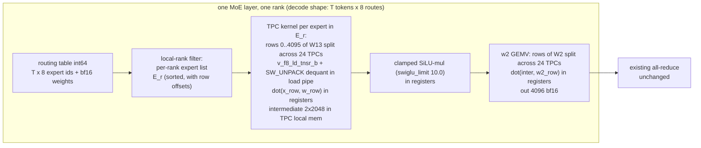

# EXTERNAL_RESEARCH_PROPOSALS.md

Independent performance research for GLM-5.3-Flash on 8× / 4× Intel Gaudi 2.

- **Author:** independent research architect (research-only; no HPU access, no implementation)
- **Date:** 2026-11-07 (revision 1)
- **Status of this document:** official research handoff channel. The implementation agent updates the
  `Status:` field of each proposal and appends to `## Research history`. Do not delete prior proposals.
- **Status vocabulary:** `PROPOSED` (new, unreviewed) → `IN REVIEW` → `IN PROGRESS` → `MEASURED` →
  `ADOPTED` / `REJECTED` / `SUPERSEDED` (with experiment ID).
- **Evidence labels:** `MEASURED` (project or cited third-party run), `VENDOR` (tier B corpus source),
  `DERIVED` (theoretical computation from measured inputs — the computation is shown).

---

## Executive summary

### Current architecture (verified against checkpoint, deployed tree, and live process, 2026-11-07)

GLM-5.3-Flash (`glm5_next`) is a hybrid decoder. From `/data/models/GLM-5.3-Flash/config.json`:

- **45 layers + 1 MTP layer:** 34 KDA (gated delta net / Kimi Delta Attention) layers,
  11 DSA layers (MLA: `kv_lora_rank` 512, 64 heads × 256-dim NoPE + 256-dim V, plus a top-2048
  key-indexer with 32 index heads and 4×128 compressed index keys per token).
- **MoE:** 42 sparse layers, 288 routed experts, top-8, `moe_intermediate_size` 2048,
  1 shared expert, clamped SwiGLU (`swiglu_limit` 10.0), `n_group` 1 / `topk_group` 1.
  3 dense layers (first_k_dense_replace, intermediate 12288).
- **mHC hyper-connections:** 4 streams per token, 20-iteration Sinkhorn mixing
  (fused TPC kernel in this port, `GLM5_NEXT_MHC_SINKHORN=kernel`).
- **Precision:** block FP8 E4M3 (128×128 blocks, dynamic activations) for MoE/dense/MLA projections;
  BF16 for KDA/DSA attention, embeddings, lm_head, MTP shared head.
- **Weight mass (DERIVED from config dimensions, cross-checked to the 328.3 GB checkpoint total
  within 1.4%):** MoE routed experts **305.5 GB (93.0%)**, attention+KDA+indexer 14.2 GB,
  dense 0.45 GB, shared experts 1.06 GB, embed+lm_head+shared_head 3.81 GB (BF16).

Serving stack (live process verified): vllm-gaudi v0.26.0 (b059f9c), Gaudi SW 1.24.1, lazy mode,
TP8+EP8 dev / TP4+EP4 deployment candidate, MTP k=1 + the adopted Q18 levers
(`GLM_ROUTER_FAST=1`, `GLM_SPEC_DEVICE_REJECT=1`, `GLM_EARLY_DRAFT=1`, byte-identical greedy).

Best verified numbers (8 HPUs): bs=1 decode **38.3–39.1 tok/s**; aggregate @16 **181–185 tok/s**;
prefill 3.3–5.7K tok/s warm at 0.5–8K (objective band met at most depths); 1M context serving-validated
(needle at 860,739 tokens). 4 HPUs (Q14): bs=1 33.26, aggregate @16 113.5, accuracy 100%.

### Where one decode step's time goes

| Item | Value | Source |
|---|---|---|
| bs=1 per-token wall (1/38.3 s, adopted stack) | **26.1 ms** | MEASURED (EXP-Q19 steady state) |
| bs=1 MTP step time (k=1, 1.88 tok/step) | **≈ 48.4 ms** | DERIVED (26.1 ms × 1.88) |
| bs=1 non-MTP step time (1/30.3 s, 1 tok/step) | **≈ 33.0 ms** | DERIVED from MEASURED 30.1–30.3 |
| bs=1 host floor H (step − device byte-time) | **≈ 12 ms (non-MTP) / ≈ 26 ms (MTP k=1)** | DERIVED (48.4 − 21 device; 33.0 − 21 device, stock op 40–41 GB @ ~1.9 TB/s); to be replaced by D1 |
| Recipe launches per step | **322** @ ~74 µs host each ≈ **23.8 ms host** | MEASURED, cookbook step-anatomy study (GLM-5.3 MXFP4, TP8+EP8, v0.24 — same model family, one vLLM older; must be re-derived on the current FP8 tree, diagnostic D1) |
| Device span, compute engines busy | 15.4 ms of 37.4 ms device span | same study |
| Expert kernels, slowest EP rank | 19.5 ms (mean rank 9.6 — EP imbalance, not a hot rank) | same study |
| MLA decode attention | 6.9 ms | same study |
| All-reduce latency | 162 per step × ~20 µs ≈ 3.4 ms | same study; 20–30 µs small-message regime confirmed by independent 8-card Gaudi2 measurements [GG: comm-gaudi2-8card.json, tier D] |
| Host work with device idle (step boundary) | ~5.5 ms (cut to ~2–3 by the adopted Q18 levers) | same study + EXP-Q18 |
| AIP utilization during decode | 0–24% | MEASURED (EXP-OPT-001) |

**Interpretation (DERIVED):** the step is host-launch-bound at *every* batch size. The host issues
~322 recipe replays serially (~24 ms); device work (weight streaming + compute) hides underneath and
only the tail is exposed. AIP 0–24% is the signature: the compute fabric is mostly waiting for the host.
This holds for bs=1 (26 ms wall ≈ 24 ms host floor) and for 16 streams (the host cost is per-step and
independent of row count because bucketing pads to fixed shapes).

**Second independent fact (DERIVED byte model, op behavior to be confirmed by D2):** the stock
`mixture_of_experts` op consumes *all* local experts' weights per call (36/rank at TP8+EP8; the
Q16 gather experiment was designed and measured against exactly this premise, and the op's signature
takes the full per-expert weight lists [GG: habana_eager/ops/mixture_of_experts.cpp, tier B]).
At bs=1 the step's tokens route to 8–72 of 288 experts → 1.0–3.0 experts actually touched per rank
(Poisson expectation 36 × R/288, R = total routes: 8 at k=0, 24 at k=1, 72 at k=4). The op therefore
streams **~6.6×–13× more expert bytes than the routing needs** at bs=1 (41.3 GB vs 6.3 GB per step
per card at k=1; 40.0 vs 3.0 at k=0; table below). This is the dominant device-side waste, and it is
why bs=1 sits at 30–39 tok/s while the hardware can stream 1.9–2.2 TB/s of GEMV weights.

**Gaudi 2 weight-streaming capability (cited, not measured on this project):**
- Spec 2.45 TB/s aggregate HBM [GG: whitepaper, tier B]; compiler cost model 1,945 GB/s
  [GG: libSynapse-1.24.1 decompile, tier C]; engine inventory 24 TPC / 2 MME / 10 DMA @ 2000 MHz [tier C].
- M=1 BF16 GEMV measured **1.14 / 1.94 / 2.19 TB/s** at 4.2 / 16.8 / 67.1 MB matrices (third-party
  manual, 4-card Gaudi2 box, tier D) — i.e. 79–90% of spec at exactly our per-expert matrix shapes.
- TPC stream envelope 2,147 GB/s (86% of spec) at ≥134 MB [tier D]; community split ~1.5 TB/s TPC vs
  ~300 GB/s MME HBM share [tier D] — **GEMV weight streaming must run on TPC, not MME, to be
  bandwidth-bound at the right number.**
- 24 KB all-reduce ≈ 20 µs; 2 GB all-reduce 250 GB/s busbw [tier D] — comm is not the constraint at
  decode payloads.

### Target physics (theoretical ceilings)

Bytes per step per card (DERIVED; model = expert 25.17 MB incl. scales; TP8: MoE 38.2 GB,
attn+dense 1.9 GB, lm_head 0.16 GB, shared_head 1.27 GB under MTP; TP4: MoE 76.3 GB, attn+dense 3.7 GB,
lm_head 0.32 GB). "Routed" = kernel reads only the experts actually hit by the step's routing table
(expected distinct local experts = L × (1 − (1−1/288)^R), R = total routes).

bs=1 ceilings (tok/s = tokens-per-step ÷ (bytes ÷ BW); pure HBM streaming, **excludes** host/AR
overhead — so real numbers will be below these):

| Layout | MoE read | MTP | GB/step | @1,696 (69%) | @1,945 (compiler) | @2,147 (TPC stream) | @2,450 (spec) |
|---|---|---|---:|---:|---:|---:|---:|
| TP8+EP8 | stock (all 36) | k=0 | 40.0 | 42 | 49 | 54 | 61 |
| TP8+EP8 | stock | k=1 (1.88 tok) | 41.3 | 77 | 89 | 98 | 111 |
| TP8+EP8 | stock | k=4 (3.33 tok) | 41.3 | 137 | 157 | 173 | **197** |
| TP8+EP8 | routed | k=0 (8 routes) | 3.0 | 559 | 642 | 708 | 808 |
| TP8+EP8 | routed | k=1 (24 routes) | 6.3 | 506 | 580 | 640 | 731 |
| TP8+EP8 | routed | k=4 (72 routes) | 11.7 | 483 | 554 | 612 | 698 |
| TP4+EP4 | stock (all 72) | k=0 | 80.1 | 21 | 24 | 27 | 31 |
| TP4+EP4 | stock | k=1 | 81.4 | 39 | 45 | 50 | 57 |
| TP4+EP4 | stock | k=4 | 81.4 | 69 | 80 | 88 | 100 |
| TP4+EP4 | routed | k=0 | 6.1 | 280 | 321 | 354 | 404 |
| TP4+EP4 | routed | k=1 | 11.3 | 281 | 322 | 356 | 406 |
| TP4+EP4 | routed | k=4 | 22.1 | 255 | 293 | 323 | 369 |

Aggregate @16 active sequences (32 verify + 16 draft rows = 48 tokens × 8 routes = 384 routes →
**all** local experts hit; routing-aware buys nothing here; 28.8 tokens/step at k=1):

| Layout | GB/step | @1,696 | @1,945 | @2,147 | @2,450 |
|---|---:|---:|---:|---:|---:|
| TP8+EP8 | 41.3 | 1,182 | 1,356 | 1,497 | 1,708 |
| TP4+EP4 | 81.4 | 600 | 689 | 760 | 867 |

**Consequences (DERIVED; these are the load-bearing conclusions of this document):**

Host-inclusive ceilings: step time = bytes ÷ BW + host floor H, with H ≈ 12–26 ms on the current tree
(non-MTP / MTP k=1, derived above; D1 replaces the estimate). tok/step: k=0 = 1, k=1 = 1.88 (project
measured acceptance), k=4 = 3.33 (reference measured, tier D).

1. **200 tok/s single-stream on 8 HPUs is physically impossible on the stock MoE op** — even MTP-4 at
   100% of spec bandwidth caps at 197 tok/s (table row 3, host excluded, so real is lower). This
   confirms and sharpens the DECISIONS.md rejection with a tighter ceiling.
2. **200 tok/s on 8 HPUs needs the routing-aware kernel AND deep MTP AND a host cut — all three.**
   The BW-only roofline is generous (24–27% of spec at k=0/1), but the measured host floor dominates:
   at the current H, k=1 caps at ~70–129 tok/s and k=4 at ~113–191 tok/s. Reaching 200 requires
   k=4 (RA-004) + host ≤ ~10 ms (RA-001 must cut the ~26 ms MTP floor ~60%) + kernel effective
   ≥ ~72% of spec BW (11.7 GB ÷ 6.65 ms device budget = 1.76 TB/s). k=1 alone would need host ≤ 6.5 ms
   *and* ~88% of spec — a harsher joint requirement. The three levers are not substitutes for each other.
3. **200 tok/s single-stream on 4 HPUs is a stretch target, not a base case.** BW-only it needs
   49–54% of spec (k=1/4); host-inclusive it is reachable only in the joint best case: k=4 + host
   ≤ ~10 ms + kernel ≥ ~89% of spec (22.1 GB ÷ 6.3 ms). The realistic 4-HPU bs=1 after the full lever
   stack is **~140–250 tok/s (expected ~180)**; stock-op 4-HPU ceiling is 31–100 even at spec BW.
4. **800 tok/s @16 on 4 HPUs is impossible at k=1 and comfortably feasible at k=4.** k=1: 28.8 tok/step
   over 81.4 GB needs ≥ 92% of spec BW *with zero host* (table) — above the best measured GEMV
   streaming (90%, B10). k=4: 53.3 tok/step over ~80 GB in a 66.8 ms step budget needs only
   **60–80% of spec BW** at host 12–26 ms — inside demonstrated capability (79–90% measured at M=1;
   the 48+ row shapes remain streaming-dominated). So the 4-HPU aggregate target **requires RA-004
   (k=4) and RA-003 (16 active)**; it does not require the routing kernel (all experts are hit at
   16 active). **An owner decision is required (RA-005).**
5. **The aggregate target at high batch is host-bound, not bandwidth-bound, today — and the
   multi-row host cost is larger than the bs=1 host cost.** Measured: 8 active streams run a
   ~82 ms step (183 tok/s ÷ 15 tok/step) against ~21 ms of device byte-time — an unexplained ~61 ms
   host-side term that is ~2.5× the bs=1 host floor. D1 must decompose it (sampler/scheduler/logprob
   work scales with rows; the 322×74 µs launch model was derived at bs=1). RA-003 (16 active) is
   expected to move the aggregate to ~330–400 tok/s on today's host; closing the gap to 800 @ 8 HPUs
   (BW-feasible at 66–92% of spec) additionally requires cutting that multi-row host term.

---

## Highest-priority proposals (ranked by impact × feasibility)

| Rank | ID | Title | One-line mechanism | Expected impact (theoretical) | Effort | Status |
|---|---|---|---|---|---|---|
| 1 | **RA-002** | Routing-aware fused block-FP8 dequant GEMV MoE kernel (Q21 sharpened) | TPC kernel reads only the routed experts, dequantizes in the load pipe, row-parallel across all 24 TPCs | 6.6× expert-byte cut at bs=1 (k=1); the only path to the 200 tok/s roofline on 8 HPUs and to any competitive bs=1 on 4 HPUs | High (weeks) | PROPOSED |
| 2 | **RA-001** | Decode tensor cache under MTP (port the per-call cache policy) | Re-enable the HPU-graph tensor cache for decode shapes; removes per-replay re-allocation host work from ~322 replays/step | host floor −30–60% (the binding constraint on 200 @ 8 HPU k=4 and on 800 @16); bs=1 +10–40%, aggregate @16 +15–50% | Low (days) | PROPOSED |
| 3 | **RA-003** | max-num-seqs 16 (32 verify rows) aggregate unlock | Host cost is per-step not per-row; double active rows under the same launch budget | aggregate @16 183 → 330–400 (expected); required for any 800@16 on 4 HPUs | Low–Medium (days) | PROPOSED |
| 4 | **RA-004** | MTP k=4 as one graphed draft chain (no early-draft) | The 4-step draft chain becomes a single HPU graph replay; deep speculation on the post-RA-002 device floor | bs=1 3.33 tok/step: 113–191 on 8 HPUs at current host, ~200+ with RA-001; **required for 800@16 on 4 HPUs** (k=1 is BW-infeasible there) | Medium–High | PROPOSED |
| 5 | **RA-005** | 4-HPU target physics audit and deployment plan | Decision document: which targets are reachable on 4 cards and what each requires | no direct perf; forces the 800@16-TP4 scoping decision | None (doc) | PROPOSED |

**Suggested execution order** (dependencies, not ranks):
1. Diagnostic D1 (8-rank profile of the *current* FP8 step) — sizes RA-001 and RA-002 host/device
   shares on our exact tree (1–2 boots, method already documented in `docs/results/moe-decode-step.md`).
2. **RA-005 decision memo** (no HPU time) — owner scopes the 4-HPU aggregate target.
3. **RA-001** (days) — smallest change, biggest host-floor attack, independent of everything.
4. **RA-003** (days, parallel with RA-001's validation) — config + graph family + KV sizing.
5. **RA-002** (weeks, continues Q21) — with the design constraints below; D2 first (confirm the stock
   op's expert read pattern) so the baseline ceiling is a measured fact.
6. **RA-004** (after RA-002) — k=4 on the new device floor.

---

## Detailed proposals

### RA-001 — Enable the HPU-graph decode tensor cache under MTP

**Status:** PROPOSED · **Priority:** 2 · **Complexity:** Low · **Owner (suggested):** primary agent

#### 1. Executive summary

The deployed runner wraps the model with `wrap_in_hpu_graph(..., disable_tensor_cache=True)`
(verified: `/opt/glm53/vllm-gaudi/vllm_gaudi/v1/worker/hpu_model_runner.py` lines 1118–1120 and 5030).
With the tensor cache disabled, *every one of the ~322 recipe replays per step* re-allocates its
tensor set (the vendor wrapper replaces cached tensors with empty tensors after each replay when the
cache is off; `dry_run` is forced on). The reference fork (abotsis 919ec98f) made this a **per-call
policy**: decode graphs keep the cache (removing per-replay host work), prefill graphs keep it
disabled (GB-sized intermediates), selected by reading `PT_HPUGRAPH_DISABLE_TENSOR_CACHE` inside the
wrapped forward [GG: abotsis-vllm-gaudi `vllm_gaudi/v1/worker/hpu_model_runner.py` l.1134+, tier D].
They run it for `glm5_next` **without** spec decode and disable it under MTP — but that decision was
made for *their* graph population (MTP-4, up to 80-lane verify graphs, ~7 GB host RSS per worker on a
125 GB host). Our population is an order of magnitude smaller (144 prompt + 16 decode graphs with lin
tamed buckets, ~200 with MTP k=1 verify shapes), the same 125 GB host has ~83 GB available right now,
and the host-launch pipeline is the measured step bottleneck at every batch size. Enabling the cache
for decode-shaped replays is a one-line wrapper change plus an env gate.

#### 2. Current limitation

- Measured: bs=1 wall 26.1 ms with ~0–24% AIP utilization (EXP-Q19, EXP-OPT-001); the step-anatomy
  study attributes ~23.8 ms of a 39 ms step to 322 launches × ~74 µs host each (v0.24 MXFP4 stack —
  D1 must re-derive this on our FP8 tree).
- Measured (vendor source, tier B): with `disable_tensor_cache=True` the wrapper forces `dry_run=True`
  at capture and "tensors in the graph will be replaced with empty tensors after replaying to save
  memory" [GG: habana_frameworks/torch/hpu/graphs.py `wrapped_hpugraph_forward`/`wrap_in_hpu_graph`].
  Per-replay, the runner therefore does allocation + input staging + teardown bookkeeping for every
  recipe — 322 times per step, on the critical host path.
- Measured (reference, tier D): the cache "removes host work from every replayed recipe; ~7 GB RSS per
  worker" and is enabled by default for `glm5_next` when speculative decoding is off [GG: abotsis
  `docs/features/glm53_flash.md` performance notes].

#### 3. Proposed architecture

Port the per-call cache policy into our runner:

1. In `_maybe_wrap_in_hpu_graph` (`hpu_model_runner.py:1118`), stop hard-coding
   `disable_tensor_cache=True`; select the flag per forward from the call context: decode-shaped
   forwards (the spec-decode verify/draft buckets) → cache **on**; prefill/prompt-shaped forwards →
   cache **off**. The reference implementation reads the env var inside the wrapped forward, so the
   policy follows the call without two wrapper instances.
2. Env gate `VLLM_GLM_DECODE_TENSOR_CACHE=1` (default OFF) so the stock boot is bit-for-bit unchanged.
3. Keep `max_graphs`/memory guards: if host RSS of a worker exceeds a threshold (suggested 12 GB
   each, 8 workers ≈ 96 GB on this 125 GB host), log and fall back to the disabled policy.

No graph shape changes, no model changes, no numerical changes (same buffers, same op order — the
cache changes *which* buffers are reused, not the math).

#### 4. Technical feasibility

- The `disable_tensor_cache` parameter exists in our exact plugin (1.24.1) — verified in
  `/opt/glm53/venv/.../habana_frameworks/torch/hpu/graphs.py` (tier B source in the corpus).
- The reference fork runs the identical feature on the identical model/hardware/software and reports
  it as host-work-removing (tier D). The only question is whether the host-RAM cost fits *our* graph
  count — it does by a wide margin (DERIVED: 7 GB ÷ their ~2,000+ graphs ≈ 3.5 MB/graph × ~200
  graphs ≈ 0.7 GB/worker; even a 5× error stays < 12 GB).
- Bit-identity is expected but NOT guaranteed (in-place reuse of retained buffers can change
  initialization of never-written regions — the `free_inplace` flag exists precisely for this). The
  validation below treats bit-identity as a *check*, not an assumption.

#### 5. Expected performance impact (all theoretical until measured)

| Metric | Baseline (adopted stack) | Conservative | Expected | Best |
|---|---|---|---|---|
| bs=1 decode | 38.3 tok/s | +5% (39) | +15–25% (44–48) | +40% (54) if the allocation/teardown is ≥40% of the 74 µs |
| Aggregate @16 | 183 tok/s | +10% (200) | +25–50% (230–275) | +60% (290) |
| Host RSS/worker | ~4–6 GB (current) | +1 GB | +2–4 GB | +7 GB (their figure) |
| Prefill/TTFT | unchanged | unchanged | unchanged | unchanged |

Rationale: the host floor is ~24 ms of ~26 ms (bs=1). Removing a fraction `f` of the per-replay work
cuts the floor by ~`f` × 24 ms; at f = 0.25–0.5 that is 6–12 ms → +30–70% on the floor alone,
discounted by the device tail that becomes exposed. At 16 streams the same host floor bounds the
aggregate (tokens/step ÷ step time with step time ≈ max(host, device)).

#### 6. Implementation complexity — Low

One wrapper change + env gate + RSS guard in `hpu_model_runner.py`; no kernel, no model, no patch
chain. The reference diff is available in the corpus (abotsis `hpu_model_runner.py`,
`_maybe_wrap_in_hpu_graph` region) for the anchor pattern.

#### 7. Risks

- **Correctness:** low but nonzero — buffer reuse across replays (mitigate: `free_inplace` semantics
  check + the byte-identity R003 logprob probe + 40-item suite, same-boot A/B per the EXP-Q15 gate
  policy).
- **Memory:** host RAM is the constraint, not HBM. 83 GB available now; guard at 12 GB/worker.
  HBM: unchanged (the 25.5 GiB graph ladder is already allocated either way).
- **Compatibility:** if a future vllm-gaudi release changes the wrapper contract, the anchor check
  (fail-closed, per this repo's patch conventions) must catch it.
- **Interaction:** the cache is *orthogonal* to async replay (which is a measured regression — see
  Rejected) and to mark_step placement (B023 was neutral). No known conflict with the Q18 levers.

#### 8. Dependencies

- D1 (below) to know the per-replay cost split before/after.
- A boot window (server is dev-dedicated; no approval needed per AUTONOMY_POLICY).

#### 9. Implementation instructions

1. Read `docs/results/moe-decode-step.md` §"The method" (steps 1 and 5) and run **D1** on the current
   boot: 8-rank torch.profiler (CPU+HPU) over ~10 warm decode steps at bs=1 and 16 streams; count
   recipes/step, per-replay host time, host gaps with device idle. This is the pre-change baseline
   and the sizing input for RA-002.
2. Port: in `vllm_gaudi/v1/worker/hpu_model_runner.py`, modify `_maybe_wrap_in_hpu_graph` (l.1118)
   and the second wrap site (l.5030) to pass `disable_tensor_cache` per-call as in the reference
   (corpus: abotsis-vllm-gaudi `hpu_model_runner.py` l.1134–1186). Gate on
   `VLLM_GLM_DECODE_TENSOR_CACHE=1`. Add the RSS guard (psutil or `resource.getrusage`).
3. CPU contract test: the flag plumbing (decode-shape → on, prompt-shape → off, env off → stock
   behavior) — follow the `tests/cpu/check_*.py` pattern.
4. HPU A/B (same-boot family, per the EXP-Q15 gate policy): boot ON vs OFF; measure bs=1 (5 reps),
   16-stream aggregate (steady reps), acceptance, R003 logprob byte-identity, 40-item suite ×2;
   record host RSS per worker and D1 delta.
5. Record in `EXPERIMENTS.md` as EXP-RA-001; update TASKS B010–B012 (host/graph overhead, currently
   NOT INVESTIGATED) and the discovery queue.

#### 10. Validation criteria

- PASS: bs=1 median ≥ 42 tok/s (≥ +10%) AND aggregate @16 ≥ 200 tok/s (≥ +10%) with accuracy suite
  delta ≤ 0.5 pp (same-boot A/B) and R003 logprobs byte-identical, host RSS ≤ 12 GB/worker.
- PARTIAL: one axis positive ≥ +10%, the other neutral — keep the lever, re-profile (D1) to locate
  the residual host cost.
- FAIL: neutral on both axes after D1 shows the per-replay allocation was < 5% of launch cost —
  record as negative (the 74 µs is then replay-submission-dominated, which re-weights RA-002's host
  assumptions).

#### 11. Novelty assessment

Not previously attempted in this project. Distinct from B023 (removing a *recipe boundary* — measured
neutral here) and from async replay (changing the *threading* of replay — measured regression by the
reference). This changes *what the wrapper does per replay* (buffer lifecycle). The reference fork's
"off under spec decode" was a host-RAM decision at 10× our graph count; our tamed-bucket population
removes that objection (DERIVED size above + 83 GB free host RAM measured today).

---

### RA-002 — Routing-aware fused block-FP8 dequant GEMV MoE kernel (sharpening Q21)

**Status:** PROPOSED · **Priority:** 1 · **Complexity:** High (weeks) · **Owner (suggested):** primary agent

#### 1. Executive summary

Replace the stock `mixture_of_experts` op for decode-shaped calls with a TPC kernel that (a) reads
only the experts actually routed to on the rank, (b) dequantizes block-FP8 weights in the load pipe
(`v_f8_ld_tnsr_b` + `SW_UNPACK`), (c) performs the w13 GEMV, clamped-SwiGLU, and w2 GEMV entirely in
registers/TPC local memory, and (d) distributes each expert's 4096 output rows across all 24 TPCs so
the whole card's HBM stream feeds one expert at a time. This is the Q21 track (1Cat `block_fp8_dequant`
core, `--extra-kernel` framework) with five additions this research contributes: the exact byte/ceiling
model that sets the target (§2/§5), the full-card row-parallel distribution requirement that beats the
v7/v8 kernels' per-route cost (§4), the in-kernel intermediate (no HBM round trip), the single-op-library
fix for the Q21 step-2 blocker (§6), and the MTP-depth interaction table (§5).

#### 2. Current limitation

- MEASURED: bs=1 38.3 tok/s (26.1 ms/step); the step-anatomy study's device span shows the expert
  kernels as the largest device term (19.5 ms slowest rank, 9.6 ms mean — EP imbalance from the
  all-experts read + balls-in-bins).
- DERIVED (byte model, §Executive summary): the stock op streams 40–41.3 GB/step/card at bs=1 (TP8)
  while the routing table needs 3.0 GB (k=0) to 11.7 GB (k=4) — a **6.6× excess at k=1, 13× at k=0**
  (41.3 vs 6.3 GB). The Q16 experiment (gather 16 of 36 experts) confirms the stock path reads all
  local experts and shows *why* naive gather loses: materializing a dequantized copy (index_select +
  fp32 down-GEMM) costs more than the savings.
- MEASURED (cited): a plain M=1 GEMV streams 16.8 MB of weights at 1.94 TB/s (79% of spec) [GG:
  gaudi2-hbm-engine-bandwidth B10, tier D] — the hardware can serve the routed-only byte budget in
  ~1.5–2 ms/step at bs=1; the stock path cannot get there at any bandwidth because it moves 13× the
  bytes.
- The cookbook's own MXFP4 MoE kernels (v7/v8, `kernels/mxfp4-moe/`) prove the decode-sized
  routed-expert TPC pattern on this model family: 66 tok/s vs ~37 stock (moe-decode-step.md).

#### 3. Proposed architecture

- **One kernel per expert, one launch per rank per layer** (or a loop kernel over E_r — decide at
  implementation; the loop version has fewer launches, which matters because launch cost is the
  host floor). T ≤ 32 tokens and ≤ 128 routes per call (the established decode scope of
  `kernels/mxfp4-moe/`), otherwise fall through to the stock op (prefill keeps the stock path).
- **Row-parallel distribution:** GEMV rows are independent (y_i depends only on row i of W), so an
  expert's 4096 w13 output rows split 512-per-AIP across all 8 AIPs / 24 TPCs with **no cross-engine
  reduction** — each TPC reads 1/24 of the expert (≈1.05 MB of the 25.2 MB) at the full card stream
  (DERIVED: 25.2 MB ÷ 2.147 TB/s ≈ 11.7 µs per expert at B10's TPC-stream envelope, vs the v7
  kernel's ~47 µs/route at MXFP4's 12.6 MB, which implies a single-AIP-class read share of ~268 GB/s).
  This distribution is the specific design constraint that must be met to beat v7's per-route cost
  with 2× the bytes of MXFP4.
- **In-kernel intermediate:** the 2048-dim intermediate (4 KB bf16) stays in TPC local memory/SRAM
  between the w13 and w2 phases — no HBM round trip (the Q16 lesson: never materialize the expert
  weights or the intermediate).
- **Numerics:** E4M3 × bf16 scale (scale rounded to BF16 *before* multiply — the checkpoint contract,
  already encoded in `extra/block_fp8_dequant_glm.c`); accumulate in fp32; clamped SwiGLU with
  `swiglu_limit` 10.0 from the fp8 quant config (the contract exists in our vLLM fp8.py, verified).
- **Hook point (verified):** `HPUFp8MoEMethod.apply_monolithic`
  (`/opt/glm53/vllm-gaudi/vllm_gaudi/ops/hpu_fp8.py` l.219) computes `topk_ids`/`topk_weights`
  (int64/bf16, exactly the kernel's inputs) and then calls `_gaudi_fix_moe_gather_apply` (l.283, the
  Q16 fix, inert without env). Branch there: decode shape + `GLM_FP8_MXK=1` → custom op; else stock.
  The Q16 gather path can be retired (it is dominated by design — see Rejected).
- **Build/integration:** `kernels/mxfp4-moe/build.sh --variant glm --extra-kernel
  extra/block_fp8_dequant_glm` (pipeline proven in Q21 step 2: TPC gate PASS, 3254 GUIDs).
  **Op-library fix:** do NOT ship a second op `.so` — the Q21 step-2 blocker (commit 16685a3) is
  that a second `TORCH_LIBRARY_IMPL(custom_op, HPU)` re-triggers dispatcher lazy-init and
  double-registers built-ins. Merge the new op into the *existing* `libmxk_op_lazy.so` build (one op
  library per process; the mHC sinkhorn op already loads through this library in production).

#### 4. Technical feasibility

- Dequant primitive: `v_f8_ld_tnsr_b` / `v_f8_ld_tnsr_partial_b` with `SW_UNPACK` (SW_UNPCK_8_TO_16)
  exist for `__gaudi2_plus__` [GG: tpc-intrinsics.h, tier B]; the 1Cat `block_fp8_dequant_gaudi2.c`
  core (E4M3 + per-128×128 FP32 scales, scales rounded to BF16 pre-multiply — our exact contract)
  compiled cleanly with `tpc-clang -march=gaudi2` on this host (Q21 step 2, MEASURED).
- GEMV pattern: `src/mxk8_core.h` in our repo implements dequant+dot / w13 GEMV + gated activation /
  w2 GEMV for MXFP4; the swap is the dequant unit (E2M1+E8M0 → E4M3+block-scales). v7/v8 reached
  66 tok/s on this model family (MEASURED, moe-decode-step.md).
- Streaming ceiling: B10's M=1 GEMV at 16.8 MB = 1.94 TB/s (tier D) bounds the per-expert time from
  above at 11.7–14.8 µs; the kernel only needs to *not* fall far short of it (load-pipelined,
  `#pragma loop_unroll(4) pipelined taken` as in the 1Cat core).
- Graph capture: custom TPC ops capture into HPU graphs in this tree (the mHC Sinkhorn kernel does,
  in production, `GLM5_NEXT_MHC_SINKHORN=kernel`).
- **Unsupported assumptions to verify:** (i) the stock op really reads all local experts at runtime
  (high confidence from Q16's design + the op signature, but D2 must confirm); (ii) full-card
  row-parallel GEMV achieves ≥ 1.5 TB/s at 25.2 MB experts (B10 measured bf16 at 16.8–67 MB; FP8
  halves the bytes per element — should only help, but the scale loads add traffic: 2×512 FP32
  scales per 256×128 block ≈ +0.4%); (iii) `PT_HPU_LAZY_ACC_PAR_MODE=0` vs the pinned `=1`
  (the Q21 playbook says 0 is required for custom ops on views — the mHC kernel works at 1 but takes
  contiguous tensors; test both, pin whichever works, record in the launch script).

#### 5. Expected performance impact (all theoretical until measured)

Per-expert time at card stream (DERIVED): 25.17 MB → 11.7 µs @2.147 TB/s, 14.8 µs @1.696 TB/s.
Total step bytes from the Executive summary table (MoE routed + non-MoE 1.9/3.7 GB); step =
bytes ÷ BW + host floor H (H = 12–26 ms current tree, 7–16 ms with RA-001; tok/step 1.88 at k=1,
3.33 at k=4):

| Config | bs=1 (routes, distinct/rank) | Total GB/step/card | MoE device time | Step (H 12–26) | tok/s | Step (H 7–16, RA-001) | tok/s |
|---|---|---:|---:|---:|---:|---:|---:|
| TP8+EP8, k=1 | 24, ~3.0 | 6.3 | 1.5–1.9 ms | 14.9–29.7 ms | 63–126 | 9.9–19.7 ms | 95–190 |
| TP8+EP8, k=4 | 72, ~9.0 | 11.7 | 4.4–5.6 ms | 17.5–32.9 ms | 101–191 | 12.5–22.9 ms | 145–267 |
| TP4+EP4, k=1 | 24, ~6.0 | 11.3 | 3.0–3.8 ms | 17.3–32.7 ms | 57–109 | 12.3–22.7 ms | 83–153 |
| TP4+EP4, k=4 | 72, ~18 | 22.1 | 8.8–11.2 ms | 22.3–39.0 ms | 85–149 | 17.3–29.0 ms | 115–193 |

(Stock-op rows for contrast, same method: TP8 41.3 GB → 37–60 tok/s (k=1, H 12–26) — the measured
38.3 sits at the bottom of that range, consistent with the host estimate; TP4 81.4 GB → 25–38 —
the measured 33.3 sits mid-range.)

- **Target metric:** bs=1 decode 38.3 → **95–190 tok/s (8 HPUs, k=1, with RA-001)** and **145–267
  (k=4)**; pure-BW ceilings 506–731 (k=1) and 483–698 (k=4). Aggregate @16 is unchanged by the
  kernel (all experts already touched at 16 active) — that is RA-001/RA-003's job.
- **Best case:** bs=1 ≥ 200 tok/s on 8 HPUs — requires the joint condition of Consequence 2:
  k=4 + RA-001 host ≤ ~10 ms + kernel ≥ ~1.76 TB/s effective (72% of spec).
- **Conservative:** 95–130 tok/s (per-route overhead at v7 level + RA-001 partial).
- **Worst case:** +20–40% (kernel only reaches ~600–800 GB/s effective and host dominates) — still
  the largest single lever, and the only path to any competitive 4-HPU decode number (115–193 with
  k=4 + RA-001).
- Uncertainty drivers: per-route fixed cost (staging the input row, scale loads — v7 paid 47 µs/route
  at half the bytes); EP straggler (the slowest rank carries ~2× the mean routes at bs=1 — the
  Q13 histogram will size this); TPC-vs-MME stream share at small per-TPC footprints (1.05 MB/TPC).

#### 6. Implementation complexity — High

New TPC kernel (core swap + row-parallel layout + loop over E_r), op library merge, runtime hook,
per-shape qualification (2/4/8/16 tokens × 1–128 routes, both EP8 and EP4), parity vs stock, and the
accuracy gate. The scaffolding (build.sh, gates, MANIFEST, variant runtime `mxfp4_moe.py`,
`--extra-kernel` contract) already exists in this repo — this is a kernel + integration project, not a
framework project.

#### 7. Risks

- **Correctness:** fp8 rounding contract (scales rounded to BF16 pre-multiply — already encoded),
  clamped SwiGLU boundary at exactly 10.0, router-weight dtype (bf16 per `apply_monolithic`),
  int64 routing table. Mitigate: CPU oracle vs the stock path at fixed seeds (the repo's parity
  pattern, `tests/run_parity.sh --variant` style), `VERIFY` mode logging ULP deltas (the Q16 fix
  already has this machinery), greedy byte-identity probe on R003.
- **Accuracy gate:** the kernel changes expert math in last-ULP ways; near-tie class may shift —
  same-boot A/B per the EXP-Q15 policy; expect the R003 chaos item to be config-sensitive regardless.
- **Memory:** none new (weights already resident; the kernel reads in place).
- **Runtime stability:** custom ops + lazy mode + graph capture — the mHC kernel proves the class
  works here; keep the fail-closed env switch (`GLM_FP8_MXK=1`, default OFF) and the shape caps
  (T ≤ 32, routes ≤ 128) exactly as the mxfp4 framework enforces them.
- **Effort risk:** the per-route fixed cost may not shrink below ~25 µs even at full card stream
  (input staging + scale loads are serial per expert). If so, the bs=1 win halves but the 4-HPU
  story (RA-005) still holds at k=1.

#### 8. Dependencies

- Q21 step 2 assets (staged: `kernels/mxfp4-moe/extra/block_fp8_dequant_glm/`, gated TPC ELF,
  build pipeline) — continue, do not restart.
- D1 (host/device split) and D2 (stock op expert-read confirmation) — 1–2 boots.
- Q13 (routing histogram) — sizes the EP-straggler term; cheap to run in the same window.
- The 1Cat tree at `/opt/dsv41/1Cat-vLLM-Gaudi` (local, compiled snapshot) as the dequant-core
  reference; license/provenance to be recorded in the port README (Apache-2.0 per the source header).

#### 9. Implementation instructions

1. **D2 first (1 boot, ~30 min):** instrument `apply_monolithic` to log `x.shape[0]`,
   `topk_ids` distinct-local count vs 36, and (if available) per-op HBM counters for one layer;
   or run one bs=1 step with `hl-smi`/profiler per-rank HBM traffic. Record: does the stock op's
   traffic scale with routes (it should not)? This converts the 40 GB/step premise from
   high-confidence-inference to measured fact.
2. **Kernel:** adapt `extra/block_fp8_dequant_glm.c` from the dequant-only form to the GEMV form:
   start from `src/mxk8_core.h` (mxk_w13x / mxk_w2x structure), swap the dequant unit to E4M3 +
   128×128 block scales (reference: 1Cat `block_fp8_dequant_gaudi2.c`), add the row-parallel
   index-space split (each TPC owns a contiguous row band of the 4096), keep the intermediate in
   local memory. One fused op: `glm_fp8_moe_gemv(x[T,4096], topk_ids[T,8], topk_w[T,8],
   w13_list[36], w2_list[36], scales)`.
3. **Build:** `build.sh --variant glm --extra-kernel extra/block_fp8_dequant_glm` with the new op
   merged into `libmxk_op_lazy.so` (single .so — see §3). Re-run both gates; update MANIFEST.
4. **Hook:** branch in `apply_monolithic` (hpu_fp8.py l.283) behind `GLM_FP8_MXK=1` with the
   fail-closed shape caps; retire the Q16 gather branch (superseded).
5. **Qualification ladder:** (a) CPU oracle vs stock at fixed seeds; (b) HPU micro-bench per-expert
   time at 25.2 MB (target: report the achieved GB/s — compare to 1.696/1.945/2.147); (c) full-model
   A/B: bs=1, 16-stream, acceptance, accuracy gate, D1 re-run.
6. Test `PT_HPU_LAZY_ACC_PAR_MODE` 0 vs 1 with the new op (record which the view-based inputs need).

#### 10. Validation criteria

- **Kernel micro-bench:** per-expert (25.2 MB) GEMV at T=1 ≥ 1.5 TB/s effective (≥ 70% of B10's
  1.94) AND parity vs stock (max ULP within the FP8 contract, VERIFY mode clean).
- **End-to-end:** bs=1 median ≥ 80 tok/s (2×) with the adopted levers + RA-001, byte-identical or
  near-tie-class greedy (suite ≤ 0.5 pp same-boot), acceptance held. Aggregate @16 not regressed
  (the kernel must fall through cleanly at T > 32).
- **Failure mode to watch:** if per-route cost stays ≥ 40 µs, bs=1 lands at ~50–60 tok/s — record,
  and the 4-HPU decision (RA-005) proceeds with that number.

#### 11. Novelty assessment

Q21 (RESEARCH status in TASKS) is the same track and is NOT superseded — this proposal adds what it
lacks: (i) the byte/ceiling model that states *what the kernel must achieve* (24–27% of spec BW for
200 t/s on 8 HPUs; 49–54% on 4 HPUs) rather than "beat stock"; (ii) the full-card row-parallel
distribution as an explicit requirement (the v7/v8 per-route cost of 47/25/17.7 µs is the measured
barrier, and it comes from not using the whole card per expert); (iii) the in-kernel intermediate as
the Q16-lesson formalization; (iv) the single-op-library integration fix for the Q21 step-2 blocker;
(v) the MTP-depth byte interaction (k=4 reads 72 routes → 8.0 experts/rank, still 4.5× less than
all-36). No prior experiment in this project attempted routed-only FP8 weight streaming.

---

### RA-003 — max-num-seqs 16 (32 verify rows): the aggregate unlock

**Status:** PROPOSED · **Priority:** 3 · **Complexity:** Low–Medium · **Owner (suggested):** primary agent

#### 1. Executive summary

The serving window runs `--max-num-seqs 8` (serve_mtp.sh) while the aggregate target is measured at
16 client streams — so 8 requests queue. The host cost of a step (the ~322-launch pipeline) is
**per-step, independent of row count** (bucketing pads to fixed shapes); the device cost grows
sub-linearly with rows (weights are read once per layer regardless; at 8+ active sequences all 36
local experts are already touched, so adding rows up to 16 active adds GEMV compute but ~zero
expert bytes). Doubling active rows from 8 to 16 therefore roughly doubles tokens-per-step
(14.4 → 28.8 at k=1) for a modest device-time increase — the aggregate should move from 183 toward
260–400 tok/s. This has never been tested: the port doc's "Do not raise max-num-seqs without
re-checking the verify-row graph shapes" is a caution, and the 16-stream benches were always run
with 8 active.

#### 2. Current limitation

- MEASURED: aggregate @16 client streams = 181–185 tok/s (adopted stack) with max-num-seqs 8
  (EXP-Q18 levers 2-3, EXP-Q02 closure); per-stream ~11.4 tok/s.
- MEASURED: 8 → 16 client streams moved aggregate only 151 → 168 under the split-draft config
  (EXP-Q01) and 125 → 126.7 under eager draft (EXP-Q02/Q03) — i.e. the *extra 8 streams do nothing
  because they queue behind max-num-seqs 8*.
- DERIVED: at 16 active sequences (32 verify + 16 draft rows = 48 tokens × 8 routes = 384 routes)
  every local expert is hit (expected distinct = 36 × (1 − (252/288)^384) ≈ 36.0), so per-card
  expert bytes per step are unchanged from the 8-active case (41.3 GB TP8 / 81.4 GB TP4); tokens/step
  doubles to 28.8 (k=1). Ceiling table: 1,182–1,708 tok/s TP8; 600–867 TP4.
- MEASURED: the step at 8 active already runs ~0.4–0.5 TB/s effective (41.3 GB ÷ ~78–110 ms) — the
  card is nowhere near its streaming ceiling, so +8 rows of GEMV compute (AIP 0–24% today) fits.

#### 3. Proposed architecture

Config + graph family only; no code change:

1. `--max-num-seqs 16` in serve_mtp.sh (and the TP4 script).
2. KV pool: 16 × 32K = 512K tokens. Current override 1280 blocks = 163,840 tokens (1.8 GiB/card,
   MEASURED) → ~5.5 GiB/card needed at 512K (DERIVED, linear in tokens; block semantics per
   EXP-Q10 — derive the exact override from the auto-sizing log at boot, budget ≤ 6 GiB/card).
   Headroom check: 64.1 GiB (MTP window load) + 5.5 ≈ 70 GiB < 78.7 GiB (GMU 0.82 × 96). If tight,
   raise GMU to 0.90 (the 25.5 GiB graph ladder is the first reclaimable block per OPT-002).
3. Verify-row graph family: 16 seqs × (k+1) = 32 verify rows + 16 draft rows. With the pinned decode
   bucket (one bs bucket) and lin tamed prompt buckets, this adds 1–2 decode graph shapes (the 32-row
   verify shape and, if bucketed separately, the 48-row combined shape). First-use capture per new
   shape costs 30–60 s (MEASURED, EXP-Q02 rep1 @16) — pre-warm both shapes in the warm-client
   runbook (RESEARCH-001 addendum 9 already mandates warming decode buckets *as verify batches*).
4. `--max-num-batched-tokens` stays 8192 (decode steps are row-limited, not token-limited, at these
   shapes).

#### 4. Technical feasibility

- vLLM continuous batching admits up to max-num-seqs; the engine, KV allocator, and the MTP
  verify-row machinery already handle 16 client streams (they queue today — the machinery is proven,
  only the admission limit is the cap).
- Graph-count cost is bounded by the bucket pinning (MEASURED graph counts: 144 prompt + 16 decode
  at the current window; +1–2 for the new row shapes).
- KDA candidate-state columns (S+1 = 2 at k=1) are per-request, not per-row — no change.
- The near-tie FP class of the verify shape *does* change (16 vs 8 active rows in the padded verify
  layout) — this is a documented class (ACCURACY.md) and is gated, not a feasibility blocker.

#### 5. Expected performance impact (theoretical)

| Metric | Baseline (8 active) | Conservative (host unchanged) | Expected (RA-001 partial on multi-row host) | Best (RA-001 cuts multi-row host 40%) |
|---|---|---|---|---|
| Aggregate @16 client streams | 183 tok/s | 300–360 (30.1 tok/step ÷ 80–90 ms) | 330–400 | 500–670 |
| Per-stream at 16 active | 11.4 (8 active) | 19–22 | 21–25 | 31–42 |
| bs=1 | 38.3 | unchanged | unchanged | unchanged |
| KV HBM/card | 1.8 GiB | +3.8 GiB (≈5.6 total) | +3.8 GiB | +3.8 GiB |

Step-time assumption: at 16 active the expert weights are already all read at 8 active, so device
time grows only with GEMV rows (~19–24 ms for the 41.3 GB at 1.7–2.1 TB/s + row compute); the
dominant unknown is the multi-row host term — measured ~61 ms at 8 active (82 ms step − 21 ms
device), unexplained, D1. The conservative column carries that 61 ms forward; the best column
assumes RA-001 removes ≥ 40% of it.

#### 6. Implementation complexity — Low–Medium

One launch-flag change, one KV override, one graph-shape pre-warm entry in the runbook, re-validation
(gates + accuracy). No kernel or runner change.

#### 7. Risks

- **Per-stream latency:** at full 16-active, per-stream drops to ~14–20 tok/s (from ~23 at
  8-active-only). The 800 tok/s target is an aggregate objective; document the per-stream tradeoff
  explicitly (E003 policy: aggregate ≠ per-request).
- **Accuracy:** verify-shape FP shift at 16 active rows — near-tie class; same-boot A/B gate.
- **Memory:** KV +5.5 GiB/card; if the boot OOMs, drop to max-num-seqs 12 (24 verify rows) as the
  intermediate step (still 2× tokens/step vs 8).
- **Graph capture:** first-use 30–60 s stalls if the warm client misses a shape — runbook item.

#### 8. Dependencies

- RA-001's A/B boot can carry this (measure 8 vs 16 active in the same boot family, alternating).
- D1 to know the device-tail share at 8 active.

#### 9. Implementation instructions

1. Compute the KV override for a 512K-token pool from the boot auto-sizing log (EXP-Q10 method);
   add `serve_mtp_16seq.sh` = serve_mtp.sh with `--max-num-seqs 16` + the new override.
2. Boot; run the warm-client runbook covering the 32-row verify shape (16 concurrent 1-token
   requests) *before* benchmarking.
3. Bench: 16-client-stream aggregate (steady reps, ≥ 5), per-stream ITL, bs=1 control, acceptance,
   R003 logprob probe, 40-item suite ×2 (same-boot family vs the 8-seq control boot).
4. If OOM or > 10% aggregate regression: fall back to max-num-seqs 12 and record.

#### 10. Validation criteria

- PASS: aggregate @16 ≥ 230 tok/s (≥ +25%) with bs=1 within noise (±5%), suite delta ≤ 0.5 pp
  same-boot, boot OOM-free at GMU ≤ 0.90.
- PARTIAL: +10–25% — keep or revert on owner call (per-stream cost vs aggregate gain); record the
  D1 device-tail share that explains the compression.
- FAIL: < +10% — the step is device-bound at 8 active (record; the aggregate path then is RA-001 +
  RA-002's host/device floor cuts instead).

#### 11. Novelty assessment

Never investigated: A025/B019/E013 measured 8/16 *client* streams but always with max-num-seqs 8, so
the 16-active regime has no data point. The port doc's caution ("verify-row graph shapes") was never
converted into the experiment it describes. The mechanism (per-step host cost vs per-row device cost)
is established by the step-anatomy study (launch count is shape-fixed) + the all-experts-hit routing
math (DERIVED above).

---

### RA-004 — MTP k=4 as one graphed draft chain (without early-draft)

**Status:** PROPOSED · **Priority:** 4 · **Complexity:** Medium–High · **Owner (suggested):** primary agent

#### 1. Executive summary

The project's MTP depth is capped at k=1 because the *eager* draft's host cost grows with depth
(reference measurement: 93 ms host vs 17 ms device per step at MTP-4, tier D), and the split-mode
draft graphs (Q01) were measured to **not stack** with early-draft pipelining (EXP-Q19: 164–173 vs
183–185 @16 — the replay's mark_step+sync discipline serializes exactly the work early-draft
pipelines). The untried combination is the third one: the **whole 4-step draft chain captured as a
single HPU graph** (the reference's "attention-in-graph" mode: metadata tensors — block tables,
slot mappings, attn bias — as graph inputs, the chain's attention included), replayed **once per
step**, with device-side rejection kept and **early-draft off**. One replay instead of four
eager forwards or four graph replays; the sync cost is paid once, not per chain step. The reference
measured this exact mode at MTP-4: acceptance 3.33/5.0, aggregate 26.0 tok/s, parity 12/12 (their
slower stack, tier D).

#### 2. Current limitation

- MEASURED: eager k=1 is the adopted default (+15.1% verified, Stage-1); eager k=2 net-neutral
  (EXP-MTP-002); Q11 (k≥2 revival) is BLOCKED on Q01, and Q01's split mode is accuracy-neutral but
  performance-conflicting with early-draft (EXP-Q19).
- MEASURED (reference, tier D): MTP-4 attention-in-graph: accepted 3.33, aggregate 26.0 vs 20.2
  bypass, single-stream 20.9, parity 12/12; their 80-lane (16 seqs × 5 rows) concurrency is
  near-linear.
- DERIVED: with RA-002's routing-aware kernel the verify step streams 11.7 GB/step (k=4, TP8) —
  the device floor for k=4 is *lower* than for k=1's 6.3 GB + the draft's 4 eager forwards; the
  bottleneck moves to "one cheap graphed chain," which this proposal provides.

#### 3. Proposed architecture

- Extend the existing `_DraftAttnGraphCore` machinery (`ports/glm-5-3-flash/glm5_next_hpu/glm5_next_hpu/mtp.py`,
  already landed for Q01: `_private_copy` storage clones, metadata-as-inputs, `set_forward_context`
  inside replay) from a **1-step** graph to a **k-step chained** graph: the graph input is the target's
  last hidden state + token ids + metadata; internally the chain runs 4 draft forwards (each consuming
  the previous step's output and writing the KDA candidate-slot columns — the existing S+1 column
  machinery generalizes to S=5); the graph output is the 4 draft token ids + the 5 draft hidden states
  for the 5-row verify.
- One replay per step, after the target verify, with the existing seam discipline
  (mark_step + sync around the replay — paid once).
- `GLM_EARLY_DRAFT=0` in this configuration (it conflicts with the replay sync by measurement,
  EXP-Q19); `GLM_SPEC_DEVICE_REJECT=1` stays (it is post-sampler, independent of the draft path).
- Verify row count = seqs × 5 (k+1). At 8 seqs: 40 verify rows + 8 draft rows — within the existing
  capture size 2048; at 16 seqs (RA-003): 80 verify rows = the reference's 80-lane shape (their
  measured near-linear concurrency point).
- KDA spec state: S+1 = 5 candidate columns (the churn/chain parity tests in `tests/cpu/`
  parameterize S — extend the test, not the algebra).

#### 4. Technical feasibility

- The reference ships this mode with measured MTP-4 numbers and 12/12 parity (tier D) — feasibility
  on the same model/hardware is demonstrated; the port is an adaptation (the Q01 port of the same
  family is already in-tree and CPU-verified).
- `dry_run=False` is load-bearing for chained graphs (upstream measured deterministic garbage from
  the first post-capture replay under dry run — EXP-Q01 iteration notes).
- The private-storage clone cost scales with the chain's module set (layer 45 + shared head ≈
  0.9 GiB/rank, unchanged from k=1 — the chain reuses the same modules).
- **Unsupported assumptions:** (i) the chain graph captures cleanly with the KDA candidate-slot
  writes in-graph (Q01 captured 1 step; 4 chained steps with in-graph state updates is new —
  mitigate: CPU parity first, then single-step HPU, then 4-step); (ii) acceptance holds at k=4 on
  our prompts (reference: 3.33/5.0 — our k=1 acceptance 1.88/2.0 is at the same ratio,
  94%, so the decay shape is consistent); (iii) the 40/80-row verify graph family fits the HBM
  graph budget (capture 2048 at TP8; +25.5 GiB ladder already allocated — the 25.5 GiB is the first
  reclaimable block if needed, OPT-002).

#### 5. Expected performance impact (theoretical)

Bytes/step from the Executive summary table (routed k=4: TP8 11.7 GB, TP4 22.1 GB; 16 active: all
experts, 41.3/81.4 GB). Step = bytes ÷ BW + H + ~1 ms chain replay; H = 12–26 ms current, 7–16 with
RA-001; tok/step = 3.33 bs=1, 53.3 at 16 active:

| Config | tok/step | Step (H 12–26) | tok/s | Step (H 7–16, RA-001) | tok/s |
|---|---:|---:|---:|---:|---:|
| 8 HPU bs=1 (TP8, 11.7 GB) | 3.33 | 18.4–33.9 ms | 98–181 | 13.4–23.9 ms | 139–248 |
| 8 HPU @16 active (RA-003, 41.3 GB) | 53.3 | BW-ceiling 20–26 ms → 2,040–2,660; realistic with the measured multi-row host term (~61 ms at 8 active, D1) 80–90 ms | 590–665 | 56–61 ms | 870–950 |
| 4 HPU bs=1 (TP4, 22.1 GB) | 3.33 | 23.3–40.0 ms | 83–143 | 18.3–29.9 ms | 111–182 |

- **Target:** bs=1 on 8 HPUs 38.3 → 98–181 tok/s with RA-002 at the current host, 139–248 with
  RA-001. Standalone on the current stack (stock op, k=4): ~68 tok/s (same step as k=1, 3.33 vs 1.88
  tok/step: 38.3 × 3.33/1.88). **Conservative:** 80–120 (chain-replay sync costs 10–15 ms,
  acceptance 3.0). **Worst case:** 40–60 (chain capture fails to stay graphable → falls back to k=1;
  the investment survives as the k=2 capability, which is the Q11 minimum).
- Note: Consequence 2 shows k=1 + RA-001 + RA-002 caps at ~126–190 on 8 HPUs — **k=4 is not optional
  margin for the 200 target, it is required** (with host ≤ 10 ms + kernel ≥ 72% of spec it reaches
  200–248). And it is the *only* path to 800@16 on 4 HPUs (Consequence 4: k=1 is BW-infeasible there
  at any host level).

#### 6. Implementation complexity — Medium–High

The Q01 port (CPU-verified, in-tree) is the base; the delta is chain-in-graph (metadata plumbing for
4 steps, S=5 column algebra test, 40/80-row verify graph family, warm-client entries). No new kernel
work (the draft layer reuses the existing target/draft ops; if RA-002 lands first, the draft's MoE
call can also take the routed-GEMV path at 1-row shapes — optional, later).

#### 7. Risks

- **Accuracy (highest):** the 5-row verify shape changes the FP near-tie class (documented,
  ACCURACY.md), and the R003 chaos item (EXP-Q15) is exactly this kind of knife-edge. Gate policy:
  same-boot A/B per EXP-Q15; consider a 5-rep × 80-item suite extension (or the I015 boundary
  diagnostics) so a 1-item flip is distinguishable from ≤ 0.5 pp.
- **Graph capture:** 4-step chain with in-graph KDA state writes — new relative to Q01; staged
  rollout (1-step → 2-step → 4-step, CPU parity at each).
- **Memory:** +~0.8 GiB/rank MLA latent cache at 5 draft rows (A027 scaling), +graph ladder for the
  40/80-row shapes; HBM headroom OK at TP8 (70 GiB with RA-003's KV), tight at TP4 (Q14: 11.1 GiB
  free after weights — budget before attempting).
- **Interaction with RA-003:** 80-lane verify at 16 seqs — the reference ran exactly this shape
  (80 lanes) and measured near-linear; our capture ladder must pre-warm it.

#### 8. Dependencies

- Q01's in-tree machinery (landed, CPU-verified, env-gated OFF).
- Q15 resolution or the same-boot gate policy (adopted in DECISIONS.md) for the accuracy verdict.
- RA-002 for the full payoff (optional for the experiment to be meaningful: k=4 vs k=1 A/B on the
  current stack already answers "does the chain graph work").
- Q11 (currently BLOCKED on Q01) — this proposal is the unblock path with a *different* design than
  the one Q11 assumed; update Q11's dependency text to RA-004.

#### 9. Implementation instructions

1. Read EXP-Q01 (design + iterations 1–3) and the reference mode (corpus: abotsis
   `vllm_gaudi/models/glm5_next_mtp.py`, `docs/features/glm53_flash.md` speculative notes;
   `VLLM_GLM_MTP_DRAFT_ATTN`/`VLLM_GLM_MTP_ATTN_GRAPH` behavior).
2. CPU: generalize `tests/cpu/check_draft_graph.py` to chain length k (chain output == k chained
   eager forwards, atol 1e-6, position-0 zeroing held at step 1 only); extend
   `check_kda_spec.py` to S=5.
3. HPU staged: boot with k=1 attn-mode graph (sanity, vs Q01 numbers), then k=2, then k=4; at each:
   acceptance, bs=1, 16-stream, R003 probe, suite.
4. Set the serving config for the experiment: `--speculative-config '{"method":"mtp",
   "num_speculative_tokens": 4}'`, `GLM_EARLY_DRAFT=0`, `GLM_SPEC_DEVICE_REJECT=1`,
   `VLLM_GLM_MTP_DRAFT_GRAPH=1` (attn mode), decode bucket pinned (32-row verify at 16 seqs /
   40-row at 8 seqs... note: rows = seqs × 5).
5. Record EXP-RA-004; update A012/A013/A026 and Q11.

#### 10. Validation criteria

- **Function:** chain graph replays correctly from step 1 (no dry-run garbage — the documented
  failure mode), churn/swap parity at S=5, block-boundary tests (the 639/640/641 set) at k=4.
- **Performance:** bs=1 ≥ 60 tok/s on the current stack (the chain-graph works) and ≥ 120 with
  RA-001+RA-002; acceptance ≥ 3.0/5.0.
- **Accuracy:** same-boot A/B vs k=1, suite delta ≤ 0.5 pp (with the extended suite or I015
  diagnostics to de-noise the chaos item).

#### 11. Novelty assessment

Q11 (BLOCKED) and Q05 (whole-verify-step graph) are the adjacent entries, but neither specifies this
combination: Q11 assumed "Q01 split mode + early-draft" (measured non-stacking, EXP-Q19); Q05
targets the *target* verify graph with the sampler outside; this targets the **draft chain** as one
graph *without* early-draft — the only untried cell of the {eager, split-graph, chain-graph} ×
{early-draft on, off} matrix, and the one the reference measured working at MTP-4.

---

### RA-005 — 4-HPU target physics audit and deployment plan (decision document)

**Status:** PROPOSED · **Priority:** 5 (do immediately — no HPU time) · **Complexity:** None (doc)

#### 1. Executive summary

The master objectives include 200 tok/s single-stream and 800 tok/s @16 **with final deployment on
4 HPUs**. The byte model (Executive summary tables) shows the 4-HPU numbers are not "8-HPU minus 50%":
TP4+EP4 doubles per-card weight mass (76.3 GB MoE vs 38.2), and every target's feasibility changes
class. This proposal states the physics, the required lever set per target, and the one decision the
owner must make. It exists so the implementation agent does not spend weeks chasing a 4-HPU
configuration that is at 92%-of-spec-bandwidth before the 8-HPU levers exist.

#### 2. Current limitation (measured 4-HPU point, Q14)

TP4+EP4, MTP k=1, adopted levers: bs=1 **33.26**, aggregate @16 **113.5**, prefill@2K 1,070 tok/s
(19% of TP8 — the Q07c fixed per-prompt cost dominates short prefill at 4 cards), accuracy 100%,
KV pool 299,593 tokens (320 hybrid blocks; weights leave 11.1 GiB/card free).

#### 3. Target physics on 4 HPUs (DERIVED; BW-only and host-inclusive)

| Target | BW-only (H = 0) | Host-inclusive (H 12–26 ms) | Feasibility |
|---|---|---|---|
| 200 bs=1, stock op, k=1 | 81.4 GB ÷ 9.4 ms = 8.7 TB/s (354% of spec) | — | **Impossible** (measured 33.3) |
| 200 bs=1, stock op, k=4 | 81.4 GB ÷ 16.65 ms = 4.9 TB/s (200%) | — | **Impossible** (BW-only ceiling 100; measured-class 68) |
| 200 bs=1, routed k=1 (RA-002) | 11.3 GB ÷ 9.4 ms = 1.20 TB/s (**49%**) | step budget 9.4 ms < host floor 12 ms — device budget ≤ 0 | **Impossible at k=1**: the host floor alone exceeds the step budget |
| 200 bs=1, routed k=4 (RA-002+RA-004) | 22.1 GB ÷ 16.65 ms = 1.33 TB/s (**54%**) | needs H ≤ ~7 ms (75% host cut) **and** ≥ 2.29 TB/s (93% of spec) simultaneously | **Stretch — plan as unreachable.** Realistic 4-HPU bs=1 after the full lever stack: 83–182 (RA-002/RA-004 tables) |
| 800 @16, k=1 (RA-003) | 81.4 GB ÷ 36 ms = 2.26 TB/s (**92%**) — above the best measured GEMV streaming (90%, B10), with zero host | — | **Impossible at k=1** on 4 HPUs at any host level |
| 800 @16, k=4 (RA-003+RA-004) | 80 GB ÷ 66.8 ms = 1.20 TB/s (49%) | 1.46–1.96 TB/s (**60–80% of spec**) at H 26→12 | **Feasible** — inside demonstrated capability (79–90% measured at M=1); routing kernel not needed (all experts hit at 16 active) |
| 800 @16 on 8 HPUs (contrast), k=1 | 41.3 GB ÷ 36 ms = 1.15 TB/s (47%) | 1.61–3.55 TB/s depending on H; BW-feasible | BW-feasible; the binding constraint today is the measured multi-row host term (~61 ms at 8 active, unexplained — D1) |

Host/AR overheads (3.4 ms AR + host floor) apply to every row; the "BW-only" column is the best
possible case. tok/step: k=1 = 28.8 (16 × 1.88), k=4 = 53.3 (16 × 3.33) at 16 active.

#### 4. Deployment plan (if the owner confirms the targets)

Phase A (8 HPUs, now): RA-001 + RA-003 + RA-002 (+ RA-004) — establish the 8-HPU best on all axes;
this is the Phase-2 work already queued.
Phase B (4 HPUs, after A): re-run the Q14 benchmark pass with the A levers (routing-aware kernel
re-qualified at EP4 shapes: 72 local experts, up to 18 routed/rank at k=4 — the shape caps must be
re-checked); **the 800@16 target runs with the k=4 serving config (RA-004) — k=1 cannot reach it
on 4 cards**; RA-001/RA-003 carry over unchanged (graph count is smaller at 4 cards); TP4 prefill
short-depth (Q07c) needs the fixed-cost fix to meet the band at 4 cards (it is 19% of TP8 at 2K).
Phase C: 1M context at 4 HPUs (pool budget ~9.5 GiB/card ≈ 1.2M tokens — plausible, untested;
Q14 caveat).

**Recommendation to the owner (the decision RA-005 exists to force):**

- **200 tok/s single-stream on 4 HPUs: plan as unreachable; re-scope it.** It requires host ≤ ~7 ms
  (a 75% cut of the current ~26 ms MTP floor) **and** ≥ 93% of spec HBM bandwidth simultaneously —
  the extreme of both at once. Realistic 4-HPU bs=1 after the full lever stack (RA-001+RA-002+RA-004):
  **83–182 tok/s (expected ~140)**. Options: (a) re-scope the 200 target to 8 HPUs only — it is
  reachable there (k=4 + host ≤ 10 ms + 72% of spec, Consequence 2); (b) keep 200 @ 4 HPUs as a
  stretch goal conditioned on RA-001 beating its best-case estimate by ≥ 2×. **Research
  recommendation: (a)** — the 4-HPU latency target becomes "≥ 150 tok/s bs=1 (2× today's 33.3)".
- **800 tok/s @16 on 4 HPUs: confirm as a k=4 target.** Impossible at k=1 (needs 92% of spec with
  zero host); **feasible at k=4** (60–80% of spec at realistic host, inside the 79–90% measured
  range) — but it *requires* RA-003 (16 active) and RA-004 (k=4) to land; the routing kernel is not
  in its dependency chain.
- **800 tok/s @16 on 8 HPUs: confirm as the development target.** BW-feasible at k=1 (47% of spec
  BW-only); the binding constraint is the measured multi-row host term (~61 ms at 8 active,
  2.5× the bs=1 host floor — unexplained, D1). RA-001's A/B must measure it at 16 rows, not just bs=1.

#### 5–12. (Sections 5–12 are not applicable to a decision document; complexity = none, risks =
scoping risk only, dependencies = owner decision, implementation = none, validation = the Q14-style
benchmark pass in Phase B, novelty = first complete per-target 4-HPU physics statement for this
project — DECISIONS.md had the 8-HPU roofline only.)

---

## Rejected ideas (investigated, not pursued — with reasons)

| ID | Idea | Why rejected | What would reopen it |
|---|---|---|---|
| RJ-01 | `VLLM_HPU_GRAPH_ASYNC_REPLAY=1` (port from reference) | Measured **regression in-model** by the reference: replay-thread launches ~10% slower while the main thread contends in `sample_tokens`; "single-stream decode fell double-digit percent at identical greedy output" [GG: abotsis `hpu_model_runner.py` l.1134+ comment, tier D]. The 2-rank bench win (~23% enqueue cost) does not transfer. | A materially different contention profile: with RA-001's tensor cache + device-reject (no host sampler walk), re-bench the 2-rank policy *and* in-model once, behind an env flag, 1 boot. Low priority. |
| RJ-02 | fp8-moe-gather revival (Q16, vllm-gaudi #1731) | Already FAILED at our shapes (−45% bs=1): the gathered-weight copy + fp32 down GEMM dominate at 2-row shapes (EXP-Q16, MEASURED). RA-002 achieves the same byte reduction *without* the copy (in-register dequant) — the gather decomposition is dominated by design. | A vendor change to the gather path's cost model, or RA-002 failing its per-route target (then a hybrid gather+GEMV is worth one more A/B). |
| RJ-03 | B023 `skip_layer_markstep` re-test | Measured neutral on our k=1 stack (36.85 vs 36.91, EXP-B023); the upstream +10% was their MTP-4/v0.24 graph pattern. The mechanism (fewer recipe boundaries) is tested; D1 will show if boundaries matter at all in our tree. | D1 shows recipe boundaries are ≥ 20% of the host floor in our tree. |
| RJ-04 | PP2×TP2 or PP4 for the 4-HPU shape | Memory math (DERIVED): 328 GB ÷ 4 cards = 82 GB/card minimum for any 4-way split; TP4+EP4 already achieves 76.5 GiB (measured). PP2×TP2 holds 22.5 layers × full-width attention + EP2 MoE ≈ 91.5 GiB/card — **does not fit** with KV. PP4 (no TP/EP): same 82 GB, removes the 162 ARs (3.4 ms/step) but adds 3 P2P stage handoffs, needs vllm-gaudi PP support (unproven), and saves nothing the host floor doesn't dominate. | A measured AR share ≥ 15% of the 4-HPU step *and* working PP in vllm-gaudi. |
| RJ-05 | MoE expert offload / host-RAM expert cache (reference `VLLM_GLM_MOE_CACHE_EXPERTS` pattern) | Host→HPU is ~20.7–24.4 GB/s per card (PCIe Gen4, MEASURED [GG: 8-card node study, tier D]); a cold 25.2 MB expert costs ≥ 1+ ms to fetch — orders of magnitude above its HBM stream time (11.7–14.8 µs). The reference runs it at GMU 0.35 (HBM-starved regime we do not have). | HBM pressure at 4 HPUs that RA-003/RA-004 create beyond the 11.1 GiB free (unlikely per the KV math). |
| RJ-06 | Cross-lane DSA-indexer top-2048 reuse at long context (MTP verify lanes share one key selection) | Analyzed: at 1M context the indexer K-pool read is ~256 MB/DSA-layer/card (TP8) → ~1.4 ms/token total — not the decode bottleneck (the weight floor dominates). The accuracy risk (verify logits computed over a different key set → acceptance shift beyond the 0.5 pp gate class) is real and the gain is not. | A measured 1M-context + MTP decode where the indexer/KV read exceeds 20% of the step (A024 territory). |
| RJ-07 | Split-mode draft graphs + early-draft (Q01 as combined with the adopted levers) | Measured non-stacking (EXP-Q19: 164–173 vs 183–185 @16): the replay sync serializes the draft step, defeating the pipelining. The split mode stays available env-gated for non-early-draft configurations (RA-004 uses the chain, not the split). | Nothing at k=1 (the levers-only config wins by measurement). |

## Research gaps (questions requiring the implementation agent's measurements)

| # | Question | Why it matters | Suggested method | Effort |
|---|---|---|---|---|
| D1 | Per-recipe host cost and recipe count on the **current FP8 tree** (the 322 × 74 µs figure is the v0.24 MXFP4 stack's); **and** the decomposition of the measured ~82 ms step at 8 active streams (device byte-time ~21 ms → ~61 ms host-side at multi-row, ~2.5× the bs=1 host floor — sampler/scheduler/logprob scaling with rows) | Sizes RA-001's expected gain and RA-002's host assumption; the multi-row term is the binding constraint on 800@16 at *both* 8 and 4 HPUs — the single most load-bearing unverified number set | 8-rank torch.profiler (CPU+HPU), 10 warm steps bs=1 + 8 active + 16 active, method in `docs/results/moe-decode-step.md` §1/§5 | 1 boot |
| D2 | Does the stock `mixture_of_experts` op read all 36 local experts at bs=1, or only the routed ones? | Converts the 40 GB/step premise (and thus the whole RA-002 ceiling) from high-confidence inference to fact | Per-rank HBM traffic counter or profiler during one bs=1 step with routing instrumentation (Q13 histogram hook) | 1 boot |
| D3 | Host-RAM cost of the decode tensor cache at our ~200-graph population | RA-001's guard threshold | `resource.getrusage` per worker, cache on/off (inside RA-001's A/B) | included |
| D4 | Achieved GB/s of a 25.2 MB expert GEMV at full-card row-parallel distribution | RA-002's per-route target (beat 1.5 TB/s to clear 200 t/s with margin) | TPC micro-bench of the new kernel (RA-002 step 5b) | included |
| D5 | EP route histogram at bs=1/k=1/k=4 and 16-active (Q13) | Sizes the straggler term in every routed-kernel ceiling (slowest rank ≈ 2× mean at bs=1) | Q13's env-gated histogram hook, one decode batch per config | 1 boot |
| D6 | Why 162 all-reduces per step (45 layers × 2 = 90 expected; mHC mixing is local — verified in `mhc.py` source) | 3.4 ms/step; if ~72 of them are avoidable by an op-class change, that is free at bs=1 | 8-rank trace, AR count per op class (moe-decode-step.md §2 method) | with D1 |
| D7 | `PT_HPU_LAZY_ACC_PAR_MODE` 0 vs 1 with view-based custom ops | RA-002 build constraint (Q21 playbook says 0; serve script pins 1) | Two boots, custom op parity check | included |
| D8 | The 128 vs 640 tokens/hybrid-block KV semantics (F003 says 128, EXP-Q10 says 640) | RA-003's KV sizing and every future pool math | Read the auto-sizing log at one boot; record the formula | 5 min |

## Implementation agent instructions (next actions, in order)

1. **Record this document** in the repo (commit `docs/research/EXTERNAL_RESEARCH_PROPOSALS.md`),
   add the five RA entries to the AUTONOMOUS DISCOVERY QUEUE in TASKS.md with cross-references, and
   set the proposal statuses as the review proceeds.
2. **RA-005 decision memo to the owner** (no HPU time): the 4-HPU target table + the (a)/(b)/(c)
   options. This is the only item that changes *what to build*.
3. **D1 + D2 + D6 in one profiling window** (same boot family, method already documented in the
   repo). These three measurements re-anchor every number in this document on our exact tree.
4. **RA-001** (days): port the per-call tensor-cache policy, A/B per §10. Fastest credible host-floor
   cut; independent of everything else.
5. **RA-003** (days, can share RA-001's boot family): max-num-seqs 16 + KV sizing + 32-row verify
   graph pre-warm. The aggregate target moves here, not in the kernels.
6. **RA-002** (weeks, continues Q21 step 3): implement with the five sharpenings (byte target,
   full-card row-parallel, in-kernel intermediate, single op library, MTP-depth table); D4 is its
   first gate.
7. **RA-004** (after RA-002): k=4 chain graph; update Q11's dependency from "Q01" to "RA-004".
8. After each: update the queue per the operating rule (did the bottleneck move?), and update the
   `Status:` fields here.

## Research history

| Date | Rev | Author | Findings / changes |
|---|---|---|---|
| 2026-11-07 | 1 | independent research architect | Initial audit of the fork (TASKS/EXPERIMENTS/CURRENT_STATE/DECISIONS/ACCURACY, all EXP-* reports, `docs/results/moe-decode-step.md`, RESEARCH-001 + addenda 1–11, port source, live process and deployed tree, checkpoint config). GaudiGrimoire consultation (log below). Independent byte model + ceilings (Executive summary). Five proposals: RA-001…RA-005. Seven rejections (RJ-01…RJ-07). Eight research gaps (D1…D8). |

### GaudiGrimoire consultation log (2026-11-07)

| Query (abridged) | Key result | Tier / source | Used in |
|---|---|---|---|
| `index_status` | corpus healthy: 5.9M files, 16.2M chunks, 655 findings, 283 sources | — | all |
| `VLLM_HPU_GRAPH_ASYNC_REPLAY` | reference implementation + measured in-model regression ("double-digit percent" single-stream loss; replay-thread launches ~10% slower, contention in `sample_tokens`) | D / abotsis-vllm-gaudi `hpu_model_runner.py` l.1134+ | RJ-01, RA-001 §7 (orthogonality) |
| `VLLM_HPU_DECODE_TENSOR_CACHE` / `PT_HPUGRAPH_DISABLE_TENSOR_CACHE` | per-call cache policy in the reference; "removes host work from every replayed recipe; ~7 GB RSS per worker"; off under spec decode **at their graph count** | D / abotsis `hpu_model_runner.py` + `docs/features/glm53_flash.md`; B / vendor `habana_frameworks/torch/hpu/graphs.py` (`wrap_in_hpu_graph`, `disable_tensor_cache`, `dry_run`, `free_inplace`, "tensors … replaced with empty tensors after replaying") | RA-001 (core mechanism), RA-005 (RAM guard) |
| `Gaudi 2 HBM bandwidth 2.45 TB/s 96 GB` | finding `gaudi2-hbm-engine-bandwidth` (20 KB): B1 spec 2.45 TB/s (whitepaper, 19 doc mirrors); B3 libSynapse-1.24.1 cost model 1,945 GB/s HBM / 970 DMA / 6,554 SRAM; B4 inventory 2 MME / 10 DMA / 24 TPC / 2000 MHz / 6 HBM stacks; B10 measured: TPC stream 2,147 GB/s (86% of spec, ≥134 MB), TPC memcpy 1,014–1,888, **M=1 bf16 GEMV 1.14 / 1.94 / 2.19 TB/s at 4.2 / 16.8 / 67.1 MB**; B9 community 1.5 TB/s TPC vs 300 GB/s MME | B (whitepaper) / C (decompiled libSynapse 1.24.1) / D (third-party 4-card runs) | Executive summary ceilings; RA-002 §4/§5/§10; RA-005 table |
| `mark_step recipe boundary host time lazy mode` | vendor semantics: mark_step = host dispatch boundary only, not device sync; HPU Graphs "bypass all op accumulations … reduce host overhead significantly"; avoid overuse (overhead + cache efficiency) | B / docs.habana.ai (mark_step, HPU_Graphs) | RA-001/RA-002 host framing; RJ-03 |
| `allreduce small message latency bridge Gaudi 2` | 8-card Gaudi2 study: all_reduce 16 MB 322 µs (91 GB/s busbw), 2 GB 250.5 GB/s; "small messages 20–30× worse"; reduce_scatter weakest; PCIe solo 20.7–24.4 GB/s, 8-card concurrent collapses to 12.4 GB/s each | D / `results/comm-gaudi2-8card.json`, `docs/13/14` | Executive summary (comm not the constraint); RJ-05 (PCIe bound for expert offload) |
| `mixture_of_experts op expert weights MME vllm-gaudi` | vendor op signature (full per-expert weight lists, `expert_routing_table`, `experts_min/max`); `VllmMixtureOfExpertsOp` per-expert `MoeMatmul` list; MXFP4 op "native TPC kernel performs dequantization on-the-fly … graph compilation path only"; mxfp4-moe README decode scope (≤32 tokens, ≤128 routes) | B / `habana_eager/ops/mixture_of_experts.cpp`, `vllm_gaudi/extension/ops.py`; D / `kernels/mxfp4-moe/README.md` | RA-002 hook point + scope caps; D2 |
| `v_f8_ld_tnsr SW_UNPACK fp8 dequant TPC` | `v_f8_ld_tnsr_b`, `v_f8_ld_tnsr_partial_b`, `v_f8_ld_g_inc_partial_vb` with `SW_UNPACK` (SW_UNPCK_8_TO_16), `__gaudi2_plus__` only; the 1Cat kernel core in-corpus (E4M3 + FP32 scales, "scale rounded to BF16 BEFORE multiplication — the model contract") | B / `clang/lib/Headers/tpc-intrinsics.h`; D / `csrc/flashinfer_gaudi/kernels/block_fp8_dequant_gaudi2.c` | RA-002 §3/§4 (dequant primitive + contract) |
| `glm53_flash speculative decoding notes MTP-4` | reference MTP notes: draft bound by reference (no double load); draft as own HPU graph; draft tokens paired with the logits-producing batch; MTP-4 recipe (80 lanes at 16 seqs, ~190 tok/s aggregate, tier D) | D / abotsis `docs/features/glm53_flash.md`, gist | RA-004 §2/§4 |
| `Gated DeltaNet KDA linear attention HPU kernel` | our `kda.py` (hpu_chunk_kda / scan) and the reference's `ops/hpu_kda_pytorch.py` (`_decay_dot` MME fix — the C015 ancestor) both in corpus; KDA scan parallel = 7% TTFT at 3200 bucket | D / ports + abotsis | context only (no new proposal — KDA decode is not the bottleneck) |
| `hpu graph capture memory GiB warmup vllm gaudi` | warmup/graph-capture docs (HPU Graph Capture section); no per-graph HBM figure beyond the project's own 25.5 GiB ladder measurement | D / docs | RA-003/RA-004 HBM budgeting (project MEASURED values used) |
| `hpu_custom_op TORCH_LIBRARY_IMPL already registered` | the DSV4.1 sinkhorn `op.cpp` (TORCH_LIBRARY_FRAGMENT + TORCH_LIBRARY_IMPL pattern) and the mxfp4-moe build interface (single `libmxk_op_lazy.so` per process, op gate) — matches the project's Q21 step-2 root-cause analysis (commit 16685a3) | D / `ports/deepseek-v4-1-flash/kernels/dsv41_sinkhorn/op.cpp`, `kernels/mxfp4-moe/README.md` | RA-002 §3 (single-op-library fix) |
| `Gaudi 2 MME peak FLOPS` | MME 432 TFLOPS BF16 + TPC 11 TFLOPS (arxiv Gaudi2 analysis); GEMM fp8 546 TFLOPS (community bench) | D | context (compute not the decode constraint; used to dismiss the 1M-indexer idea, RJ-06) |

**Cross-checks performed outside the corpus:** checkpoint `config.json` (model dimensions → byte
model, cross-checked to the 328.3 GB total within 1.4%); deployed tree
(`/opt/glm53/vllm-gaudi/vllm_gaudi/v1/worker/hpu_model_runner.py` l.996–1120, l.5021–5060 —
`disable_tensor_cache=True` at both wrap sites; `vllm_gaudi/ops/hpu_fp8.py` `apply_monolithic`
l.219–283 — routing-table dtypes and the Q16 hook point); port source (`model.py`
`GLM5_NEXT_DECODE_LAYER_GROUP=45` single-group mark_step, `mhc.py` — mHC mixing is local, no
collective, kernel-gated Sinkhorn; `mtp.py` — the Q01 graph cores in-tree); live process (adopted
config, MTP k=1, TP8+EP, 32K/8seq); host resources (125 GB RAM, 83 GB available — the tensor-cache
budget).
