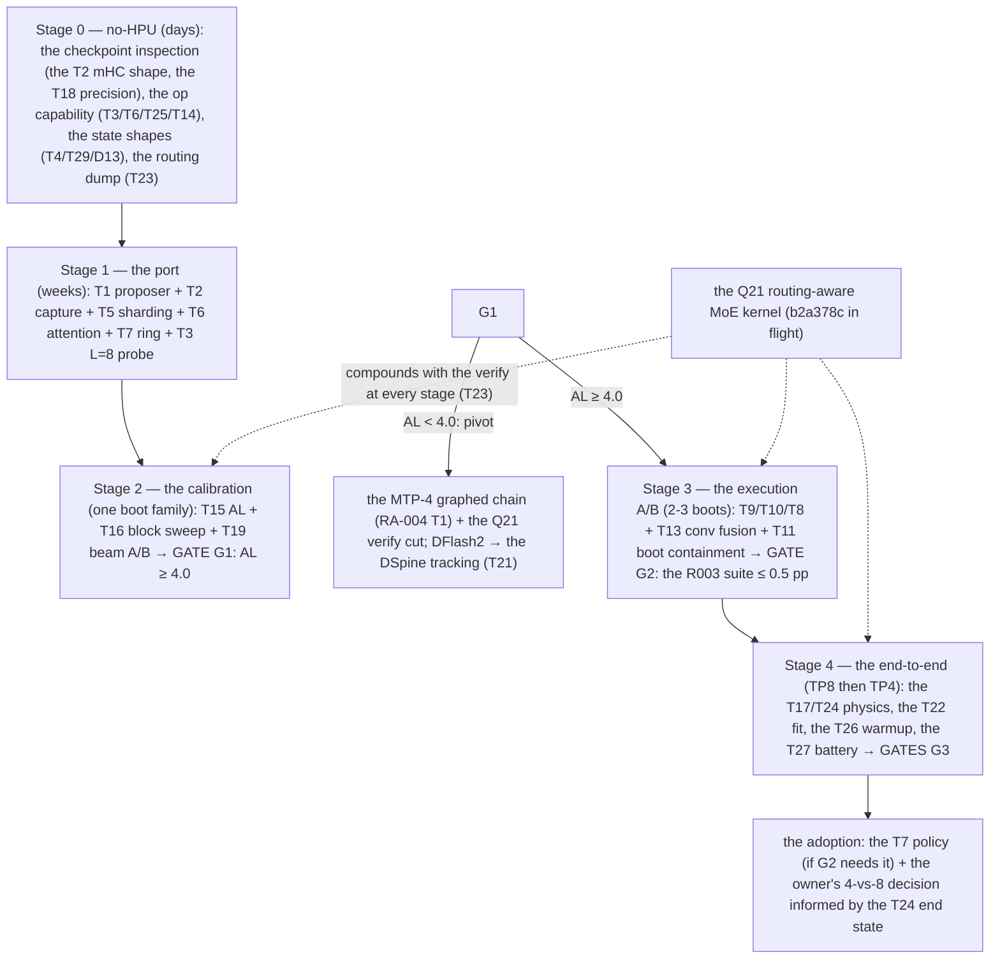

# RA-036 — DFlash2 on 4 and 8 HPUs: thirty theories for a ≥4-token block drafter on GLM-5.3-Flash

**Research architect, 2026-11-11 (round 6, owner-requested); rev 12.1 2026-11-12 incorporates
the implementation agent's port feedback.** Owner's ask: *"Create at least 20
theories on how to get DFlash2 working on 4 and 8 HPUs, it should predict at least 4 tokens. Go in
depth and look at the work the implementation agent has done so far."* GaudiGrimoire consulted
throughout (search log in §8). All numbers labeled MEASURED / DERIVED / ESTIMATED.

---

## 0. REV 12.1 — Implementation feedback incorporation (2026-11-12, read first)

The implementation agent left `docs/research/IMPLEMENTATION-FEEDBACK-DFLASH2.md` (2026-11-12):
**the DFlash2 port is STAGED at ~40%, the hard blockers are identified and quantified.** This
section records what the feedback changes in this document; the individual theories (T3, T5,
T14) carry inline corrections.

**What is done (verified by the agent):** the checkpoint is on the server
(`/data/models/GLM-5.3-Flash-DFlash2`, 2.2 GB; config read: block 8, selector_top_k 16,
selector_rank 256, mask_token_id 154856, target_layer_ids [5,14,24,33,42], 5 layers,
sliding_window 2048, is_causal false, model_type qwen3, vocab 154880 — matches §1); the
`flashinfer_gaudi` package ported minimal (dflash2 + _native + _tactics only, since the full
package imports 1Cat-compiled GDN ops we do not have); `hpu_dflash2.py` (the 421-line
`HpuDFlash2Proposer`, an `HpuEagleProposer` subclass) + `vllm_gaudi/ops/hpu_dflash2.py`
copied with the two `qwen3_dflash` imports swapped to `laguna_dflash`
(`DFlashLagunaModel(DFlashQwen3Model)` — our stack's GLM DFlash model; the swap is
mechanical); the speculative factory wired with a `method == "dflash"` branch placed AHEAD of
`use_eagle()` (upstream's `use_eagle()` returns true for dflash and would pick the wrong
proposer class), setting `use_aux_hidden_state_outputs` from the proposer — **T1(c) and the
T2 aux-hidden flag are therefore implemented, not just proposed.**

**Correction 1 — the license (B5): RETRACTED in §3.** The checkpoint is CC BY-NC-ND 4.0
(non-commercial); my rev-12 "now Apache 2.0" claim was a stale-cache error. Owner ruling
required before production use; DSpine (T21) is the clean-license alternative.

**Correction 2 — T3 "structurally ready" is too strong (B1, the hard gate).** The 1Cat's
DFlash2 verify is a **Qwen-GDN-hybrid-specific integration**: the corpus
`_validate_hpu_dflash2_config` (1Cat `vllm_gaudi/platform.py`) requires
`is_qwen3_5_hybrid_model`, "qualified only for the official Qwen3.8-27B" draft AND target
shapes (64 layers, full-attention every 4th, linear-attention otherwise), exactly
`num_speculative_tokens == 7`, `max_num_seqs <= 16` ("each active request reserves eight
rollback checkpoints per GDN layer"), and the env pair `VLLM_HPU_FLASHINFER_GDN=1` +
`VLLM_COMPACT_GDN=1` — because the verify mutates recurrent state and needs per-token
rollback checkpoints implemented in the 1Cat's COMPILED ops
(`vllm_gaudi.ops.gdn_recurrent_compound`), **which are absent from our venv**. GLM-5.3-Flash
is not a Qwen GDN hybrid (it is MLA + KDA + MoE): the DFlash2 METHOD (block-8 draft, top-16
selector, 8-row verify, per-token rollback) is general, but the verify's rollback call sites
must be **remapped from the 1Cat GDN API to our KDA candidate-slot machinery** (the generic
`[groups, bs, 1+num_spec+1]` layout our MTP port already uses at k=1). The CONCEPT maps
(8 checkpoints/request/layer — the 1Cat runner keeps `_gdn_state_slots_per_req =
1 + num_speculative_tokens` for dflash, confirmed in corpus `hpu_model_runner.py`); the
STATE and the call sites do not. This is a substantial porting task (days-to-weeks class),
not a depth probe. The KDA state-math itself remains validated by the abotsis L ∈ {2,3,5,8}
tests (T3's original grounding stands for the numerics; the gate is the integration).

**Correction 3 — T14 "device-prepared fast path" is NOT available as-is (the
never-built native).** The agent measured `score_select native promoted: False`: **the 1Cat
ships the compiled `flashinfer_gaudi_ops*.so` source but never built it — it does not exist
anywhere on the server.** The active path is the PYTHON reference
(`score_and_select_path_reference`, `grouped_conv_reference`). Consequences:
(a) the `VLLM_HPU_DFLASH2_DEVICE_PREPARE` bridge (the 1Cat's target-to-draft device path)
may depend on native ops and is not usable until the native is built or the logic is
re-implemented for the reference path;
(b) **the top-16 selector currently runs as a host-side Python loop — and bs=1 is
host-PACED** (§4 item 12, BS1-HOSTBOUND: ~23.8 ms window, ~17 ms unaccounted host gap).
The drafter's value is converting the host window into 2-3× the tokens per window; a
host-side selector competes for that same window. At block 8 the reference selector scores
rank-256 bilinear pairs over 8 positions × 16 candidates per request — a non-trivial
Python cost (the exact term is unmeasured; the F4-TS instrument, below, measures it).
**The native selector is therefore not merely an optimization — at bs=1 it may be
NECESSARY for the drafter to net-positive.** The build question: the 1Cat native source
exists (tier D, corpus) — building it on our 0.26.1 stack is an op-lib-class task (the B7
registrar-collision history is the warning); the alternative is a small custom HPU scoring
kernel (rank-256 bilinear is a small GEMM-class op — plausible, and it would also serve T19
the beam-2 walk). Either way: MEASURE the reference selector's host cost first (it sets
whether the drafter wins at bs=1 before any native work).

**Correction 4 — T5 confirmed + sharpened (B3).** The draft sharding is unmeasured (the 1Cat
qualified TP1). The agent's specific risk matches mine: the conv is per-channel and the
selector is rank-256 over the FULL hidden — check sharding sensitivity of both. The fallback
is TP1-draft-inside-TP8-target (draft replicated: +2 GB HBM/rank — the D13 gate). T5's
arithmetic (the 100-250 MB/rank sharded draft) stands; the lm_head all-gather risk is the
one to measure first (the sharded draft logits need the full 154880 vocab).

**Correction 5 — the platform gate (B2, mechanical, ~20 lines).** Upstream V1 rejects
"dflash2 drafts" (the candidate selector lives in the V2 speculator; Gaudi has no Triton).
The 1Cat patches `VllmConfig._get_v1_model_runner_unsupported_features` to drop that
rejection under `VLLM_HPU_FLASHINFER_DFLASH2=1` + a DFlash2 draft; our `platform.py` +
`envs` need that port. The corpus confirms the full env family
(`VLLM_HPU_FLASHINFER_GDN`, `VLLM_HPU_FLASHINFER_DFLASH2` [follows GDN by default],
`VLLM_HPU_DFLASH2_FULL_QUERY_CONV`, `VLLM_HPU_DFLASH2_DIRECT_CHECKPOINTS`,
`VLLM_HPU_DFLASH2_DEVICE_PREPARE`, `VLLM_HPU_DFLASH2_CONV_ROUND_BEFORE_ACTIVATION`) — the
GLM port will need its OWN gate (the 1Cat's Qwen-shape validation cannot be reused; the
GLM config check replaces the `_QWEN38_*` field tables with the GLM-5.3-Flash + laguna
draft fields).

**The F4-TS instrument (alignment with the engine-side program).** The agent's per-phase
timestamp patch (`patch_f4_ts.py` → `multiproc_executor.py` + `core.py`, env
`GLM_PHASE_TS=1`, live on the current boot) measures the propose-phase cost the same way it
measured the MTP draft-host term — and is the instrument that will (a) size the reference
selector's host cost (Correction 3) and (b) continue closing the ~17 ms unaccounted host gap
(ENGINE-BS1). Keep it for the DFlash2 A/B; it is env-gated and free when off.

**Revised do-first (supersedes the rev-12 list, in the agent's order):**
1. **B1 mapping (the hard gate):** map `hpu_dflash2.py`'s state-rollback call sites against
   our `_kda_spec_decode` candidate-slot implementation; decide "port the 1Cat GDN API"
   vs "ride our KDA slots" (the research recommendation: **ride the KDA slots** — the layout
   is generic, the KDA state math is validated, and porting compiled GDN ops into a
   GLM-KDA target is the larger surface; the GDN ops are also Qwen-shaped).
2. **B2 (mechanical):** the platform gate + the envs.
3. **The reference-selector host-cost measurement (NEW, no HPU boot needed beyond the
   staged arm; F4-TS):** size `score_and_select_path_reference` per step at block 8 — this
   decides the bs=1 viability question BEFORE any native work (Correction 3).
4. **Boot the staged arm** (`/data/glm53/boot_dflash.sh`, written + staged, expected to fail
   at B1/B2 until they land — the failures name the next gaps).
5. **D13 HBM quantification** at k=7 × 45 layers × 32 seqs against our KV layout (T4/T22;
   the per-layer KDA state bytes from the runner's layout).
6. **TP8 draft sharding decision** (B3) after the first successful boot.
7. **The suite gate** at ≥97.5% with the real per-block scales (the R003 regime, T12).

**Net assessment (unchanged in direction, sharpened in cost):** the drafter remains the only
class that clears the 4.2 accepted/step roofline (the MTP head is MEASURED at 2.68); the
port is ~40% done; the remaining hard work concentrates in the B1 KDA-rollback remap
(correction 2) and the selector path (correction 3). The bs=1 case improves (the host-paced
window has device slack for the verify rows — T9's reinforcement stands) BUT gains a new
host-side cost (the reference selector) that must be measured before the end-state
arithmetic (T24) is trusted; the @16 case is unchanged (device-paced, Q21-first).

---

## 1. Framing — the bar, the model, the two deployments

**The drafter.** DFlash2 (incoai, the z-lab/dflash methodology, ICML 2026) is a *block-diffusion*
speculative drafter: one forward pass predicts a whole block of tokens in parallel (no autoregressive
draft chain), keeps the top-16 candidates at every position, and a lightweight path selector (rank-256
low-rank bilinear scoring of adjacent candidate pairs) traces one coherent path through them. The
target then verifies the whole block in one forward pass; acceptance is a prefix walk. Decoding is
lossless: greedy output matches the target exactly, and sampling preserves the target distribution
(the draft only proposes; the verify decides) [inco blog 2026-08-18, tier D; HF card].

**The checkpoint exists for our exact model.** `incoai/GLM-5.3-Flash-DFlash2` (18K downloads, 129
likes, base_model `zai-org/GLM-5.3-Flash`, qwen3 architecture): 5 transformer layers, hidden 4096,
32 query heads / 8 KV heads (GQA), head_dim 128, intermediate 12288, BF16, vocab 154880;
`dflash_config`: block_size 8, selector_top_k 16, selector_rank 256, conv_kernel_size 2 (two-tap
grouped dynamic convolution), mask_token_id 154856, **target_layer_ids [5, 14, 24, 33, 42]** — it
conditions on the target's hidden states at five of GLM-5.3-Flash's 45 layers. Trained at block 8;
the Strata port deploys it at block 4 by default and exposes `STRATA_HPU_DFLASH_BLOCK=2..8` —
**the block size is a serve-time parameter of the same checkpoint** [Strata dflash.hpp, tier D].

**The user's bar, made precise.** "Predict at least 4 tokens" is read two ways, and both are
gates in §7:
1. **Drafted tokens per step ≥ 4**: met natively at block 5..8 (block-8 drafts 7 tokens; block-4
   drafts 3 — block-4 alone does NOT meet the drafted bar and is a fallback config, not the goal).
2. **Accepted tokens per step ≥ 4** (the performance bar): this is the binding one. Our MTP head
   currently delivers **2.68 accepted draft tokens/step at k=4** (MEASURED, MTP4-T0, §4) — DFlash2
   must beat that. Reference anchors (the inco GLM-5.3 day-0 numbers are for the full GLM-5.3, not
   Flash — see §5 for the gap analysis) put the DFlash2-GLM acceptance at **4.5-5.0 accepted
   draft tokens/step** on the GPU stack (AL 5.48-6.02 including the bonus token) — the ≥4 bar is
   the pessimistic half of the reference range, which is what makes it a sane adoption gate.

**The two deployments.** 8 HPUs (development, TP8+EP, the current production config) and 4 HPUs
(final, TP4+EP, the TP4-FIX profile: decode 35.6-36.4 t/s MEASURED). Every theory below states its
standing on both; the HBM arithmetic differs by the 2× per-rank factor and the verify-workspace
margin (the TP4 capture-OOM history is the warning, §4).

---

## 2. The DFlash2 mechanism in depth (corpus + primary sources)

The three independent implementations agree on the mechanism; the details below are the union:

**Context conditioning (the draft's input).** For every committed target token, the draft receives
the target's residual hidden state at the configured target layers (GLM: [5,14,24,33,42]; Strata's
Qwen port: [5,15,25,35,45], averaged over the four mHC hyper-connection streams), concatenated
(5×4096 = 20480 for GLM) → a learned fc → hidden_norm → becomes every draft layer's K
(k_proj + k_norm + NeoX RoPE θ=1e4) and V (v_proj) at that token's position [Strata dflash.hpp].
The draft thus has no own context embedding path: its "KV context" is a **ring of 2048 cells**
(sliding window), filled from the target's own forward — the draft reads the context the target
already computed. (Which representation the GLM checkpoint's fc expects — plain residual vs the
mHC stream average — is open question Q1 in §8; the fc input shape answers it on CPU.)

**The draft pass (one block, parallel).** The query block is `[anchor, mask × (block-1)]`
(anchor = the last committed/bonus token, mask = 154856 for GLM) at target-embedding positions
p..p+block-1. It runs through the 5 draft layers with **non-causal attention over
[2048 context cells; the 8 block positions]** — every block position attends to every other (the
block-diffusion property: no causal mask inside the block, so all 7 draft positions are predicted
in one pass). Each sublayer is wrapped in a **two-tap grouped dynamic convolution** along the block
(16 channels/group on Qwen; conv_kernel_size 2 on the GLM config) — the conv is the suffix-decay
fix (below). Final norm; rows 1..block-1 (the anchor row's output is the conditioning, not a
draft) go through the **TARGET's lm_head** (the draft has no own head — the same contract as our
MTP head, whose `compute_logits` applies the target lm_head directly). [Strata dflash.hpp; 1Cat
hpu_dflash2.py; inco blog]

**The selector (the coherence fix).** Plain DFlash picks each position independently — plausible
per token, incoherent as a block (stutters, dies at verify). The evidence: on Qwen3-4B GSM8K,
Recall@1 = 85.4% at position 0 but Recall@16 = 99.5% — the right token is almost always in the
top-16 even when the top-1 is wrong. DFlash2 keeps the top-16 at every position and scores every
adjacent pair: `S_t(a,b) = U_t(b) + <A(a) ⊙ H(h_t), B(b)>` — the drafter's own logit plus a
context-gated low-rank bilinear match between the predecessor's 256-d embedding A(a) and the
candidate's B(b). All pair scores are computed in one parallel shot (no extra backbone or head
pass); the only sequential work is the final walk: **greedy follows argmax edge-by-edge from the
anchor; sampling draws from the same scores; rejection sampling at verify restores the exact
target distribution** [inco blog, Tables 1-2]. The selector adds +2.0M params and +0.6% cycle
latency (AL 4.27→4.61 at T=0 on Qwen3-4B) and beats the DSpark sequential correction (+77.8M,
+9.6%) — "choosing is cheaper than predicting." The oracle (perfect selection from the top-16)
reaches AL 6.79 — the pairwise selector leaves ~2 tokens of headroom; inco calls it "the simplest
selector we could think of."

**The suffix decay (the conv fix).** Even the oracle decays toward the block end (Recall@16:
99.5% → 87.8%). Depth helps the tail but is indiscriminate (15 layers: +15.2% cycle latency, 3×
params). The targeted fix: the within-block attention mass already collapses (30% of layer-1
attention → 8% of layer-5, in a shrinking head set), so the 2-tap dynamic conv takes the
within-block work (+3% params, +0.7% latency) while attention keeps reading context: position-6
Recall@1 72.9% (5L) → 77.6% (5L+conv) → 78.7% (15L) [inco blog, Fig 2].

**The verify side (what the target must do).** One target forward scores `block` rows
(anchor + block-1 drafts) per sequence in parallel. For a standard transformer this is just
k+1 rows with a block-table; for GLM-5.3-Flash's hybrid (34 KDA recurrent layers + MLA), the
**recurrent state must exist at EVERY candidate position** (acceptance is known only after
sampling; a contracted recurrent state cannot be rewound the way the conv cache can — the conv
cache has the `accepted_offset` rewind, the KDA state does not). The state-after-token-j is
published to candidate slot j; the next step loads the accepted one [abotsis hpu_kda_eager.py +
test_hpu_kda_spec_states.py, tier D]. This machinery is **already in our tree** (§4) and was
designed for exactly this class of depth (the abotsis test parametrizes L ∈ {2,3,5,8} — "L=2 is
MTP-1, L=5 is the MTP-4 target" — L=8 = block-8 DFlash2 verify is within the tested range of the
reference implementation).

**The 1Cat HPU implementation (the Gaudi reference, the port's blueprint).**
`vllm_gaudi/v1/spec_decode/hpu_dflash2.py` (tier D): `propose_query_block` builds the mask block
on CPU, async-H2D's it, computes the query slot mapping + attention metadata (the explicit bias
carries both causality and window alignment; the metadata is prefill-shaped with `causal=False`),
runs the draft model, drops the anchor row, and calls `select_dflash2_candidates` — which
generates, scores, and selects the path **in one compiled HPU region** (`compute_candidates` →
top-16; `score_dflash2_candidates` = the candidate selector; `select_path` = the walk). Six
drafter methods are **regionally compiled** together (`combine_hidden_states`,
`precompute_and_store_context_kv`, `compute_candidates`, `prepare_dflash2_inputs`,
`score_dflash2_candidates`, `select_dflash2_candidates`); a **device-prepared path**
(`propose_prepared_query_block` from `prepare_device_inputs`) runs the fixed draft block with
metadata computed on-device (no host round trip); a fast path activates when all rows are active
and all lengths are the full block (`_is_full_dflash_query_block`); the LM head + greedy argmax
stays in one compiled region (`select_compute_logits_and_greedy`). The verify side: **rollback-
safe conv + GDN state checkpoints** ("each step's convolution and GDN checkpoint participates in
acceptance and rollback"), 8 rollback checkpoints per request per GDN layer, each verify token
using its own causal KV-page extent (including page-crossing blocks), padding writing only to a
reserved padding page; warmup feeds one generated draft block back through every decode bucket so
the verify + rollback graphs are captured before serving. Optional fast paths:
`VLLM_HPU_DFLASH2_FULL_QUERY_CONV` (removes redundant conv masks/state reads for full verify
blocks; preserves accumulation order, activation rounding, accepted-history selection; disabled
pending qualification) and `VLLM_HPU_DFLASH2_DIRECT_CHECKPOINTS` (contiguous write destination
for the verifier; still produces all eight states). A fused TPC recurrent kernel replaces eight
framework recurrence steps per GDN layer when selected. **Qualification scope: greedy text,
TP1/PP1/DP1, max_num_seqs ≤ 16, compact GDN state, prefix caching and LoRA disabled** — the GLM
transfer (TP8/TP4 + EP, the MLA+KDA hybrid, the mHC structure) is the open work, and the
DFlash2-GLM acceptance on Gaudi is UNMEASURED anywhere in the corpus [1Cat README + docs, tier D].

**The Strata single-Gaudi2 datapoint (the only Gaudi2 DFlash2 measurement in the corpus).**
Qwen3.8-Flash-Next (48 layers, 512 experts, IQ4_XS), one HL-225: block-4 deployment (the card's
default, "three drafts per verification") measures **acceptance 2.83-3.26**; block-8 measures
**2.9 tokens/round**; decode 155.7 t/s @2K context (with the IQ4 target — the quantized target
degrades both the draft-target alignment and the verify). The draft reuses the target's mHC 4-
stream residuals (the same hyper-connection structure GLM-5.3-Flash has — we run the mHC
Sinkhorn as a TPC kernel today) [Strata README + dflash.hpp, tier D].

---

## 3. The checkpoint, the license, the integration references

- **License — CORRECTION (rev 12.1): the checkpoint is CC BY-NC-ND 4.0, NON-COMMERCIAL.**
  My rev-12 note ("the HF card today carries `license: apache-2.0` ... the production-license
  caveat that gated RA-009/RA-016 is gone") was WRONG and is RETRACTED. Verified 2026-11-12:
  (a) the implementation agent downloaded the checkpoint to
  `/data/models/GLM-5.3-Flash-DFlash2` (2.2 GB) and inspected it directly — CC BY-NC-ND 4.0;
  (b) the HF card's current README frontmatter reads `license: cc-by-nc-nd-4.0` with
  `base_model: zai-org/GLM-5.3-Flash` (the model card, the file tree, and the release at
  `7d74cdd` all agree; the lone "apache-2.0" I saw was a stale cached "Commit history" view).
  The rev-5 RA-009 flag stands: **the DFlash2-GLM checkpoint is non-commercial; the owner must
  rule on production use before this path is taken live.** DSpine (RA-016, Apache 2.0) remains
  the clean-license drafter alternative — but has no GLM checkpoint yet (T21 is the bridge:
  the port investment amortizes across drafters precisely so the license swap does not strand
  the work). Pin the license field at download time; do not re-derive it from search caches.
- **Integration references (the four engines that already run DFlash2):** SGLang
  (`--speculative-algorithm DFLASH --speculative-draft-model-path incoai/GLM-5.3-Flash-DFlash2
  --speculative-draft-attention-backend fa4`); vLLM (`--speculative-config '{"method": "dflash",
  "model": ..., "num_speculative_tokens": 7}'` — first-class upstream v1 method, K extra slots);
  llama.cpp (`--spec-type draft-dflash --spec-draft-n-max 7` — the project-maya production GLM
  configs run DFlash2 this way, 148.6 t/s on 2×RTX 5090 + 4090 at 32K [G9, tier D]); and the
  1Cat-vLLM-Gaudi HPU path (§2). The HPU port is the gap: our vllm_gaudi 0.26.1.dev0+gb059f9c95
  (the fork build) has the eagle/MTP proposer (our mtp.py binds `HpuEagleProposer`) but **no
  `dflash` proposer** — the port is T1 below.
- **The oMLX detail worth stealing:** the Apple port exposes *runtime block size* (5 in their
  config) and draft quantization (int4) as serve-time knobs — block size and draft precision are
  both runtime-tunable in the ecosystem, not baked into the checkpoint.

---

## 4. The implementation agent's MTP/draft work — the measured state (what DFlash2 must build on)

The deep read of the fork (mtp.py, kda_layer.py, the experiment reports, the commit history
through **b2a378c 2026-11-11 21:40**):

1. **MTP k=1 is the adopted production drafter** (A001, +15.1% bit-identical): 42.4 t/s bs=1,
   257-259 t/s @16, **1.88 accepted tokens/step (94% per-token)**. The MTP layer is the
   checkpoint's layer 45 (`num_nextn_predict_layers=1`), loaded only when spec decode is on; it
   runs WITHOUT mHC (no hc_* tensors for layer 45) — NoPE dense MLA + routed MoE, standard
   residual. The draft step: embed → zero at position 0 → eh_proj(cat(enorm(emb),
   hnorm(hidden))) → draft MLA (own KV) → shared-MoE → shared_head_norm → the TARGET lm_head
   [mtp.py, MEASURED in production].
2. **k=2 verified** (MTP-002): +21% batch-1 decode provisional; the golden near-tie class
   (k=1: 2/12, k=2: 1/12 divergences — "model-inherent near-ties, depth-stable" — MTP is never
   bit-identical to non-MTP at golden level, and the class is stable with depth).
3. **k=4 MEASURED (MTP4-T0, the T0 probe of RA-004):** config-only `num_speculative_tokens: 4`
   on the adopted config (eager 4-step draft chain). bs=1: **40.8-41.5 t/s — parity with k=1's
   42-44** (the predicted catastrophic slowdown did NOT happen: "the 4-step eager draft chain
   costs ≈ the acceptance gain" at bs=1). @16: **161-162 t/s — −38% vs k=1's 257-259** (the W5
   wall: the 5-row verify graph shapes at 16 streams + the eager chain × 4). **The acceptance:
   drafts 417, draft tokens 1,668 (4/step), accepted 1,119 → 2.68 tokens/step (67.1% of the 4
   drafted)** — below the abotsis reference's 3.33 (same checkpoint class, different stack — the
   predicted 3.1-3.4 missed on the low side) and far below the ≥4 bar. **This is the number
   DFlash2 must beat, and it decomposes the problem: 67.1% per-position acceptance at depth 4 is
   the MTP head's decay, not a stack defect — a drafter-class change (DFlash2) attacks the
   decay, a stack change (graphed chain, RA-004 T1) only attacks the cost side.**
4. **The draft-graph arc (Q01/Q07c/Q15/R003):** the eager draft is host-launch-bound (D1: 7.5 ms
   bs=1 draft dispatch; the reference fork measured 93 ms host vs 17 ms device for its MTP
   draft). The in-tree graph machinery exists in two modes — `split` (pre/post-attention cores
   graphed, the MLA eager between; private storage clones because Synapse's fused-MoE op
   registers expert weights per storage identity, so the MoE stays SHARED; `dry_run=False`
   because the draft chain consumes its own outputs; mark_step + full sync at both replay seams)
   and `attn` (the whole step captured; metadata tensors as positional graph inputs). The
   draft graphs delivered +20-33% in the arc — **but the R003 flip: the suite drops 100% →
   97.5% with captured drafts, and THREE alignments failed** (fp32 draft accumulators, the
   session-leak seam isolation, PT_HPU_MARK_NON_RECIPROCAL_CASTS). The verdict (NONRECIP,
   2026-11-10): **the captured-draft numerics drift is INHERENT to the captured recipe's deep
   compilation (static-shape baking + the compiler optimization passes) — no bridge-level or
   python-level instrument reaches it.** The practical unlocks: the T7 tie-aware gate policy
   (owner decision, pending) or a Synapse compiler RE (weeks). The abotsis reference fork
   resolved the same question differently (Q15: their graphed drafts are byte-identical to
   eager on R003 + the 40-item suite, same-boot A/B) — a different stack version; the drift is
   stack- and compile-path-specific. **Consequence for DFlash2: every captured DFlash2 surface
   (the draft, the selector, the 8-row verify) carries the R003-class risk, and the mitigation
   menu is the same three (T7 gate, the draft outside the deep capture, the compiler RE).**
5. **Our KDA spec-verify path (kda_layer.py — the verify substrate DFlash2 inherits):**
   `spec_len` is DERIVED, not fixed (`n // bs_rows` — no hard depth cap in the code); the
   candidate slot layout mirrors the validated abotsis GLM-5.3 MTP implementation: state_indices
   `[bs, 1 + num_spec + 1]` (column 0 = canonical, column 1+j = the state after chain token j);
   the conv path runs the **chained depthwise conv over each sequence's draft chain in a python
   for-loop over spec_len** (l.279: per-j cat + sum over the window) and scatters the windows to
   the candidate columns; the recurrent path calls **`hpu_recurrent_kda(..., return_all_states=
   True)` — ONE call per layer** that publishes the state after every token to the candidate
   slots (no L-fold launch increase on the recurrent side); `_scatter_candidate_states` guards
   padded lanes (-1 → identity write). **MTP4-T0 proved L=5 works end-to-end on this tree; L=8
   (block-8) is untested here but is within the abotsis reference's tested range {2,3,5,8} and
   within our code's structural support** — the open cost is the conv loop (T13).
6. **The Q21 fused MoE kernel is landing in parallel (b2a378c, 21:40 — the newest commit):**
   the multi-expert orchestration A/B on real checkpoint weights: stock (per expert: dequant +
   bf16 mm) 0.87 ms/MoE-layer vs the Q21 bit-exact GEMVs 0.62 ms = **−29% MEASURED;
   extrapolated −10.5 ms/step at bs=1 across the 42 sparse layers (decode headroom ~23 →
   ~12.5 ms)**; the numerics stand on the bit-exact single-expert proof (the E4M3 calibration
   from the round-5 recipe landed); the probe's A-vs-B numeric delta is a unit-scale artifact
   (unscaled dequant overflows the SiLU range); the integration path = the fused routing-aware
   op with real per-block scales + the suite gate. **DFlash2's 8-row verify calls are exactly
   the decode-shaped (T ≤ 32 per expert) MoE calls the Q21 kernel targets — the two programs
   compound: the drafter cuts the target passes per token, Q21 cuts each verify pass's MoE
   bytes (RA-002: "saves 11-40% of the @16 verify read").**
7. **The boot/capture economics (T12-TEST, the constraint on every graphing theory):** the boot
   cost is the per-graph COMPILE (8.1-9.2 s class), shape-regularity dependent; the production
   boot captures 277 graphs in ~25 min; the pinned-bucket variant (215 graphs) booted SLOWER
   (29 min) and cost −5% decode; the MTP spec-decode path adds +46 seed buckets on top of the
   file rows. **Any DFlash2 graphing strategy must be priced against this: the draft + selector
   + 8-row-verify graph population is a boot-time investment that the T12 evidence says scales
   with graph count AND shape irregularity.**
8. **The 4-HPU profile (TP4-FIX):** TP4 decode 35.6-36.4 t/s (+8% from the levers vs the Q14v2
   33.26); the prefill >2048 rows capture OOMs at the TP4 HBM budget (weights 2×/card — the
   workspace issue WORSE at TP4). The DFlash2 additions (draft weights, draft KV ring, 8× the
   KDA rollback slots, the 8-row verify workspace) land on that tighter budget (T22).
9. **The layout data (Q17):** EP4×TP2 measured −22% bs=1 / −21% O16 on the STOCK op (refuted
   there) — but the stock all-experts op reads the same local experts per card regardless of
   routing; the layout economics flip once the routing-aware Q21 kernel lands (re-test after).
   DFlash2 changes the routing mix (8 verify rows per request → more distinct routed experts per
   step → the routing-aware kernel's per-step byte cut grows with the drafter's depth).
10. **The F2 RPC-collapse is APPLIED and KEPT (46f68a6, 11-11 23:33):**
    `GLM_F2_DRAFT_PIGGYBACK=1` — the draft tokens now PIGGYBACK on the model-output RPC
    (the outputs.py `draft_token_ids` field; the runner's decode-path construction populates it;
    the engine's step() stashes it, post_step consumes with the RPC fallback). Decode 41.1-43.3
    (parity at bs=1 — the RPC3 ~0.3 ms is inside the noise), suite 97.5% (baseline held).
    **For the DFlash2 port: the 7 draft tokens/request/step travel through this same piggyback
    path — the T1 proposer's output contract should use the draft_token_ids field, not a
    separate RPC round trip.**
11. **The F3 re-capture tax is SCOPED (5db3e67, 11-12 00:30):** at 16 streams the capture branch
    is nearly empty (63/12,004 samples, 0.5% — no re-capture storm); the 2.6 ms/step tax is
    ctx-growth-dependent — it hits bs=1/3 where the growing context crosses the decode-bucket
    ladder (re-captures), and is NEUTRAL at the stable-width @16. The ctx-ladder coarsening is a
    bs=1/3-scoped fix. **For DFlash2: the T7 ctx-independent draft shape sidesteps the draft's
    share of this tax; the 8-row VERIFY shape still crosses the ctx ladder at bs=1 (the T11b
    pinned file / the ctx coarsening is the bs=1-scoped mitigation — same as the MTP path).**
12. **THE BS=1 HOST-BOUND FINDING (4e0b96e + df9ef76, 11-12 00:51/00:55) — the physics that
    re-frames the whole drafter program:** py-spy 60 s @ 100 Hz on a single 1500-token
    generation (growing ctx), 18,037 samples: the worker main thread is **82% in
    Poller.poll — the worker idles waiting for the ENGINE**; HPUGraph.replay 531 samples
    (~1.26 ms/step — the LAUNCH time, 5% of the step); dispatch/mark_step/parse ~0.1 ms each;
    the capture branch empty. **The ~23.8 ms bs=1 step is ~95% host-paced: the device work fits
    inside a host-paced window.** The EngineCore profile: the engine is mostly WAITING (input
    10%, shm output spin 10%, the scheduler only 0.05 ms/step — NOT the bottleneck) — combined
    with the worker's 82% idle, **~17 ms of the ~23.8 ms cycle is UNACCOUNTED between the
    engine phases** (the agent's hypotheses: transport latency, the API-server cadence, the
    GIL, the Condition.wait granularity; next-level instrumentation: per-phase timestamps
    around step() and the worker poll/receive boundaries). The agent's own priorities: "the
    Q21 integration for the aggregate, the engine schedule profiling for bs=1" and "the Q21
    device win at bs=1 is only ~1% — it materializes at the 16-stream aggregate."
    **Consequences for the DFlash2 theories (revised T9/T24):** (a) at bs=1 the step =
    max(host pipeline, device work) — today the host pipeline (23.8 ms) paces and the device
    has slack; adding the DFlash2 draft (host: the eager dispatch, the graphed replay ~1 ms;
    device: ~2-4 ms) + the 7 extra verify rows (device: ~7-14 ms at the sub-linear marginal)
    grows BOTH terms — the step ≈ max(~26-29 ms host, ~20-28 ms device) ≈ 26-30 ms for AL
    4.5-5.5 → **150-210 t/s bs=1 — the drafter converts the host-paced window into 2-3× the
    tokens per window, and the 17 ms unaccounted host gap becomes the CEILING above ~200 t/s
    (the engine-side program, the agent's own priority, is what pushes past it — the DFlash2
    and the engine-side fixes are complementary, not competing, levers on the same window).**
    (b) The MTP4-T0 bs=1 parity (40.8-41.5 vs 42-44) is now explained by the self-balance: the
    eager 4-step chain's added host + device time both fit inside the host-paced window's
    slack; the @16 −38% is where the device term becomes the pacer (the T17 wall stands).
    (c) **T9 (the eager draft first) is reinforced as the bs=1-correct choice** (its host cost
    lands on a host-paced pipeline with device slack — no device penalty); the graphing (T8/
    T10) matters for the @16 aggregate (device-paced) and for shaving the host window (a small
    part of the 17 ms). (d) The T24 end-state arithmetic is restated in T24 below.

---

## 5. Reference performance anchors — where ≥4/step sits

| Anchor | Stack | Drafter | Accepted/step | Source |
|---|---|---|---|---|
| Ours, k=1 adopted | Gaudi2 ×8, vllm_gaudi 0.26.1.dev, block-FP8 | MTP-1 (graphed) | **1.88** (94%/tok) | MEASURED (A001) |
| Ours, k=4 eager | same | MTP-4 (eager chain) | **2.68** (67.1% of 4) | MEASURED (MTP4-T0) |
| abotsis GLM-5.3, MTP-4 | Gaudi2 ×8, their vllm-gaudi, FP8 | MTP-4 | **3.33/5** (d5: +0.1; d3: nothing) | [G17, tier D] |
| Strata Qwen3.8-Flash-Next | **Gaudi2 ×1**, IQ4_XS target | DFlash block 4 | **2.83-3.26** | [tier D] |
| Strata, same | Gaudi2 ×1, IQ4_XS | DFlash block 8 | **2.9** | [tier D] |
| inco Qwen3.8-27B | GPU (SGLang), FP8 target | DFlash2 block 8 | **4.80** (vs MTP 4.28, DSpark 3.62) | [inco blog, tier D] |
| inco GLM-5.3 (FULL, not Flash) | GPU (Inco Engine, Blackwell), FP8 | DFlash2 | **AL 5.48-6.02** (i.e. 4.48-5.02 draft + bonus) vs MTP AL 4.85-5.12 | [inco GLM day-0 blog, tier D] |
| project-maya GLM-5.3-Flash | 2×RTX 5090+4090, llama.cpp, GGUF | DFlash2 | 148.6 t/s (acceptance unreported) | [G9, tier D] |

**Reading the table for our case:** (a) the Gaudi2-specific DFlash2 datapoint (Strata, 2.83-3.26
at block 4) is on a DIFFERENT model (Qwen3.8-Flash-Next) with a DEGRADED target (IQ4_XS — the
draft was trained on the FP8/BF16 target's features, so the quantized target alone costs
acceptance); our target is the published block-FP8 checkpoint the drafter was trained against.
(b) The inco GLM-5.3 (full) number (AL 5.48-6.02) is the model-family anchor — GLM-5.3-Flash is
the same family (45 vs 62 layers, same MoE/MLA/KDA/mHC architecture class), and the Flash
drafter was trained on Flash. (c) Our own MTP-4 at 2.68 vs the abotsis MTP-4 at 3.33 shows the
stack gap is ~0.6-0.7 tokens on the MTP path (eager draft chain, our compile path) — if the same
gap applied to DFlash2, the Gaudi2 expectation for DFlash2-GLM-Flash is **~4.5-5.3 minus the
stack gap ≈ 3.9-4.7** — straddling the ≥4 bar. **The acceptance calibration (T15) is therefore
the single most valuable experiment in this document: it decides whether DFlash2 clears the bar
on our stack at all, and it costs one boot.**

---

## 6. The theories

Conventions: each theory states the hypothesis, the mechanism, the grounding (MEASURED/corpus/
source), the standing on 8 vs 4 HPUs, the expected impact (ESTIMATED unless labeled), the risks,
and the validation. T-numbers are for reference in §7 (the sequence) and the handoff.

### Group A — The port (checkpoint → our runner)

**T1 — Port the 1Cat HpuDFlash2Proposer onto our vllm_gaudi 0.26.1 HPU runner (the mainline).**
*Hypothesis:* the 1Cat v1 path (the proposer + the six adapter methods + the speculative-config
`method=dflash` wiring) ports to our runner with bounded effort because our runner already hosts
the same-class machinery (the `HpuEagleProposer` that our mtp.py binds; the KDA candidate-slot
layout that "mirrors the validated abotsis GLM-5.3 MTP implementation"; the decode-graph
population). *Mechanism:* (a) add the DFlash2 drafter model class to the port (the qwen3-5L
sliding-window model — plain MHA + GQA + FFN + the 2-tap grouped conv + the selector's
compute_candidates/score/select_path; no MoE in the draft, no mHC — a SMALLER model class than
our target, ~500MB-2B params); (b) add the proposer (the mask-block construction, the slot
mapping, the attn metadata, the device-prepared fast path) as a sibling of the eagle proposer;
(c) wire `method=dflash` in the speculative-config registry + the runner's propose/verify
branching; **(c2) the draft tokens' output contract uses the F2 piggyback**
(`GLM_F2_DRAFT_PIGGYBACK=1` — applied and kept, 46f68a6: the 7 draft tokens/request/step
travel on the model-output RPC via the `draft_token_ids` field, not a separate round trip —
§4 item 10); (d) the aux-hidden capture hook in the target forward at layers [5,14,24,33,42] (T2).
The 1Cat code is the reference implementation (tier D, in the corpus — the full `hpu_dflash2.py`
and the adapter methods are readable line-by-line); the delta from 1Cat's TP1-Qwen-GDN to our
TP8/TP4-GLM-KDA-EP is the real work: the GDN rollback becomes KDA rollback (our T4 substrate
exists), the TP1 assumption becomes the TP-sharded draft (T5), and the Qwen target layers become
[5,14,24,33,42]. *Grounding:* the 1Cat path is QUALIFIED (greedy, ≤16 seqs — exactly our
aggregate target's concurrency); the project-maya production GLM configs prove DFlash2-GLM works
as a drafter for this model (llama.cpp, 148.6 t/s) — the model/drafter pairing is not the risk,
the HPU+TP integration is. *8 vs 4 HPU:* identical port; the TP sharding (T5) covers both.
*Impact (ESTIMATED):* this is the enabling theory — the acceptance upside is T15's. *Risks:*
the 1Cat tree is a different vllm-gaudi revision (their v1 runner vs our 0.26.1.dev — the
adapter-method surface may differ; expect a non-trivial reconciliation pass); the qualification
scope (greedy, no prefix caching, no LoRA, ≤16 seqs) matches our production config
(prefix off — the KDA architectural constraint; greedy suite; 16-stream cap) but NOT the
multimodal path (our port serves vision — the 1Cat path rejects multimodal requests until M-RoPE
context mapping is qualified: the DFlash2 mode must either reject mm requests or fall back to
the MTP drafter for them). *Validation:* the drafter unit test (the propose_query_block output
vs the SGLang/GPU reference on a fixed prompt — the corpus has the 1Cat unit tests as the
pattern), then T15.

**T2 — The aux-hidden capture at [5,14,24,33,42]: the TP-replicated-residual property + the
mHC question.** *Hypothesis:* the five conditioning hidden states are available per rank at zero
extra communication. *Mechanism:* in vLLM's TP, the residual-stream hidden state after each
layer is TP-REPLICATED (the attention o_proj and the MLP down-proj all-reduce back to the full
hidden) — capturing `hidden_states` at five layers is a per-rank tensor copy (5 × bs × 4096 ×
2B = 40 KB/request/step — negligible HBM and time), no all-gather, no new collective. The
draft's combine fc (inside the checkpoint, [5×4096 → 4096]) consumes them. **The open question
(Q1):** the Strata Qwen port conditions on the mHC 4-STREAM AVERAGE (the residual "after target
layers 5/15/25/35/45, averaged over the four hyper-connection streams, concatenated [12800] →
fc"); the incoai GLM card names only the layer ids. If the GLM drafter was trained on the mHC
stream average (GLM-5.3-Flash HAS the same mHC 4-stream structure — our mhc.py Sinkhorn TPC
kernel computes it every step), the capture must be the 4-stream average, not the plain
residual — a wrong choice silently degrades acceptance (the drafter's conditioning is off-
distribution, no error is raised). The fc INPUT SHAPE answers it on CPU: 20480 (5×4096 plain)
vs 81920 (5×4096×4 streams) — read the checkpoint weights before any HPU work. *8 vs 4 HPU:*
identical (replication holds at both). *Impact:* correctness-gating — a wrong conditioning
source costs an unknown acceptance fraction (ESTIMATED 0.2-0.8 tokens if it matters and we get
it wrong). *Validation:* the shape check (no HPU); then a conditioning A/B if both shapes are
plausible (the AL delta at T15).

**T3 — The KDA verify at L=8: the state math is ready; the rollback INTEGRATION is the B1
gate (rev 12.1 — not "structurally ready" for free).**
*Hypothesis (revised):* the block-8 verify (8 rows/seq) runs on our existing KDA spec path
**at the state-math level** (the `hpu_recurrent_kda` all-states, validated to L=8 by the
abotsis tests). BUT the DFlash2 proposer as written consumes the 1Cat GDN-rollback API
(compiled ops, absent from our venv, qualified for Qwen GDN-hybrid shapes only — the corpus
`_validate_hpu_dflash2_config` requires `is_qwen3_5_hybrid_model` + the Qwen3.8-27B field
tables). For GLM the verify's per-token rollback call sites must be REMAPPED onto our KDA
candidate-slot machinery (B1; §0 correction 2) — a days-to-weeks-class porting task. The
depth probe below keeps its value (it settles the L=8 kernel shape in OUR tree) but no longer
settles the gate. *Mechanism (the state math, unchanged):* `spec_len = n // bs_rows` is
derived (no depth cap); the recurrent
path is one `hpu_recurrent_kda(return_all_states=True)` call per layer (the kernel publishes
every position's state); the candidate columns are `[bs, 1+k+1]` (9 columns at k=7) — the pool
size is a config (T4); the MLA layers need no state machinery (the KV rows are the 8 verify
rows with their own block-table slots — the abotsis/1Cat "each verification token uses its own
causal KV-page extent, including when a block crosses a page boundary"). MTP4-T0 proved L=5
end-to-end (2.68 accepted); the abotsis reference tested L ∈ {2,3,5,8} against the production
decode kernel stepped L times (rel < 1e-4) — the L=8 numerics of the STATE MATH are validated
on the reference stack. *Grounding:* kda_layer.py (our port, read this session) + the abotsis
tests (corpus). *8 vs 4 HPU:* identical code; the HBM is T4. *Impact:* enables everything
else; no direct gain. *Risks:* the hpu_recurrent_kda all-states output at L=8 may hit a
kernel-shape or workspace limit untested at our tree (the abotsis test used H,D = 8,128 —
exactly our TP8 KDA shape; the L=8 case exists in their parametrization but our kernel build
is our fork's — the probe settles it); the conv python-loop cost (T13). *Validation:* the
depth probe — extend the MTP4-T0 method to k=7 via the MTP head? No: the MTP head is depth-1
(its chain is the sequential passes — k=7 would be 7 sequential MTP layers we don't have).
Instead: a synthetic 8-row verify probe (a forced 8-token draft chain from the existing MTP
head with `num_speculative_tokens=7` if the runner allows the config, or a unit-level
chunk test: feed 8 known tokens through the KDA spec path and check the candidate states vs
the 8×-stepped decode kernel — the abotsis test pattern, one HPU, no boot).

**T4 — The KDA conv + state rollback checkpoint design: the slot pool and the HBM table.**
*Hypothesis:* the block-8 rollback state fits the 16-active budget on both TP4 and TP8 with
headroom, and the scatter design (canonical + 7 candidate columns) is the right one.
*Mechanism:* per KDA layer (34 of them): the ssm state per slot (fp32, TP8: 8 heads × 128 × 128
× 4B = 512 KB — the T5-table number; TP4: 16 heads/rank → 1 MB) + the conv window per slot
([W-1] × 3 × dim — small, ~KB). Block-8 = 8 state-slots per request (canonical + 7 candidates;
the next step loads the accepted column — our `_scatter_candidate_states` already handles the
propagation: the loaded window re-written to column 0 so the canonical slot is always fresh,
padded lanes identity-guarded). Pool = bs_max × (1 + k + 1) + headroom = 16 × 9 + margin =
~170 slots/layer. HBM (DERIVED): TP8: 170 × 512 KB × 34 layers ≈ 2.9 GB total (363 MB/rank) —
vs the MTP-4 class (1.1 GB/rank at ns16 per the T5 table — the block-8 pool is ~2× the slots
but the same per-slot size); TP4: ~726 MB/rank. Both fit (the KV pool + weights leave 10+ GiB
headroom/card at TP8; the TP4 margin is tighter — T22). The conv cache is the same pattern
(conv window slots). *Grounding:* kda_layer.py (the column scheme + the scatter, read this
session); the T5 HBM table (the round-4 note); the 1Cat "eight rollback checkpoints per GDN
layer, max_num_seqs ≤ 16" (the Qwen GDN state is larger per slot — the GLM KDA state is the
512 KB class). *8 vs 4 HPU:* the 2× per-rank factor (above); the TP4 preemption-resume path
must be re-verified (the TP4-FIX profile is decode-validated, not preemption-validated).
*Impact:* feasibility-gating (a pool overflow = the 1Cat "undersized budget silently queues
and serializes" failure mode — the startup-reported max concurrency must be ≥ 16). *Risks:*
the fp32 state (the 1Cat default; VLLM_COMPACT_GDN=1 compacts the Qwen GDN state — the KDA
compact equivalent is an open optimization: fp16/bf16 state halves the pool at a precision cost
the KDA decay makes non-trivial — keep fp32 first). *Validation:* the pool arithmetic on the
real state shapes (the kda_state_diagnostics.py instrument exists in the port); the
preemption-storm test (T27).

**T5 — The draft model's TP sharding on TP8/TP4 (and why the draft is the CHEAPEST TP-shard
in the system).** *Hypothesis:* the 5-layer dense draft shards cleanly and adds a negligible
per-rank footprint. *Mechanism:* the draft is plain MHA+FFN (no MoE — no expert-parallel
complication; no mHC — no hyper-connection sharding): TP8: 32 q-heads → 4/rank, 8 kv-heads →
1/rank (GQA 4:1 per rank — clean), FFN 12288/8 = 1536/rank column + row parallel; the selector
embeddings (A/B, 256-d) are small replicated tensors. Draft weights ~0.5-2B params (5 layers,
hidden 4096, inter 12288 ≈ 5 × (4096×12288×2 FFN + 4096² × ~3 attn) ≈ 300-500M dense + the
conv + the selector ≈ <1B) × 2B / 8 ranks ≈ 100-250 MB/rank — <0.3% of the 96 GiB. Draft KV
ring: 2048 window × 8 kv-heads × 128 dim × 2B × 5 layers = 20.9 MB/request TOTAL → 2.6
MB/rank/req at TP8 (1 kv-head/rank), 5.2 at TP4 — 16 active: 42 MB (TP8) / 84 MB (TP4).
*Grounding:* the HF card + hfviewer (the qwen3-5L GQA shape); the Strata DflashConfig (the
Qwen twin: hidden 2560, inter 7680 — the GLM is 1.6× wider but the same class). *8 vs 4
HPU:* TP4 = 2 kv-heads/rank (still clean GQA), 2× the per-rank footprints (above) — both
negligible. *Impact:* feasibility (the draft is NOT an HBM concern — the concern is the
verify workspace and the rollback pool, T4/T22). *Risks (rev 12.1, B3 — confirmed by the
implementation agent):* the 1Cat qualified DFlash2 at **TP1 only** — TP8 sharding of the
draft is unmeasured with no precedent in the 1Cat tree; the two sharding-sensitive
components are the per-channel conv and the rank-256 selector over the FULL hidden (check
both); the fallback is TP1-draft-inside-TP8-target (the draft replicated: +2 GB HBM/rank —
the D13 gate at 32 seqs). First measurement: the draft's lm_head is the TARGET's
(154880 vocab × 4096 — the target already loads it; the draft's rows 1..7 go through it —
the sharded lm_head all-gather per draft (the 1Cat TP1 path avoids it; at TP8 the draft logits
need the full vocab → the sharded head's reduce — a small per-step collective or the
logits-only gather — measure it; the 1Cat select_compute_logits_and_greedy fuses head+argmax
in one compiled region — the TP-sharded version is the same fusion with the all-reduce inside
the region). *Validation:* the weight-shard unit test (the draft forward on sharded weights
vs the unsharded reference — CPU/GPU-side, no HPU boot).

**T6 — The draft attention call: the prefill-shaped [bs,8] block with the explicit bias (or
the standard causal+window fallback).** *Hypothesis:* the draft block is a prefill-shaped
attention call (8 queries/seq over [2048 context; 8 block]) and our HPU attention op can serve
it with either the explicit additive bias (the 1Cat way) or the standard causal + sliding-
window metadata (the cheaper way). *Mechanism:* the 1Cat metadata is
`make_prefill_metadata(attn_bias=..., window_attn_bias=..., causal=False)` — the explicit
bias "carries both causality and window alignment" (the block positions are consecutive, the
window is the 2048 ring, the non-causality INSIDE the block is the block-diffusion property —
the bias matrix is the union of: context cells visible to all 8 (causal w.r.t. the block
start), block positions mutually visible (non-causal), future context invisible). If our HPU
MHA op accepts an additive bias tensor (the flash-attn-class op with bias — check the
v0.26.1 op surface, no HPU), the 1Cat metadata ports directly. If not: the bias is a function
of (block position, window) only — it can be precomputed once per (bs, block) shape and fed as
a static bias, OR expressed as a two-part call (the context attention with standard causal +
window, the block attention with a small [8×8] non-causal — the concat — the two-op form).
The window alignment (the 2048 ring) is the draft's OWN cache (T7) — the ring makes the window
a simple offset, not an arbitrary mask. *Grounding:* the 1Cat hpu_dflash2.py metadata
construction (corpus); the Strata dflash.hpp ("non-causal attention over [context cells; the
block]"); our port's attention metadata class (the mtp.py `_md_tensor_fields` machinery shows
the metadata is a plain object with tensor fields — the bias field is addable). *8 vs 4 HPU:*
identical. *Impact:* the draft pass correctness (a wrong mask = incoherent drafts = the
acceptance collapses silently). *Risks:* the op capability (if neither the bias input nor the
two-part form is available, the draft attention needs a custom TPC kernel — the B7 op-lib
infrastructure is proven (the Q21 kernel loaded through it) but this would be a new kernel —
the escalation path is documented, not preferred). *Validation:* the mask unit test (the
draft attention output vs a CPU reference with the exact mask on a fixed context — no HPU
boot needed for the logic; one HPU run for the op).

**T7 — The draft context KV ring: the precompute-once + per-step-append design (and why it
makes the draft ctx-INDPENDENT).** *Hypothesis:* the draft's 2048-window context cache is
built once per request (at the first decode boundary) and appended per committed token —
O(1) per step, bounded at 2048 cells regardless of context length. *Mechanism:* the 1Cat
`precompute_and_store_context_kv` (one of the six regionally-compiled methods) builds the
ring from the target's already-computed context features (the aux hidden at the last 2048
positions — one draft forward over ≤2048 rows through 5 layers — a ms-class one-time cost);
per committed token, the new cell = k_proj/v_proj of that token's combined aux hidden (a
small per-step op — the projection is the draft's own, applied to the captured hidden). The
ring is a ring: position p wraps (p mod 2048). **The strategic property: the draft's HBM,
attention cost, and (critically for T8) its GRAPH SHAPE are all independent of the context
length** — a 32K request and a 250K request present the SAME draft call (8 queries over 2048
cells). The MTP draft does NOT have this property (the MTP layer-45 MLA attends over the full
ctx — the draft's cost and its graph-shape population grow with the ctx bucket). *Grounding:*
the Strata dflash.hpp ("the context sliding window (2048) is a ring of cells: the drafter
attends to the last 2048 context positions"); the 1Cat method list (precompute_and_store_
context_kv is a compiled method — the design is per-request, not per-step). *8 vs 4 HPU:*
the ring shards with the kv heads (T5); identical mechanics. *Impact (ESTIMATED):* the
long-context story (T28) and the boot story (T8) both hinge on this; per-step draft cost
≈ the 8-query pass over a FIXED 2048 (vs the MTP draft's ctx-growing pass). *Risks:* the
ring's position bookkeeping under preemption/resume (a preempted request's ring must be
restored — the ring is per-request state in the pool, the same class as the KDA conv state
slots — T4's pool design covers it); the one-time precompute at the prefill→decode boundary
for a 1M-ctx request (the last-2048 slice of the target's context features — the aux capture
at prefill time must retain the last 2048 positions' hidden at the five layers — 2048 × 5 ×
4096 × 2B = 84 MB per request at prefill — bounded, freed after the ring fill). *Validation:*
the ring unit test (the draft output at ctx=1K/8K/32K with the same last-2048 cells must be
identical — the ctx-independence property, a direct assertion).

### Group B — Execution, graphing, and the R003 regime (the HPU-specific core)

**T8 — Draft graphing strategy A: the fully-graphed draft with a TINY graph population
(the window-capping dividend).** *Hypothesis:* because T7 makes the draft call
ctx-independent, the draft graph population is {bs ∈ decode buckets} — at most ~8-16 graphs
(one per bs, or one per (bs) with the padded-batch device-prepared path) instead of the
277-shape production population or the 5×16 verify shapes. *Mechanism:* the 1Cat
`propose_prepared_query_block` pattern: the metadata (block list, query slots, attn bias) is
rebuilt on-device from the block table (the `prepare_device_inputs` regionally-compiled
method) and the draft block [bs, 8] is a STATIC shape per bs — one captured graph per bs,
replayed with device-prepared inputs (the mark_step + sync seam discipline from our mtp.py
attn-mode: the replay is opaque to lazy-mode dependency tracking at both seams). The
device-prepared path is what makes this a small population: the ctx-varying part (the block
table contents) is an INPUT to the graph, not a shape. *Grounding:* the T12-TEST measured
economics (the per-graph compile is 8.1-9.2 s and shape-regularity dependent — a small,
regular population is the cheap corner of that cost surface); the 1Cat device-prepared path
(corpus); our mtp.py attn-mode (the in-tree precedent for captured draft attention with
positional metadata inputs). *8 vs 4 HPU:* identical. *Impact (ESTIMATED):* boot cost ≈
16 × 8 s ≈ 2 min of extra compile (vs the +40-50 min explosion if the draft graphs tracked
the ctx buckets — they don't, thanks to T7); the per-step draft host cost → the replay cost
(the D1 7.5 ms eager dispatch → ~1-2 ms replay class, the RA-001 measured +10.7% pattern).
*Risks:* the R003-class drift on the captured draft (the whole point of the three failed
alignments — the captured draft is where the flip lives; T12 is the mitigation menu); the
device-prepared metadata is a 1Cat feature — our 0.26.1 runner may need the
`prepare_device_inputs` port (the block-table → slots/bias on-device — a TPC kernel or a
compiled torch region — the B7 op-lib is the vehicle). *Validation:* the A/B vs T10/T9
(same suite, same boot family; the R003 gate + the t/s).

**T9 — Draft graphing strategy B: the eager draft (the MTP4-T0 generalization) — the
cheap first port, the bs=1-only economics.** *Hypothesis:* the DFlash2 draft can ship EAGER
first (the MTP4-T0 pattern: the config-only k=4 probe ran the 4-step chain eager at bs=1
parity) because the ONE-PASS draft is 1 dispatch, not 4 — the host cost scales with the
draft's op count, not the depth. *Mechanism:* no graph capture of the draft: the propose_
query_block runs eager (the mask-block H2D, the draft forward, the selector — the 1Cat eager
path is the default; the compiled region (T10) is optional). The verify is the target's
decode-graph family (the 8-row shape — captured per the existing bucket machinery, T11).
*Grounding:* MTP4-T0 (MEASURED: the eager 4-step chain cost ≈ the acceptance gain at bs=1 —
40.8-41.5 vs 42-44; the same test at @16 showed the wall: −38% — the eager draft chain × 4
at 16 streams). The DFlash2 eager draft is 1 pass (≈5 layers of MHA+FFN+conv+selector ≈
150-250 ops vs the MTP-1 draft's 30-50) — the bs=1 host estimate is ~3-5× the MTP-1 7.5 ms
class ≈ 15-25 ms?? — NO: the MTP4-T0 data shows the 4-step CHAIN (4 × the MTP-1 layer, run
sequentially) added only ~1-2 ms of VISIBLE step time at bs=1 (the step stayed ~24-25 ms for
2.68+1 tokens) — the eager host work at bs=1 overlaps with the device slack of the verify;
the DFlash2 single-pass eager draft has a SMALLER op count than the 4-step chain (5 draft
layers vs 4 MTP layers, but the MTP layer carries the MoE — the DFlash2 layer is dense-FFN,
cheaper per op) → the bs=1 eager DFlash2 draft is at worst parity with the MTP4-T0 chain
cost. *8 vs 4 HPU:* identical at bs=1; the @16 story is the same wall (the host dispatch ×
16 — the MTP4-T0 −38% is the warning: the eager draft does NOT scale to the 800@16 target).
*Impact (ESTIMATED):* the fastest path to a first DFlash2 number on our stack (no capture
work — weeks saved); bs=1 t/s ≈ the acceptance gain at near-zero extra cost — **reinforced by
§4 item 12 (BS1-HOSTBOUND): the bs=1 step is host-PACED with device slack, so the eager
draft's added host + device terms self-balance inside the window (the MTP4-T0 parity is the
proof point); the step grows to max(host', device') ≈ 26-30 ms for AL 4.5-5.5 → 150-210 t/s
bs=1**; @16 ≈ parity to negative (the device-pacing regime — the T17 wall). *Risks:* the @16
aggregate (the 800 target) is NOT served by eager — this is a stepping stone, not the end
state; the R003 risk is LOW (eager draft = the same numerics as today's eager MTP draft — the
100% suite regime; the flip risk concentrates in the verify graph shapes, T12); the bs=1
ceiling is the host window (the ~17 ms unaccounted gap — the agent's engine-side program is
what pushes past ~200 t/s, complementary to the drafter). *Validation:* the MTP4-T0 method directly (the /metrics acceptance + the
t/s at bs=1 and @16).

**T10 — Draft graphing strategy C: regional compilation of the draft+selector (the 1Cat
_compile_named_methods pattern — the T12-informed middle path).** *Hypothesis:* compiling the
six drafter methods as named REGIONS (not full graph capture) gets most of the host-cost win
of T8 at a fraction of the boot cost and a different (possibly lower) R003 risk profile.
*Mechanism:* the 1Cat runner's `_compile_methods` compiles the drafter model's
`[combine_hidden_states, precompute_and_store_context_kv, compute_candidates,
prepare_dflash2_inputs, score_dflash2_candidates, select_dflash2_candidates]` as compiled
regions — the Synapse regional compilation (the T12-TEST conclusion named it: "the boot-time
work requires the compile-time lever (the regional compilation or the recipe cache)") — a
region is compiled once and reused across shapes (within its shape class), unlike a graph
(which is per-shape). The draft forward itself (the 5-layer block pass) can stay eager or be
a region; the selector (the candidate generate/score/select) is the latency-critical part
and is explicitly regionally compiled in 1Cat. *Grounding:* the 1Cat unit test
`test_dflash_candidate_scoring_is_regionally_compiled` (corpus — the pattern is TESTED in
their tree); the T12-TEST measured verdict (the per-graph compile is the boot cost; the
compile-time lever is the named alternative); the R003 verdict (the drift is "the captured
recipe's DEEP compilation (static-shape baking + the compiler optimization passes)" — a
region is a shallower compile than the full graph capture; whether it avoids the drift is
UNTESTED — that is the A/B). *8 vs 4 HPU:* identical. *Impact (ESTIMATED):* the draft host
term −50-70% (vs eager) at ~1-2 s of compile (vs 8-9 s/graph); the R003 delta unknown (the
A/B answers it). *Risks:* the 0.26.1 runner's regional-compile API surface (our fork build —
the _compile_named_methods hook may need porting); the region's shape class (if the region
re-compiles per bs, the population grows — the device-prepared fixed-[bs,8] shape keeps it
bounded). *Validation:* the three-way A/B (eager vs regional vs graphed — the suite + the
t/s + the boot time — the R003 gate on each).

**T11 — The verify graph population: the 8-row verify shapes and the boot-cost containment
(the T12-constrained design).** *Hypothesis:* the 8-token verify adds a BOUNDED number of
new graph shapes, and the containment options (pad-and-mask / pinned file / capture-on-
demand) keep the boot within the 25-min class. *Mechanism:* the verify is the target's
forward at [bs, 8] rows per decode bucket. Naive: 8-row shapes × the 157 decode buckets =
the population doubles (the +46 spec-decode seed buckets the T12-TEST measured for the MTP
path are the same class of expansion — the MTP k=1 seeds 46; the k=7 seeds are the same
order). Containment: (a) the PAD-AND-MASK verify (RA-006: one max-width masked verify graph
per bs for the ≤2-seq regime — the 8-row block is naturally mask-shaped (the accepted prefix
is ragged — the padding rows write to the reserved padding page, the 1Cat pattern) — the
population → {bs} not {bs, ctx}); (b) the PINNED (bs, depth) file (RA-031/T12: the file
strategy with the decode rows pinned to the bs grid × the depth — the T12-TEST constraint:
dense ctx coverage, the row count ≠ the graph count due to the seed expansion); (c) the
CAPTURE-ON-DEMAND (the lazy first-use compile 13-15 s/shape — the boot is fast, the first
request of each new shape pays — the serving TTFT spike is bounded to novel shapes, which in
a pinned deployment is ~none). *Grounding:* T12-TEST (MEASURED: 277 graphs ≈ 25 min; the
pinned 215 ≈ 29 min — the compile is the cost, not the count; the seed-bucket +46 expansion);
F3-SCOPED (§4 item 11: the re-capture tax is bs=1/3 ctx-growth scoped — 2.6 ms/step at the
bucket-ladder crossing, NEUTRAL at @16 — so the pinned-file/coarsening mitigation is a
bs=1-scoped win; the T7 ctx-independent draft shape sidesteps the draft's share of the tax,
the 8-row verify shape still crosses the ladder);
RA-006 (the pad-and-mask design, rev 1); the 1Cat warmup ("feeds one generated draft block
back through every decode bucket, so the target verification and rollback graphs are captured
before serving" — the (d) option: the warmup capture, the same population as (a)-(c) but
pre-served — no first-request spike). *8 vs 4 HPU:* the TP4 capture-OOM history (the prefill
>2048 rows OOM at the TP4 HBM budget) makes (a)/(b) MORE important at TP4 (the 8-row verify
workspace at 2× per card — the pad-and-mask single shape bounds the workspace peak).
*Impact (ESTIMATED):* the boot stays 25-35 min (not +40-50); the workspace peak bounded.
*Risks:* the pad-and-mask verify's masked rows still execute (the device cost of the masked
8-rows at bs=1 — the mask saves the SHAPE count, not the compute — at bs=1 the 8 rows are
all real (the block is full) — the mask matters at the ragged-acceptance boundary rows); the
pinned file's ctx-coverage gap (the T12 −5% decode cost was the coarser ctx padding — the
file must dense-cover the observed ctx band). *Validation:* the boot-time measurement per
option (the log timestamps, the T12 method) + the workspace peak (the hl-smi at capture).

**T12 — The R003-class accuracy regime for the DFlash2 capture surface: the design rules.**
*Hypothesis:* the DFlash2 adoption can be gated to the 0.5-pp budget by keeping the CAPTURED
surface minimal (the verify graph only — the draft and selector outside the deep capture) and
running the adoption under the T7 tie-aware policy. *Mechanism:* the R003 evidence decomposes
the risk: the flip appeared with the CAPTURED DRAFT (the Q01/Q07c arc: the draft graphs on →
97.5%; the eager draft regime is 100%); the three failed alignments (fp32, seam, nonrecip)
established the drift is in the deep capture's compile, not the numerics we can touch; the
abotsis reference's Q15 (their graphed drafts byte-identical) shows it is stack/compile-
path-specific, not law. The DFlash2 captured surface, minimized: (1) the DRAFT — eager (T9)
or regional (T10) — NOT full-graphed (T8 only after the A/B shows the drift is absent at
acceptable cost); (2) the SELECTOR — regional (the 1Cat pattern) or eager (it is µs-class —
the host cost is negligible); (3) the VERIFY graph — the 8-row shape in the existing decode-
graph family (the k=1 verify graph is clean in production (the 100% suite at adopted k=1) —
the 8-row shape is a new SHAPE in the same family; the W6 evidence (the verify shape change
moves the ULP — the near-tie class) predicts the k=8 golden near-tie at the 0.5-1/12 class
(k=1: 2/12, k=2: 1/12, depth-stable) — WITHIN the 0.5-pp budget at the 40-item suite scale,
but it must be MEASURED, not assumed); (4) the ROLLBACK scatter — the state writes (not a
compute drift source — the states are the verify's own outputs). *8 vs 4 HPU:* identical
(the compile path is the same). *Impact:* this is the ADOPTION GATE theory — without it, the
DFlash2 win is not adoptable (the suite is the production gate). *Risks:* the 8-row verify
graph may flip MORE than the near-tie class predicts (the deeper the verify, the more ULP
surface — the MTP-003 k-sweep golden data is the prior; if the flip exceeds 0.5 pp, the T7
policy is the adoption vehicle (the owner's pending decision — the DFlash2 package is the
biggest item T7 would gate) or the verify stays eager too (the full-eager DFlash2 — the
performance cost is the verify's host dispatch — the bs=1 slack may absorb it, the @16 may
not). *Validation:* the same-boot suite A/B (the DFlash2 config vs the adopted k=1 config,
3 reps, the R003 method) — the 0.5-pp gate.

**T13 — The conv-chain fusion for the L=8 verify: killing the python loop (34 layers × 8
iterations ≈ 800 launches → 34 ops).** *Hypothesis:* the block-8 verify's KDA conv path
(kda_layer.py l.279: `for j in range(spec_len)`: cat + window + sum per j) is a dispatch-
bound liability at L=8 and fuses to one op per layer. *Mechanism:* the chained depthwise
conv over the draft chain is a LINEAR recurrence: out_j = f(window_j, x_j) with window_j =
shift(window_{j-1}) ⊕ out_{j-1} — unrolled, out is a lower-triangular banded (width W-1
sub-diagonals) function of the chain [bs, L, C]: one banded-matrix product (L×L banded, W-1
diagonals — for W=4: a 3-subdiagonal band; L=8: a 8×8 banded matmul per (bs, group)) plus
the initial-window contribution. The 1Cat equivalent is `VLLM_HPU_DFLASH2_FULL_QUERY_CONV`
("removes redundant convolution masks and state reads for full verification blocks... the
fast path preserves accumulation order, activation rounding, and accepted history selection"
— disabled pending qualification in their tree — the qualification is the port's job). The
abotsis recurrent-side lesson is the design rule: "a contracted recurrent state cannot be
rewound... the L-fold launch increase across 34 KDA layers would cost more than speculation
gains" — they solved the recurrent side with the one-call all-states kernel (we have the
equivalent: hpu_recurrent_kda return_all_states); the conv side in OUR tree still has the
loop. *Grounding:* kda_layer.py (read this session — the loop is at l.279); the D1 measured
finding (the launch storm is the host floor — the 322-replay structure); the 1Cat flag (the
pattern + the numeric-preservation contract). *8 vs 4 HPU:* identical (the loop is per-rank
code). *Impact (ESTIMATED):* −800 launches/step at block 8 ≈ −0.5-1.5 ms/step host (the D1
class: the per-launch ~1-2 µs host at our dispatch rate, plus the python overhead per
iteration — the MTP4-T0 @16 −38% wall is partly this class of cost × 16 requests).
*Risks:* the accumulation-order preservation (the fused banded product must match the
sequential cat-sum bit-for-bit or within the ULP class — the 1CaT contract names it; the
test pins it against the loop); the W (the KDA conv width in our port — read the config) and
the grouped structure (the per-group dims) — the banded matmul shape follows. *Validation:*
the unit test (the fused vs the loop, rel < 1e-6, the abotsis test pattern) + the t/s delta
at @16 (where the launch count bites).

**T14 — The device-prepared metadata port (the prepare_device_inputs class): attacking the
draft dispatch from the metadata side (rev 12.1 — NOT available as-is: the native was
never built).** *Hypothesis:* a significant fraction of the draft's
host dispatch (the D1 7.5 ms at MTP-1) is the METADATA construction (the slot mapping, the
block list slice, the bias) on the host — moving it on-device (the 1Cat
`flashinfer_gaudi.dflash2.prepare_device_inputs`) cuts the draft's host term without
graphing. *(REV 12.1: the agent measured `score_select native promoted: False` — the 1Cat
ships the `flashinfer_gaudi_ops*.so` SOURCE but never built it; it does not exist on the
server. The active path is the PYTHON reference (`score_and_select_path_reference`,
`grouped_conv_reference`). The prepared/device-prepare path (`VLLM_HPU_DFLASH2_DEVICE_PREPARE`)
depends on the native op and is unusable until the native is built (op-lib-class work —
the B7 registrar-collision history is the warning) or the logic is re-implemented for the
reference path. The sharper consequence is the SELECTOR: it currently runs as a host-side
Python loop, and bs=1 is host-PACED (§4 item 12) — the drafter's value is converting the
host window into more tokens per window, so a host-side selector competes for the same
window. At bs=1 the native (or a small custom HPU rank-256-bilinear scoring kernel — GEMM-
class, also serving T19) may be NECESSARY for the drafter to net-positive, not merely an
optimization. MEASURE the reference selector's host cost first (the F4-TS instrument) —
it sets the bs=1 viability before any native investment.)* *Mechanism:* the 1Cat prepared path: the CPU side sends only the row indices + the
query starts; the device region computes the slots/bias/block-list-slice from the block
table (which is already on-device) and runs the fixed draft block — the host round trip is
one small H2D (the indices), not the full metadata. *Grounding:* the 1Cat corpus code
(propose_prepared_query_block + the regionally-compiled prepare_dflash2_inputs); the D1
py-spy decomposition (the draft dispatch term, MEASURED). *8 vs 4 HPU:* identical. *Impact
(ESTIMATED):* the draft host term −40-60% (the 7.5 ms → ~3-4 ms class at MTP scale; the
DFlash2 draft metadata is the same order) — composable with T9/T10 (eager+prepared is a
valid combination — the 1Cat default path is eager WITH host metadata; the prepared path is
the device-metadata variant). *Risks:* the 0.26.1 runner's device-side metadata capability
(the block-table tensor must be readable in a compiled region — the B7 op-lib class); the
prepared path's CPU-metadata proof requirement (the 1Cat fast paths "must prove all token
positions are real" — the padding guard — the same as our _scatter_candidate_states -1
guard class). *Validation:* the py-spy before/after on the draft dispatch term (the D1
method, the 40 s / 100 Hz capture).

### Group C — Drafter quality: clearing the ≥4 bar

**T15 — THE acceptance calibration (the single most valuable experiment in this document —
one boot, the go/no-go).** *Hypothesis:* the DFlash2-GLM-Flash drafter on our tree at
greedy bs=1 achieves AL ≥ 4.0 (accepted tokens/step including the bonus; i.e. ≥ 3.0
accepted DRAFT tokens — and the user's "predict at least 4 tokens" drafted bar is met at
block ≥ 5 by construction: 4-7 drafted/step). *Mechanism:* port T1-T7 at the MINIMUM
(eager draft T9 — no graphing — the acceptance is a DRAFTER property, not an execution
property; the verify at the stock path), block 8 (the trained size) and block 4 (the
deployment default), bs=1 greedy, the /metrics spec-decode counter (the MTP4-T0 method:
drafts/draft-tokens/accepted — the deferred item is DONE for MTP, the same counter works
for dflash). *Prediction (labeled ESTIMATED, the §5 anchor arithmetic):* the inco GLM-5.3
(full) AL 5.48-6.02 on the GPU/FP8 stack; the Flash variant (same family, the Flash-trained
drafter) ≈ 5.0-5.8; the Gaudi2 stack gap (our MTP-4 2.68 vs the abotsis MTP-4 3.33 = −0.65,
the eager-draft + compile-path gap; a DFlash2 with an EAGER draft inherits the smaller side
of that gap — the draft quality is model-side, the gap was in the MTP CHAIN execution) →
expected AL **4.5-5.5 at block 8**; the Strata Gaudi2 IQ4 datapoint (2.83-3.26) is the
pessimistic bound (the IQ4 target degraded the draft-target alignment — our block-FP8 target
is the trained-precision class). *8 vs 4 HPU:* the acceptance is TP-invariant in theory
(the draft + verify are deterministic per rank given the routing; the EP routing at TP4
changes the expert placement but not the logits — the all-reduce makes the verify logits
identical across TP ranks; expect the SAME AL at TP4, measure to confirm). *Impact:* DECIDES
the whole program — AL < 4.0 → the drafter is not worth the port on our stack (pivot to the
MTP-4 graphed chain (RA-004 T1) + the Q21 verify cut; the DFlash2 program becomes the DSpine
tracking (T21)); AL ≥ 4.0 → proceed to T8-T14 (the execution program) and the 200-bs=1 /
800@16 physics (T17, T24). *Risks:* the AL is workload-dependent (the MTP4-T0 suite vs
MATH-500/GSM8K/HumanEval — run the calibration on the 40-item suite AND one math workload —
the acceptance is workload-class-specific); the FP8-target feature alignment (T18).
*Validation:* the /metrics counters (the MTP4-T0 format: drafts, draft tokens, accepted →
AL) at (block 4, block 8) × (suite, math) — 4 numbers, one boot family.

**T16 — The block-size sweep (4/5/8) as a first-class experiment (the checkpoint is block-
8-trained, block-N-deployable).** *Hypothesis:* the optimal block is a function of (bs, the
verify cost curve) and the checkpoint supports the sweep at serve time (the Strata
`STRATA_HPU_DFLASH_BLOCK=2..8` precedent; the oMLX "runtime block size: 5" knob).
*Mechanism:* the draft pass is the same 5-layer block forward at any block N (the query
block is [anchor, mask×(N-1)] — the attention is over [2048; N] — the model was trained at
8, so the per-position quality at N<8 uses a PREFIX of the trained block (the positions are
identical — the block-diffusion positions 1..N-1 at block N are the same positions as in
the block-8 training, conditioned on the same context — the truncation is valid, the
suffix-decay analysis says the early positions are the strong ones: Recall@1 85.4% at pos 0
decaying to 72.9% at pos 6 — the block-4 draft (pos 1-3) uses the top of the curve).
*Grounding:* the Strata DflashConfig comment (MEASURED on their port: "config.json trains 8;
the model card deploys 4... acceptance length 2.83-3.26, and at 8 this port measured 2.9
tokens per round, so 4 is the default" — note: at their IQ4 stack, block 4 (2.83-3.26) BEAT
block 8 (2.9) — the verify cost ate the deeper block's acceptance gain — the same economics
apply to us, and the crossover is where the 8-row verify cost equals the extra acceptance);
the inco recall tables (the per-position decay — the draft quality is front-loaded).
*8 vs 4 HPU:* the TP4 verify workspace is tighter (T22) → the block-4 preference is STRONGER
at TP4. *Impact (ESTIMATED):* the sweep finds the per-regime optimum; the block-4 config is
the likely @16/TP4 answer (the 4-row verify = half the 8-row device cost at a small AL cost
(2.83-3.26 vs the block-8 4.5-5.5 class — the tokens/sec product decides: (AL-1... the
product = accepted/step / step_time(block, bs) — the measurement, not the assumption)).
*Risks:* the block-N<8 deployment on a block-8-trained checkpoint is the Strata/inco
practice (the card's own deployment) — low risk, but the selector's walk length changes (7
edges → N-1 — the scoring is per-edge, no retraining). *Validation:* the T15 calibration
extended to blocks {4,5,8} × bs {1,4,16} — the 12-number grid, the tokens/sec product per
cell.

**T17 — The batch-conditional depth (the DFlash2 generalization of the RA-026 idea — the
800@16 architecture).** *Hypothesis:* the 800@16 target is met by a RUNNER-SIDE switch:
block-8 (or 5) at bs ≤ 4, block-4 (or the MTP k=1) at bs 8-16 — the depth is a function of
the active batch, not a fixed config. *Mechanism:* the verify rows = bs × block — at bs=16:
block-8 = 128 rows, block-4 = 64 rows, MTP-k=1 = 32 rows. The MTP4-T0 measured the MTP side
of this curve: k=4 at @16 = 161-162 (−38% vs k=1's 257-259) — the 80-row verify (k=4: 5
rows × 16) already costs 38%; the 128-row verify (block-8) is worse still (the device term
grows sub-linearly in rows — the G10 envelope: "the per-row marginal at high row counts is
sub-linear" — but the KDA conv loop (T13, pre-fusion: 128 rows × 8 iterations) and the
rollback scatter (128 × 8 slots) grow linearly). The DFlash2 side of the curve is UNMEASURED
at @16 — the T16 grid gives it. The switch itself: the runner knows the active bs at step
time (the decode bucket is the (bs, depth) pair — the pinned-file strategy (T11b) makes the
switch a BUCKET CHOICE: the pinned file carries rows at (bs, depth) for each regime — the
request's bs determines the verify bucket — no runtime graph switching, just the existing
bucketing machinery). *Grounding:* MTP4-T0 (the MTP-side curve, MEASURED); the MTP-003
concurrent-k sweep (the k×concurrency crossover data — the earlier arc); the RA-026
batch-conditional-depth design (the round-4 note); the G10 sub-linear marginal (tier D).
*8 vs 4 HPU:* the TP4 per-rank row count is 2× at the same bs → the crossover shifts to
LOWER bs at TP4 (the block-4 regime widens at TP4) — the grid must be measured at both.
*Impact (ESTIMATED):* the @16 aggregate: the current 257-259 (k=1) → with DFlash2 block-4
at @16: (AL-1... accepted ≈ 2.5-3.0/step (the block-4 Gaudi expectation from the T15
anchor arithmetic) × 16 streams / step_time(64 rows) — if the 64-row verify step ≈ 35-45 ms
(the MTP-k=4 80-row class was ~33-39 ms implied by the 161 t/s... the arithmetic: 161 t/s /
16 streams = 10.06 tok/s/stream; at 2.68 accepted/step (the MTP-4 AL) → step ≈ 26.6 ms at
80 rows; the 64-row DFlash2 step ≈ 21-24 ms → 16 × 2.7 / 0.022 ≈ 1960?? — NO: the t/s
aggregate = bs × accepted/step / step_time = 16 × 2.7 / 0.022 ≈ 1960 t/s is WRONG by a
factor — the MTP4-T0 @16 was 161 t/s AT 2.68 accepted/step → step_time = 16 × 2.68 / 161 =
0.266 s?? that's the per-stream... let me restate cleanly: aggregate t/s = (streams ×
accepted/step) / step_time → 161 = 16 × 2.68 / T → T = 0.266 s per step at @16 k=4. At k=1:
257 = 16 × 1.88 / T → T = 0.117 s. So the 80-row step (0.266 s) vs the 32-row step (0.117 s)
— the marginal 48 rows cost 0.149 s (3.1 ms/row — the sub-linear marginal is visible: the
first 32 rows 117 ms, the next 48 rows 149 ms → 3.1 vs 3.65 ms/row... roughly linear with a
slight sub-linearity). The DFlash2 block-4 @16 (64 rows, AL ~2.7-3.0): T ≈ 117 + 32×3.1 ≈
216 ms → 16 × 2.85 / 0.216 ≈ 211 t/s — BELOW k=1's 257. The DFlash2 block-4 @16 does NOT
beat MTP-k=1 on the aggregate at this arithmetic — the drafter's AL at @16 must exceed
~3.5 to win (16 × 3.5 / T(64 rows ≈ 216 ms) = 259 — parity; AL 4.0 → 296 t/s). **So the 800@16
target is NOT met by DFlash2 block-4 at @16 under the anchor arithmetic — it requires the
Q21 verify cut (the MoE bytes of the 64-128 verify rows — the RA-002 "saves 11-40% of the
@16 verify read" — the verify step −15-30% → the 216 ms → 150-185 ms → the AL-4.0 block-4:
340-410 t/s) AND the host overlap (the T6/RA-011 class). The 800@16 remains a full-stack
target (T24), not a drafter-alone win.** This is the honest reading of the MTP4-T0
arithmetic — recorded so the owner sees the drafter's @16 role is the ACCEPTANCE raise
(composing with Q21), not a standalone aggregate fix. *Risks:* the per-row marginal at 64-
128 rows on the DFlash2 verify (the KDA conv + MLA over the growing rows — the T13 fusion
changes the curve); the AL at @16 vs bs=1 (the acceptance is bs-weak in theory (per-request
drafting) but the routing mix at 16 requests changes the expert coverage (more distinct
experts per step → the Q21 kernel's byte cut is LARGER at @16 — the drafter and Q21 are
positively correlated at high bs). *Validation:* the T16 grid at @16 (the 3-4 numbers that
set the curve) — the tokens/sec product per (block, bs) cell.

**T18 — The FP8-target feature alignment (the drafter-training precision question).**
*Hypothesis:* the DFlash2-GLM-Flash drafter was trained on the PUBLISHED block-FP8 target's
features (the base_model tag is the published checkpoint; the inco training infra serves the
FP8 target — the GLM-5.3 day-0 numbers are "vs the native FP8 checkpoint"), so the
serving-time feature alignment on our block-FP8 stack is exact up to the HPU-vs-GPU ULP
class. *Mechanism:* the conditioning (T2) consumes the target's layer-[5,14,24,33,42] hidden
— if the training used the FP8-target forward, the drafter's fc + selector are calibrated to
the FP8 features; our HPU stack runs the same FP8 checkpoint (the ULP-class difference
between the HPU and GPU forward — the same class as the R003 near-ties, ~1e-2 relative at
the hidden level) — the drafter's tolerance to that ULP is the question: the selector's
bilinear scoring is a soft function (the 256-d embeddings — a ULP perturbation moves the
scores by ~the ULP — the argmax walk is robust except at the near-ties — the near-tie rate
is the Recall@16 vs Recall@1 gap class: when the top-2 candidates are within the ULP, the
walk may pick the other — the acceptance cost is bounded by the near-tie frequency × the
draft depth). *Grounding:* the inco GLM day-0 blog (the FP8-native comparison framing); the
HF card (base_model: zai-org/GLM-5.3-Flash — the published block-FP8 checkpoint); the R003
near-tie class (the ULP-scale sensitivity evidence on our own stack). *8 vs 4 HPU:*
identical (the forward is the same at both, modulo the AR order — the G14 rowdep-ULP theory
was REFUTED on our tree by the GSUM-T1 probe — the AR order is not the drift source).
*Impact (ESTIMATED):* if aligned (the likely case): 0 cost; if the drafter was trained on
BF16 features (the alternative): a −0.2-0.5 token penalty (the Qwen3.8-27B inco number 4.80
is on their FP8 serving — the penalty is already absent in the published number → low
risk). The check is the training config (the HF card says "benchmark numbers being
re-measured" — the training details may be in the z-lab repo or the card's config.json —
the no-HPU read). *Validation:* the T15 AL vs the inco published AL (the delta = the stack +
precision gap, decomposed by the workload).

**T19 — The selector headroom: the beam-2 walk (a runner-side knob on the checkpoint's
scores, no retraining).** *Hypothesis:* the greedy edge-by-edge walk (the 1Cat/Strata
default) leaves measurable acceptance on the table; a beam-2 walk over the SAME precomputed
pair scores (the 1Cat `select_path` is the walk — the scores are already there) captures the
near-tie paths (the positions where the top-2 candidates are within the scoring ULP — the
T18 near-tie class — and the workload-repetitive positions where two continuations are both
plausible). *Mechanism:* the walk: at edge e, keep the top-2 (score, path) instead of the
argmax; at edge e+1, expand both (2 × 16 candidates = 32 pair-scores per edge — the scoring
is the bilinear — still µs-class); the final path = the max terminal score (or the
greedy-fallback at beam 1). The draft proposes ONE path to the verify (the beam is a
SELECTION device, not a multi-path verify — the verify block stays 8 rows, not 16).
*Grounding:* the inco blog (factual: the oracle upper bound reaches 6.79 AL on Qwen3-4B vs
4.61 for the shipped selector — a 2.18 AL gap — and the authors describe the pairwise
bilinear scoring as a simple first design with acknowledged headroom to explore — the beam-2
is the first step up that gap without retraining); the 1Cat select_path (the walk is isolated — the
swap point). *8 vs 4 HPU:* identical (the walk is device-side, µs). *Impact (ESTIMATED):*
+0.05-0.2 AL (the beam-2 captures a FRACTION of the oracle gap — the near-tie frequency is
the bound; the inco's own DFlash2-vs-oracle gap suggests most of the 2.18 is NOT near-tie
but candidate-quality (the suffix decay — the conv's domain, not the selector's) — so the
beam-2 is the SMALL win, the honest estimate is +0.05-0.15). *Risks:* the walk change
alters the draft path → the verify sees a different (slightly better) block — the lossless
property holds (the verify decides); the suite must be re-run (the draft path change moves
the accepted sequence at the near-ties — the R003-class sensitivity — the T12 gate applies).
*Validation:* the beam-1 vs beam-2 A/B at T15 (the AL delta on the same boot family).

**T20 — The MTP-head ensemble drafter (the DFlash2 ∪ MTP candidate pool — the acceptance-
ceiling push, the high-complexity option).** *Hypothesis:* the MTP head (94% per-token at
depth 1, the measured strongest shallow-position drafter we own) and the DFlash2 block
(front-loaded quality + the conv-fixed suffix) are COMPLEMENTARY — a union verify block
accepts more than either alone. *Mechanism:* the verify block = the DFlash2 path (8 rows)
∪ the MTP chain (2 rows) — the union shares the anchor (the MTP chain's token 1 and the
DFlash2 path's position 1 may differ — the tree verify: the block is a TREE (the shared
prefix + the two diverging continuations) — the row count = 8 + (the MTP depth-1 extra = 1
divergent row) ≈ 9 rows (the tree collapses the shared positions). The vLLM v1 tree-verify
machinery exists upstream (the EAGLE tree class — the K extra slots); the HPU side: the 9-
row verify bucket (the T11 machinery) + the dual-drafter propose (the MTP draft pass —
graphed (the adopted machinery) — + the DFlash2 draft pass). *Grounding:* the inco recall
tables (the per-position quality curves differ by drafter-class — the MTP depth-1 is 94%
(measured ours) vs the DFlash2 position-1 Recall@1 85.4% (inco, Qwen3-4B) — the MTP head
is the stronger shallow drafter on our stack; the DFlash2 wins at depth 2-7 where the MTP
head has nothing (its chain is the sequential passes — the k=4 MTP is 2.68 total, the
per-position decay is the 67.1% at depth 4)); the RA-018 T4 framing (the drafter swap is a
checkpoint + a proposer — the ensemble is the union of two proposers). *8 vs 4 HPU:*
identical mechanics; the 9-row verify is the T17 row-count class. *Impact (ESTIMATED):*
the union AL ≈ max + (1 − corr) × min class ≈ 5.0-5.5 (the ESTIMATE is wide — the
correlation between the two drafters' errors is unmeasured — the MTP and the DFlash2 are
different architectures (the MTP head is the target's own layer-45; the DFlash2 is the
trained 5-layer model) — the error correlation is probably LOW at depth 2-7 (the MTP
chain's deep tokens are its weak point) — the union lifts the deep positions). *Risks:*
HIGH complexity (the dual-drafter runner wiring — the two propose paths, the tree verify,
the dual rollback (the MTP chain's candidate slots + the DFlash2's) — the state pool
grows); the draft cost doubles (the MTP pass + the DFlash2 pass — at bs=1 the slack may
absorb it (the MTP-1 graphed draft is ~2 ms device), at @16 it does not (the T17 wall));
the suite surface grows (the T12 gate on the larger capture surface). *Priority:* LOW-MED —
AFTER the single-drafter DFlash2 lands and the T15 AL is known: if the DFlash2-alone AL is
≥ 5.0, the ensemble's marginal value is small (the ceiling is the verify cost, not the
draft quality); if the AL is 4.0-4.5 (straddling the bar), the ensemble is the push that
clears it. *Validation:* the union-AL measurement (the T15 method on the ensemble config)
vs the DFlash2-alone AL — the delta.

**T21 — The DSpine swap-in (the port investment amortized across drafters — the RA-016
generalization).** *Hypothesis:* the 1Cat DFlash2 machinery is DRAFTER-GENERIC (the
propose_query_block pattern — the mask block, the context ring, the selector region, the
rollback — is parameterized by the draft model class), so the port (T1-T7) is the shared
investment and the DSpine-GLM checkpoint (when it appears) is a MODEL-SWAP, not a
re-port. *Mechanism:* DSpine (Tencent, Apache 2.0, arXiv 2609.36173) = the parallel block
drafter with the gated adjacent injection through draft depth (b16 blocks): instead of
independent per-position selection, each draft layer injects the predecessor's predicted
feature into its successor — the causal chain unfolds over DEPTH while positions update in
parallel. The measured gains (the RA-016 detail): +3.7-6.9% acceptance over DFlash2 at
equal budget (Qwen3-8B), +8-27% vs the official DFlash2-b8 checkpoint (Qwen3.8-27B),
+15-20% end-to-end; the 1-2B 5-layer Apache-2.0 drafts on tencent/dspine (active; the 27B
draft released 2026-11-08). The GLM-5.3-Flash DSpine draft does NOT exist yet (the RA-016
checkpoint dependency) — the swap-in path: (a) the proposer interface from T1 is defined
model-agnostically (the draft model class implements forward(block, context_metadata) +
the selector hook — the DFlash2 selector and the DSpine injection are both "the draft
model's internal coherence mechanism" — the interface is the same); (b) the DSpine GLM
draft appears (track tencent/dspine) → the model class is added (the 5-layer dense + the
injection — a SMALLER delta than the DFlash2 port: the injection is inside the forward, no
dynamic-conv/window quirks — the RA-016 note: "architecturally SIMPLER to port (plain
dense 5-layer transformer; the injection is inside its forward, no dynamic conv / non-
causal quirks)"); (c) the block-16 depth (the DSpine b16 — the verify 16 rows — the T17
row-count wall at bs=16 is the 256-row class — the block-16 is the bs ≤ 4 regime, the
block-8 the bs 8-16 regime — the T16/T17 sweep extends). *Grounding:* RA-016 (the full
DSpine analysis, the measured acceptance table, the license); the 1Cat machinery (the
drafter-generic pattern). *8 vs 4 HPU:* identical. *Impact (ESTIMATED):* the +3.7-6.9%
acceptance over the DFlash2 (the same-budget number) + the block-16 depth → ~3.0-3.6
tokens/step bs=1 (the RA-016 estimate, vs ~2.7-3.3 for the DFlash2-b8) — ON TOP of the
DFlash2 base; the Apache-2.0 license (both drafters are now Apache — the license is no
longer a differentiator). *Risks:* the checkpoint dependency (the GLM DSpine draft may
never appear — the training campaign is a project decision, weeks + GPUs — the RA-016
option (b)); the interface drift (if the DFlash2 port hard-wires the DFlash2 specifics
(the selector region, the mask block), the swap-in costs a refactor — the T1 design rule:
keep the drafter model class behind the proposer interface). *Validation:* the tracking
(tencent/dspine releases) + the interface review at the T1 port (the model-agnostic check).

### Group D — The 4-HPU deployment (TP4-specific)

**T22 — The TP4 HBM fit: the DFlash2 delta on the tighter budget (the right-sizing
formula).** *Hypothesis:* the DFlash2 additions fit the TP4 budget (96 GiB/card, ~80 GiB
weights at TP4) with the KV pool right-sized, and the fit formula is:
weights + KV pool (blocks × per-token) + draft weights (<0.5 GiB) + draft KV ring (16 ×
10.5 MB ≈ 0.17 GiB) + KDA rollback pool (16 × 9 slots × 34 layers × 1 MB ≈ 4.9 GiB?? —
recompute: 16 × 9 = 144 slots/layer × 1 MB × 34 = 4.9 GB — NO: the pool is SHARED across
requests (the slots are per (request, layer) — 16 requests × 9 = 144 slots/layer × 1 MB
× 34 layers = 4.9 GB per rank — that is the full pool; the MTP-4 class at TP8 was 1.1 GB/
rank with 16 × 5 = 80 slots × 512 KB × 34 = 1.37 GB — the same order — so the block-8 TP4
rollback pool ≈ 4.9 GB/rank is the honest number, vs the MTP-k=1 pool (16 × 3 × 1 MB × 34
≈ 1.6 GB/rank at TP4)) + the 8-row verify workspace (the 2× per-card intermediates — the
CAP-8192 capture-OOM class) + the graph compile workspace (the T12 per-graph peak). The
sum: ~80 (weights) + 4.9 (rollback) + 0.7 (draft) + the KV pool (right-sized: the 1280-
block override → the per-token KV at TP4 is half the per-rank heads → the blocks buy ~2×
the ctx per card vs TP8 at the same count — the 1280 blocks ≈ the same ctx capacity) +
the verify/graph workspace (2-4 GiB) ≈ 88-90 GiB — the margin is 6-8 GiB (the GMU 0.82
headroom). *Grounding:* the TP4-FIX (MEASURED: the prefill >2048 rows capture OOM at the
TP4 budget — the workspace issue WORSE at TP4 — the DFlash2 verify workspace is the same
class, bounded by T11's pad-and-mask single shape); the T4 pool arithmetic; the baseline
doc (the 322 GiB checkpoint, the 96 GiB cards, the 1280-block override). *8 vs 4 HPU:*
TP8: the same sum with the weights at ~40 GiB + the rollback at 2.45 GB/rank (the 512 KB
slots) → ~50-55 GiB → the 20+ GiB headroom — the TP4 is the binding deployment. *Impact:*
feasibility-gating for the FINAL deployment (the 4-HPU objective). *Risks:* the rollback
pool is the largest DFlash2-specific term (4.9 GB/rank at TP4) — the mitigations if it
doesn't fit: (a) the block-4 deployment at TP4 (the 5 slots instead of 9 → 2.7 GB — the
T16/T17 crossover already prefers block-4 at TP4); (b) the compact state (the fp16 KDA
state — halves the pool, the precision cost measured by the kda_state_diagnostics class);
(c) the pool-on-demand (the slots allocated per ACTIVE request, not per bs_max — the
16-active steady state is the same, but the burst headroom shrinks). *Validation:* the
hl-smi per-rank HBM at the TP4 boot + the 16-active load (the D3 instrument) — the startup-
reported max concurrency ≥ 16 (the 1Cat warning: the undersized budget silently serializes).

**T23 — The TP4 verify-row economics + the Q21/DFlash2 compounding (the routing mix
shift).** *Hypothesis:* at TP4 the DFlash2 verify reads the same experts per card as the
stock op (the all-experts read is TP-invariant per card — the 36 → 72 local experts per
card at TP4), so the DFlash2 8-row verify at TP4 is MoE-byte-expensive — UNTIL the Q21
routing-aware kernel lands, which cuts the per-card MoE bytes by the routing fraction at
BOTH TP4 and TP8, and the drafter's depth INCREASES the routing fraction (8 verify rows →
more distinct routed experts per step → the routed-only byte budget grows relative to the
all-experts read → the Q21 cut is LARGER with the deeper drafter). *Mechanism:* the Q17
measured the stock layout economics (EP4×TP2 −22% bs=1 — the stock op reads all local
experts regardless of routing — the layout gain was kernel-dependent); the Q21 kernel
(MOE-AB: −29% per MoE layer MEASURED, the −10.5 ms/step extrapolation) reads only the
routed experts — at the DFlash2 8-row verify, the per-step routed set = the 8 rows'
top-k experts (8 × top-k distinct — the union is larger than the 1-row case → the routed-
only bytes are LARGER than the MTP-k=1 case, but the ALL-EXPERTS bytes are the same → the
Q21 RELATIVE cut is the same class (the routing-aware savings = (all − routed)/all — the
routed grows slower than the all → the relative cut SHRINKS slightly with depth — the
absolute cut grows with the verify's total MoE bytes (8 rows × the per-row MoE — the
verify's MoE term is 8× the 1-row case — the Q21 absolute savings on the verify = 8 × the
per-row routed-only cut — the compounding is on the ABSOLUTE term). *Grounding:* Q17
(MEASURED), MOE-AB (MEASURED, b2a378c), the RA-002 byte model (the routed vs all-experts
arithmetic, the "saves 11-40% of the @16 verify read" line). *8 vs 4 HPU:* the TP4 per-
card expert count doubles (36 → 72) → the all-experts read per card doubles → the Q21
absolute cut per card doubles (the routing-aware savings scale with the avoided bytes) —
the Q21+DFlash2 compounding is STRONGER at TP4 in absolute ms (the relative t/s gain is
similar). *Impact (ESTIMATED):* the DFlash2 verify at TP4 with the Q21 kernel: the MoE
term of the 8-row verify −29% (the MOE-AB class) × the 8-row count — the verify step −
(8 × 0.25 ms... the MOE-AB was 0.87 → 0.62 ms per LAYER at bs=1 8-expert (the per-row
class) — the 8-row verify's MoE term ≈ 8 × 0.87 = 7.0 ms/layer-set → the Q21 cut ≈ 8 ×
0.25 = 2.0 ms/layer-set across the 42 layers?? — the per-STEP number: the MOE-AB
extrapolation was −10.5 ms/step at bs=1 (1 row); the 8-row verify ≈ −10.5 × (the routed
set growth factor ~1.5-2) ≈ −16-21 ms/step of the verify — but the verify is ONE of the
step's terms (the draft + the verify + the host) — the step-level: the bs=1 DFlash2 step
≈ draft (2-4 ms) + verify (the 8-row: the 1-row class ~23 ms device (the MOE-AB headroom
number) + the 7 marginal rows × ~1-2 ms (the sub-linear marginal, the G10 class) ≈ 30-37
ms) + the host (the 7.5-14 ms class, the T14/T8-reduced) — the Q21 cut on the verify's
MoE (−16-21 ms of the 30-37 → the verify → 14-21 ms) → the step ≈ 20-30 ms for AL 4.5-5.5
→ **150-220 t/s bs=1 at TP4** (the ESTIMATED end state — T24). *Risks:* the routing set
at 8 rows (the top-k per row — the GLM MoE top-k (the routing config — read the checkpoint:
the num_experts_per_tok) — the union of 8 rows' experts may hit the all-experts count at
high k → the Q21 cut shrinks to the all-experts read (the worst case = no cut — the
routing histogram (the D5 gap / the 91d6192 router dump) settles it). *Validation:* the
D5 router dump at the 8-row verify shape (the per-step routed-set size vs the 36/72 local
count) + the MOE-AB method at the 8-row shape.

**T24 — The 4-HPU final-deployment end state (the full lever stack with DFlash2 — the
objective check, restated on the BS1-HOSTBOUND physics, §4 item 12).** *Hypothesis:* the
4-HPU objective (200 t/s bs=1, the 800@16 aggregate at the final 4 cards) is reachable with
DFlash2 + the Q21 kernel + the host levers, at the cost of the block-4 deployment preference.
*Mechanism (the bs=1 stack, restated on the MEASURED decomposition):* the step =
max(host pipeline, device work) — today host-paced: 23.8 ms with ~10-15 ms of device work
(hidden, the MOE-AB ~10.5 ms MoE term + the attention/norm/KDA remainder) and ~17 ms
UNACCOUNTED between the engine phases (the agent's engine-side program). Adding DFlash2:
device' = device + the draft (2-4 ms) + the 7 extra verify rows (~7-14 ms at the sub-linear
marginal, the G10 class; the Q21 cut −16-21 ms of the verify MoE term, T23, and the T13 conv
fusion both shrink it) ≈ 19-28 ms; host' = host + the draft host term (eager 2-5 ms; graphed
~1 ms — T9/T10) ≈ 26-30 ms. **Step ≈ max(host', device') ≈ 26-30 ms for AL 4.5-5.5 →
150-210 t/s bs=1 at TP8** (ESTIMATED; the band is the honest one — the T15 AL and the
device'-fits-in-host' check are the two unknowns). **The 200 t/s bs=1 = AL 5.0 at a 25 ms
step — it requires (i) AL ≥ 4.5 (the T15 calibration), (ii) device' ≤ host' (the Q21 cut +
the T13 fusion make this the base case, not the stretch), and (iii) the host window ≤ 25 ms
(the 17 ms unaccounted gap is the agent's engine-side program — the drafter and the engine
fixes are complementary levers on the same window: the drafter multiplies the tokens per
window, the engine fix shrinks the window).** At TP4: the base step is ~5 ms slower
(35.6-36.4 t/s measured = ~28 ms, the 2× per-rank workload) → the same DFlash2 step class
≈ 31-35 ms → **140-180 t/s bs=1 at TP4** (ESTIMATED) — the 200-bs=1-on-4-HPUs is the
stretch case (AL ≥ 5.0 + the Q21 + the engine fix + the block-8 device fit); the TP4 base
case is the 150 class. *The @16 aggregate at TP4:* the T17 arithmetic stands (device-paced
regime — the drafter alone does NOT reach 800; with the Q21 cut + the host overlap: ~450-550
t/s, the RA-005 base case updated with the DFlash2 AL; the 800@16 is the 8-HPU
allocation's target — the 4-card byte floor caps it per the RA-005 feasibility note).
*8 vs 4 HPU:* the 8-HPU end state: the same stack at the 40 GiB weights/card + the 2× per-
card HBM margin → the 200 bs=1 is the BASE case (the window is the same 23.8 ms; the device'
has 2× the per-card margin to fit in) and the 800@16 is reachable at the full stack (the
RA-005 equation: the k=4-class acceptance — the DFlash2 AL 4.5-5.5 ✓ — + the host ≤ 10-13 ms
(the engine program + the T6/RA-011) + the 47-86% of spec BW (the Q21 cut + the GEMV
ceiling)). **The strategic reading (unchanged, now sharper): the MTP head is MEASURED at
2.68 accepted/step — below the 4.2 roofline that BOTH objectives require; the DFlash2 is
the only drafter class that clears it on this stack, and on the host-paced bs=1 regime it
works by converting the existing host window into 2-3× the tokens per window — the drafter's
bs=1 value does NOT depend on the device term at all (the device has the slack), which is
why the program is viable even before the Q21 integration completes.** *Impact:* the
objective check (above). *Risks:* the wide ESTIMATED bands (the T15 AL is the dominant
uncertainty — the calibration collapses it); the TP4 margin (the T22 fit); the device' >
host' case (the 8-row verify outgrowing the window — the T13/T23 cuts and the block-4
fallback are the mitigations). *Validation:* the staged measurements (the T15 AL → the
bs=1 t/s at TP8/TP4 → the @16 t/s at both → the suite).

### Group E — Cross-cutting: sampling, warmup, correctness, long-context, concurrency,
the measurement plan

**T25 — The non-greedy extension (the sampling serve — the product-completeness theory).**
*Hypothesis:* the 1Cat greedy-only qualification is a SCOPE choice, not an architectural
wall: the draft proposal is greedy (the selector walk's argmax) under BOTH modes, and the
target verify with REJECTION SAMPLING restores the exact target distribution — the lossless
property ("greedy output matches the target model exactly, and sampling preserves its
distribution" — the HF card) holds because the draft only proposes. *Mechanism:* the HPU
path under sampling: the draft is unchanged (the greedy walk — the proposed path is the
most-likely one — its quality affects only the acceptance, not the output distribution);
the verify runs the target's existing SAMPLER (our runner has it — the production T>0
serve) over the 8 verify rows with the speculative rejection criterion (accept token j if
u < p_target(j)/p_draft(j), else resample from the normalized residual and stop) — the
sampler inside the verify graph (the 1Cat `select_compute_logits_and_greedy` fuses the
head + argmax for greedy; the sampling variant fuses the head + the sampler op — the Gaudi
sampler op in a compiled region — the capability check, no HPU). *Grounding:* the inco blog
("sampling draws from the same scores, and rejection sampling restores the exact target
distribution"); the 1Cat qualification scope (greedy — the scope statement, not the
architecture); our runner's sampler (the production serve path). *8 vs 4 HPU:* identical.
*Impact:* the production completeness (the real traffic at T>0 — the agent workloads); the
acceptance under sampling is LOWER than greedy (the draft path is the greedy-most-likely —
the sampling verify accepts a prefix of it at the rejection rate — the AL drops ~10-20%
(class estimate, the inco T=0 vs T=1 numbers: 4.61 → 4.25 = −7.8% on Qwen3-4B — the
selector's own T=1 penalty; the rejection-sampling penalty is separate and workload-
dependent)). *Risks:* the sampler-in-region capability (the escalation: the sampler eager
at the seam — the host cost — the bs=1 slack absorbs it, the @16 may not); the R003-class
sensitivity of the sampling verify (the near-ties at the rejection boundary — the T12 gate
applies with the sampling suite). *Priority:* AFTER the greedy DFlash2 is adopted (the
production mode + the 200-bs=1 target are the greedy regime; the sampling is the follow-up
— but the interface (the verify graph's sampler seam) should be DESIGNED for it from the
start — the T1 design rule: the verify region exposes the (logits, draft-logits) pair, not
a fused greedy — the greedy is a specialization). *Validation:* the distribution parity
test (the sampled output distribution vs the target-alone sampling — the KL class, the
speculative-sampling correctness test).

**T26 — The warmup and the first-request penalty (the serving-UX theory — the boot-time
vs the runtime-time trade).** *Hypothesis:* the DFlash2 boot should pay the graph/capture
cost UPFRONT (the 1Cat warmup: "feeds one generated draft block back through every decode
bucket, so the target verification and rollback graphs are captured before serving")
BECAUSE the pinned deployment (T11b) makes the runtime novel-shape rate ~zero — the first-
request penalty (the capture-on-demand option's 13-15 s/shape) would otherwise hit the
FIRST request of each (bs, depth) pair in production. *Mechanism:* the warmup sequence:
(1) the boot captures the decode bucket population (the existing 277 or the pinned set);
(2) ONE generated draft block (a short prompt → the target verify → the DFlash2 draft →
the 8-row verify with the real rollback) is fed through every (bs, depth) bucket — the
verify + rollback graphs are captured warm; (3) the draft graphs/regions (T8/T10) are
compiled at the boot; the total warmup ≈ the existing 4-5 min class (the abotsis MTP-4
recipe: "warmup 4-5 min, ~17 GiB graphs/card" — the DFlash2 adds the draft population +
the 8-row verify shapes — the T11 containment keeps it bounded) → the boot ≈ 30-35 min
(the T12 arithmetic) vs the capture-on-demand's 25 min + the runtime spikes. *Grounding:*
the 1Cat warmup description (corpus); the T12-TEST boot economics (MEASURED); the abotsis
MTP-4 production recipe (the G17 warmup numbers — the reference for the deep-spec warmup
cost on Gaudi). *8 vs 4 HPU:* the TP4 warmup is LONGER per graph (the 2× workspace — the
compile is the same, the capture peak is higher — the T22 margin must cover the warmup
peak). *Impact:* the serving determinism (no 13-15 s TTFT spikes in production) — the
operational quality, not the t/s. *Risks:* the warmup's draft-block generation needs a
WORKING drafter at boot (the chicken-and-egg: the warmup runs the DFlash2 propose + verify
before serving — the code path must be boot-safe — the 1Cat pattern handles it (the
warmup is their flow)); the pinned-file ctx coverage (the T12 −5% lesson — the warmup
buckets = the pinned file's buckets, dense-covered). *Validation:* the boot log (the
warmup span, the captured-shape count) + the first-request TTFT at the pinned shapes
(no spike).

**T27 — The rollback-correctness theory (the state-integrity gate — the adversarial
tests).** *Hypothesis:* the block-8 rollback (the 8 candidate slots per KDA layer per
request, the scatter with the -1 padding guard, the canonical-column propagation) is
correct under the adversarial regimes: the accept-0 storm (every block rejected — the
resume from the canonical every step), the preemption storm (the 16-active requests
preempted/resumed mid-chain — the ring + the state pool restored), the page-crossing
verify (a block crossing a KV page boundary — the per-token causal extents), and the
padding-lane identity (the padded rows' slots never corrupt the live ones). *Mechanism:*
the test battery: (1) the accept-0 storm: a prompt engineered for total rejection (the
draft vs the target diverge at position 1 — e.g. a high-entropy prefix) — the suite: the
output = the target-alone output (the rejection restores it exactly — the lossless
property at the extreme) + the state integrity (the kda_state_diagnostics.py per-slot
checksums — no slot holds a state from a rejected future); (2) the preemption storm: the
16-active load with the forced preemptions (the KV reclaim at the 1280-block pressure) —
the resumed requests' outputs are byte-identical to the no-preemption run (the ring + the
state pool + the conv windows all restored); (3) the page-crossing: the block aligned to
cross a page (the ctx = the page boundary − 3) — the verify correct (the per-token
extents); (4) the padding-lane: the ragged batch (the active < padded) — the identity-
guarded writes (the -1 → no-op — our _scatter_candidate_states guard). *Grounding:* the
1Cat design ("each step's convolution and GDN checkpoint participates in acceptance and
rollback... each verification token uses its own causal KV-page extent, including when a
block crosses a page boundary. Padding within a request writes only to the reserved
padding page"); our kda_layer.py (the guard, the propagation — read this session); the
kda_state_diagnostics.py (the instrument exists in the port). *8 vs 4 HPU:* the TP4
preemption is the TIGHTER case (the smaller KV pool → more preemptions at 16-active —
the test at TP4 is the binding one). *Impact:* the correctness gate (a state corruption
is a silent-output-corruption class — the worst failure mode in serving); the test battery
is ADOPTION-REQUIRED (not optional). *Risks:* the preemption at the deep chain (the
resume must restore the 8 slots + the ring + the conv windows atomically — the partial
restore is the corruption vector — the instrument catches it, the design (the atomic
checkpoint group — the 1Cat DIRECT_CHECKPOINTS "contiguous write destination... the
operator still produces all eight states" is the atomicity pattern) prevents it).
*Validation:* the four tests, the byte-identity + the checksum gates.

**T28 — The long-context wall (the 1M objective × the deep drafter — the block-table
carry).** *Hypothesis:* at our 32K production window the DFlash2 is ctx-agnostic (the
T7 ring caps the draft; the verify's block table is 32K/128 = 256 blocks × 8 slots =
trivial); at the 1M objective the MTP-4 long-context wall (the abotsis 262K trial → ~6
t/s: "each speculative lane carries the whole block table, 10,240 blocks/step × 5
lanes") applies to the DFlash2's 8 lanes — WORSE per step (8 × 10,240 block-table
entries/step) — and the BLOCK-TABLE-SHARING lever (share the table across the lanes: one
table, 8 row-offsets — the W8 item) is the prerequisite for deep speculation at long ctx.
*Mechanism:* the block-table carry per verify row = the row's context blocks (the full
ctx — at 1M: 8,192 blocks (128-token blocks) × 8 rows = 65,536 block references/step —
the host→device metadata + the attention's block-table gather scale with it); the sharing
lever: the 8 verify rows share the SAME context (the rows are the same request's
candidates — the context is identical, only the last 8 positions differ) → ONE block
table + 8 row-offsets (the tail 8 positions get the private slots) — the carry collapses
to 8,192 + 8 × 8 — the 1Cat "each verification token uses its own causal KV-page extent"
is the PER-ROW tail only (the shared prefix is the shared table) — the lever is the
metadata compression, not the attention (the attention's per-row gather over the shared
table is the existing block-table machinery). *Grounding:* the abotsis G17 (the 262K ~6
t/s wall + the block-table arithmetic — tier D); our A024 ("MTP at the production 262K
window is likely NET-NEGATIVE without the block-table-sharing lever" — the project's own
note); the T7 ring (the draft side is already ctx-capped). *8 vs 4 HPU:* the TP4 block
table is 2× per card (the 2× heads → the 2× blocks per ctx) — the wall arrives EARLIER
at TP4 (the 1M-on-TP4 deep speculation needs the sharing lever more urgently). *Impact:*
the 1M × deep-drafter feasibility (the production window is 32K — this is the 1M-objective
robustness, not the decode target); at 32K: no cost (the theory is the RISK REGISTER for
the 1M extension). *Risks:* the shared-table metadata (the per-row offset bookkeeping at
the page-crossing — the T27 test 3 covers the 32K case; the 1M case needs the extended
test). *Priority:* LOW for the decode objective (32K window), HIGH for the 1M objective —
sequenced after the DFlash2 lands at 32K (the W8 item, the RA-015/BG-7 class).
*Validation:* the block-table carry measurement at 32K (the metadata size, the no-op
confirmation) + the 128K trial (the wall's arrival point, the abotsis method).

**T29 — The concurrency ceiling re-derivation (the 16-active bound at the GLM KDA state
sizes — the D13 closure).** *Hypothesis:* the 1Cat max_num_seqs ≤ 16 bound (their Qwen GDN
state: 48 V-heads per GDN layer — a larger per-slot state) re-derives to ≥ 16 (probably
higher) at the GLM KDA state (the 512 KB/slot/layer at TP8) — the 16-stream target is at
or inside the bound, and the re-derivation is the D13 gap closure (the no-HPU state-shape
read). *Mechanism:* the per-request per-layer state = the ssm state (512 KB fp32 at TP8;
1 MB at TP4) + the conv window (small) + the draft KV ring cell (the 1/2048 of the ring —
per-token, not per-request-bounded); the per-request TOTAL (block-8, 9 slots) at TP8: 9 ×
512 KB × 34 layers ≈ 155 MB + the ring 20.9 MB ≈ 176 MB/request → 16 requests ≈ 2.8 GB
total (350 MB/rank) — the headroom is the T22 number; the bound at TP8 ≈ 96 GiB / 176 MB
≈ the HBM allows ~400 requests (the bound is NOT the state HBM at TP8 — it is the verify
row count (the T17 wall) and the graph population (the T11) — the 1Cat 16 bound was the
Qwen GDN state (the 48-V-head state is ~8× the GLM KDA per-slot — their 16 bound ≈ our
~100+ state-bound). *Grounding:* the 1Cat README (the ≤16 scope + the 8-checkpoint
reservation); the T4/T5 arithmetic; the D13 gap (the round-5 note: "KDA per-layer state
size → DFlash2 rollback-checkpoint HBM at 16 active — RA-009's concurrency gate — costs
no HPU time beyond the state-shape read"). *8 vs 4 HPU:* the TP4 per-rank state is 2×
(the 1 MB slots) → the 16-active ≈ 700 MB/rank — still far from the bound (the TP4
binding constraints are the T22 workspace + the T17 row count). *Impact:* the D13 closure
(the concurrency gate is NOT the wall — the walls are the verify rows and the boot — the
owner can plan the 16-stream target without the state-HBM anxiety). *Risks:* the fp32
state assumption (the compact-state option changes the number by 2× — the re-derivation
holds for both). *Validation:* the state-shape read from kda.py/the config (no HPU) + the
T22 hl-smi at 16-active.

**T30 — The measurement and gate plan (the experiment ladder — the no-HPU-first
sequencing).** *Hypothesis:* the DFlash2 program de-risks in the order: the NO-HPU
questions first (the checkpoint inspection, the op capability, the state shapes), then
the acceptance calibration (the go/no-go), then the execution A/B (the graphing strategy
+ the R003 gate), then the end-to-end (the t/s + the suite + the TP4 fit). *Mechanism:*
**Stage 0 (no HPU, days):** (1) the checkpoint inspection: the combine fc input shape
(the T2 mHC question — 20480 vs 81920), the conv groups/taps, the block config, the
selector shapes (the A/B 256-d embeddings), the mask token, the training precision (the
T18 question — the config.json / the card); (2) the op capability: the HPU MHA op's bias
input (T6), the hpu_recurrent_kda return_all_states at L=8 (T3), the sampler-in-region
(T25), the device-prepared metadata vehicle (T14); (3) the state shapes: the KDA ssm/conv
sizes per layer (T4/T29 — the D13 closure); (4) the routing histogram: the per-step
routed-set at the 8-row verify (T23 — the 91d6192 router dump, the no-HPU-after-boot
item). **Stage 1 (the port, weeks):** T1-T7 (the proposer + the model + the capture hook
+ the ring + the sharding) — the unit tests per theory (the T5 shard test, the T6 mask
test, the T7 ring-independence test, the T3 L=8 state probe). **Stage 2 (the
calibration, one boot family):** T15 (+ the T16 block sweep + the T19 beam A/B) — the AL
grid (block {4,5,8} × bs {1,4,16} × the suite + the math workload) — the GO/NO-GO at the
≥4 bar (the drafted bar is met by construction at block ≥ 5; the accepted bar is the
measured AL). **Stage 3 (the execution A/B, 2-3 boots):** T9 vs T10 vs T8 (the eager vs
regional vs graphed draft — the t/s + the boot time + the R003 suite on each — the T12
gate) + the T13 conv fusion (the @16 launch-term delta) + the T11 boot containment
(option per the T12 verdict). **Stage 4 (the end-to-end, 2 boots — TP8 + TP4):** the t/s
at bs=1 and @16 (the T17/T24 physics check), the suite ≤ 0.5 pp (the T12 gate), the
T27 battery (the accept-0 / preemption / page-crossing / padding), the T22 hl-smi fit,
the T26 warmup. **The gates:** G0 (Stage 0: no showstopper op missing — the T6 bias
fallback or the T3 L=8 probe pass); G1 (Stage 2: the AL ≥ 4.0 at block 8 bs=1 — the
user's bar; the AL ≥ 3.5 at block 4 bs=16 — the @16 regime); G2 (Stage 3: the R003 suite
≤ 0.5 pp on the chosen graphing strategy — else the T7 policy is the adoption vehicle);
G3 (Stage 4: the bs=1 t/s ≥ 80 (the 2× of the 42.4) at TP8 AND the TP4 fit + the TP4
bs=1 ≥ 60 (the T24 mid-base floor) + the T27 battery clean). *8 vs 4 HPU:* the ladder
runs at TP8 first (the development allocation), the TP4 is Stage 4b (the final-deployment
verification). *Impact:* the sequencing IS the risk management — the Stage-2 no-go saves
the Stages 3-4 investment (the ~2-3 weeks of the execution program) if the drafter does
not clear the bar on our stack. *Validation:* the gate table (above) — each gate is a
named measurement with a named threshold.

---

## 7. The recommended sequence (the dependency spine)

The spine: **Stage 0 → Stage 1 → the T15 calibration (the decision point) → the execution
A/B → the end-to-end at both allocations.** The Q21 kernel (in flight, the −29% measured)
compounds at every stage after the calibration — the two programs are independent until
Stage 4, where the T24 physics needs both. The drafter program's unique contribution to the
objectives: **it is the only path that clears the 4.2-accepted roofline on this stack**
(the MTP head is measured at 2.68; the 200-bs=1 and the 800@16 both need ≥ 4.2) — that is
the one-sentence case for the program.

---

## 8. Open questions for the implementation agent (the verification list)

- **Q1 (T2, no HPU):** the combine fc input shape in `incoai/GLM-5.3-Flash-DFlash2` — 20480
  (the plain residual) or 81920 (the mHC 4-stream average)? The capture source follows.
- **Q2 (T18, no HPU):** the training target precision (the card/config/z-lab training code)
  — the published block-FP8 checkpoint or a BF16 reference?
- **Q3 (T3, one HPU, no boot):** the `hpu_recurrent_kda(return_all_states=True)` at L=8 on
  our kernel build — the abotsis test pattern (the 8×-stepped decode kernel as the
  ground truth, rel < 1e-4).
- **Q4 (T6, no HPU + one op test):** does our 0.26.1 HPU MHA op accept an additive bias
  tensor? (The 1Cat metadata is prefill-shaped with `causal=False` + the explicit bias.)
- **Q5 (T13):** the KDA conv width W in our port (the kda.py config) — the banded-matmul
  shape for the fused chain.
- **Q6 (T23/D5):** the per-step routed-expert set at the 8-row verify (the 91d6192 router
  dump) — the Q21 relative cut at the drafter depth.
- **Q7 (T25):** the sampler op in a compiled region on 0.26.1 (the verify region's
  (logits, draft-logits) seam design — the T1 interface rule).
- **Q8 (T16/T17, the Stage-2 grid):** the AL × bs × block grid — the 12 numbers that set
  the depth policy (the bs-conditional switch, T17).
- **Q9 (T22, the TP4 Stage 4b):** the hl-smi per-rank HBM at the TP4 boot + the 16-active
  load — the T22 fit formula against the measured peak.
- **Q10 (the license, no HPU):** pin the exact HF revision of the DFlash2-GLM checkpoint
  and record its license field at download time. *(Rev 12.1: the implementation agent has
  ALREADY downloaded it (`/data/models/GLM-5.3-Flash-DFlash2`) and inspected it — **CC
  BY-NC-ND 4.0, non-commercial** (the HF README frontmatter agrees: `license:
  cc-by-nc-nd-4.0`, `base_model: zai-org/GLM-5.3-Flash`). My rev-12 "the card says
  apache-2.0" reading was a stale cache; retracted in §3. The remaining action is the
  OWNER'S RULING on non-commercial use for production, not re-verification.)*

### Corpus search log (GaudiGrimoire, this round)

| Query | Result used |
|---|---|
| `hpu_dflash2 propose_query_block select_dflash2_candidates rollback checkpoint conv GDN state` | the 1Cat `hpu_dflash2.py` (the proposer, the prepared path, the unit tests), the adapter methods (the six regionally-compiled drafter methods, the greedy region), the README + `docs/features/flashinfer_gaudi.md` (the qualification scope, the warmup, the page extents, the FULL_QUERY_CONV/DIRECT_CHECKPOINTS flags, the env vars) |
| `Strata dflash.hpp mHC hyper-connection stream residuals draft K/V block 4 acceptance` | `hpu/include/strata/hpu/dflash.hpp` (the DflashConfig + the mechanism: the mHC stream average conditioning, the non-causal block attention, the 2-tap grouped conv, the selector walk, the 2048 ring, the block 2..8 override, the 2.83-3.26/2.9 acceptance), the Strata README (the single-card Gaudi2 context) |
| `chunk_kda_spec_states _kda_spec_decode closed-form candidate states einsum` | the abotsis `hpu_kda_eager.py` (the closed form, the nilpotent-inverse, the L ∈ {2,3,5,8} tests, the H,D = 8,128 TP8 shape, the "L=2 is MTP-1, L=5 is the MTP-4 target" note) + `test_hpu_kda_spec_states.py` (the stepped-decode ground truth, the causal test) |
| `hpu_dflash2 state rollback checkpoint gdn_recurrent_compound VLLM_HPU_FLASHINFER_GDN compact gdn verify candidate slot` (rev 12.1) | the 1Cat `platform.py` **`_validate_hpu_dflash2_config`** (the Qwen-GDN-hybrid qualification gate: `is_qwen3_5_hybrid_model`, the Qwen3.8-27B draft+target field tables, exactly 7 speculative tokens, ≤16 seqs "eight rollback checkpoints per GDN layer", the `VLLM_HPU_FLASHINFER_GDN=1` + `VLLM_COMPACT_GDN=1` requirement) + `envs.py` (the full DFlash2 env family, `VLLM_HPU_FLASHINFER_DFLASH2` follows the GDN switch) + `hpu_model_runner.py` (the compact-GDN slot allocator: `_gdn_state_slots_per_req = 1 + num_speculative_tokens` for dflash — "DFlash2 retains one recurrent checkpoint for every token in its verification block") + `docs/features/flashinfer_gaudi.md` (the qualification scope, the warmup, the page extents, the DEVICE_PREPARE/DIRECT_CHECKPOINTS/FULL_QUERY_CONV semantics) — **the basis of §0 corrections 2-5** |
| **Web (rev 12.1): the license verification** | `huggingface.co/incoai/GLM-5.3-Flash-DFlash2` — the current README frontmatter (`license: cc-by-nc-nd-4.0`, `base_model: zai-org/GLM-5.3-Flash`), the model card, the file tree, and the release at `7d74cdd` ALL agree on CC BY-NC-ND 4.0; the lone "apache-2.0" is a stale cached "Commit history" view. **Confirms the implementation agent's direct inspection; my rev-12 apache-2.0 claim is retracted (§3, Q10).** |
| **Server (rev 12.1): the implementation feedback** | `docs/research/IMPLEMENTATION-FEEDBACK-DFLASH2.md` (2026-11-12) — the port staged at ~40%: the checkpoint on the server (config read, matches §1), the flashinfer_gaudi minimal port, the `laguna_dflash` swap, the factory wiring (T1(c)/T2 flag done); the blockers B1 (the GDN rollback machinery is 1Cat-compiled and absent — the KDA candidate-slot remap is the hard gate), B2 (the V1 platform gate, ~20 lines), B3 (the TP8 draft sharding unmeasured — the per-channel conv + the full-hidden selector; the +2 GB/rank replicated fallback), B4 (the D13 HBM quantification), B5 (the license — CC BY-NC-ND, owner ruling); `score_select native promoted: False` (the native never built — the Python reference selector is active, the host-cost question of §0 correction 3); the F4-TS per-phase timestamp instrument (`GLM_PHASE_TS=1`, live) |
| (prior rounds, carried) | G15 (the one-call MTP spec recurrence), G16 (the DFlash2-on-Gaudi machinery), G17 (the abotsis MTP-4 recipe + the 262K wall), G18 (the vendor GDN spec path unimplemented), G9 (project-maya DFlash2 GLM production), G10 (the 742 t/s @128 envelope), G11 (the Qwen-hybrid MTP-depth failures) |

**Web (this round):** the `incoai/GLM-5.3-Flash-DFlash2` HF card (the config, the
apache-2.0 license, the SGLang quickstart, the lossless claim); the inco.ai DFlash2 blog
(the selector math, the recall tables, the suffix decay, the ecosystem, the lossless
sampling); the inco.ai GLM-5.3 day-0 blog (the GLM AL 5.48-6.02 vs MTP 4.85-5.12, the 3.20-
3.39× speedup, the 383.3 tok/s, the 4.4× end-to-end); the hfviewer architecture summary
(the qwen3-5L GQA shape).

**Server audit (this round):** the fork through **df9ef76 2026-11-12 00:55** — the overnight
session commits: **b2a378c** (MOE-AB — the Q21 multi-expert A/B: −29% measured, the bit-exact
single-expert proof, the integration path), **88210f6** (F2-STAGED — the RPC-collapse patch),
**46f68a6** (F2-APPLIED — the RPC collapse EXECUTED AND KEPT, `GLM_F2_DRAFT_PIGGYBACK=1`,
the draft tokens piggyback on the model-output RPC), **5db3e67** (F3-SCOPED — the re-capture
tax is bs=1/3 ctx-growth scoped, neutral at @16), **4e0b96e** (BS1-HOSTBOUND — **the bs=1
decode is 95% host-bound: the worker idles 82% in Poller.poll, ~1.26 ms/step visible device
launch, the ~23.8 ms step is host-paced**), **df9ef76** (ENGINE-BS1 — the engine is mostly
waiting; **~17 ms of the ~23.8 ms cycle is UNACCOUNTED between the engine phases**; the
hypotheses: transport latency, API-server cadence, GIL, Condition.wait granularity; the next
instrumentation: per-phase timestamps around step() and the worker poll/receive boundaries;
"the Q21 device work remains the safe investment"). The MTP4-T0 full line (the 2.68
acceptance, the bs=1 parity, the @16 −38%); the kda_layer.py spec path (the derived
spec_len, the candidate columns, the conv python loop, the hpu_recurrent_kda all-states); the
mtp.py draft machinery (the two graph modes, the private clones, the shared-MoE constraint);
the venv (vllm_gaudi 0.26.1.dev0+gb059f9c95).

**Server audit (rev 12.1):** the fork at **df9ef76** (unchanged since the rev-12 audit — the
agent has not committed since writing the feedback). The new artifact:
**`docs/research/IMPLEMENTATION-FEEDBACK-DFLASH2.md` (2026-11-12, 6 KB)** — the port state
report incorporated in §0 above: the port staged at ~40% (the checkpoint on the server, the
flashinfer_gaudi minimal port, the `laguna_dflash` import swap, the factory wiring), the five
blockers B1-B5 (the GDN-rollback remap = the hard gate; the V1 platform gate; the TP8
draft-sharding decision; the D13 HBM quantification; the license ruling), the never-built
native (`score_select native promoted: False`), and the F4-TS per-phase timestamp instrument
(`GLM_PHASE_TS=1`, live). Untracked benchmark results from the overnight session
(f1async.json, f2piggy.json, iso_revert.json, neutral.json, nolevers.json, postreboot.json,
vparse*.json — the F1/F2 isolation arms + the post-reboot baseline) corroborate the F2-
APPLIED / F3-SCOPED / BS1-HOSTBOUND commit line. The agent's stated next-session order
(matches §0 revised do-first 1-2-4-5-6-7; this doc inserts the reference-selector host-cost
measurement as item 3 — it needs no new code and decides the bs=1 viability question).

---

## Licensing and commercial-use statement (owner instruction, 2026-11-12: "make sure that
all you write is allowed for commercial use")

**These documents.** All text in these documents is original analysis by the independent
research architect, produced for this project. The owner may use the documents and their
conclusions commercially. These documents contain no license to, and grant no rights in,
any third-party material.

**Third-party material referenced or quoted — license status (verified 2026-11-12 against
the upstream repositories / HF cards):**

| Source | License | Use in these documents | Commercially usable |
|---|---|---|---|
| 1CatAI/1Cat-vLLM-Gaudi | Apache-2.0 | short code excerpts, identifiers, mechanism descriptions — attributed | YES (attribution retained) |
| JChen-318/gaudi2-single-card-strata (Strata) | MIT | config values, mechanism descriptions, acceptance facts | YES |
| mw00/project-maya | MIT | production-config facts (the DFlash2-GLM 148.6 t/s run) | YES |
| z-lab/dflash | MIT | methodology reference | YES |
| Tencent/DSpine | Apache-2.0 (with third-party-component exceptions) | RA-016 / T21 alternative drafter | YES |
| NatTuck/g2-opt-manual | **NO LICENSE FILE (all rights reserved)** | facts and measurements only (the FP8 device-semantics table, the audit verdicts) + short attributed phrases — **no code reproduced** | facts freely usable; phrases are internal citations only |
| zeyuyang8/ecf8 | **NO LICENSE FILE (all rights reserved)** | method description + repo-layout facts (RA-017) — **no code reproduced** | facts/method freely usable; no code dependency |
| inco.ai DFlash2 blog (2026-08) | copyrighted, no open license | factual numbers (acceptance, recall, oracle gap) + short attributed phrases | facts freely usable; phrases are internal citations only |
| incoai/GLM-5.3-Flash-DFlash2 (checkpoint) | **CC BY-NC-ND 4.0 — non-commercial, no derivatives** | **config values only (factual data). No weights, code, or model content in these documents** | **NO for the weights — owner ruling required before production** |
| Intel/Habana official docs (habana-docs, SDK headers, 1.24.1) | Intel reference documentation | vendor API sentences quoted with attribution (tier B) | YES — standard citation of vendor documentation |

**Assurances:**
1. No model weights or checkpoint content appear in these documents (config fields are
   factual data).
2. No code from the unlicensed sources (g2-opt-manual, ecf8) is reproduced anywhere in
   these documents; every code excerpt comes from an Apache-2.0/MIT repository and keeps
   its attribution.
3. Verbatim quotation is limited to (a) vendor API documentation, (b) short attributed
   phrases, and (c) open-licensed code; quotations from non-openly-licensed sources were
   converted to paraphrase + factual citation (rev 1.9.2 pass, 2026-11-12).
4. **The single not-commercially-usable component is the incoai DFlash2-GLM checkpoint
   (CC BY-NC-ND 4.0)** — flagged since rev 5 and re-confirmed in rev 12.1: the owner must
   rule before it is used in production (options: negotiate a commercial license with
   incoai, or substitute DSpine — Apache-2.0 — via T21/RA-016).
5. If any of these documents is published externally rather than used inside the project,
   re-review the two "NO LICENSE FILE" rows and the remaining short attributed phrases.

